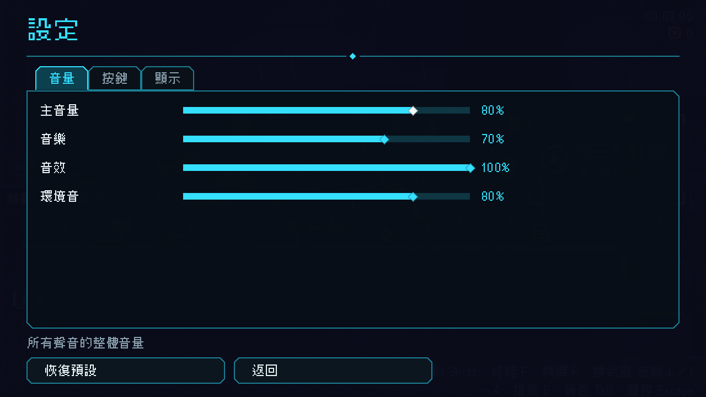
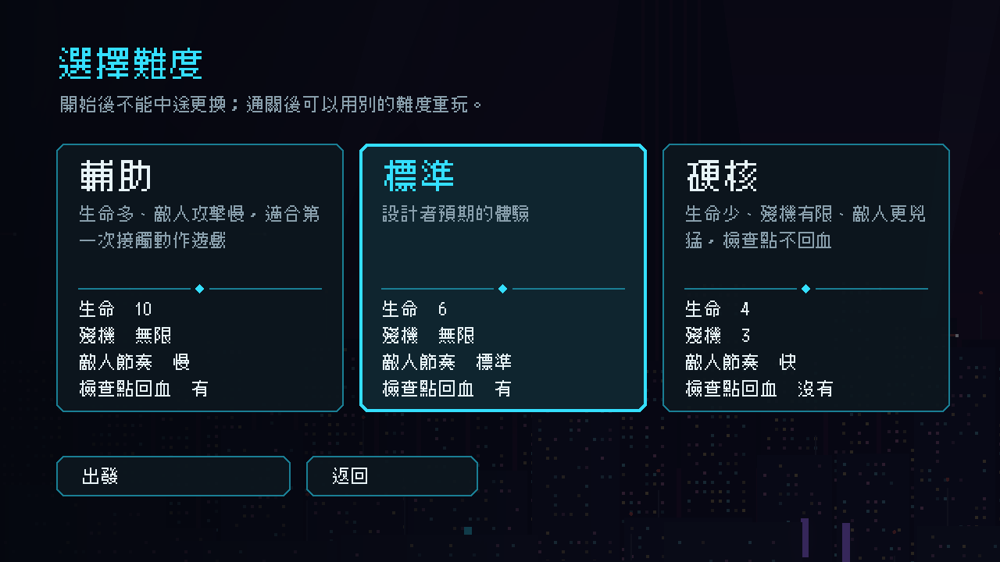

# [NE-173] 修正選單疊在一起與難度卡片重疊

> 狀態：完成

## 內文

### 需求
遊戲內的選單會互相重疊、互相干擾：
- 關卡中按 Esc 開暫停選單，再開設定時，設定畫面沒有蓋住暫停選單，兩個畫面疊在一起。
- 設定開著時按上下鍵，會同時操作到底下的暫停選單。
- 暫停時，關卡開場的章節標題卡還蓋在暫停選單上面。
- 剛進遊戲選難度時，三張難度卡片有時會疊在同一個位置。

主選單開設定、開敗北圖鑑時也要確認沒有同樣的問題。

### 來源
2026-10-04，使用者回報：「遊戲內的 esc 選單使用起來會有重疊的問題，按上下會同時操作兩個選單，然後一開始遊戲出現的難度選項，有時候會重疊再一起」（附兩張截圖）。

### 驗收條件
- [x] 在暫停選單開設定，設定畫面佔滿整個畫面並完整蓋住暫停選單，沒有重疊
- [x] 主選單開設定、開敗北圖鑑，過關結算畫面，同樣佔滿整個畫面
- [x] 設定或圖鑑開著時，底下的選單不會被聚焦或操作，按上下只動最上層的畫面；關閉後焦點回到原本的按鈕
- [x] 暫停選單出現時，章節標題卡不會蓋在它上面；暫停選單與背包、對話同時出現時也不互相蓋住、不重複吃輸入
- [x] 難度卡片每次都並排顯示，重複進出難度頁、從主選單直接進難度頁都不會疊在一起
- [x] 其他有「依序滑入」動畫的選單與畫面，位置也不會因為排版時機而錯亂
- [x] 這些情況有自動測試鎖住，不會再回來

### 測試流程
1. 進入關卡，在開場標題卡還在時按 Esc，確認暫停選單在標題卡上面
2. 在暫停選單點「設定」，確認設定畫面蓋滿畫面；按上下鍵，只有設定內的控制項會動；按返回後焦點回到暫停選單的「設定」
3. 在主選單開設定與敗北圖鑑，做同樣檢查
4. 從主選單點「開始任務」，反覆進出難度頁十次，三張卡片每次都並排

---

# 跟其他票的關係

- Blocks：無
- Blocked by：無
- Related：NE-172

---

# Commit-1

## 內文

暫停選單開設定時，設定畫面的遮罩變成 0 大小，兩個畫面疊在一起，按上下鍵還會跳到底下的暫停選單；主選單開設定、圖鑑也有同樣的問題。暫停時開場章節標題卡還蓋在暫停選單上；難度卡片在容器還沒排好版時就開始滑入，偶爾三張疊在同一個位置。
現在設定與圖鑑一律佔滿整個畫面，開著時底下的畫面隱藏、不能聚焦，關閉後焦點回到原本的按鈕。暫停選單的疊放順序高於章節標題卡、通訊對話與背包，開場標題卡在暫停時會藏起來並停住計時。滑入動畫等版面排好才記位置，重複進出會先停掉上一次的動畫，難度卡片每次都並排。
驗收：反覆十次從「影格剛開始」的時機進入難度頁，三張卡片都不重疊；暫停選單開設定後按上下鍵，焦點只在設定內；關閉設定後焦點回到「設定」按鈕；以上都有自動測試鎖住。

### 測試結果

| 項目 | 結果 |
|---|---|
| 完整測試套件（改到共用測試檔，自動升級為全跑） | 新失敗 0，已知失敗 10 維持不變 |
| 執行 log | 無 ERROR |

### 截圖

