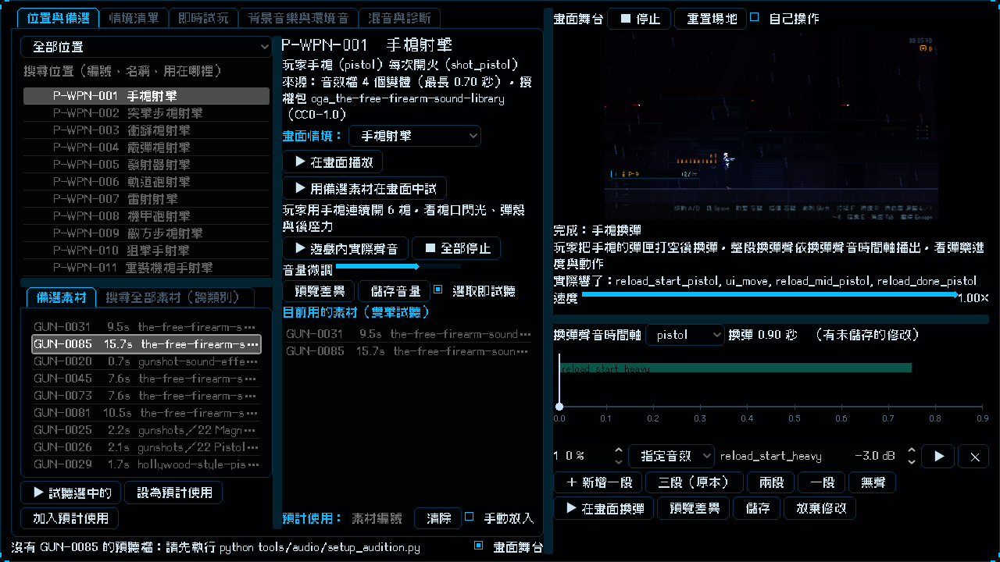

# [NE-175] 重排實驗室版面並可拖動分隔比例

> 狀態：完成

## 內文

### 需求
音效實驗室「位置與備選」分頁的備選素材清單被擠在中欄最底下，只剩兩行高，很難挑。要調整成：
- 備選素材（含「搜尋全部素材」）放到左邊，和位置清單上下各佔約一半的高度。
- 各區塊之間的分隔都能用滑鼠拖動，自己調整佔用螢幕的比例，比例會被記住。
- 視窗放大或全螢幕時，不要只是把整個畫面等比放大，而是讓清單與捲動區域真的多顯示內容。

### 來源
2026-10-04，使用者要求：「把備選素材放到左邊，跟搜尋位置那邊 share 一半的畫面，然後最好是可以讓我手動拉動兩個 scroll bar 占用螢幕空間的比例，然後當我全螢幕的時候不要只是按照比例縮放，也要給 scroll bar 可以顯示更多內容」（附實驗室畫面截圖）。

### 驗收條件
- [x] 左邊由上到下是位置清單與備選素材，預設各約佔一半高度
- [x] 位置清單與備選素材之間、左中右各欄之間、右側畫面舞台與其他內容之間，都能用滑鼠拖動調整比例，分隔處看得出可以拖
- [x] 調整後的比例下次開啟實驗室還原；存檔內容損毀或超出範圍時退回預設，不報錯
- [x] 視窗放大或全螢幕時，清單顯示的列數比預設視窗多（可見範圍變大），文字與按鈕維持可讀的大小；視窗很小時也不會擠壞
- [x] 離開實驗室（包含從 F5 開發工具選單切走）後，視窗縮放行為還原成遊戲原本的設定
- [x] 中欄只留位置資訊、畫面情境、音量、目前用的素材、預計使用等，原有功能都還在

### 測試流程
1. 開啟音效實驗室選一個位置，確認左邊上方是位置清單、下方是備選素材，各約一半
2. 拖動兩者之間的分隔，確認高度比例改變；關閉實驗室再開，確認比例還在
3. 把視窗拉大或進全螢幕，確認清單能多顯示很多列，而不是整個畫面放大
4. 從實驗室用 F5 切到別的工具或回主選單，確認畫面縮放恢復

---

# 跟其他票的關係

- Blocks：無
- Blocked by：無
- Related：NE-174、NE-166、NE-172

---

# Commit-1

## 內文

備選素材清單被擠在中欄最底下只剩兩行，視窗放大也只是整個畫面等比變大。
現在左欄上半是位置清單、下半是備選素材與「搜尋全部素材」，預設各佔一半；中欄只留位置資訊、畫面情境、音量、目前用的素材與預計使用。左欄上下、左中欄之間、工作區與右側畫面舞台之間、舞台畫面與換彈時間軸之間，都有加粗上色的分隔線可以用滑鼠拖動，滑鼠停上去有說明。調整後的比例記在使用者資料夾，下次開啟還原；存檔損毀或數值超出範圍時退回預設比例，只在 log 記錄是哪個檔案哪一項，不影響開啟。視窗放大時各區塊一起變大，清單多顯示列數，文字大小不變；離開實驗室時視窗縮放還原。
驗收：實驗室與畫面舞台的測試確認左欄上下各約一半、拖動後比例改變並被記住、重新讀檔還原、損毀與超出範圍的存檔退回預設、視窗變高時清單可見範圍變大；受影響範圍的測試全部通過。

### 測試結果

| 項目 | 結果 |
|---|---|
| 受影響範圍的測試（SoundLabSuite、SoundStageSuite） | 188 項，新失敗 0 |
| 資料驗證 | 0 錯誤 |
| 執行 log | 無 ERROR |

### 截圖

