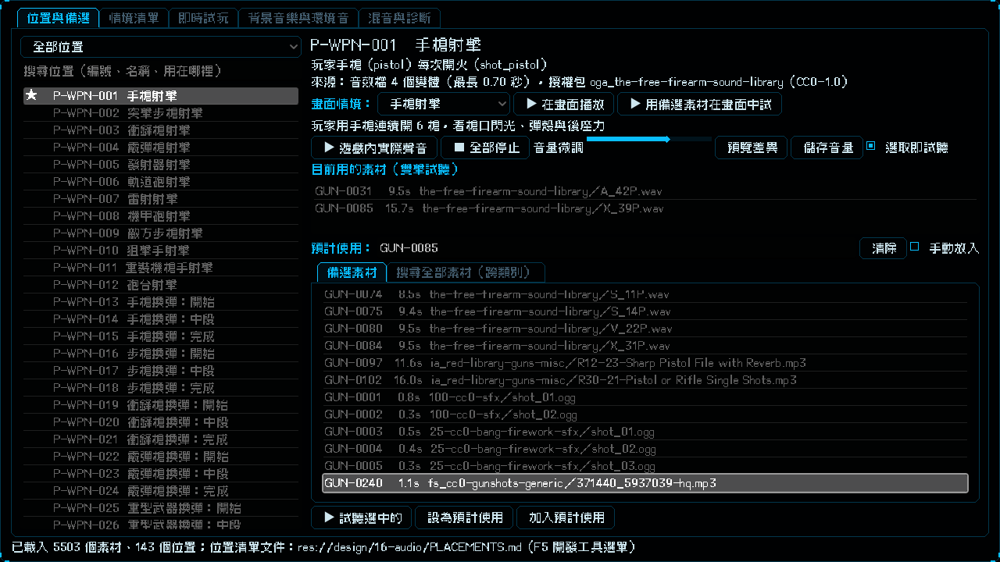

# [NE-176] 移除失效音效來源並補充槍聲與音樂來源

> 狀態：完成

## 內文

### 需求
素材下載一次失敗 71 個：32 個 archive.org 的素材包已經 404 或 500（來源下架），另外 39 個 OpenGameArt 素材包是 .7z 壓縮檔，下載工具不會解壓，被誤報成失敗；其中包含主要的真實槍聲來源。要移除失效的來源，讓 .7z 能正常下載解壓，再多找一批 CC0 的槍聲與背景音樂，讓實驗室可以挑的聲音更多。

### 來源
2026-10-05，使用者回報槍聲素材下載大量 not found，要求移除失效的來源、重新多找 CC0 槍聲，並且背景音樂也多找一點。

### 驗收條件
- [x] 下載工具對 .7z 素材包能解壓；沒有安裝解壓套件時，失敗訊息直接說要裝什麼
- [x] 已失效的 archive.org 素材包從來源目錄移除，它們的素材編號一併從素材目錄剔除，被剔除的編號不會被重新使用；沒有任何位置的目前素材或預計使用指向被剔除的編號
- [x] 重新下載後，原本因為 .7z 失敗的素材包全部下載成功，只剩下沒有可用音訊的來源被明確記錄
- [x] 新增 CC0 槍聲素材包（手槍、步槍、霰彈槍、衝鋒槍與機槍、消音槍、各式槍聲、重武器與砲聲、槍械操作），每包都記錄作者、頁面與授權；授權欄不是 CC0 的一律不收
- [x] 新增 CC0 背景音樂，涵蓋平靜、安全區、都市與機械感、戰鬥、頭目、主選單、通關與死亡短曲，並標好用途，用途相符的曲子優先出現在對應位置的備選
- [x] 武器與背景音樂位置的備選上限提高，原有備選與使用者已填的預計使用保留
- [x] 素材目錄、位置登記、位置清單文件與素材清單文件重新產生，每個位置至少十個備選
- [x] 新素材都有預聽檔，實驗室可以試聽
- [x] 找來源、加入來源的做法寫進音訊素材流程的操作手冊

### 測試流程
1. 執行下載工具，確認沒有 archive.org 失效來源、沒有 .7z 失敗
2. 開啟實驗室，選手槍、步槍、霰彈槍、衝鋒槍、消音槍各個位置，備選裡有新的槍聲，雙擊能聽到
3. 資料與音訊相關的測試套件全過

---

# 跟其他票的關係

- Blocks：無
- Blocked by：無
- Related：NE-177、NE-174、NE-164、NE-155

---

# Commit-1

## 內文

素材下載一次失敗 71 個：32 個 archive.org 素材包已經下架（404、500），另外 39 個 OpenGameArt 素材包是 .7z，下載工具不會解壓而被誤報成失敗，其中包含最主要的真實槍聲來源。
現在失效的 archive.org 來源已從目錄移除，對應的素材編號一併剔除（編號不重用，沒有任何位置引用它們）；.7z 能正常下載解壓，沒裝解壓套件時失敗訊息直接說要裝什麼；39 個 .7z 素材包全部下載成功。
新增 CC0 來源：Freesound 的槍聲 8 包（手槍、步槍、霰彈槍、衝鋒槍與機槍、消音槍、各式槍聲、重武器與砲聲、槍械操作，共 225 個聲音）與 OpenGameArt 的背景音樂 170 包（平靜、安全區、都市與機械感、戰鬥、頭目、主選單、通關與死亡短曲，已標好用途）。授權複查一併改成只看授權欄的標籤、要求全部都是 CC0：另有 14 個「CC0 加其他授權」的雙授權素材包依規則不收，已移除；Freesound 改成逐個聲音的頁面確認 CC0。
素材從 5258 個增加到 5503 個（槍聲與槍械操作 233 → 375、音樂 326 → 592）；武器與背景音樂位置的備選上限提高到 60，原有備選與你已填的預計使用保留，每個位置至少十個備選；新素材都有預聽檔，實驗室可以試聽。找來源與加入來源的做法已寫進音訊素材流程的操作手冊。
驗收：全部來源頁面授權複查 878 / 878 通過；素材目錄、位置登記與位置清單文件對得上，沒有指向已剔除編號的位置；實驗室選手槍射擊位置，備選裡有新的槍聲，可以雙擊試聽。

### 測試結果

| 項目 | 結果 |
|---|---|
| 局部測試（音訊、實驗室、舞台、音樂、開發選單） | 5 個套件，21445 項，新失敗 0 |
| 授權複查 | 878 / 878 通過 |
| 資料驗證 | 0 錯誤 |

### 截圖

