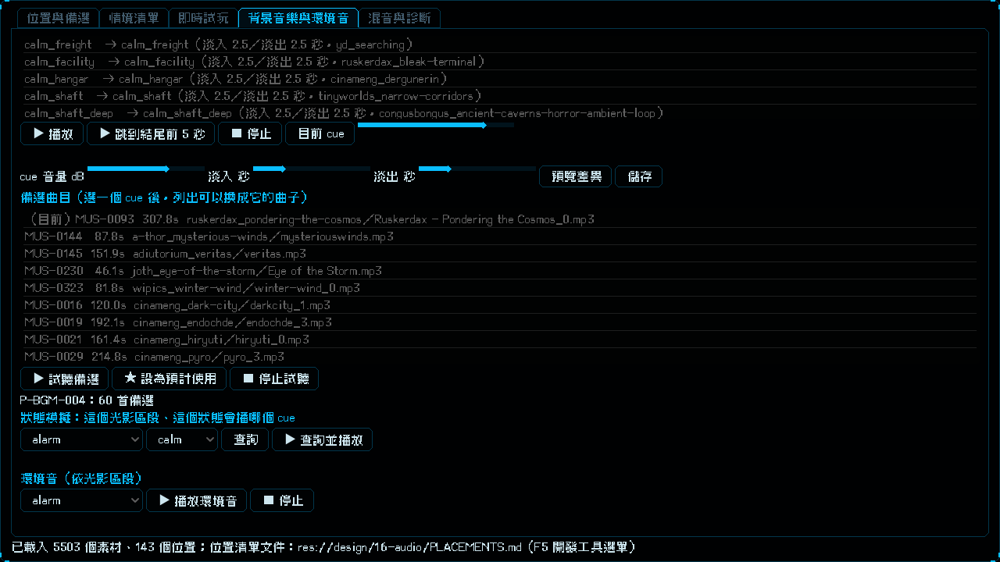

# [NE-177] 實驗室背景音樂分頁加入備選曲目

> 狀態：完成

## 內文

### 需求
音效實驗室的「背景音樂與環境音」分頁只能聽現在用的 cue，沒有備選曲目可以挑；備選只在「位置與備選」分頁的音樂位置裡，找不到也不順手。要在背景音樂分頁選一個 cue 後，直接列出那首曲子的備選曲目，可以試聽、設成預計使用，並提示備選曲目的數量與沒有預聽檔而被隱藏的數量。

### 來源
2026-10-05，使用者回報：「為什麼背景音樂沒有備選可以讓我選？一樣多找一點」。

### 驗收條件
- [x] 背景音樂分頁選中一個 cue，下方列出它那首曲子的備選曲目（編號、時長、素材包與檔名），目前在用的標「（目前）」、已填預計使用的標「★」
- [x] 雙擊或按「試聽備選」可以聽到該曲目的預聽檔，會先停掉正在播的 cue；響度與遊戲內一致
- [x] 按「設為預計使用」把選中的曲目寫進位置清單文件的對應位置，只改那一格
- [x] 沒有預聽檔的備選不列出，清單旁用一句話說明隱藏了幾首與補齊的指令
- [x] 沒有位置登記的曲子、沒有選 cue 就按試聽或設為預計使用，都只提示不報錯
- [x] 每個音樂位置的備選曲目比原本多（來源見 NE-176），用途相符的曲子排在前面
- [x] 沒有任何預聽檔的環境（例如 CI）測試照常通過

### 測試流程
1. 開啟實驗室，切到「背景音樂與環境音」，選 `calm_rooftop`
2. 確認下方出現備選曲目清單，雙擊其中一首能聽到聲音，目前在用的標「（目前）」
3. 選一首按「設為預計使用」，到「位置與備選」分頁選 P-BGM-004，確認預計使用欄有該編號
4. 選主選單、戰鬥、頭目 cue 各看一次，備選數量都比原本多

---

# 跟其他票的關係

- Blocks：無
- Blocked by：無
- Related：NE-176、NE-174、NE-164、NE-162

---

# Commit-1

## 內文

實驗室的背景音樂分頁只能聽現在用的 cue，備選曲目只在另一個分頁的音樂位置裡，不順手。
現在選一個 cue，下方就列出它那首曲子的備選曲目（編號、時長、素材包與檔名）；目前在用的標「（目前）」、已填預計使用的標「★」。雙擊或按「試聽備選」會先停掉正在播的 cue 再播預聽檔，響度和遊戲內一致；按「設為預計使用」只改位置清單文件那一格。沒有預聽檔的備選不列出，清單旁說明隱藏了幾首與補齊的指令；沒有位置登記的曲子或什麼都沒選就按按鈕，只提示不報錯。
每個音樂位置的備選曲目現在是 60 首，用途相符的曲子排在前面（來源見 NE-176）。
驗收：選 calm_rooftop 列出 60 首備選並標出目前在用的曲子；挑一首設為預計使用後，位置與備選分頁看得到；沒有任何預聽檔的情況（CI）下實驗室測試照常通過。

### 測試結果

| 項目 | 結果 |
|---|---|
| 局部測試（音訊、實驗室、舞台、音樂、開發選單） | 5 個套件，21445 項，新失敗 0 |
| 資料驗證 | 0 錯誤 |

### 截圖

