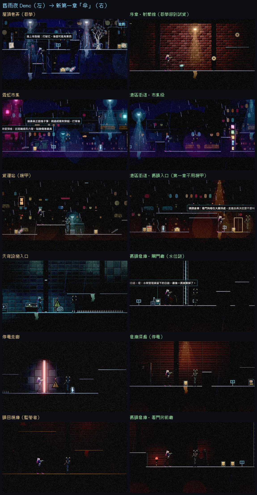
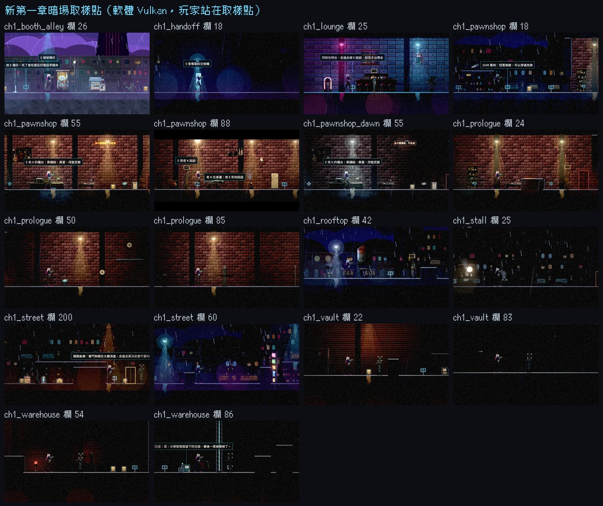
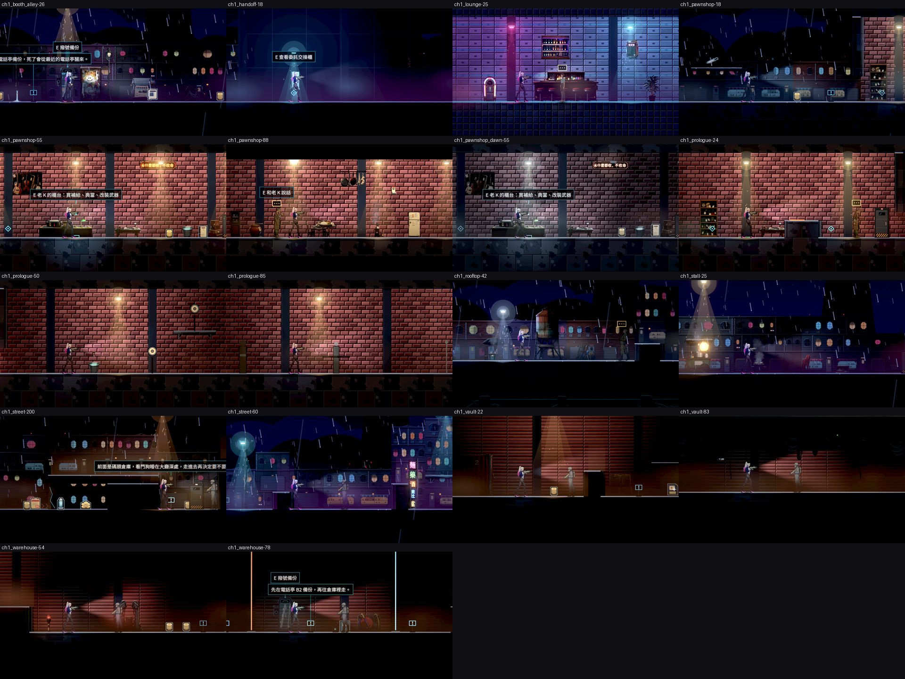

# [NE-178] 重做第一章關卡：依新劇情改寫場景與流程

> 狀態：進行中

## 內文

### 需求
目前的第一章關卡是舊版 Demo：六個區段（屋頂巷弄、霓虹市集、貨運站、設施入口、停電走廊、頭目機庫）一路向右推進，和新版劇情（第一章「傘」）的場景、事件順序、頭目與教學都對不上。要依 `design/13-story-v2/` 重做第一章的關卡：從當舖開場、屋頂差事、電話亭、街道戰鬥教學，到碼頭倉庫的頭目與水位謎、復原室、復原館、天亮的麵攤，讓關卡本身就是在說這一章的故事。

### 來源
2026-10-04，使用者要求重作第一章的關卡，先開票。設計見 `design/13-story-v2/EVENTS.md` 第 2 節（事件 1.01～1.13）、`MAP.md`（H1、H2、H5～H10、H23）、`BOSSES.md` 第一章看門狗、`PUZZLE.md`、`SCRIPT_CH01.md`、`UMBRELLA.md`。

2026-10-10需求補充：先完成序章至第三章，逐章劇本審查、正式主支線與演出、累積單檔發行；詳見[整體設計](../../design/20-campaign-experience/DESIGN.md)。

### 驗收條件
- [x] 開工前先確認並寫進設計文件：舊六個區段如何對應到新場景（保留、改寫、廢棄），以及第一章不再是單一路線推進時的場景銜接與傳送方式
- [ ] 依事件 1.01～1.13 的順序重建第一章場景與流程：當舖店面與廚房、屋頂、港區街道、電話亭巷、碼頭倉庫、復原室、復原館、宵夜麵攤，每個場景有對應的事件觸發點與檢查點
- [x] 教學依新劇情重排：開場的移動與工作檯改裝、街道戰鬥教學，每項教學在對應場景內完成，並有一句話的遊戲內提示
- [x] 碼頭倉庫完成看門狗頭目戰場地與水位謎（三個閘門，第三個要用死來解），死亡後從復原室回到倉庫的路線可通行，且世界狀態（頭目血量、水位）依設計保留
- [x] 第一章的敵人名單與擺放符合新版每章名單（見 NE-97）；名單與密度用資料整批調整，不把 Demo 密度當標準
- [ ] 收集品、補給點、對話點（傘桶、船錢罐、地下室門、麵攤等）依新劇情重新配置，第一章的教學與數值曲線合理
- [x] 每個場景通過可通行檢查與暗場可讀性量測；每個檢查點站得穩
- [ ] 輔助、標準、硬核三種難度都能通關第一章
- [x] 重做前後的畫面截圖比較

- [x] 沿用已完成的新版九區與節奏成果補齊差異，逐區核對原布局、長度與故事因果，不重新套用舊六段Demo。

### 測試流程
1. 從頭到尾玩一遍第一章，確認事件順序、場景銜接與教學
2. 在頭目戰與水位謎死亡，確認從正確的位置重來、世界狀態保留
3. 執行可通行檢查與暗場可讀性量測
4. 三種難度各通關一次
5. 單獨執行關卡與劇情相關測試

---

# 跟其他票的關係

- Blocks：ST-19、NE-233
- Blocked by：無
- Related：NE-40（舊版第一章場景）、NE-97（每章敵人名單）、NE-98、NE-99、NE-54（第二章，同樣依新劇情調整）

---

# Commit-1

## 內文

開票時第一章還是舊雨夜 Demo 的六段直線關卡；之後新版各區已經依新劇情陸續蓋好，但沒有人把「舊六段怎麼對到新區域」寫下來，新加的序章與館外交接櫃也沒進暗場量測與檢查點檢查。
這次不重蓋關卡，只補差異：設計文件寫清楚舊六段各自保留、改寫或廢棄到哪一區（教學移到序章、霓虹市集改成港區街道市集段、機甲貨運站在第一章不用、設施入口與頭目機庫改成碼頭倉庫的閘門廳與看門狗前廳、停電走廊改成倉庫深處），以及區域之間的門、單向出口與死後回電話亭的規則；主線順序表補上序章與交接櫃。章節區域清單加入序章與交接櫃，暗場量測多了這兩區的取樣點；新增「每座電話亭都站得穩」的測試。
實際渲染量測新第一章 15 個取樣點，14 點通過；街道市集段玩家對比 0.60 剛好在門檻上被判太暗，是 NE-66 已記錄的光影問題，本票不改光影。舊 Demo 同一工具量測頭目機庫太暗、設施入口取樣無效。

### 測試結果

| 項目 | 結果 |
|---|---|
| 受影響範圍（基準 04676daf，原選擇器） | 2,002 項、0 新失敗、0 已知失敗 |
| 檢查點站立 | 第一章每座電話亭放上去都站穩、不滑動 |
| 暗場可讀性（軟體 Vulkan） | 新第一章 14／15 通過；市集段 0.60（NE-66 追蹤）。舊 Demo：頭目機庫太暗、設施入口取樣無效 |
| 區域清單 | 量測範圍與章節區域清單一致（含序章、交接櫃） |
| 待本機原生驗收 | 三種難度各通關一次、從頭到尾玩一遍確認銜接；原生光影下重量市集段 |

### 截圖

雲端軟體 Vulkan（Forward+）截圖，噪點與光影以本機原生為準。

分支：`claude/nest-egg-main-story-flow-ph1dnu`（[分支提交紀錄](https://github.com/deadline314/Nest-Egg/commits/claude/nest-egg-main-story-flow-ph1dnu)）。對照與核對見 [CH01_LEVEL.md 第 13 節](../../design/13-story-v2/CH01_LEVEL.md)。「每個場景都有檢查點」沒有勾：安全區（當舖、屋頂、麵攤等）依設計不放電話亭，死後回最近的電話亭。

# Commit-2

## 內文

上次街道市集段的玩家對比 0.60 剛好卡在門檻上，所以「每個場景通過暗場量測」沒有勾。主線之後把第一章分成亮、一般、暗三級光影（BG-33），這次在最新主線上用同一個工具重量。
序章、當舖、屋頂、街道、電話亭巷、碼頭倉庫、倉庫深處、館外交接櫃、復原館、宵夜麵攤、天亮的當舖，共 11 區 18 個取樣點全部通過，市集段由 0.60 升到 2.61；每區的出入口與主要路徑由產生器的可通行檢查走過一遍，每座電話亭放上去都站得穩、不滑動。本票沒有改光影。

### 測試結果

| 項目 | 結果 |
|---|---|
| 暗場可讀性（軟體 Vulkan，同一工具） | 11 區 18 點全部通過；市集 0.60 → 2.61 |
| 可通行檢查 | 產生器檢查玩家站得住、出入口與道具落地、主要路徑跳得過去：全部通過 |
| 檢查點站立 | 第一章每座電話亭站穩、不滑動 |
| 受影響範圍 | 見同一輪的 BG-22 Commit-2（46,601 項） |
| 待本機原生驗收 | 三種難度各通關一次、真人從頭到尾玩一遍 |

### 截圖

雲端軟體 Vulkan（Forward+）截圖。

分支：`feature/story`。
