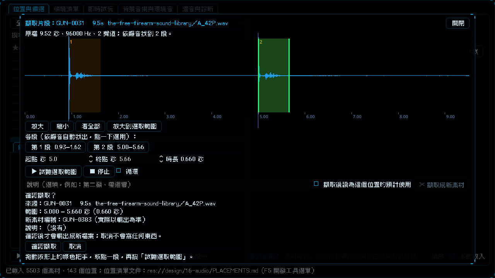

# [NE-180] 實驗室加入音訊片段擷取介面

> 狀態：完成

## 內文

### 需求
在音效實驗室選一個素材，開啟擷取介面：看到原始完整音訊的波形與依靜音自動標出的各段，選一段或手動框選，拖動起訖或輸入秒數微調並試聽；按「擷取成新素材」後先出確認，使用者確認才真的輸出成新素材；取消不寫任何檔案。工具與資料由 NE-179 提供。設計見 `design/16-audio/DESIGN.md` 5.4 節。

### 來源
2026-10-05，使用者提出：有些音訊裡同時包含多段音效，希望有一個讓他擷取音訊某一段的小介面，確認之後才真的把該音訊擷取出來另存成一個檔案。

### 驗收條件
- [x] 在「位置與備選」分頁的素材清單（備選、搜尋結果、目前用的）選一個素材可以開啟擷取介面；沒有原始檔時說明怎麼補，不報錯
- [x] 顯示原始完整檔的波形與時間軸（不是只有預聽檔的前幾秒），長音訊可以捲動與縮放
- [x] 依靜音自動標出各段並顯示段數；一鍵選用某一段；也可以在波形上手動框選
- [x] 起訖可以拖動，也可以輸入秒數微調；顯示選取的時長
- [x] 可以試聽選取範圍（單次與循環），播放游標跟著走；播放中調整範圍立刻生效
- [x] 按「擷取成新素材」先出確認，列出來源素材、起訖、時長與新素材編號預覽；確認後才輸出，取消或關閉介面不寫任何檔案、不改任何清單
- [x] 成功後新素材立刻出現在備選與搜尋，可以試聽，並顯示新編號；失敗時顯示 NE-179 工具給的具體原因
- [x] 有「擷取後設為這個位置的預計使用」選項，預設不勾；不勾時擷取不改位置清單文件
- [x] 測試不依賴本機素材與外部程式：用合成音訊與假的工具輸出測試；沒有 Python 與 ffmpeg 的環境（CI）也通過
- [x] 介面每個控制項都有 tooltip，操作說明一句講重點

### 測試流程
1. 開啟實驗室，在備選清單選一個含多聲的素材，按「擷取」
2. 確認看到完整波形與自動標出的各段，點第二段，按試聽範圍
3. 拖動終點微調後按「擷取成新素材」，先在確認視窗取消，確認沒有新檔案
4. 再按一次並確認，確認新素材出現在搜尋，可以試聽；重複擷取同一範圍時提示已存在

---

# 跟其他票的關係

- Blocks：無
- Blocked by：NE-179
- Related：NE-174、NE-175、NE-162

---

# Commit-1

## 內文

一個音訊裡有多段聲音時，只能手寫加工清單的起訖時間，看不到波形，也不能只取其中一段。
現在在「位置與備選」分頁選一個素材（備選、搜尋結果、目前用的都可以），按「✂ 擷取片段…」會蓋上一個擷取介面：
- 看到原始完整音訊的波形與時間軸（不是只有預聽檔的前幾秒），長音訊可以放大、縮小、捲動；依靜音自動找出的各段標在波形上，按鈕或點一下就選用那一段。
- 拖動綠色把手調整起點與終點、在空白處拖曳框選新範圍，也可以直接輸入秒數；顯示選取的時長。
- 試聽選取範圍（空白鍵也行），可以循環，播放游標跟著走，播放中調整範圍立刻生效。
- 按「擷取成新素材」先出確認，列出來源、起訖、時長、新素材編號預覽與說明；確認才輸出，取消或關閉介面不寫任何檔案。成功後左邊搜尋會列出新素材，可以立刻試聽；已經擷取過的範圍提示既有素材；失敗時顯示擷取工具給的具體原因（原始檔沒下載、起訖不合法、找不到 Python 等）。
- 可勾「擷取後設為這個位置的預計使用」，預設不勾，不勾時完全不動位置清單文件。
驗收：用真實的擷取工具打開含兩聲槍響的素材，看到完整波形與兩段、選第二段並出現確認內容（見截圖）；自動測試用假的擷取工具與合成音訊，涵蓋拖動、輸入、縮放、試聽與循環、確認與取消、成功、已存在與失敗，不需要 Python、ffmpeg 或本機素材。

### 測試結果

| 項目 | 結果 |
|---|---|
| 局部測試（擷取介面、實驗室、舞台、音訊、音樂、開發選單） | 6 個套件，21579 項，新失敗 0 |
| 執行 log | 無 ERROR |

### 截圖

