# [NE-181] 修正鎮暴員、重裝機槍手與監管者的大腿與腰部零件

> 狀態：完成

## 內文

### 需求
NE-90 檢查八種動作預覽與遊戲內畫面時，三個重甲人形的下半身仍有明顯的零件問題：
- 鎮暴員、重裝機槍手：大腿零件上半是一整塊由兩側顏色連成的漸層，看起來像一片飄在髖部的布，跑與跳時跟著大腿擺成方塊。
- 監管者：軀幹下緣是一條平直的切邊，下面只接著很細的大腿，站姿與頭目戰前過場（遊戲內）都看得出一截縫。

需要重新切割與補全這三個角色的軀幹、骨盆與大腿，使站、跑、蹲、跳、倒下與過場裡都沒有塊狀漸層、平直切邊或縫隙。需要重畫底層身體時由使用 ComfyUI 的流程處理。

### 2026-10-08 使用者補充：上下半身斷開是破圖

使用者指出最新預覽中上下半身被切開、沒有正確接在一起，特別是監管者的軀幹下緣、骨盆與大腿交界。這是未修復的破圖，不可因底層補全完成或測試通過就視為可交付。須修正切線、支點、骨架綁定與接合輪廓，站、跑、蹲、跳、倒下以及遊戲與過場倍率皆確認連續；不得用加深陰影、遮擋或提高稽核上限掩蓋斷裂。

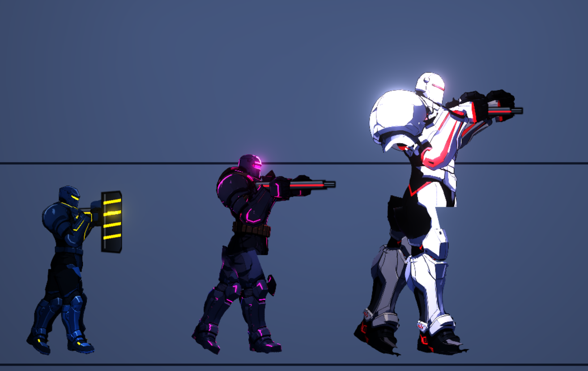

### 來源
2026-10-04，NE-90 的預覽與遊戲內檢查（截圖見 NE-90 Commit-2）；NE-153 的「已知的小問題」也列了同樣三個角色。

### 驗收條件
- [x] 小裂縫、單像素孔洞、缺角、切斷輪廓與漂浮碎片均已解決；不得因大缺口消失就給過。保留逐格失敗紀錄與修後證據。
- [x] 使用者附圖中的上下半身斷開已解決：軀幹、骨盆與大腿正確接合，各姿勢與兩種倍率無背景裂縫、切斷輪廓或漂浮零件，附修前修後對照
- [x] 鎮暴員、重裝機槍手的大腿在站、跑、蹲、跳、倒下的預覽裡沒有塊狀漸層，髖部到膝蓋的輪廓連續
- [x] 監管者的軀幹下緣沒有平直切邊，腰到大腿沒有縫，頭目戰前過場裡看起來是完整的重甲
- [x] 修改後的零件尺寸與支點變動有紀錄，角色定義與遊戲內檢查都正常
- [x] 修前修後各附預覽截圖（站姿特寫與八種動作）與遊戲內截圖

### 測試流程
1. 開預覽工具看三個角色的站姿特寫與八種動作
2. 進遊戲看鎮暴員、重裝機槍手出現的區段與監管者戰前過場
3. 對照修前修後

---

# 跟其他票的關係

- Blocks：NE-90、NE-79、NE-80、NE-81
- Blocked by：無
- Related：NE-152、NE-153

---

# Commit-1

## 內文

2026-10-08 使用者以預覽截圖指出上下半身斷開、未正確接合也是破圖，並補充要求所有角色的所有部件正確接合。已保留原圖、補入明確驗收條件，供其他 Session 直接理解失敗類型；全角色共用驗證流程見 NE-222 與 rig-animation Skill。

本次只提交需求補充，不宣稱三名重裝角色已修復或驗收。狀態為進行中，修復条件仍未勾選；文件及圖片連結已檢查，未執行遊戲驗收。

### 使用者問題圖

---

# Commit-2

## 內文

三名重甲角色的腰、骨盆及大腿已重新分割與接合。被手臂擋住的底層改用保留原始定稿的局部補全，移除大腿上的方塊填色，復原完整單腳與鞋頭；重裝機槍手的護膝改回近側膝蓋。站、跑、仰射、蹲、跳、格擋、硬直與倒下的預覽均保留修前／修後，遊戲中的鎮暴員、重裝機槍手與監管者戰鬥、機庫過場亦已截圖核對。

小缺口仍按失敗處理。大缺口修完後，逐格檢查曾抓到倒下姿勢的單像素缺口；定位到骨盆裁切外約 6 個貼圖像素後，補回來源圖中的接合範圍。最終三角色 × 三接點（腰、前髖、後髖）× 八姿勢 × 120 影格 × 兩面向 × 兩倍率（1×／3.4×）共 **34,560 次取樣，失敗 0**；沒有提高像素容許面積。取樣隱藏其他部件、護甲、武器與發光，避免遮住接點。完整外觀及實際場景另行核對，像素取樣不代替其他部位或人工操作驗收。

來源、提示詞、seed 18151、U 階段原圖、遮罩與分割依據保存在三名角色的 art_src／spec／manifest；原定稿與原骨架關節座標保持一致。所有尺寸／支點差異見 [零件差異紀錄](images/NE-181-part-dimensions.json)。骨盆尺寸／支點分別由鎮暴員 153×147／(29.38,120.86) 改為 229×214／(105.38,173.86)，機槍手 226×179／(46.9,145.63) 改為 305×308／(124.9,233.63)，監管者 323×238／(85.22,191.03) 改為 389×354／(151.22,282.03)。

### 驗證

- Godot 4.7.2、RTX 4070 SUPER、Vulkan Forward+；GPU 工作使用共用鎖，量測時 ComfyUI 已停止。
- `tools/run_tests_changed.sh 484085b6d85898602895a29e0659250943afd9c7`：72 組、45,212 checks，新的失敗 0、已知失敗 0。固定比較基準包含本票差異，未使用空的未提交集合。重定基底納入最新環境匯入及共享鎖修改後，再跑同一固定基準：50,295 checks，新的失敗 0、已知失敗 0；共享鎖排他與釋放另有 2 項檢查通過。再納入 ST-6 市集光照修正後，匯入新測試類別再跑 Exposure／Chapter1Map／Characters：1,846 checks，新的失敗 0、已知失敗 0；第一次因新類別尚未匯入而未能啟動，該次不算通過。
- 三名角色 `check_spec --joints` 與 `check_parts --normals` 均通過；遮罩快取／多輸出對應／來源紀錄／Godot 錯誤辨識的離線檢查通過。
- [逐格報告](images/NE-181-joint-report.json)：34,560 次、0 失敗。重現：透過 `gpu_lock.py` 執行 `res://tools/rig_joint_audit.tscn -- --chars=enforcer,heavy_gunner,warden --joints=waist,hip_front,hip_back --frames=120 --out=<絕對目錄>`，再執行 `tools/check_joint_frames.py <同目錄>`。自檢確認單像素孔洞與分離部件均會失敗。
- 共用網格維持原 500 頂點及折疊比例門檻。凜 ×10、600 格的網格增量為每隻 35.1 µs／格（327 頂點），同條件修前為 35.6 µs／格；這是腳本量測，不宣稱 GPU 幀率或人工手感測試。
- 實際場景由既有 placement、enemy_flow、warden_core 與 cutscenes:cut_c2_hangar 工具驅動；不修改關卡、劇情文字或出場配置。

### 修前／修後與小缺口

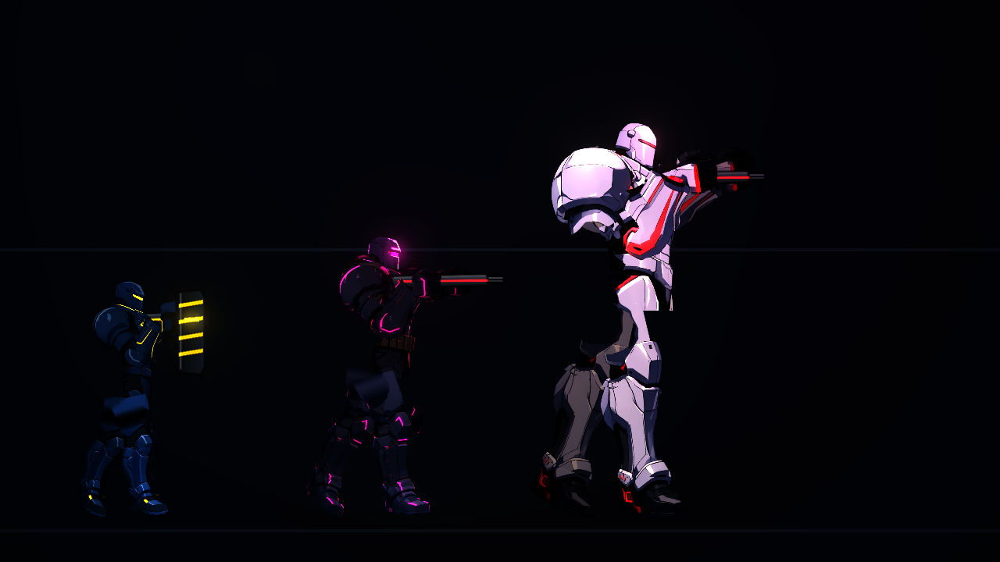
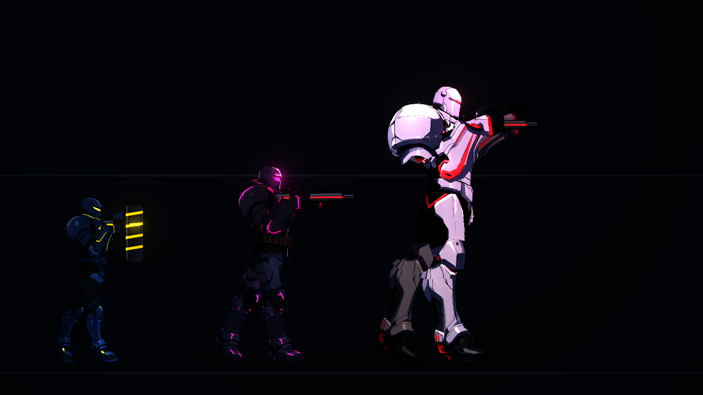
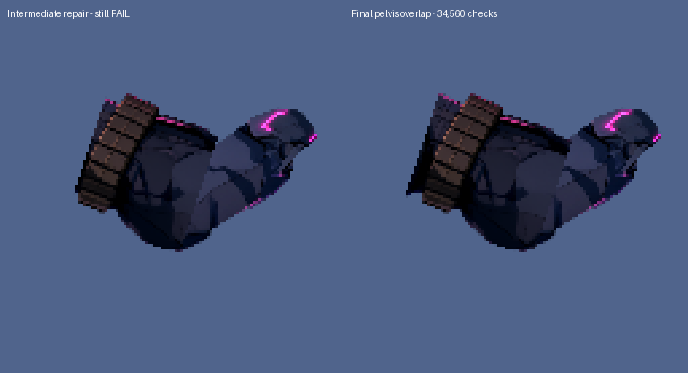

### 八動作

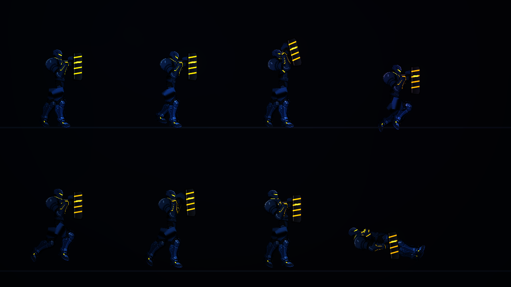
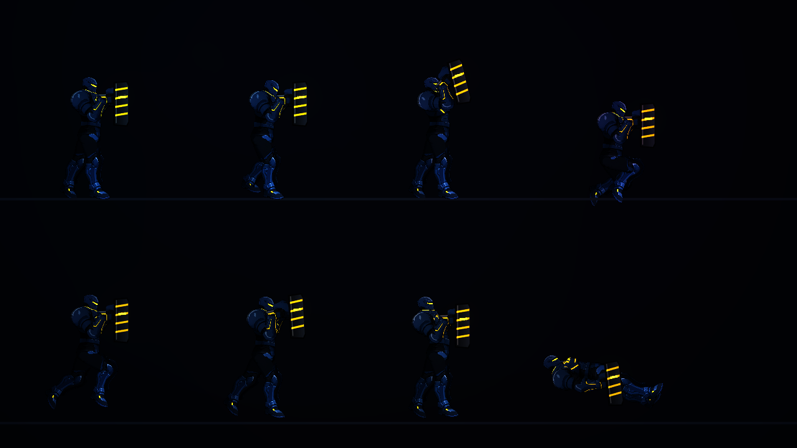
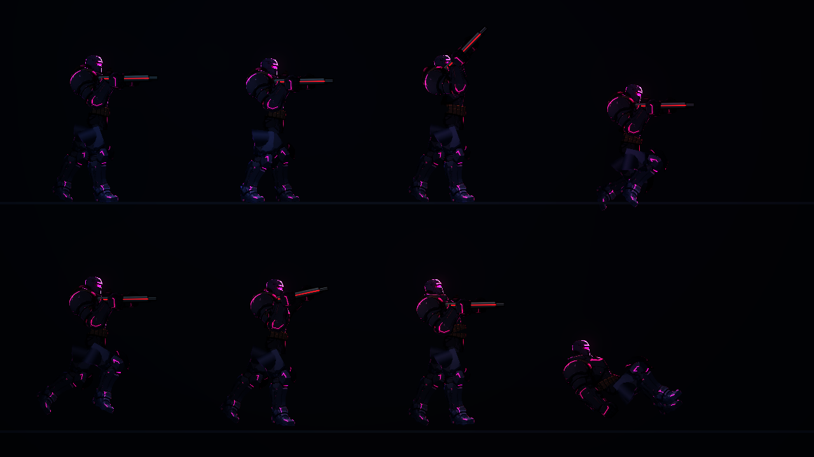
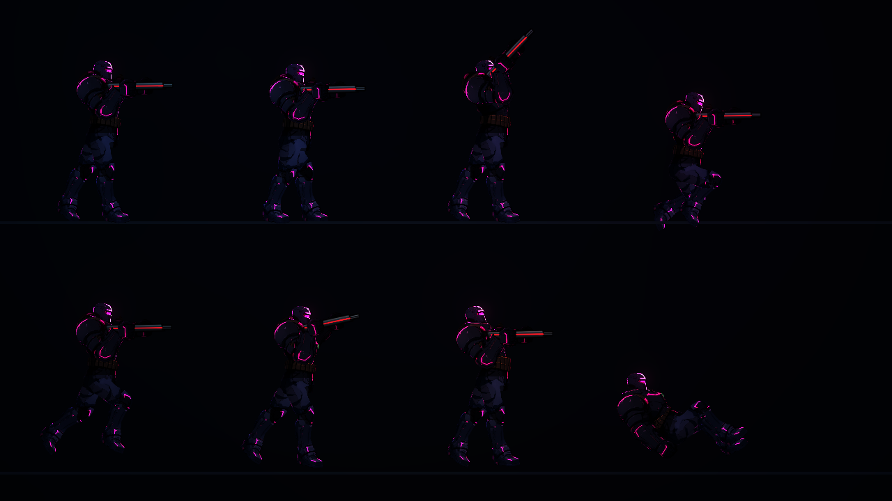

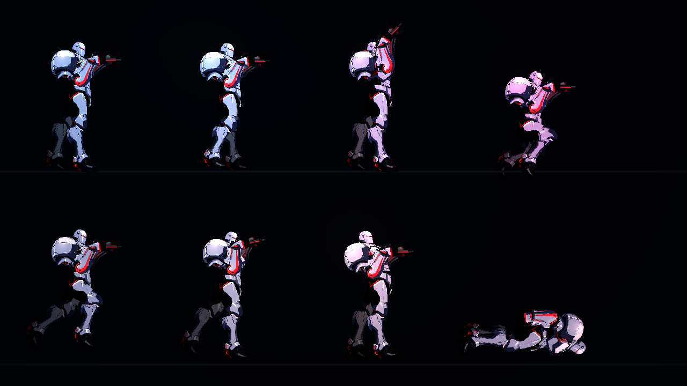

### 遊戲與過場

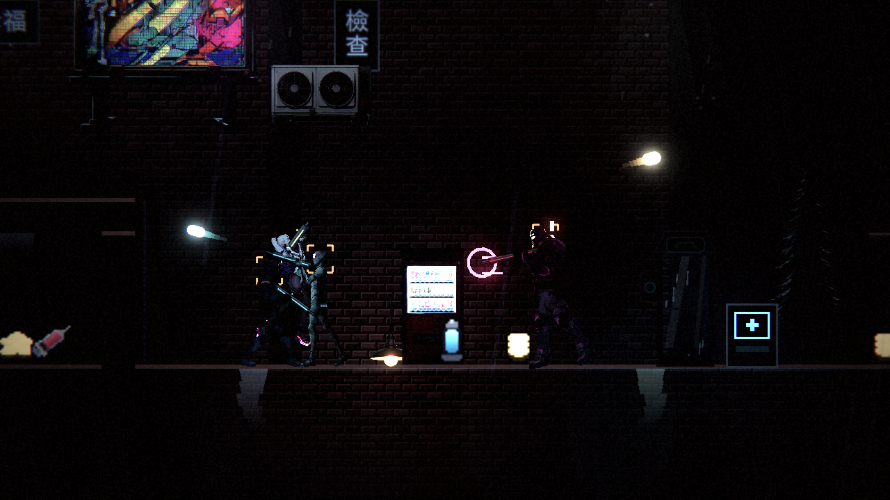

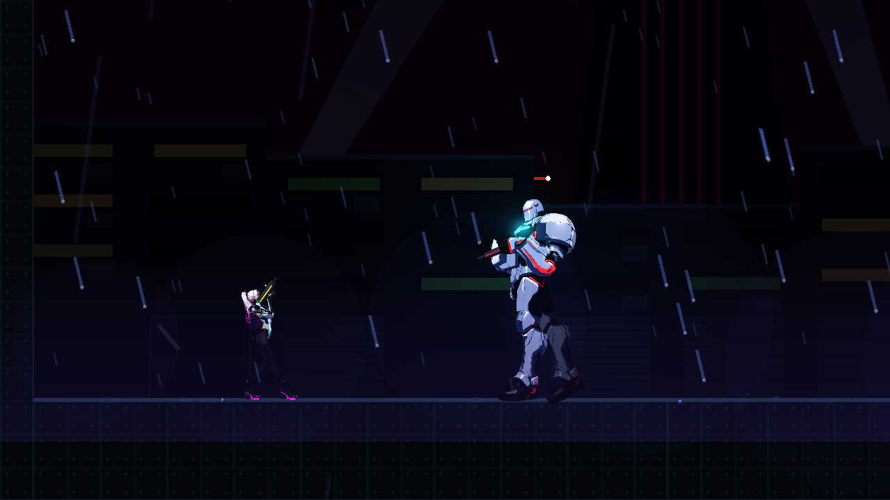
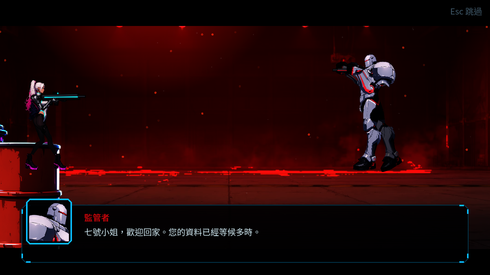

---

# Commit-3（鎮暴員膝甲貼合腿甲）

## 內文

鎮暴員的兩塊膝甲在站姿、仰射與硬直時會離開腿甲邊緣。將兩處掛點各朝腿側移 1.6 世界像素，正式角色資料與可重建規格同步。保留原件、裁切、護甲層級和法線。盾牌、骨頭與戰鬥參數沿用原設定。

### 驗收

- RX 9070 XT Forward+，八姿勢各 120 格、兩方向兩倍率。膝部 7,680 次取樣，封閉孔、游離碎片與中心露空由 746 次降到 0。原檢查器另標 8 次放大倍率的輪廓凹點，各在跑步或蹲姿，保留原判定與原始紀錄。
- 原有三角色腰、前髖與後髖共 34,560 次，沒有封閉孔、游離碎片或中心露空。143 筆邊緣標記均為機槍手倒地的單像素。同格完整模型中 135 筆有覆蓋、8 筆位於外輪廓。鎮暴員倒地 20 筆局部標記追到胸甲與軀幹外邊緣。
- 監管者完整模型在倒地時另有小區域的透空標記，仍要確認身體與前臂、骨盆的接合，本票保留審查中。
- 正式角色資料在測試場實跑舉盾、衝撞、受擊與倒下。分件規格 0 錯誤、0 警告。受影響四組共 7,627 項全過，33 秒。

[兩倍率與完整姿勢的原生紀錄](attachments/NE-181-leg-support-2026-11-20/evidence.zip)

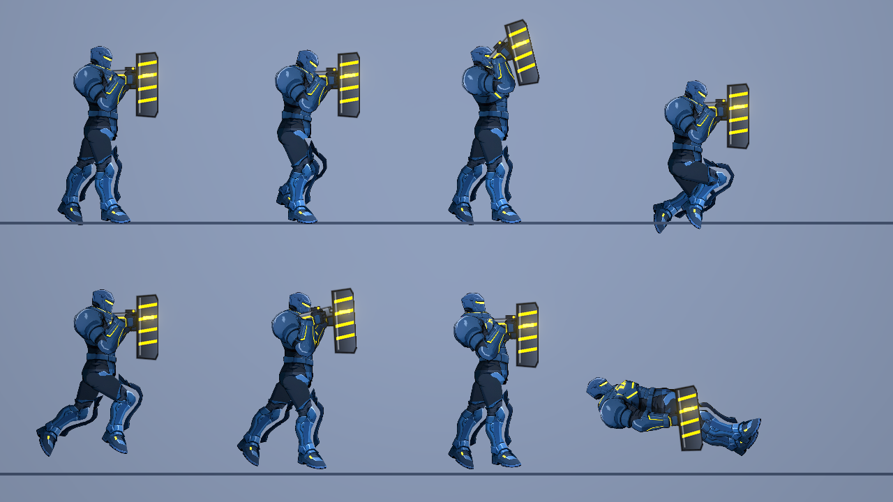

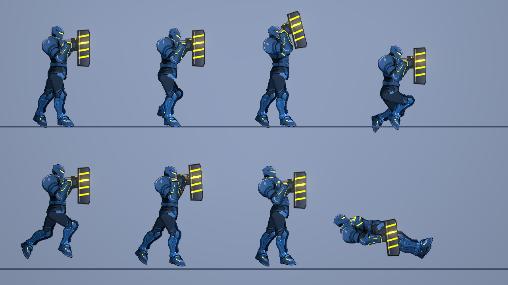

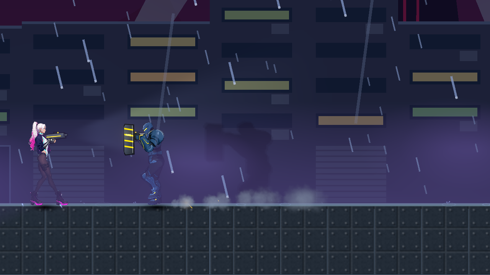

---

# Commit-4（完成三名重甲角色的腰髖驗收）

## 內文

追查監管者倒地時的透明像素。只保留腰髖、軀幹、腿及其護甲，用完全相同的倒地動畫重拍。原先 294 格、372 個像素的封閉輪廓，在去掉交疊手臂的診斷中全部與外緣相通。腰、前髖、後髖在過場倍率雙方向共 720 次取樣，原檢查器零失敗。遊戲中的手臂、裝甲、姿勢與素材都保留。

### 驗收

用 RX 9070 XT Forward+ 重拍重裝機槍手動作、監管者核心戰鬥和正式機庫演出，核對三人的腰與大腿接合。檢查器的正負控制仍拒絕單像素封閉孔及分離零件。先前已推送的鎮暴員膝甲調整通過四組、7,627 項回歸。這次補齊監管者與機槍手的驗收證據。

[原生倒地取樣、逐像素分類與正式過場](attachments/NE-181-warden-hip-review-2026-11-20/evidence.zip)

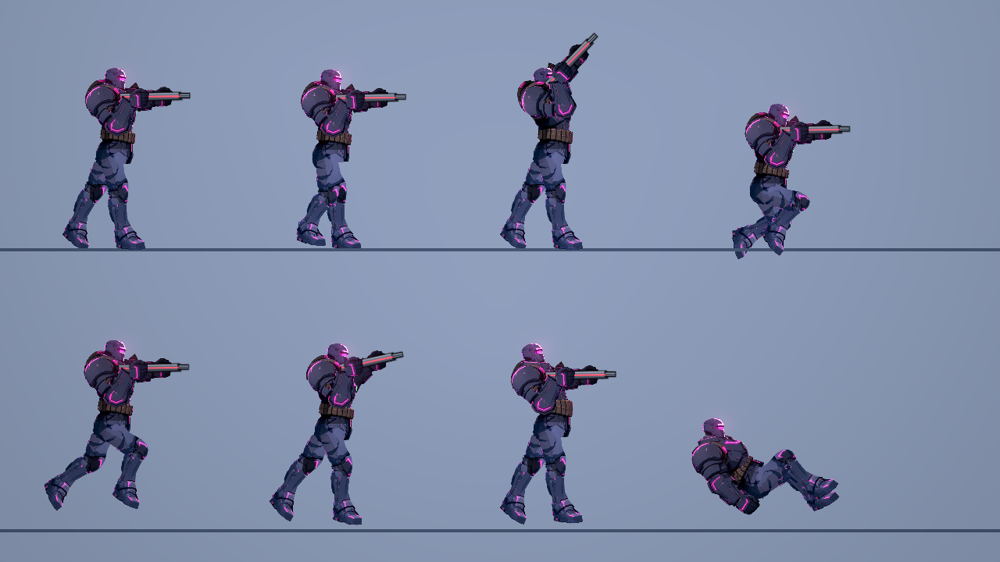

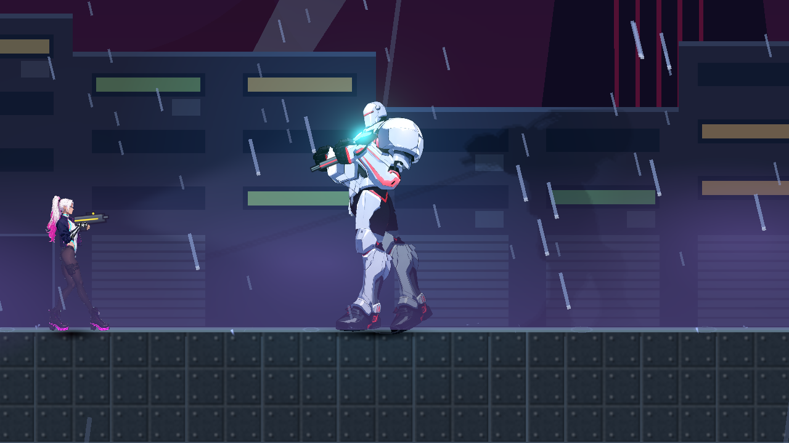

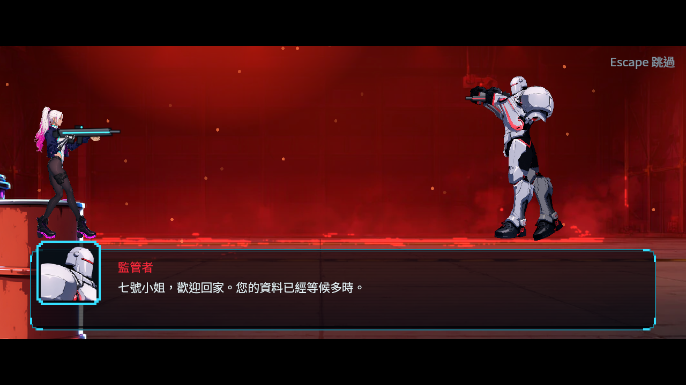
