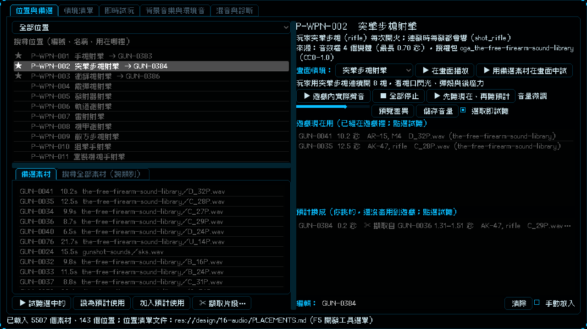

# [NE-181] 實驗室並排顯示目前用的與預計換成的素材

> 狀態：完成

## 內文

### 需求
在實驗室「位置與備選」分頁，看不出一個位置「遊戲現在用什麼」和「預計換成什麼」：預計使用只是一個很窄的輸入框，只顯示被截斷的編號，看不出是哪個檔案、多長、從哪裡來；位置清單只用星號表示有填，看不出是哪個；清單的文字也被截斷；目前用的與預計的沒有並排，也沒標明哪個已經在遊戲裡、哪個還沒套用。要並排顯示兩份清單、每個素材顯示完整資訊（擷取出來的片段要標來源），並能先聽現在的、再聽預計的來比較。

### 來源
2026-10-05，使用者貼出實驗室畫面並說：我在我的介面全看不出來我現在選了什麼，也看不出我預計應用什麼。

### 驗收條件
- [x] 選中一個位置，中欄並排兩份清單：「遊戲現在用」和「預計換成（還沒套用到遊戲）」，標題就寫明兩者的差別
- [x] 兩份清單的每個素材都顯示一行完整說明：編號、時長、槍種等說明、檔名與素材包，不再被截成只剩編號；完整內容在 tooltip
- [x] 擷取出來的片段（NE-179）標明「擷取自某個素材的起訖秒數」，並列出原檔的素材包與檔名
- [x] 預計換成的清單列出位置清單文件裡填的每一個素材；沒有預聽檔的也列出並標明無法試聽，素材目錄裡找不到的編號也列出並標明，不隱藏使用者自己的挑選
- [x] 位置清單的每一行顯示預計的素材編號（兩個以上顯示第一個並標還有幾個），沒填預計的不顯示
- [x] 兩份清單都可以點選或雙擊試聽
- [x] 有「先聽現在、再聽預計」的按鈕：先播遊戲現在的聲音，隔一下再播預計的第一個素材；沒有預計使用時只提示不報錯
- [x] 手動輸入編號、清除、手動放入照舊可用，位置清單文件的內容與寫入方式不變
- [x] 每個控制項都有 tooltip；現有的實驗室測試仍通過

### 測試流程
1. 開啟實驗室，選手槍射擊位置，確認中欄上面是「遊戲現在用」、下面是「預計換成」，每個素材一行顯示完整說明
2. 對一個位置填預計使用（可以是擷取出來的片段），確認預計清單列出它並標明擷取來源，位置清單那一行出現它的編號
3. 暫時移走某預計素材的預聽檔，確認它仍列在預計清單並標明無法試聽
4. 按「先聽現在、再聽預計」，依序聽到遊戲現在的聲音與預計的素材

---

# 跟其他票的關係

- Blocks：無
- Blocked by：無
- Related：NE-174、NE-175、NE-179、NE-180、NE-162

---

# Commit-1

## 內文

在位置與備選分頁看不出一個位置「遊戲現在用什麼」和「預計換成什麼」：預計使用只是窄輸入框裡被截斷的編號，位置清單只有星號，清單文字也被截斷。
現在選中一個位置，中欄並排兩份清單：「遊戲現在用（已經在遊戲裡）」和「預計換成（你挑的，還沒套用到遊戲）」，每個素材一行完整說明：編號、時長、槍種等說明、檔名與素材包，完整內容在 tooltip；擷取出來的片段標明「擷取自某素材的起訖秒數」與原檔說明。預計換成的清單列出位置清單文件裡你填的每一個素材，沒有預聽檔的也列出並標明無法試聽，素材目錄找不到的編號也列出並標明，不隱藏你自己的挑選；遊戲現在用的清單仍然只列有預聽檔的素材。左邊的位置清單每一行直接顯示預計的素材編號（兩個以上標共幾個）。兩份清單都能點選或雙擊試聽，新增「先聽現在、再聽預計」按鈕：先播遊戲現在的聲音，隔一下再播預計的第一個素材。手動輸入編號、清除與手動放入照舊可用，位置清單文件的內容與寫入方式沒有變。搜尋與備選清單裡的擷取片段也改成標來源。
驗收：用你本機的資料看突擊步槍位置，左邊直接看到「→ GUN-0384」，右邊上面是遊戲現在用的 AR-15 與 AK-47 錄音，下面是預計換成的擷取片段（擷取自 GUN-0036 的 1.31–1.51 秒，AK-47）（見截圖）；自動測試涵蓋擷取片段的說明、未知編號、無預聽檔的標示、位置清單顯示預計編號、空的預計使用，以及比較按鈕。

### 測試結果

| 項目 | 結果 |
|---|---|
| 局部測試（實驗室、舞台、擷取介面） | 3 個套件，320 項，新失敗 0 |
| 執行 log | 無 ERROR |

### 截圖

