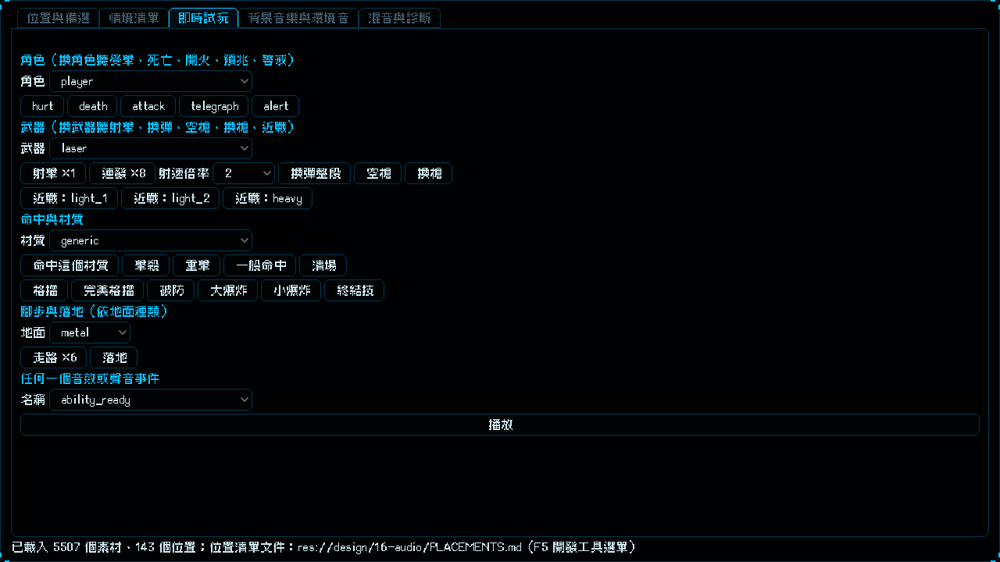

# [NE-182] 射速加快時音效跟著加快並收掉上一發尾音

> 狀態：完成

## 內文

### 需求
射擊間隔比音效短時，上一發的尾音還沒播完就響起下一發。例如霰彈槍每 0.55 秒一發、音效最長 0.84 秒；超頻（目前的射速加成）或之後的射速升級讓間隔更短時更明顯。要讓射擊音效隨射速加快，音高不變，並在下一發響起時把上一發的尾音快速收掉。設計見 `design/16-audio/DESIGN.md` 5.5 節。

### 來源
2026-10-05，使用者提出：霰彈槍開一發的速度比音效快，音效還沒播完就開下一發；希望音效可以加速，遊戲未來的升級系統升級射速時也加快音效。並選定加速時音高保持不變。

### 驗收條件
- [x] 加工時為每個玩家武器的射擊音效產生幾級加速的變體（預設 1.25、1.5、2.0 倍，資料可調），音高不變、響度與原速對齊、起音保留；原速的檔案不變
- [x] 加速變體的長度約等於原長除以倍率，頻譜重心與原速相近（音高沒變），有自動驗證
- [x] 音效庫的每個音效可以登記各級速度的檔案；沒有登記或檔案遺失時退回原速並記錄具體位置，遊戲不崩潰
- [x] 播放射擊音效時依「射速倍率」選最接近的一級變體；玩家的射速倍率由目前有效射擊間隔算出，超頻中自動加快，之後的射速升級不必另外處理音效
- [x] 同一個音效的上一發還沒播完又響起時，上一發在很短時間內淡出（時間資料可調，預設只給射擊音效）；敵人射擊與非射擊音效的行為不變
- [x] 霰彈槍在原本的射擊間隔下，上一發的尾音不再蓋到下一發；超頻時射擊音效明顯變短、音高聽起來沒變
- [x] 實驗室的即時試玩可以選射速倍率，逐級試聽每一把槍
- [x] 沒有加速變體的環境（例如 CI 與沒跑過加工的機器）測試照常通過

### 測試流程
1. 在實驗室即時試玩選霰彈槍，依序選 1、1.25、1.5、2 倍聽，音效逐級變短、音高沒變
2. 進遊戲用霰彈槍連射，確認上一發的尾音不再蓋到下一發
3. 啟動超頻連射，確認音效跟著加快；結束後恢復原速

---

# 跟其他票的關係

- Blocks：無
- Blocked by：無
- Related：NE-157、NE-138、NE-162、NE-33

---

# Commit-1

## 內文

射擊間隔比音效短時（例如霰彈槍每 0.55 秒一發、音效最長 0.84 秒），上一發的尾音還沒播完就響起下一發，超頻讓射速更快時更明顯。
現在玩家的七把武器（手槍、步槍、衝鋒槍、霰彈槍、雷射、發射器、軌道砲）與機甲加農砲的射擊音效，各有 1.25、1.5、2 倍三級加速變體：加工時用時間伸縮（音高不變、保留起音）產生，響度與原速對齊，原速的檔案完全沒動，一共新增 84 個檔案、約 0.8 MB。音效庫登記每一級的檔案（數量必須和原速的變體對得上），資料檢查會抓格式不對、倍率不合理、檔案不存在、數量對不上；缺檔時那一級退回原速並記錄具體位置，遊戲不崩潰。玩家開槍時帶上目前的射速倍率（超頻中大於 1），音效庫選最接近的一級；之後的射速升級只要改射速倍率，音效自動跟上，不必另外處理。同一個射擊音效的上一發還沒播完又響起時，上一發在 70 毫秒內淡出，不再蓋住下一發（時間可在資料裡調整，敵人與其他音效沒有改）。實驗室的即時試玩分頁新增「射速倍率」選項（1、1.25、1.5、2），連發的間隔也跟著縮短，方便逐級試聽每一把槍（見截圖）。
驗收：加工後每把槍每個加速變體的長度約等於原長除以倍率；頻譜重心與原速相比最大只差約 13%，音高沒有被移動（合成的單頻音測試誤差在 3% 內）；起音位置保留；超過上限的倍率用最後一級，沒有加速變體的音效（例如命中聲）在加速時照常播放。我沒有實際聽過，音質與倍率上限（目前 2 倍）需要你聽過再調。

### 測試結果

| 項目 | 結果 |
|---|---|
| 局部測試（音訊、實驗室、舞台、手感、武器覆蓋、音樂、輸入、換彈時間軸） | 8 個套件，22631 項，新失敗 0 |
| 時間伸縮工具自動測試 | 6 個全過 |
| 資料驗證 | 0 錯誤 |

### 截圖

