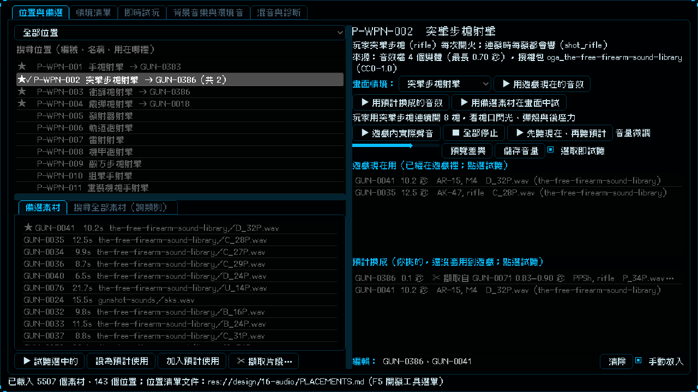

# [NE-183] 實驗室畫面射擊可選遊戲現在用或預計換成的音效組

> 狀態：完成

## 內文

### 需求
在實驗室的畫面舞台射擊（或執行其他情境）時，只能聽到遊戲現在的聲音，或用單一個備選素材試，沒有辦法選「遊戲現在用」或「預計換成」那一整組音效來射擊，看不出預計換成之後連射起來的實際感覺。要能選兩組音效各自射擊，預計換成那一組每次射擊輪流用組裡的素材。

### 來源
2026-10-05，使用者要求：射擊的時候讓我可以選「遊戲現在用」「預計換成」的音效組射擊，現在沒的選。

### 驗收條件
- [x] 位置與備選分頁的畫面情境列有兩個按鈕：用遊戲現在的音效、用預計換成的音效，兩者都在右側畫面舞台執行同一個情境
- [x] 用預計換成的音效時，這個位置的聲音暫時換成預計使用裡所有有預聽檔的素材，每次射擊輪流使用、不連續重複；只在記憶體，不寫任何資料，情境結束或取消後還原
- [x] 還沒有預計使用、或預計的素材都沒有預聽檔時，只提示原因與補齊方法，不執行、不報錯
- [x] 原有的「用備選素材在畫面中試」（單一素材）照舊可用
- [x] 音樂位置仍引導到背景音樂分頁；沒有畫面情境的位置照舊說明原因
- [x] 每個控制項都有 tooltip；現有測試仍通過

### 測試流程
1. 開啟實驗室，選手槍射擊位置，在備選裡挑兩個素材按「設為預計使用」
2. 按「用遊戲現在的音效」，舞台連射聽到現在的聲音；再按「用預計換成的音效」，連射聽到預計的兩個素材輪流響
3. 清除預計使用後按「用預計換成的音效」，只出現提示

---

# 跟其他票的關係

- Blocks：無
- Blocked by：無
- Related：NE-166、NE-181、NE-162

---

# Commit-1

## 內文

實驗室的畫面舞台只能用遊戲現在的聲音，或用單一個備選素材試，看不出預計換成的整組音效連射起來是什麼感覺。
現在畫面情境列有兩個按鈕：「用遊戲現在的音效」和「用預計換成的音效」。用預計換成的音效時，這個位置的聲音暫時換成預計使用裡所有有預聽檔的素材，連射時每一發輪流用、不連續重複，只在記憶體，情境結束或取消後還原，不寫任何資料；還沒有預計使用或預計的素材都沒有預聽檔時，只提示原因與補齊方法。原有的單一備選素材試聽照舊。
驗收：連續射擊時用合成的兩個聲音當預計換成的組，兩個都輪流響到；空的預計使用與沒有預聽檔的預計使用都只提示；情境結束後替換被清掉。

### 測試結果

| 項目 | 結果 |
|---|---|
| 局部測試（舞台、實驗室、音訊） | 3 個套件，21387 項，新失敗 0 |

### 截圖

