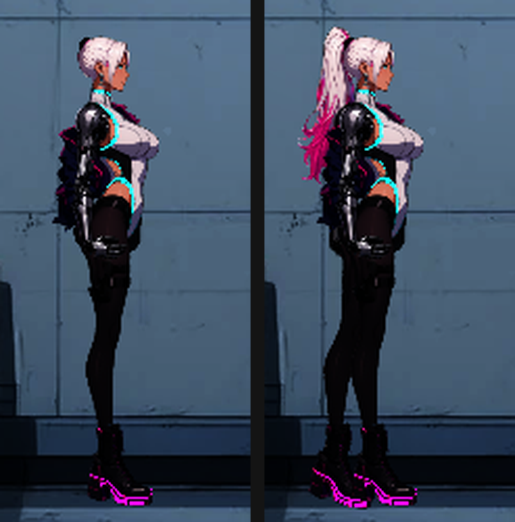

# [NE-184] 修正角色後側手腳與頭髮被背景蓋住

> 狀態：完成

## 內文

### 需求
凜的另一隻腳會被蓋在背景後面，站著只看得到一隻腳。要讓角色後側的手、腳、頭髮在所有場景都畫在背景前面。

### 來源
2026-10-05，使用者回報：女主的另一隻腳不知道為什麼會被蓋在背景之後。

### 驗收條件
- [x] 確認原因並記錄在票上
- [x] 過場舞台裡，凜（與其他角色）的後側手、腳、頭髮顯示在舞台背景前面；前景物件仍然蓋在角色前面，淡入淡出、字幕等效果層仍在最上面
- [x] 關卡裡，背牆、導軌、牆面裝飾、背景道具、地形都畫在所有角色零件之下，後側手腳不再被它們蓋住；前景道具與原本的相對順序不變
- [x] 圖層順序集中登記在一處，並有自動檢查：真實的角色資料沒有超出登記的範圍、背景排在最低的角色零件之下
- [x] 附修正前後的截圖

### 測試流程
1. 看過場舞台（例如轉運站走廊）裡站著的凜：兩條腿、兩隻靴子、白色馬尾與粉色髮尾都看得到
2. 進關卡走動、蹲下、跳躍，確認後側的腳與手臂不再被地面與牆蓋住，前景物件仍然蓋在角色前面

---

# 跟其他票的關係

- Blocks：無
- Blocked by：無
- Related：NE-119、NE-152、NE-74

---

# Commit-1

## 內文

凜站著只看得到一隻腳、一隻靴子，連白色馬尾也不見了。
原因是角色後側的手、腳、頭髮零件的圖層是負值（最低 -9），而關卡的背牆（-1）、地形、牆面裝飾、背景道具、導軌，以及過場舞台的背景各層（0）都排在它們上面，後側的零件就被背景蓋住了；前側零件的圖層是正值，所以只有一側看得到。這不是亮度的問題，和之前調亮後腿的修正（NE-119）無關。
現在圖層順序集中登記：關卡的靜態場景（背牆、導軌、裝飾、背景道具、地形）一律排在所有角色零件之下，過場舞台的背景各層在演員之下、前景各層在演員之上，過場的黑底再往下排，效果層維持最上面。修正前後的凜見截圖：左邊修正前只有一條腿一隻靴、沒有馬尾；右邊修正後雙腿雙靴，馬尾與粉色髮尾出現。
驗收：新增圖層順序檢查，涵蓋真實角色資料的圖層範圍、登記順序、過場舞台前後層、兩個關卡的背牆與地形；十一個相關套件共 2417 項檢查新失敗 0；十張過場舞台截圖逐張比對，只有角色後側零件與隨機的雨、粒子不同。

### 測試結果

| 項目 | 結果 |
|---|---|
| 局部測試（圖層順序、過場、環境、道具、電話亭、第二章、角色等 11 個套件） | 2417 項，新失敗 0 |
| 執行 log | 無 ERROR |

### 截圖

