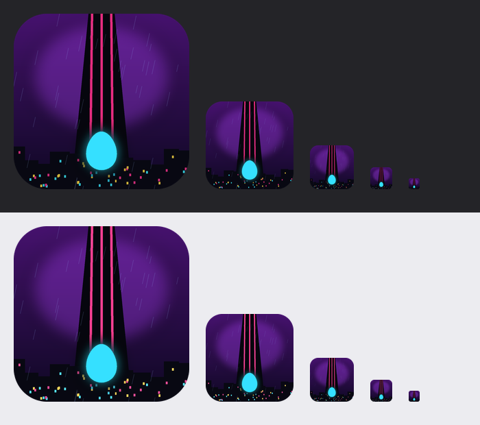

# [NE-185] 更換遊戲圖示為天穹塔

> 狀態：完成

## 內文

### 需求
遊戲圖示還是最初的簡單青色蛋形，和現在的遊戲世界（賽博龐克雨夜、天穹塔、巢中之卵）沒有關聯。要換成依遊戲背景設計的新圖示，由使用者從候選中挑選，不使用 ComfyUI。

### 來源
2026-10-05，使用者要求依現在的遊戲背景換一個圖示，先給幾個候選挑選；挑了「天穹塔」方向後再給 6 個延伸，最後選定 G1（粗塔：紫夜、粗洋紅紅線的塔、低天際線與塔下的大青卵）。

### 驗收條件
- [x] 先提供候選讓使用者挑選，用程式繪製，不使用 ComfyUI
- [x] 專案圖示換成選定的設計，圓角方形、透明圓角，用遊戲色盤的青、洋紅、紫
- [x] 提供各尺寸都清楚的版本：專案用 PNG，另附 Windows 用的多尺寸 ico（16 到 256）
- [x] 舊的 svg 圖示移除，沒有任何地方還引用它
- [x] 縮小到 32 與 16 像素仍看得出塔、紅線與卵的輪廓
- [x] 現有測試仍通過

### 測試流程
1. 開啟專案，確認編輯器與執行時視窗的圖示是新的天穹塔
2. 看 256、128、64、32、16 像素在深色與淺色背景上的樣子，輪廓清楚

---

# 跟其他票的關係

- Blocks：無
- Blocked by：無
- Related：NE-35

---

# Commit-1

## 內文

遊戲圖示是最初的簡單青色蛋形，和現在的世界觀沒有關聯。
依遊戲背景畫了兩輪候選（第一輪 6 個方向、挑中天穹塔後再給 6 個延伸），使用者選定 G1：紫色雨夜、塔上三條粗洋紅紅線、低矮的霓虹天際線，塔下一顆發光的青色大卵。專案圖示換成它（512 像素 PNG，圓角透明），另附 Windows 用的多尺寸圖示檔（16 到 256），匯出執行檔時可以使用；舊的簡單圖示已移除，唯一引用它的一項測試改用新圖示檔。圖示全由程式繪製，沒有使用生圖工具；縮到 32 與 16 像素仍然看得出塔、紅線與卵。
驗收：深色與淺色背景上的各尺寸對照見截圖；流程測試通過。

### 測試結果

| 項目 | 結果 |
|---|---|
| 流程測試（main） | 1319 項，新失敗 0（已知失敗 6 項，main 上本來就有） |

### 截圖

