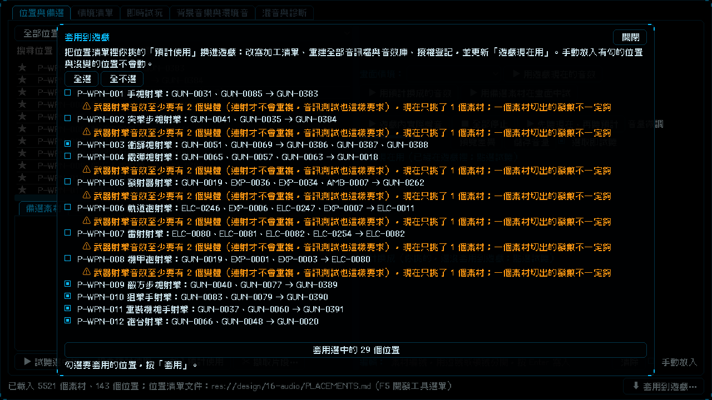

# [NE-186] 實驗室加入套用到遊戲按鈕

> 狀態：完成

## 內文

### 需求
在實驗室挑好「預計使用」之後，要換進遊戲得另外打指令（套用工具），實驗室裡沒有按鈕，使用者不知道怎麼套用。要在實驗室加「套用到遊戲」：先列出會改哪些位置、讓使用者勾選、確認後才套用；套用要重建全部音訊，在背景執行，結束後顯示結果與下一步。

### 來源
2026-10-05，使用者問「我要怎麼套用指定音效？」，接著要求在實驗室加套用到遊戲的按鈕，並要先更新到 main 上再工作。

### 驗收條件
- [x] 實驗室下方有「套用到遊戲」按鈕，按下去先列出會改的位置：位置、遊戲現在用的素材、預計換成的素材；手動放入有勾的位置與沒變的位置不列
- [x] 每個位置可勾選，有全選與全不選；按鈕顯示選了幾個位置
- [x] 有警告的位置預設不勾並標明警告，例如武器射擊音效只挑了一個素材、音訊測試要求至少兩個變體；使用者仍可自己勾選
- [x] 看不懂的素材編號、素材目錄沒有的編號等問題另外列出，這些位置不會套用
- [x] 按「套用」先出確認，說明會改哪些檔案、約需多久；確認前什麼都不改，取消不套用
- [x] 確認後在背景套用，顯示已經過幾秒；進行中不能關閉面板、不能操作實驗室；結束後顯示成功的位置數與下一步（匯入新檔、重開實驗室、跑測試、提交），失敗顯示具體原因
- [x] 套用完實驗室重新讀取素材目錄與位置清單，「遊戲現在用」更新
- [x] 找不到 Python 或工具失敗時只顯示說明，不崩潰
- [x] 套用工具支援只套用指定的位置，並提供機器可讀的輸出與結果檔；中文在 Windows 上不會因為編碼而亂碼
- [x] 每個控制項都有 tooltip；測試不需要 Python 與 ffmpeg

### 測試流程
1. 在實驗室幫幾個位置挑預計使用，按下方的「套用到遊戲」
2. 確認列出會改的位置，有警告的預設不勾；勾選幾個後按「套用選中的 N 個位置」，先看到確認，按取消什麼都沒變
3. 再按套用並確認，看到經過秒數，結束後顯示結果與下一步，「遊戲現在用」更新

---

# 跟其他票的關係

- Blocks：無
- Blocked by：無
- Related：NE-163、NE-181、NE-182、NE-183

---

# Commit-1

## 內文

實驗室只能挑「預計使用」，換進遊戲要自己打指令，也看不出有警告的位置。
現在實驗室下方有「⬇ 套用到遊戲…」：打開面板列出每個會改的位置（位置、遊戲現在用的、預計換成的），可勾選、全選與全不選；有警告的位置（例如武器射擊音效只挑了一個素材，音訊測試至少要兩個變體）預設不勾並標明警告，看不懂的編號與素材目錄沒有的編號另外列為問題。按「套用」先出確認，說明會改寫哪些檔案與約需多久，取消什麼都不改；確認後在背景套用（要重建全部音訊，約一到三分鐘），面板顯示已經過秒數，期間不能關閉；結束後顯示成功的位置數與下一步（匯入新檔、重開實驗室、跑測試、提交），失敗顯示具體原因，並重新讀取素材目錄與位置清單讓「遊戲現在用」更新。套用工具新增只套用指定位置、機器可讀輸出與結果檔；輸出只含 ASCII，因為 Windows 上 Godot 讀工具輸出時用系統碼頁，中文會亂碼甚至讓結果讀不出來，這也一併修正了擷取片段工具的同樣問題。
驗收：用你的真實資料打開面板，列出 29 個會改的位置，標出武器射擊音效只有一個素材的警告（見截圖），沒有真的套用；自動測試用假的套用工具，涵蓋勾選、警告預設、確認與取消、背景輪詢、成功與失敗、找不到 Python 與沒有結果檔。

### 測試結果

| 項目 | 結果 |
|---|---|
| 局部測試（套用面板、實驗室、擷取介面、舞台、音訊） | 5 個套件，21814 項，新失敗 0 |
| 套用工具自動測試 | 10 個全過 |
| 擷取工具自動測試 | 15 個全過 |

### 截圖

