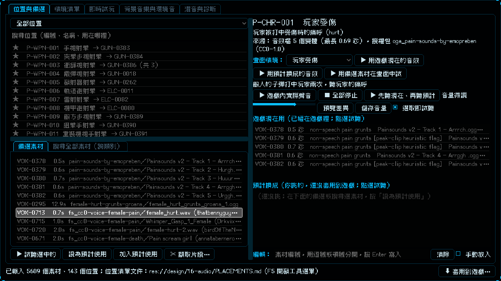

# [NE-187] 補充女性與更多人聲素材

> 狀態：完成

## 內文

### 需求
實驗室裡的人聲（受傷、死亡、用力）幾乎都是男性，但主角凜是女性，玩家受傷與死亡沒有合適的女性聲音可挑。要多找一批 CC0 的人聲，特別是女性的受傷痛呼、死亡慘叫、跳躍與攻擊的用力聲、喘息，也補一些男性的變化給敵人用；玩家受傷與死亡位置的備選要優先列出女性聲音。

### 來源
2026-10-05，使用者貼出實驗室的人聲清單並說：vocal 都是男生，可以幫我多找一些其他 vocal 跟女生的嗎。

### 驗收條件
- [x] 新增 CC0 女性人聲：受傷痛呼、死亡慘叫、用力與喘息，只收非語言的聲音（不收台詞）；排除兒童聲與情色相關的聲音
- [x] 新增 CC0 男性人聲：受傷與死亡的變化，供敵人使用
- [x] 每個素材都確認授權是 CC0，記錄作者與來源；新素材都有預聽檔
- [x] 玩家受傷與死亡位置的備選優先列出女性聲音，人形敵人的受傷與死亡位置的備選補上新的男性聲音；使用者已填的預計使用不受影響
- [x] 實驗室清單裡 Freesound 的素材顯示聲音標題與作者，不再只看到一串編號
- [x] 人聲位置的備選上限提高，原有備選保留

### 測試流程
1. 開啟實驗室，選「玩家受傷」，備選裡看得到女性的痛呼與喘息，點一下可以試聽
2. 選「玩家死亡」，備選裡看得到女性的慘叫
3. 選「人形敵人受傷」與「人形敵人死亡」，備選裡有新的男性聲音

---

# 跟其他票的關係

- Blocks：無
- Blocked by：無
- Related：NE-176、NE-164、NE-158

---

# Commit-1

## 內文

實驗室的人聲幾乎都是男性，但主角凜是女性，玩家受傷與死亡沒有合適的女性聲音可挑。
新增 88 個 CC0 人聲（Freesound，逐個聲音確認授權，只收非語言的聲音，排除台詞、兒童聲與情色相關的聲音）：女性受傷痛呼 9 個、女性死亡與慘叫 30 個、女性用力與喘息 14 個（含一組女性攻擊用力聲）、男性受傷痛呼 25 個、男性死亡 10 個。另外，原本就有一個較長的女性受傷錄音，可以用擷取片段工具切出需要的幾聲。玩家受傷與死亡位置的備選現在優先列出女性聲音，人形敵人的受傷與死亡位置補上新的男性聲音，備選上限提高到 60，你已經填的預計使用都沒有動。清單裡 Freesound 的素材改顯示聲音的標題與作者，不再只看到一串編號（見截圖）。
說明：Freesound 上 CC0 的女性「受傷痛呼」本來就少，只找到 9 個，死亡與慘叫則很多；不夠的話可以用擷取片段工具從較長的女性受傷錄音裡切出更多聲，或再找來源。這次沒有實際聽過，請你試聽挑選。
驗收：玩家受傷位置的備選前面是女性的受傷與喘息聲，玩家死亡位置前面是女性慘叫（見截圖）；音訊、實驗室與套用面板套件 22418 項檢查新失敗 0。

### 測試結果

| 項目 | 結果 |
|---|---|
| 局部測試（音訊、實驗室、套用面板） | 3 個套件，22418 項，新失敗 0 |
| 授權全量複查 | 883 / 883 通過 |

### 截圖

