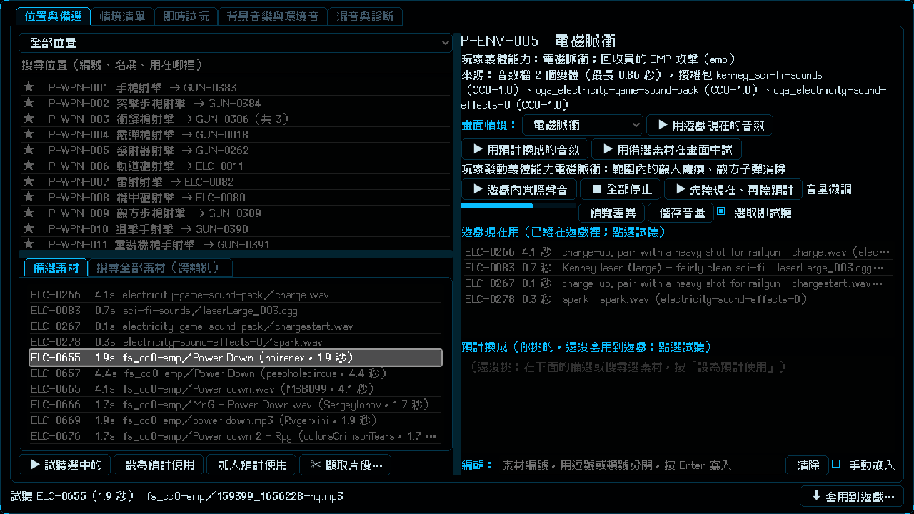

# [NE-188] 補充背景音樂與場景音效素材

> 狀態：完成

## 內文

### 需求
背景音樂的選擇不夠多，另外電磁脈衝、過載、義體能力就緒、拾取、木箱破壞、玻璃破碎、雷聲與不同材質的腳步聲，使用者在實驗室裡找不到合適的音效。要多找一批 CC0 的背景音樂與這幾類音效，並讓它們排在對應位置的備選前面。

### 來源
2026-10-05，使用者說：音樂 BGM 幫我多找一些，另外電磁脈衝、過載、義體能力就緒、拾取、木箱破壞、玻璃破碎、雷聲多找一點 CC0 的素材，不同材質的腳步聲也是。

### 驗收條件
- [x] 新增 CC0 背景音樂，涵蓋選單、平靜探索、緊張潛行、戰鬥、頭目、安全屋、勝利與失敗；只收授權欄位僅標示 CC0 的，雙重授權的不收
- [x] 新增 CC0 音效：電磁脈衝、過載、義體能力就緒、拾取、木箱破壞、玻璃破碎、雷聲
- [x] 新增 CC0 腳步聲：金屬、混凝土、潮濕、木頭、泥土草地，以及落地聲
- [x] 每個素材都確認授權是 CC0，記錄作者與來源；新素材都有預聽檔
- [x] 對應位置（電磁脈衝、過載、義體能力就緒、拾取、木箱破壞、玻璃破碎、雷聲、金屬／混凝土／潮濕腳步與落地）的備選前面列出新素材，使用者已填的預計使用不受影響
- [x] 背景音樂位置的備選上限提高，原有備選保留

### 測試流程
1. 開啟實驗室，選「電磁脈衝」，備選裡看得到新的 EMP 與斷電音效，點一下可以試聽
2. 依序看「過載」「義體能力就緒」「拾取」「木箱破壞」「玻璃破碎」「雷聲」與腳步、落地位置，備選裡都有新素材
3. 切到背景音樂分頁，新的曲目可以試聽

---

# 跟其他票的關係

- Blocks：無
- Blocked by：無
- Related：NE-187、NE-154

---

# Commit-1

## 內文

背景音樂與幾類場景音效的選擇太少。
新增 78 首 CC0 背景音樂（OpenGameArt，逐首確認授權欄位只有 CC0）與 98 個 CC0 音效（Freesound，逐個聲音確認授權）：電磁脈衝 29、過載 30、義體能力就緒 9、拾取 30，另有木箱破壞、玻璃破碎、雷聲各約 30，以及金屬、混凝土、潮濕、木頭、泥土草地的腳步與落地各約 30。對應位置的備選現在先列出這些新素材，背景音樂位置的備選上限提高到 120，你已經填的預計使用都沒有動。木頭與泥土草地目前沒有對應的遊戲位置，素材在「搜尋全部素材」裡可以找到。
說明：Freesound 上符合 CC0 的「義體能力就緒」只找到 9 個；這次沒有實際聽過，請你試聽挑選。
驗收：電磁脈衝位置的備選裡有新的 EMP 與斷電音效（見截圖）；音訊、實驗室、套用面板與擷取片段套件新失敗 0，授權全量複查 974 / 974 通過。

### 測試結果

| 項目 | 結果 |
|---|---|
| 局部測試（音訊、實驗室、套用面板、擷取片段） | 4 個套件，25184 項，新失敗 0 |
| 授權全量複查 | 974 / 974 通過 |

### 截圖

