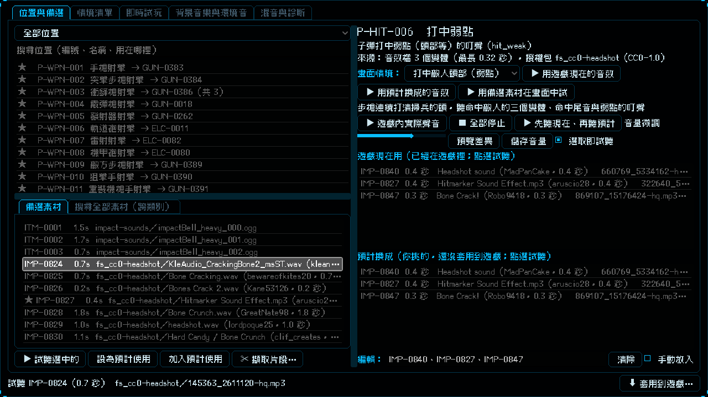

# [NE-189] 換用爆頭與破碎音效並補劍與電話素材

> 狀態：完成

## 內文

### 需求
打中弱點（爆頭）、木箱與玻璃破碎、護盾被打破、敵人被擊殺時的聲音不夠有感覺，要換成更合適的 CC0 音效。另外要多找劍鳴與揮劍砍東西的聲音，以及電話相關的聲音（鈴聲、拿起與掛上話筒、撥號與忙線音），並告知每個素材包的名稱。

### 來源
2026-10-05，使用者說：可以幫我放爆頭的音效或是東西破掉的音效嗎；再幫我找找看有沒有劍鳴聲，或是拿劍砍東西的聲音，記得都要告訴我這些音效包的名稱；再幫我找電話相關的聲音。範圍確認為：爆頭音效與換更好的破碎音，破掉的種類包含木箱、玻璃、護盾與裝甲破碎、敵人被擊殺。

### 驗收條件
- [x] 打中弱點時播放新的爆頭音效（CC0）
- [x] 木箱破壞與玻璃破碎換成新的變體，原本的保留在變體裡
- [x] 敵人護盾的最後一層被打掉時播放破防音效，不再只是擋下的聲音
- [x] 敵人被擊殺的重擊音換成新的變體
- [x] 新增劍鳴與拔劍、揮劍與砍中各種東西的 CC0 音效，近戰揮擊、命中、終結技、格擋的備選優先列出
- [x] 新增電話鈴聲、拿起與掛上話筒、撥號與忙線音的 CC0 音效，電話亭各位置的備選優先列出
- [x] 每個素材都確認授權是 CC0，記錄作者與來源；新素材都有預聽檔
- [x] 使用者原本已填的預計使用沒有被取代，新挑的接在後面

### 測試流程
1. 開啟實驗室，選「打中弱點」，「遊戲現在用」是新的爆頭音效
2. 在遊戲裡打敵人的弱點、打破木箱與玻璃、打掉盾兵的護盾，聽到對應的新聲音
3. 選「近戰輕斬揮空」「近戰輕斬命中」「格擋」，備選前面有新的劍音效；選電話亭的各位置，備選前面有新的電話音效

---

# 跟其他票的關係

- Blocks：無
- Blocked by：無
- Related：NE-188、NE-154

---

# Commit-1

## 內文

弱點命中、破碎、護盾破碎與擊殺的聲音太普通，劍與電話的素材也不夠。
爆頭、木箱、玻璃、破防與擊殺重擊現在用新挑的 CC0 音效（依標題挑選，沒有實際聽過，請試聽，不合意可在實驗室改）；敵人護盾的最後一層被打掉時會播破防音效。新增 Freesound 素材包（都是 CC0）：
- 爆頭與弱點命中：`fs_cc0-headshot`（25 個）
- 護盾與裝甲破碎：`fs_cc0-shield-break`（12 個，這類 CC0 本來就少）
- 擊殺碎裂與爆開：`fs_cc0-kill-burst`（27 個）
- 劍鳴與拔劍：`fs_cc0-sword-ring`（30 個）
- 揮劍與砍東西：`fs_cc0-sword-cut`（40 個）
- 電話鈴聲：`fs_cc0-phone-ring`（30 個）
- 話筒拿起與掛上：`fs_cc0-phone-handset`（24 個）
- 撥號、忙線與電話雜音：`fs_cc0-phone-dial`（40 個）
你原本在預計使用填的破防、擊殺、木箱、玻璃保留，新挑的接在後面一起輪播；爆頭原本沒填，直接用新的三個。
驗收：音訊、音訊舞台、實驗室、套用面板、擷取片段與新敵人套件 25907 項檢查新失敗 0。

### 測試結果

| 項目 | 結果 |
|---|---|
| 局部測試（音訊、音訊舞台、實驗室、套用面板、擷取片段、新敵人） | 6 個套件，25907 項，新失敗 0 |
| 依更動範圍的測試 | 41885 項，新失敗 1（監管者 pauldron 骨頭，NE-89 進行中的既有問題，與本票無關） |
| 授權全量複查 | 982 / 982 通過 |

### 截圖

