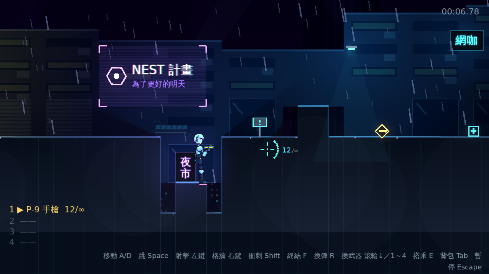
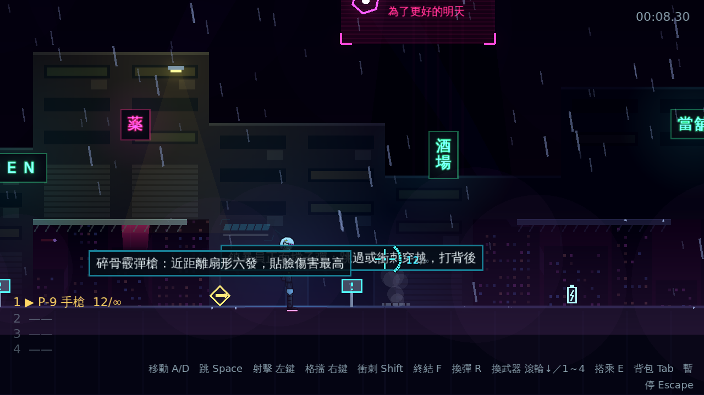
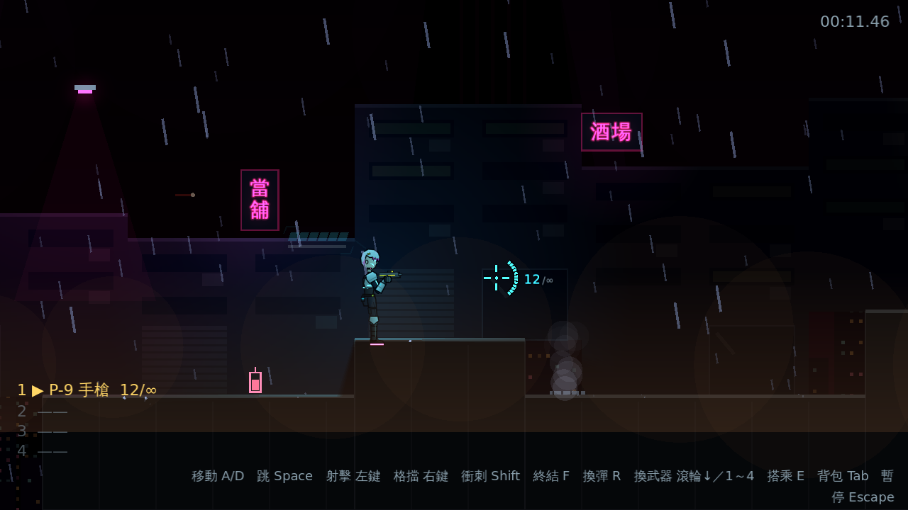
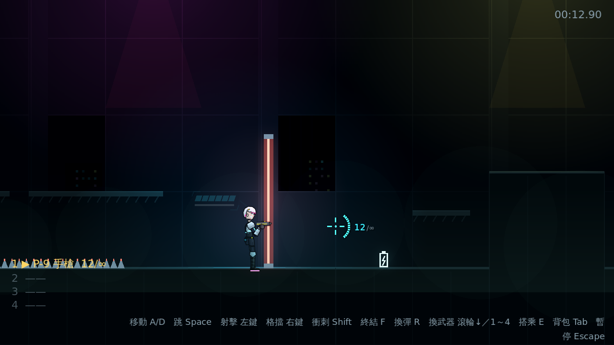
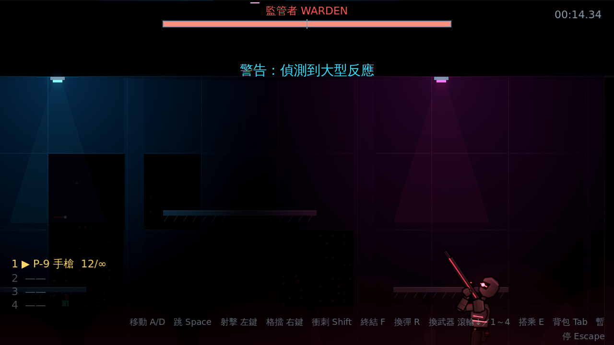
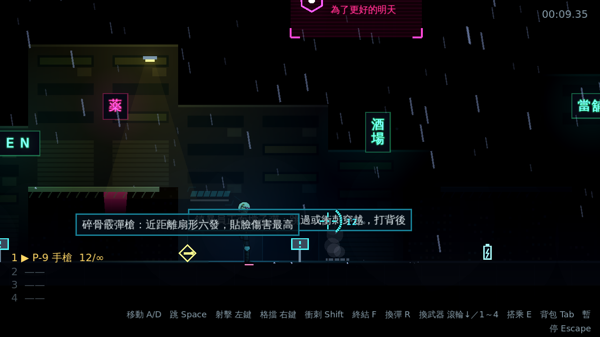

# [NE-18] 建立區段環境光與光影設定

> 狀態：完成

## 內文

### 需求
目前畫面沒有「暗」的底：光源只是在亮的畫面上再加亮，背景完全不受光，所有區段也共用同一套色彩。要讓整個遊戲有環境光，並讓每個區段有自己的光影設定，玩家走過區段邊界時平滑過渡。設計見 `design/08-lighting/DESIGN.md` 的「架構」第 1、3 節。

### 來源
2026-10-02，使用者於開發對話中提出：「整個遊戲可以有完整的光影設計，請參考業界最佳實例」「整體的渲染跟場景應該要陰沉一點，遊戲希望整體沉重一點」；確認壓抑程度為重度壓抑、先做光影再做內容。

### 驗收條件
- [x] 遊戲有環境光：沒被光源照到的地形、角色與背景明顯變暗，光源周圍形成光池
- [x] 背景各層（天空、樓群、車流）受環境光影響，並可依設定再壓暗，不再獨立於光影之外
- [x] 光影設定以資料檔定義（環境光、霧、背景暗化、泛光等），新增設定不需改程式
- [x] 關卡資料可指定「從哪個位置開始套用哪個設定、過渡多遠」，玩家跨越邊界時畫面平滑過渡、沒有跳變
- [x] 事件可以暫時覆蓋光影設定（例如停電、警報），結束後平滑回到區段設定
- [x] 發光的東西（霓虹招牌、子彈、爆炸、發光層）不會被環境光壓暗
- [x] 從檢查點重生時直接套用該位置的區段設定，不會從別的區段漸變過來
- [x] 設定檔缺漏或數值異常時記錄具體位置並改用安全預設，不會崩潰

### 測試流程
1. 開始第一關，確認未被光源照到的地形與背景明顯變暗、路燈周圍有光池
2. 從左走到右，確認跨越區段邊界時色調平滑變化
3. 觸發停電事件，確認光線暫時變暗並在結束後平滑回復
4. 通過檢查點後死亡，確認重生後立刻是該位置的光影
5. 執行完整測試套件，全部通過

---

# 跟其他票的關係

- Blocks：NE-19、NE-20、NE-21、NE-22、NE-23、NE-24
- Blocked by：無
- Related：NE-19

---

# Commit-1

## 內文

畫面沒有「暗」的底，光源只是在亮的畫面上再加亮，背景完全不受光，所有區段也共用同一套色彩。
現在整個遊戲有環境光：沒被光源照到的地形、角色與背景明顯變暗，路燈周圍形成光池；子彈、霓虹招牌、全像看板、雷射柵欄、尖刺、敵人、拾取物、雨與霧維持自發光，永遠看得見。光影以資料檔定義（環境光、背景色調、霧顏色與濃度、泛光門檻與強度），第一章依位置分成五個區段（屋頂巷弄、霓虹市集、貨運站、設施入口、頭目機庫），玩家走過邊界時所有數值平滑過渡。停電、警報這類事件可以暫時覆蓋區段光影，結束後平滑淡回；從檢查點重生時一開始就是該位置的光影。設定檔缺漏或數值異常時記錄具體位置並退回全亮預設。
驗收方式：冒煙測試驗證所有光影設定與區段有效、壞資料被回報且不崩潰、每個區段中段套用該區段設定、邊界為兩者中點且跨越時沒有跳變、環境光與背景、霧、泛光跟著玩家、事件覆蓋淡入／取代／淡出、發光物件與地形的材質、離開關卡還原泛光、檢查點重生的光影；自動截圖確認五個區段與停電。

### 測試結果

| 項目 | 結果 |
|---|---|
| 完整測試套件 | 通過 645 / 645 |
| 資料驗證 | 0 錯誤 |
| 執行 log | 無非預期 ERROR |

### 截圖

