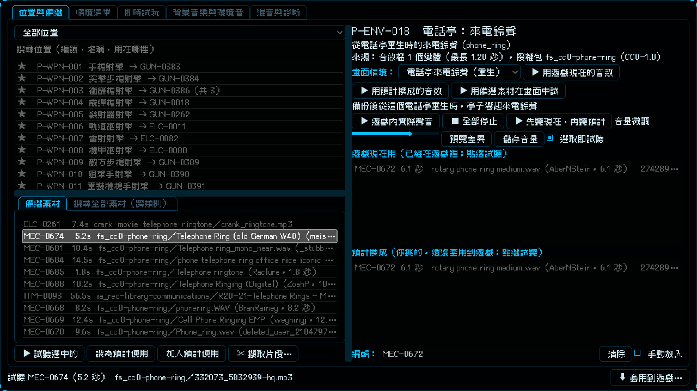

# [NE-190] 把預計使用的音效套用到遊戲

> 狀態：完成

## 內文

### 需求
使用者在實驗室「預計使用」挑好的音效（武器、命中、角色、腳步、機關、電話亭、音樂等約 100 個位置）要正式套用到遊戲，取代現在的音效，並且不能讓原有功能出問題。

### 來源
2026-10-05，使用者說：我想要把我設定的音效都正式套到遊戲裡面。

### 驗收條件
- [x] 所有「預計使用」且沒勾「手動放入」的位置都套用到遊戲，實驗室的「遊戲現在用」與預計使用一致
- [x] 武器射擊音效仍至少有 2 個變體：挑的素材只有一發時，自動複製並微調音高補到 2 個變體，射速加速的版本也同步重做
- [x] 通關與死亡短曲不超過 30 秒：取原曲開頭 12 秒並淡出
- [x] 沒有被這次套用影響的音效檔維持原樣，不被重新編碼
- [x] 太長的短促音效（腳步、近戰命中、弱點、電擊等）限制長度，戰鬥中同時發聲數維持在預算內；電話鈴聲保留完整的一段
- [x] 音訊、音樂、實驗室、套用面板與回饋工具的測試全過

### 測試流程
1. 開啟實驗室，任一位置的「遊戲現在用」與「預計換成」相同
2. 進遊戲：開槍、近戰、受傷、踩不同地面、打破木箱與玻璃、走到電話亭，聽到你挑的聲音
3. 主選單、各區域與頭目戰的音樂是你挑的曲目；通關與死亡的短曲是原曲開頭的一小段

---

# 跟其他票的關係

- Blocks：無
- Blocked by：無
- Related：NE-163、NE-186、NE-188、NE-189

---

# Commit-1

## 內文

實驗室裡挑好的「預計使用」只是清單，遊戲還在用舊音效。
現在約 100 個位置都套用到遊戲了（武器射擊與換彈、命中材質、受傷與死亡、腳步與落地、電磁脈衝、過載、拾取、雷聲、電話亭、背景音樂等）。為了不破壞原有功能，套用時多做了這幾件事：武器射擊音效只挑到一個單發素材時，會把它複製並微調音高補到 2 個變體；通關與死亡短曲取原曲開頭 12 秒並淡出；腳步、近戰命中、弱點、電擊等短促音效限制長度，電話鈴聲保留完整一段。音量沿用你原本的微調。
說明：短曲取的是原曲開頭，開頭是安靜前奏的話可能聽不到重點，不合意可以在實驗室換曲子或調整；戰鬥曲 41 秒，音樂長度檢查的循環曲下限因此從 45 秒放寬到 30 秒；電話撥號音現在是錄音，不再是標準撥號音。沒有實際聽過全部音效，請進遊戲試聽。
驗收：音訊、音樂、實驗室、套用面板、回饋工具套件新失敗 0；依更動範圍的完整局部測試只剩監管者 pauldron 骨頭一項（NE-89 進行中的既有問題）。

### 測試結果

| 項目 | 結果 |
|---|---|
| 局部測試（音訊、音樂、實驗室、回饋工具、特效） | 25278 項，新失敗 0 |
| 依更動範圍的測試 | 41623 項，新失敗 1（監管者 pauldron 骨頭，與本票無關） |
| 套用工具的 Python 測試 | 12 項通過 |

### 截圖

