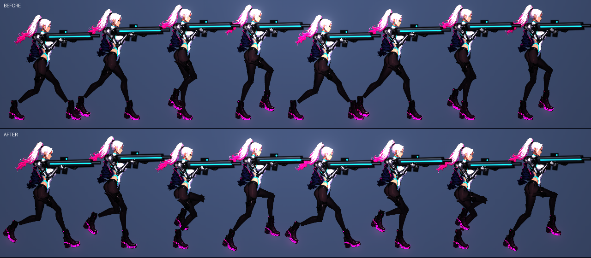
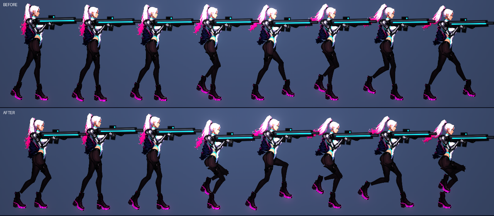
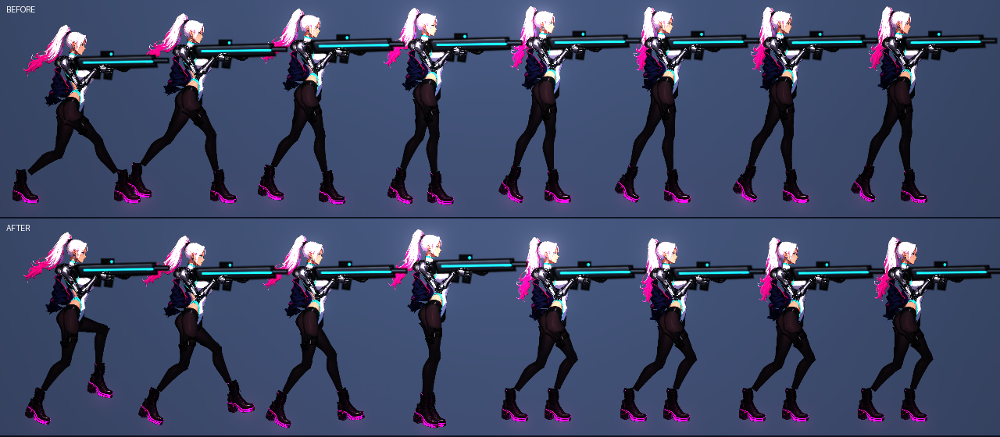
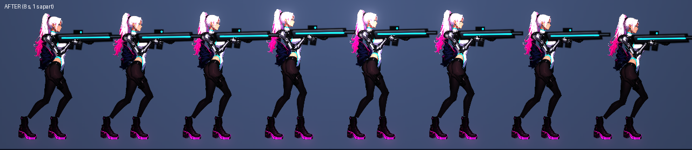

# [NE-191] 重新設計主角的跑步、待機與慣性動作

> 狀態：完成

## 內文

### 需求
主角跑起來像踩高蹺、上半身像一塊板、起步與停步沒有重量、待機像一張靜態圖，看起來不合理也不好看。要依業界的跑步循環做法重新設計：有騰空的跑步（接觸、下沉、過渡、上升）、膝蓋與腳掌的滾動、骨盆與胸的反向擺動、頭保持穩定、起步前傾與煞車後仰的慣性、待機的重心轉移。只改主角的動作資料，敵人與 NPC 的動作不能變。設計見 `design/17-protagonist-motion/DESIGN.md`。

### 來源
2026-10-05，使用者：檢視目前主角的骨架設計，覺得現在動起來很不合理、也不好看，希望參考業界最佳實例重新設計主角的動作，整個動作要優美。

### 驗收條件
- [x] 跑步有騰空：一個步伐週期內有兩腳同時離地的時段，身體最高點在騰空、不在腿併攏
- [x] 著地時膝蓋微彎，腳掌依序著地、踩穩、蹬地離地，腳底不滑、不陷進地面
- [x] 跑步時骨盆與胸反向微擺、頭保持穩定，持槍的手臂與槍隨步伐輕微起伏，槍口瞄準方向不受影響
- [x] 起步時身體前傾、煞車時後仰再回正、快速反向時有過衝，不是直接切換姿勢
- [x] 待機有重心轉移與換腳，不再是靜態圖；呼吸幅度看得出來
- [x] 敵人與 NPC 的動作資料與表現不變（測試鎖定：新欄位預設值等於不啟用）
- [x] 動畫稽核（骨頭拉伸、關節反折、腳踩實地、角度跳動）主角全過
- [x] 預覽工具可以輸出跑步一個週期的連續條帶，截圖附在票上

### 測試流程
1. `rig_preview.tscn -- --chars=rin --gait` 看跑步一個週期的八格
2. 進遊戲左右移動、急停、反向、站著不動十秒
3. 預期：跑步有重量與節奏，起步與煞車有慣性，待機會自己換重心

---

# 跟其他票的關係

- Blocks：NE-192、NE-193
- Blocked by：無
- Related：NE-96、NE-119、NE-152

---

# Commit-1

## 內文

凜跑起來像踩高蹺：兩腳永遠有一腳打直踩地，軀幹和槍八格裡幾乎不動；起步、煞車沒有慣性，待機像一張圖。
現在全速奔跑有騰空，著地時膝蓋微彎、腳掌依序腳跟著地、踩穩、蹬地；後腳抬高折起；身體在踩地中段壓低、騰空時升高；骨盆與胸反向微擺、頭保持穩定，持槍的手臂與槍隨之起伏，瞄準方向不受影響。起步前傾、煞車後仰再回正、反向時有過衝。待機時兩腳固定在地上，骨盆慢慢左右移動、膝蓋彎曲，重心會轉移。走路（速度比例低於約 0.7）仍是總有一腳踩地的走路式落腳，只有接近全速才騰空。
過程中發現並修正一個舊問題：動作資料合併時只收預設值裡有的欄位，凜的 `duty`、`lift` 一直被靜靜丟掉沒有生效；現在補進預設值，只有凜寫了這兩個欄位，其他角色不受影響。
其他角色與 NPC 的動作維持不變：新欄位預設值全是「不啟用」，新測試逐一鎖定 13 個角色的新欄位仍是關閉。預覽工具新增 `--seq=start|stop|idle`（依時間取樣八格）與 `--run-speed`（看全速奔跑），動畫稽核新增「全速奔跑」情境（只量有騰空的角色）。
驗收：動畫稽核、新的主角動作測試（99 項）、姿勢、NPC 動畫、動作資料、死亡與受擊反應套件全過；更動範圍的完整局部測試 41722 項，新失敗 4 項，皆與本票無關：音效實驗室 2 項在還原本票改動後同樣失敗（容器沒有音訊裝置），音效場景對照 2 項在單獨重跑時全過（多程序同時跑造成的計時問題）。沒有在實機操作遊戲，畫面都是預覽工具與稽核；請進遊戲實際跑跳確認手感。

### 測試結果

| 項目 | 結果 |
|---|---|
| 主角動作測試套件（新） | 99 / 99 |
| 動畫稽核（凜與 11 個敵人） | 0 超標 |
| 更動範圍的測試 | 41722 項，新失敗 4（皆與本票無關，見內文） |
| 執行 log | 本票相關無腳本錯誤 |

### 截圖

