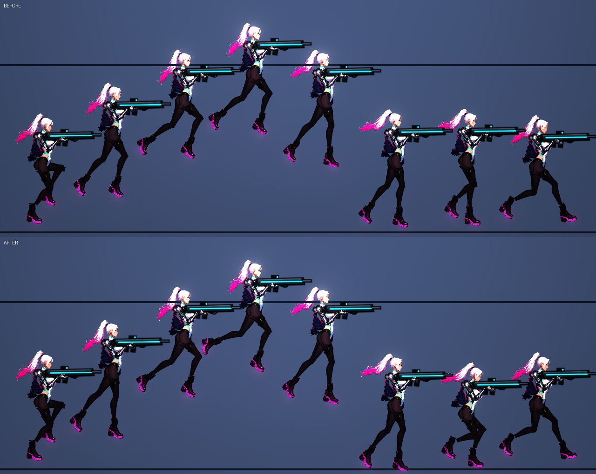
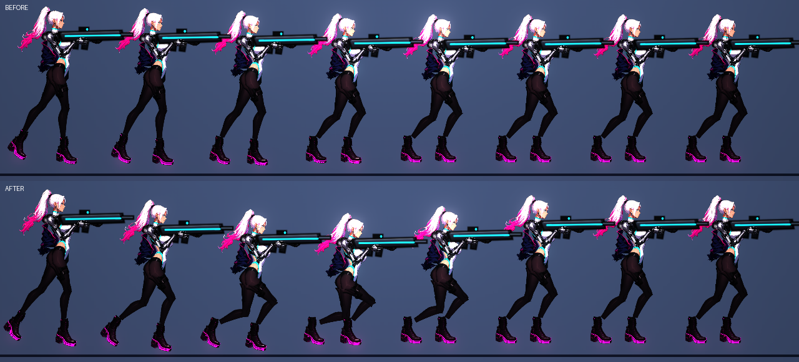
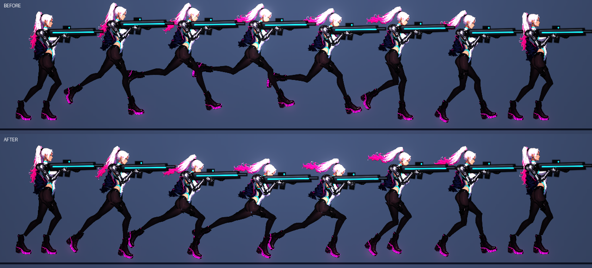

# [NE-192] 重新設計主角的跳躍、落地與衝刺動作

> 狀態：完成

## 內文

### 需求
主角的跳躍是上升與下落兩張靜態姿勢在頂點瞬間互換，落地只有整個貼圖縮放一下，衝刺只有一格姿勢。要改成：空中姿勢依垂直速度連續混合；起跳瞬間蹬地伸展（不加起跳前預備，維持操作反應）；頂點滯空；下落伸腿找地；落地由骨盆與膝蓋吸收衝擊再彈回；衝刺蹬出時拉長、結束時煞車前衝；起跳、落地、衝刺、受擊時衣襬與頭髮餘震。節點縮放的擠壓降到原本的三分之一以下。設計見 `design/17-protagonist-motion/DESIGN.md`。

### 來源
2026-10-05，使用者：主角動起來很不合理、不好看，希望整個動作優美。

### 驗收條件
- [x] 上升、頂點、下落的姿勢依垂直速度連續混合，頂點沒有姿勢瞬間切換（單格角度跳動在稽核限制內）
- [x] 起跳瞬間有蹬地伸展，隨後收腿；從按下跳躍到離地的時間與操作反應不變
- [x] 落地時骨盆下沉、膝蓋彎曲、胸前傾，再彈回站姿；衝擊越大吸收越深；跑動中落地直接接回跑步
- [x] 衝刺蹬出時身體拉長前傾、後腿伸直，結束時煞車前衝再回正
- [x] 起跳、落地、衝刺、受擊時衣襬與頭髮會餘震
- [x] 整個節點的擠壓縮放幅度降到原本的三分之一以下，貼圖不明顯變形
- [x] 敵人與 NPC 的動作不變；動畫稽核的空中與落地情境主角全過
- [x] 預覽工具可以輸出起跳到落地的連續條帶與衝刺條帶，截圖附在票上

### 測試流程
1. `rig_preview.tscn -- --chars=rin --jump` 與 `--dash` 看連續條帶
2. 進遊戲：原地跳、跑跳、從高處落下、衝刺、被打
3. 預期：落地有緩衝與彈回，跳躍頂點自然，衝刺有蹬出與煞車

---

# 跟其他票的關係

- Blocks：無
- Blocked by：NE-191
- Related：NE-119

---

# Commit-1

## 內文

凜的跳躍是上升、下落兩張靜態姿勢在頂點瞬間互換，落地只有整個貼圖縮放一下，衝刺只有一格姿勢，起跳、落地時衣襬也不會動。
現在：空中姿勢依垂直速度在「上升、頂點、下落」之間連續混合，頂點沒有姿勢切換；起跳後約 0.14 秒後腿向後蹬直、胸挺起，再收腿（沒有起跳前預備，按下跳躍到離地的時間與操作反應不變）；落地時由彈簧驅動身體下沉、膝蓋彎曲、胸前傾，再略帶過衝地彈回站姿，衝擊越大下沉越深；衝刺蹬出時身體壓低、前腿高抬、後腿向後伸直，結束後靠慣性前傾的彈簧煞車回正；起跳、落地、衝刺、受擊時衣襬與頭髮會餘震。整個節點的擠壓縮放只留原本幅度的 0.3，貼圖不再明顯變形。
其他角色與 NPC 不變：新欄位預設值全是「不啟用」，測試逐一鎖定。動畫稽核新增頂點、落地吸收與衝刺的情境，凜與 11 個敵人全過。預覽工具新增 `--seq=jump|land|dash`。
驗收：動畫稽核、主角動作測試（147 項，新增空中連續、起跳伸展、落地吸收與回彈、衣襬衝量、擠壓縮小）、姿勢、動作資料全過；更動範圍的測試 41771 項，新失敗 4 項皆與本票無關：音效實驗室 2 項（還原本票改動後同樣失敗，容器沒有音訊裝置）、音效對照 1 項與「樣本戰鬥的同時發聲數預算」1 項（還原本票改動後重跑也會一過一不過，是計時問題）。沒有在實機操作遊戲，畫面都是預覽工具模擬的；請進遊戲跳幾次、從高處落下、衝刺確認手感。

### 測試結果

| 項目 | 結果 |
|---|---|
| 主角動作測試套件 | 147 / 147 |
| 動畫稽核（凜與 11 個敵人） | 0 超標 |
| 更動範圍的測試 | 41771 項，新失敗 4（皆與本票無關，見內文） |
| 執行 log | 本票相關無腳本錯誤 |

### 截圖

