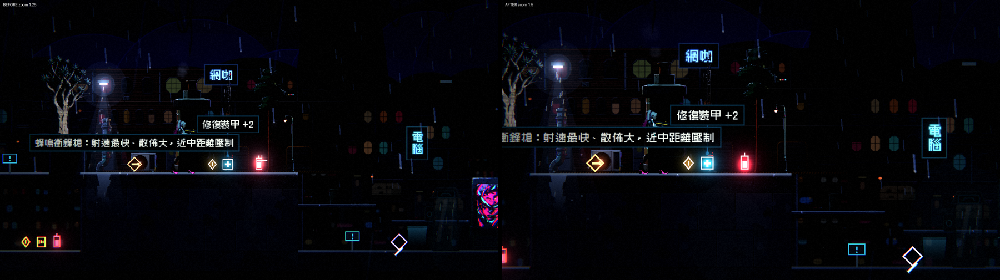
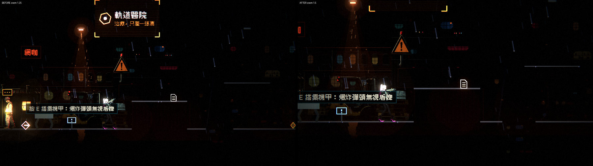

# [NE-194] 拉近鏡頭讓主角成為畫面主角

> 狀態：完成

## 內文

### 需求
遊戲主軸是主角，但現在畫面裡主角只佔高度兩成，動作細節看不清楚。要把鏡頭拉近，同時用前瞻與瞄準偏移補回前方視野，讓玩家仍能在敵人貼近之前看到並反應。縮放值收成鏡頭的資料，縮放脈衝、震動、後座的行為不變。設計見 `design/17-protagonist-motion/DESIGN.md` 3.5。

### 來源
2026-10-05，使用者：遊戲的主軸要以主角為主，視角應該要拉近一點。

### 驗收條件
- [x] 預設鏡頭縮放拉近，主角在畫面中的高度比例明顯變大（截圖前後對照）
- [x] 前瞻與瞄準偏移隨之調整，主角面向與瞄準方向的前方視野比例不比現在差
- [x] 第一章各區段的敵人進入視野時，與主角的距離足夠反應（量測附在票上）
- [x] 縮放脈衝、震動、後座與頭目戰鎖左界行為不變，相關測試全過
- [x] 介面（生命、彈藥、提示）不受縮放影響，位置與大小不變
- [x] 縮放值是資料或單一常數，不散落在多處

### 測試流程
1. 進第一章，跑、跳、瞄準各方向，對照拉近前後的截圖
2. 走到有遠程敵人的區段，確認遠處的敵人在開火前能被看到
3. 預期：主角更大更清楚，前方視野夠用

---

# 跟其他票的關係

- Blocks：無
- Blocked by：無
- Related：NE-191、NE-192

---

# Commit-1

## 內文

鏡頭縮放 1.25，主角約佔畫面高度兩成，動作細節看不清楚。
現在縮放拉近到 1.5（視野從 512×288 縮到 427×240 世界像素），主角約大 20%。為了補回前方視野：前瞻 48→56、瞄準偏移 22→30；垂直偏移與死區跟著縮小；下落時鏡頭會往下多看（下落速度超過 200 後，最多多看 36 像素），讓玩家看得到要落下去的地方；敵人在畫面外保持運作的邊界 80→120 像素，讓畫面外的敵人進入攻擊距離前就已啟動。縮放集中在鏡頭的單一常數，縮放脈衝、震動、後座、頭目戰鎖左界都沒有改。介面是疊加層，不受縮放影響。
視野量測（算出來的，沒有在遊戲裡逐區段實測）：面向前方可見距離（半個視野＋前瞻＋瞄準偏移）326 → 299 像素，涵蓋一般敵人的攻擊距離 240～300（槍兵 240、精英 260、重裝與迫擊砲 300）；占半個視野的前瞻比例 27% → 40%。背後可見距離 186 → 127 像素，這是拉近的代價；狙擊手（攻擊距離 440）與砲台（偵測 340～360）原本就在視野外，沒有變差。
測試一併調整：幽影隱形測試依賴「燈在視野內」，視野縮小後原本的擺放（玩家離幽影 480 像素）燈會被燈光預算收掉，改成玩家站近一點（352 像素）、燈半徑加大、鏡頭立即跟上，並縮短等待燈熄後重新隱形的時間（等太久幽影會自己走近開火）。
驗收：鏡頭、打擊感、環境、新敵人等更動範圍的測試 42171 項，新失敗 4 項皆與本票無關（音效實驗室 2 項、監管者 pauldron 骨頭 1 項為既有問題；音效場景對照 1 項是多程序同時跑的計時問題，單獨重跑會過）。請進第一章實際跑一遍，確認遠程敵人與下落的視野夠用，不合意可以調 `LevelCamera.ZOOM`（一個常數）。

### 測試結果

| 項目 | 結果 |
|---|---|
| 更動範圍的測試 | 42171 項，新失敗 4（皆與本票無關，見內文） |
| 幽影隱形與燈光測試 | 全過（已配合視野調整擺放） |
| 執行 log | 本票相關無腳本錯誤 |

### 截圖

