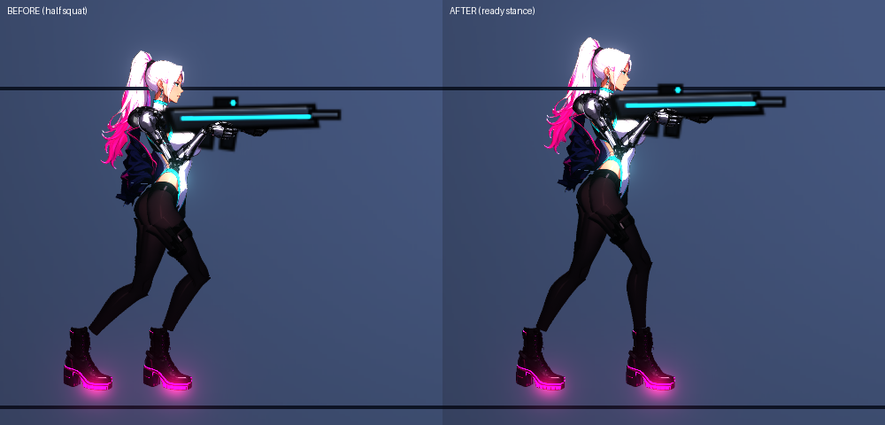

# [NE-195] 改善主角的站立姿勢

> 狀態：完成

## 內文

### 需求
主角站著不動時像半蹲：兩腳靠得很近、兩個膝蓋都往前彎、骨盆往後頂，看起來很奇怪。要改成合理的準備站姿：上身挺直、兩腳前後錯開約一個肩寬、腿近乎伸直，重心慢慢在兩腳間轉移。

### 來源
2026-10-05，使用者：他這個站立的方式很奇怪，有什麼更合理的站立姿勢嗎（附待機截圖）。

### 驗收條件
- [x] 待機時兩腳前後錯開（前腳在前、後腳在後），距離約一個肩寬
- [x] 腿近乎伸直，身體不是半蹲；上身挺直、只微微前傾
- [x] 腳固定在地上不滑，骨盆慢慢左右移動，膝蓋隨之微彎（重心轉移）
- [x] 站姿的兩腳距離可以用角色動作資料調整，其他角色的待機不變
- [x] 動畫稽核與主角動作測試全過

### 測試流程
1. `rig_preview.tscn -- --chars=rin --closeup` 看站姿
2. 進遊戲站著不動十秒
3. 預期：像持槍待命的人，不是蹲著

---

# 跟其他票的關係

- Blocks：無
- Blocked by：無
- Related：NE-191

---

# Commit-1

## 內文

待機時兩腳固定在「依站姿腿角算出來」的位置，那個位置兩腳幾乎併攏，再加上腿長比例 0.95，變成兩膝都往前彎的半蹲。
現在待機的兩腳位置可以直接寫在動作資料（`idle.feet_x`，兩腳離骨盆的前後距離）：凜是前腳 +8、後腳 −7 像素，腿長比例 0.995（近乎伸直），上身微微前傾；骨盆仍然慢慢左右移動讓重心在兩腳間轉移。沒寫 `feet_x` 的角色維持原本算法，其他角色不變。
驗收：主角動作測試新增站姿檢查（兩腳距離 10～18 像素、骨盆不低於站高 3.5 像素以上），155 項全過；動畫稽核、姿勢、動作資料、電話亭套件全過；更動範圍的測試結果見下表。沒有在實機看，請進遊戲確認站姿。

### 測試結果

| 項目 | 結果 |
|---|---|
| 主角動作測試套件 | 155 / 155 |
| 動畫稽核（凜與 11 個敵人） | 0 超標 |
| 更動範圍的測試 | 42160 項，新失敗 5（皆與本票無關：監管者 pauldron 骨頭＝NE-89 既有問題、音效實驗室 2 項＝容器無音訊裝置、同時發聲預算與音效場景對照 2 項＝多程序同時跑的計時問題，單獨重跑會過） |
| 執行 log | 本票相關無腳本錯誤 |

### 截圖

