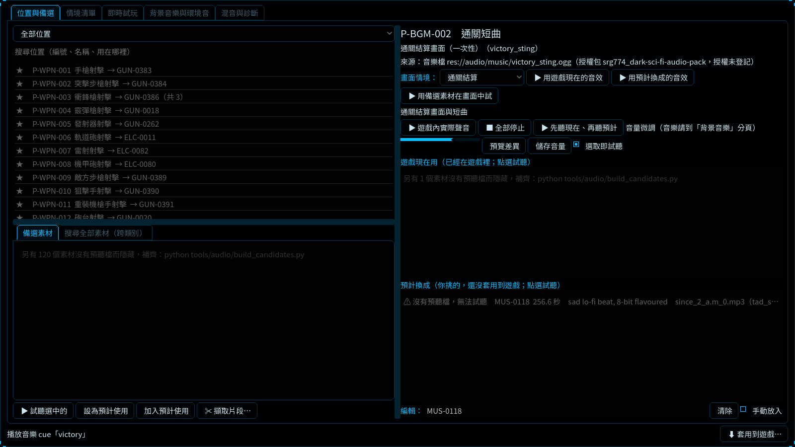
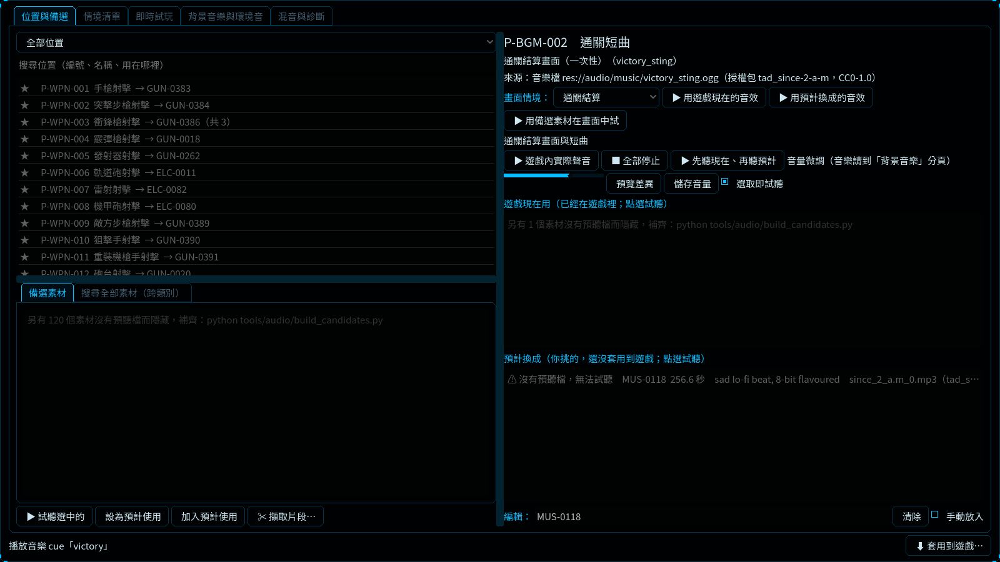
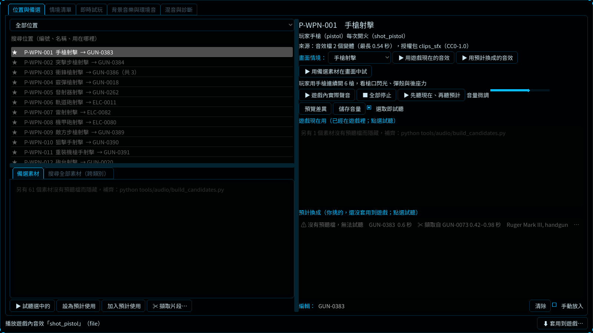
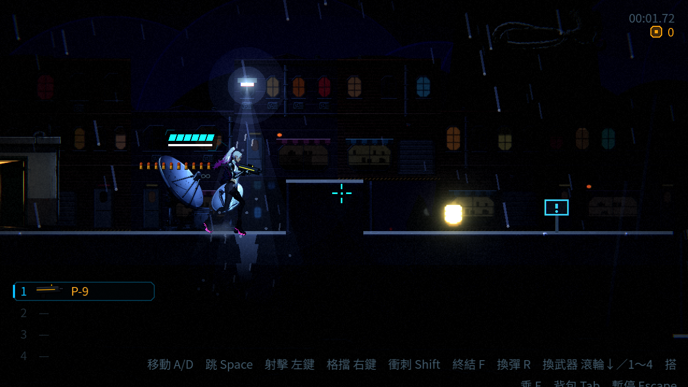
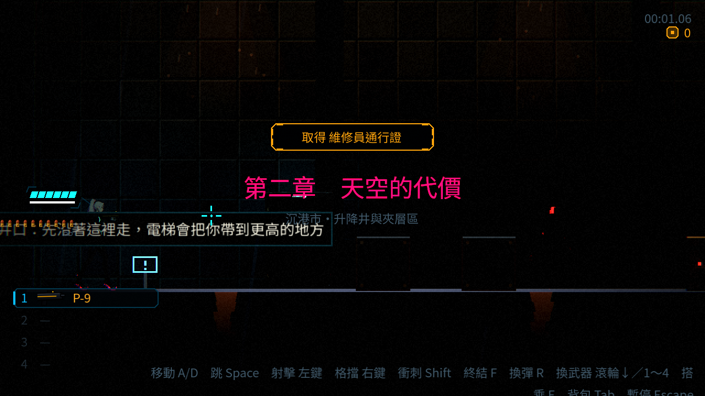

# [NE-196] 試聽並驗收已套用的音效

> 狀態：審查中

## 內文

### 需求
NE-190 把使用者挑的約 100 個音效套進遊戲，但這些音效都沒有人實際聽過：只依標題挑選、單發槍聲用音高微調的複本補到 2 個變體、通關與死亡短曲只取原曲開頭 12 秒、電話撥號音換成錄音。需要使用者進遊戲試聽驗收，不合意的在實驗室改掉並重新套用。

### 來源
2026-10-05，NE-188、NE-189、NE-190 交付後的收尾事項。

### 驗收條件
- [ ] 從主選單玩到第二章結束，武器（含音高微調的複本）、命中、受傷、腳步、機關、電話亭、介面的聲音都沒有明顯不合適的
- [ ] 通關與死亡短曲聽起來完整；開頭是安靜前奏的曲子已換曲或調整取用的段落
- [ ] 不合意的位置已在實驗室換成別的素材並套用
- [x] 音訊與實驗室相關測試通過

### 測試流程
1. 開啟實驗室，逐類試聽「遊戲現在用」，不滿意的改「預計使用」後按「套用到遊戲」
2. 進遊戲實際玩一輪，確認聲音與畫面對得上、不吵、不重複得太明顯

---

# 跟其他票的關係

- Blocks：無
- Blocked by：無
- Related：NE-154、NE-188、NE-189、NE-190

---

# Commit-1

## 內文

已套用的曲目有 10 首仍顯示舊曲名與舊授權包，實驗室甚至顯示「授權未登記」。現在來源標示與使用者選擇的正式素材及 CC0 登記一致；後續增量建置或指定曲目建置也會同步來源，避免再次保留舊標示。正式音檔、選擇、片段、音量、關卡配樂對應與增量快取均保持原樣。

本次核對基準為 `6f4805be` 加本票修正，第一章使用屋頂、電話巷與倉庫的新區域資料，第二章使用保留的 `level_02`。147 個位置經實驗室「遊戲內實際聲音」播放路徑產生錄音，另有真實關卡的移動、跳躍、落地、七把槍原速／2x 連射及電話事件對照。電話按鍵捕捉修正後，在電話巷錄到完整的拿起、三聲撥號、話筒錄音及掛上；早期未觸發的注入嘗試另標為未通過，不當作成功實玩。

提供 [可播放審查頁](attachments/NE-196/index.html)、[操作與結論界線](attachments/NE-196/README.md)、[逐檔與事件技術資料](attachments/NE-196/technical.json)。審查頁包含 275 個正式檔案的變體、加速檔與來源，以及混音器錄音。此次只修正來源顯示，修前／修後音訊位元組相同，沒有聲稱調音改善。兩首短曲均為 12 秒且有可測的起音與淡出；電話三段音訊長於相鄰事件間隔，重疊是否合意交由錄音審查。

執行環境沒有音訊輸出裝置及原始候選快取，沒有人工試聽、選音喜好或完整通關結論。真實關卡為跳過過場、提高生命的腳本輸入抽查；截圖說明來源與場景，聲音驗收使用可播放片段。此環境候選缺預聽會在實驗室顯示，未偽裝為已下載。捕捉程序結束的 ObjectDB 警告保留在紀錄中；受影響測試沒有新失敗。主觀與完整試玩驗收條件保持未勾選。

### 測試結果

| 項目 | 結果 |
|---|---|
| 音訊、音樂、實驗室及舞台基準 | 26,266 項，新失敗 0、已知失敗 0 |
| `tools/run_tests_changed.sh 6f4805be` | 41 組、38,707 項，新失敗 0、已知失敗 0 |
| Python 來源同步、增量建置、套用、伸縮、擷取 | 53 項通過；快取命中不重編碼、保留其他區域對應 |
| 來源修復重跑 | 第一次修正 10 首；第二次 0 變更 |
| 正式素材與選擇比對 | 音檔、加工參數、位置選擇、音效庫、建置快取無差異 |
| 聲音喜好／完整通關 | 沒有代替使用者確認 |

原始執行摘要與捕捉 log：[測試與執行紀錄](attachments/NE-196/tests/changed-summary.txt)。

### 截圖

以下為 Godot 4.7、Forward+、llvmpipe 的實際截圖；聲音對照另見上方審查頁。

其餘逐類畫面：`NE-196-lab-HIT.png`、`NE-196-lab-CHR.png`、`NE-196-lab-MOV.png`、`NE-196-lab-ENV.png`、`NE-196-lab-UIS.png`、`NE-196-lab-AMB.png`，均在本票 images。
