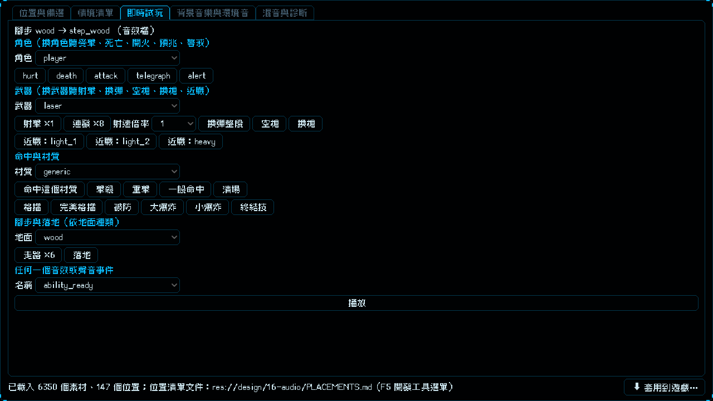

# [NE-198] 加入木頭與泥土草地的腳步與落地位置

> 狀態：完成

## 內文

### 需求
目前腳步只分金屬、混凝土、潮濕三種，NE-188 已經找到木頭與泥土草地的 CC0 腳步素材，但遊戲裡沒有對應的位置與地面材質，素材只能躺在「搜尋全部素材」。要讓玩家走在木地板、泥土與草地上時聽到對應的腳步與落地聲。

### 來源
2026-10-05，使用者要求補不同材質的腳步聲；NE-188 後木頭與泥土草地沒有可放的位置。

### 驗收條件
- [x] 遊戲的地面材質可以標示木頭、泥土草地，走路與落地播對應的聲音
- [x] 實驗室新增這些位置，備選優先列出新素材，並有可驗證的畫面情境
- [x] 沒標材質的地面維持原本的聲音
- [x] 音訊與實驗室相關測試通過

### 測試流程
1. 走到木地板與泥土地，腳步聲與金屬、混凝土明顯不同
2. 在實驗室選這些位置，用畫面情境試聽

---

# 跟其他票的關係

- Blocks：無
- Blocked by：無
- Related：NE-188、NE-163

---

# Commit-1

## 內文

腳步只分金屬、混凝土、潮濕，NE-188 找來的木頭與泥土草地素材沒有位置可放，也沒有地面種類可用。
現在新增「木頭」「泥土草地」兩種地面種類，各有腳步（3 個單步變體）與落地聲，分別是 4 個新位置（腳步：木頭、腳步：泥土草地、落地：木頭、落地：泥土草地）；地形材質在資料裡對到 wood 或 dirt 就會播對應聲音，沒標的材質（含所有現有材質）維持原本的聲音。實驗室新增這 4 個位置與可試聽的畫面情境，備選優先列出木頭與泥土草地素材，即時試玩分頁的地面選單也多了這兩種。
說明：目前遊戲裡還沒有木地板或泥土草地的地形材質（貼圖要另開場景票），所以實際關卡暫時聽不到；要用時把新材質 id 對到 wood 或 dirt 即可。選的單步片段是看波形挑的，沒有逐一聽過，請在實驗室試聽，不合意改「預計使用」再套用。
驗收：音訊、實驗室、舞台、套用面板、角色與武器覆蓋等受影響套件新失敗 0；音訊建置只多出 9 個新檔，既有檔案位元組不變。

### 測試結果

| 項目 | 結果 |
|---|---|
| 依更動範圍的測試 | 27211 項，新失敗 0 |
| 套用工具、增量快取、片段工具的 Python 測試 | 12、11、15 項通過 |
| 音訊建置 | 重做 9 個（全是新檔）、略過 215 個 |

### 截圖

