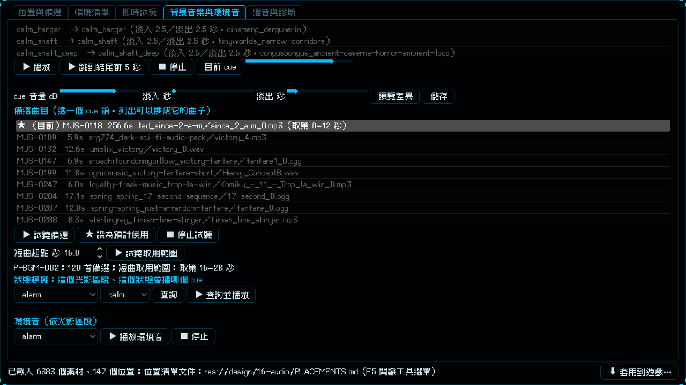

# [NE-199] 補齊稀少的 CC0 音效來源與音樂段落處理

> 狀態：完成

## 內文

### 需求
有幾類 CC0 音效很少：護盾與裝甲破碎只找到 12 個、義體能力就緒只有 9 個、擊殺爆開與劍鳴也不多；音樂方面，通關與死亡短曲目前只是取原曲開頭 12 秒，循環曲的循環點只靠交叉淡化。要多找來源，並讓短曲能挑原曲中合適的段落。

### 來源
2026-10-05，NE-188、NE-189、NE-190 的限制說明。

### 驗收條件
- [x] 從 OpenGameArt、Freesound 以外的 CC0 來源（或更多搜尋詞）補上稀少類別，每個素材確認授權為 CC0
- [x] 短曲位置可以指定取用的起點，實驗室試聽時看得到取用的範圍
- [x] 新素材都有預聽檔，並排進對應位置的備選
- [x] 音訊與實驗室相關測試通過

### 測試流程
1. 實驗室選「破防」與「義體能力就緒」，備選明顯變多
2. 選通關短曲，可以選取用的段落並試聽

---

# 跟其他票的關係

- Blocks：無
- Blocked by：無
- Related：NE-188、NE-189、NE-190

---

# Commit-1

## 內文

護盾破碎、義體能力就緒、擊殺爆開、劍鳴的 CC0 音效太少，通關與死亡短曲又只能取原曲開頭 12 秒。
音效：沒有找到 Freesound、OpenGameArt 以外的 CC0 來源，改成增加搜尋詞並放寬下載數門檻，Freesound 的 CC0 素材增加：義體能力就緒 9→16、護盾破碎 12→19、擊殺爆開 27→35、劍鳴 30→40（共 33 個新素材，原有的一個不少）；新素材都有預聽檔，已排進破防、義體能力就緒、擊殺、格擋、完美格擋的備選；來源頁的 CC0 授權全部複查通過（982 頁）。
短曲：預計使用可以寫成「MUS-0123@45」，套用時從原曲第 45 秒取 12 秒（淡入淡出）；起點超過曲長會擋下並說明。實驗室「背景音樂」分頁選通關或死亡短曲時多一欄「短曲起點」與「試聽取用範圍」，備選列表和下方說明列出取用範圍；通關與死亡短曲的備選也放寬到比 30 秒更長的曲子，才有得選段落。
說明：預聽檔只有原曲前 60 秒，起點超過時只能套用、不能在實驗室預聽；擊殺爆開的來源有些是卡通風格，挑選時請聽過。循環曲的循環點仍是交叉淡化，這張票沒有動。
驗收：音訊、實驗室、套用面板等受影響套件新失敗 0；套用工具 16 項 Python 測試通過。

### 測試結果

| 項目 | 結果 |
|---|---|
| 依更動範圍的測試 | 27336 項，新失敗 0 |
| 套用工具的 Python 測試 | 16 項通過（新增短曲起點 4 項） |
| 授權複查 | 982 頁通過、0 項有問題 |

### 截圖

