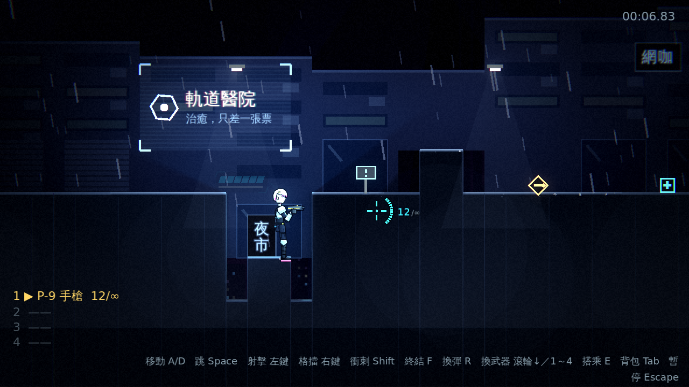
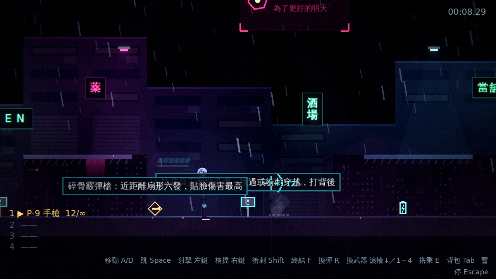
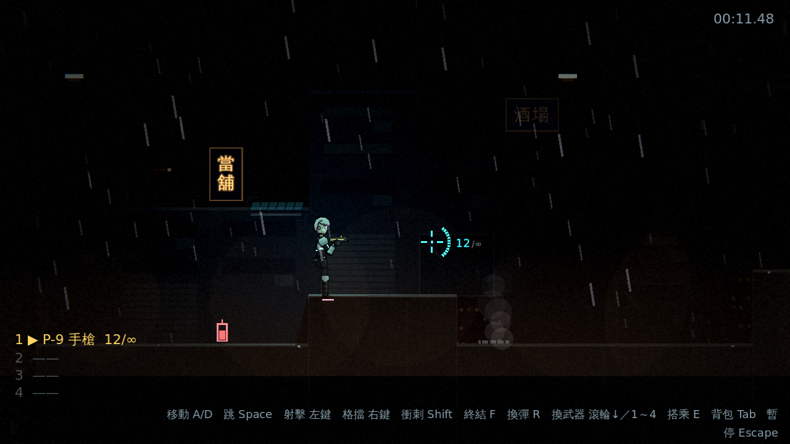
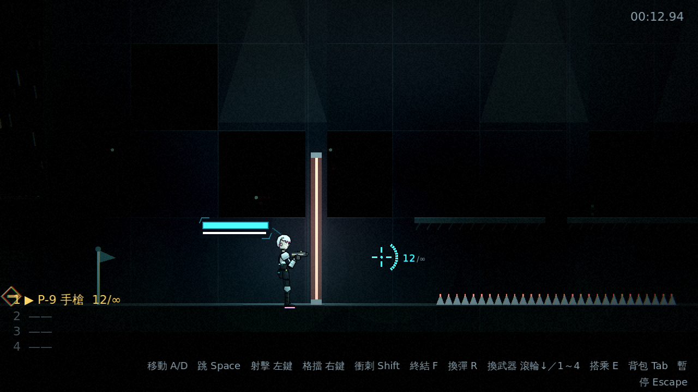
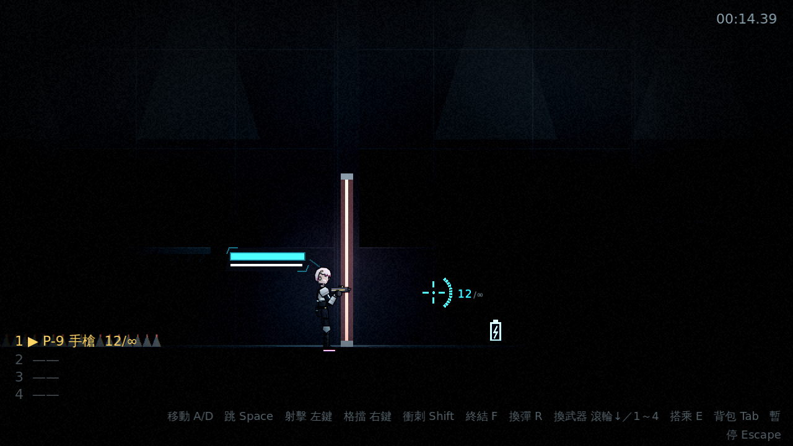
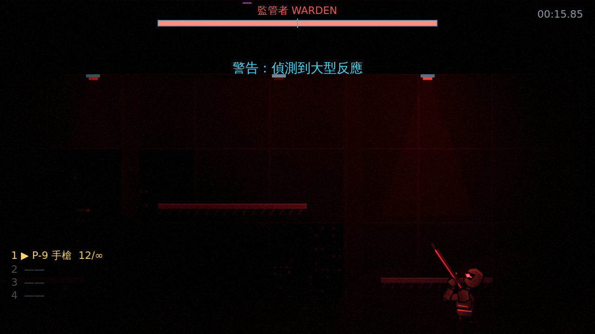

# [NE-19] 重配第一章的色彩與光源

> 狀態：完成

## 內文

### 需求
第一章五個區段目前色彩與明暗幾乎一樣，沒有情緒起伏。依色彩腳本為每個區段設定獨立的光影，並重新配置場景燈與霓虹：每個區段有明確的主光與光池，光池之外很暗，越深入越壓抑。設計見 `design/08-lighting/DESIGN.md` 的「第一章色彩腳本」。

### 來源
2026-10-02，使用者於開發對話中提出：「整個遊戲可以有完整的光影設計，請參考業界最佳實例」「整體的渲染跟場景應該要陰沉一點，遊戲希望整體沉重一點」；確認壓抑程度為重度壓抑、先做光影再做內容。

### 驗收條件
- [x] 五個區段（屋頂巷弄、霓虹市集、貨運站、設施入口、頭目機庫）各有獨立的環境光、霧與調色，符合色彩腳本
- [x] 從頭走到尾能清楚感覺到由「冷」到「窒息」的變化，頭目機庫最壓抑
- [x] 每個區段有明確的主光與光池，光池之外很暗
- [x] 部分場景燈會閃爍或熄滅，設施入口有停電的段落
- [x] 每個區段的敵人、平台與危險物仍然看得清楚
- [x] 沿途的檢查點、道具與教學看板在暗處依然找得到

### 測試流程
1. 從主選單開始，走完整個第一章，逐區段確認色彩與明暗
2. 在每個區段停下確認光池、敵人與平台的可見度
3. 打到頭目戰，確認頭目機庫的光影最壓抑但頭目的招式預兆看得清楚
4. 執行完整測試套件，全部通過

---

# 跟其他票的關係

- Blocks：NE-22、NE-25
- Blocked by：NE-18、NE-20
- Related：NE-18

---

# Commit-1

## 內文

第一章五個區段的色彩與明暗幾乎一樣，沒有情緒起伏。
現在依色彩腳本，每個區段有獨立的環境光、霧、調色、場景燈與霓虹風格：屋頂巷弄是冷灰藍的月光，霓虹市集是洋紅與青的光池，貨運站是鈉燈橘黃與濃霧，設施入口是冷綠、日光燈高頻閃爍，頭目機庫幾乎全黑、紅色警示燈脈動。環境光的亮度逐區段遞減，頭目機庫最暗、暗角最重。燈的顏色、光池大小、閃爍頻率與壞掉的比例由區段風格決定，壞掉的燈不亮也沒有光源；沿路新增場景燈讓每個區段至少有兩盞形成光池，光池之外很暗。設施入口後段是停電走廊，進入時整體壓暗、離開後淡回（從檢查點重生在走廊裡也直接是停電的光影）；頭目戰開始時切換成紅色警報光影，擊敗後淡回。敵人、子彈、尖刺、雷射柵欄、檢查點、道具與教學看板都是自發光，在暗處依然找得到。
驗收方式：冒煙測試驗證環境光逐區段遞減、機庫暗角最重、每區段燈風格有效且不同、每盞燈的顏色與光池取自所在區段、有壞掉與會閃的燈（壞掉的沒有光源）、同一種子的燈結果一致、停電事件進出與重生、頭目戰的警報光影；自動截圖逐區段確認。

### 測試結果

| 項目 | 結果 |
|---|---|
| 完整測試套件 | 通過 723 / 723 |
| 資料驗證 | 0 錯誤 |
| 執行 log | 無非預期 ERROR |

### 截圖

