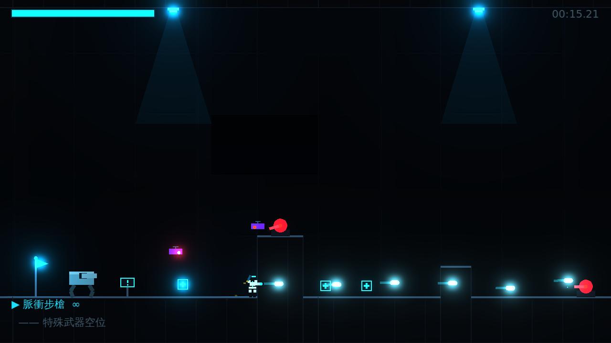
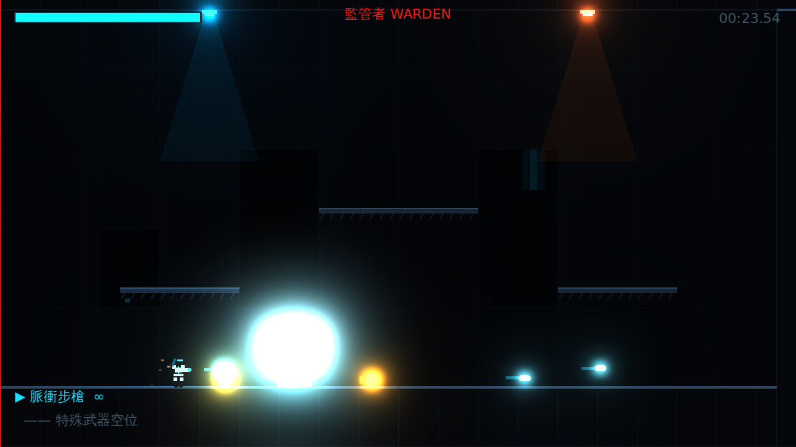
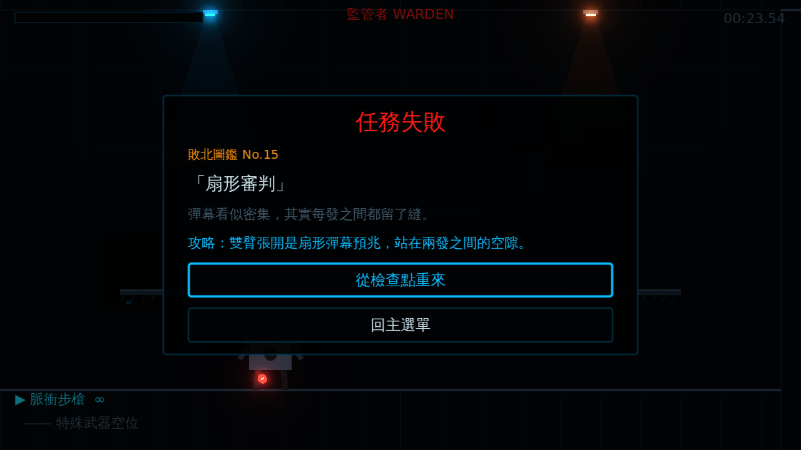

# [NE-1] 建立垂直切片關卡與頭目戰

> 狀態：完成

## 內文

### 需求
需要一個可直接遊玩的垂直切片，驗證全年齡橫向捲軸射擊的核心玩法：一個完整關卡、多種需要不同應對方式的敵人、可騎乘機甲、一個多階段頭目，以及取代成人向收集要素的「敗北圖鑑」。

### 來源
2026-10-02，使用者於開發對話中提出：「用 Godot，先做垂直切片」，並要求敵人不要只換外觀、要有不同攻擊與應對方式，射擊手感、打擊感與移動手感最優先。

### 驗收條件
- [x] 可從主選單選擇三種難度並開始遊戲
- [x] 六種敵人各有不同攻擊方式與對應的應對方式，攻擊前都有預兆
- [x] 可撿取武器並切換，特殊武器有彈藥限制
- [x] 可搭乘機甲，機甲被擊毀時玩家彈出且不會立刻死亡
- [x] 頭目有兩個階段，擊敗後進入結算畫面
- [x] 死亡時解鎖對應死因的敗北圖鑑卡片並顯示攻略
- [x] 靠近道具、載具、教學看板時顯示一句重點說明

### 測試流程
1. 以標準難度從頭玩到頭目戰並擊敗頭目，確認結算畫面顯示時間、死亡數、擊破數與圖鑑進度
2. 分別被不同敵人擊倒，確認每次顯示對應的圖鑑卡片
3. 執行完整測試套件，全部通過

---

# 跟其他票的關係

- Blocks：無
- Blocked by：無
- Related：NE-2、NE-3

---

# Commit-1

## 內文

專案原本是空的，沒有任何可玩內容。
現在有一個完整的垂直切片：廢棄培育區一關、六種敵人與一個兩階段頭目、四把武器、一台機甲、三種難度、敗北圖鑑，以及霓虹泛光與動態光影；所有美術與音效以程式產生。
實際跑過從移動射擊、撿武器、搭乘機甲、六種敵人 AI 到擊敗頭目過關的完整流程，並以軟體渲染截圖確認畫面。

### 測試結果

| 項目 | 結果 |
|---|---|
| 完整測試套件 | 通過 91 / 91 |
| 資料驗證 | 0 錯誤 |
| 執行 log | 無 ERROR |

### 截圖

