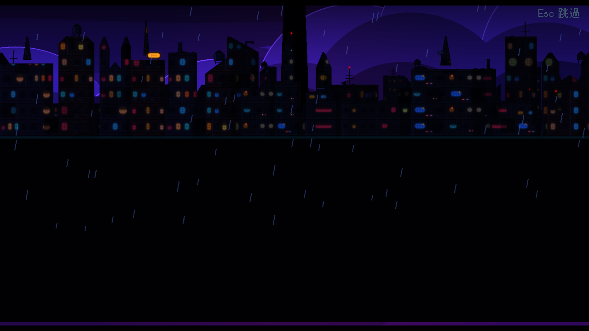
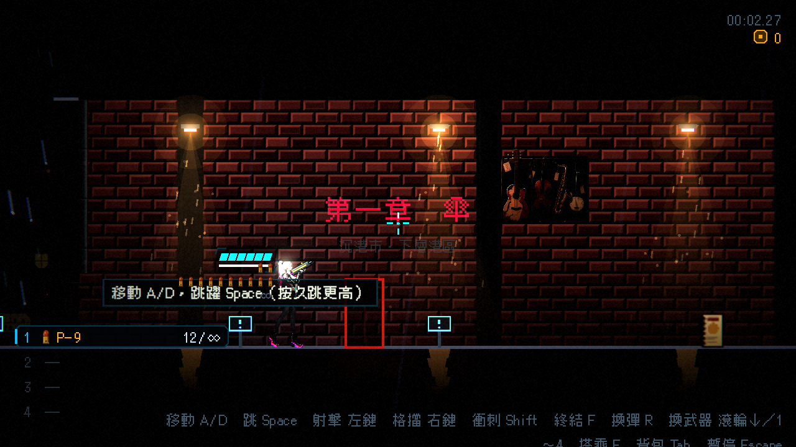

# [NE-202] 鎖定過場操作並立即恢復遊戲

> 狀態：完成

## 內文

### 需求
所有過場演出期間都不能操作角色或觸發射擊音效。演出結束後立即恢復操作，不需要額外按 Esc；新增演出也能沿用相同的操作鎖定規則。

### 來源
2026-10-06，使用者回報開場動畫中點擊左鍵會聽到開槍聲，動畫結束看到主角後仍無法操作，必須按 Esc 才恢復。

### 驗收條件
- [x] 過場、對話、畫面轉場及阻擋式章節卡期間不能移動、射擊、換武器、換彈或開啟遊戲選單
- [x] 過場期間點擊左鍵不消耗彈藥，也不播放射擊音效
- [x] 演出正常結束、跳過或被移除後立即恢復操作，不需要按 Esc
- [x] 重疊演出必須全部結束才恢復操作，且不受結束順序影響
- [x] 演出前已暫停的遊戲仍保持暫停，切換畫面後的游標符合目的畫面
- [x] 演出期間的按鍵不會在結束時變成意外射擊、跳躍或衝刺

### 測試流程
1. 開始新遊戲，在開場動畫中點擊左鍵、按住移動、換彈及選單按鍵，確認角色、彈藥與射擊音效均不受影響。
2. 等待動畫結束或跳過，直接移動與射擊，確認不需要按 Esc。
3. 交錯結束重疊演出，並在演出中移除演出畫面，確認不留下操作限制。
4. 在已暫停的狀態播放演出，確認結束後仍暫停；進入關卡及返回選單時確認游標狀態正確。

---

# 跟其他票的關係

- Blocks：無
- Blocked by：無
- Related：無

---

# Commit-1

## 內文

原本過場與畫面轉場重疊時會留下暫停狀態，且角色仍能收到射擊輸入。現在所有阻擋操作的演出共用同一套規則，最後一段演出結束才恢復遊戲，跳過或移除畫面也能完成清理。

已在實際遊戲畫面確認開場期間點擊無射擊聲、無彈藥消耗，跳過後直接移動成功。回歸測試也確認正常結束、重疊演出、輸入殘留及原先暫停狀態；近戰驗證明確指定瞄準方向，避免受其他測試影響。

### 測試結果

| 項目 | 結果 |
|---|---|
| Godot 4.7 完整平行測試 | 42,949 項檢查；修正測試方向後重跑原失敗組合，其餘組合通過 |
| 原失敗組合回歸 | 1,921 / 1,921 通過 |
| 非預期腳本錯誤 | 0 |
| 實際遊戲畫面 | 過場點擊無射擊，結束後不按 Esc 即可移動 |

### 截圖

