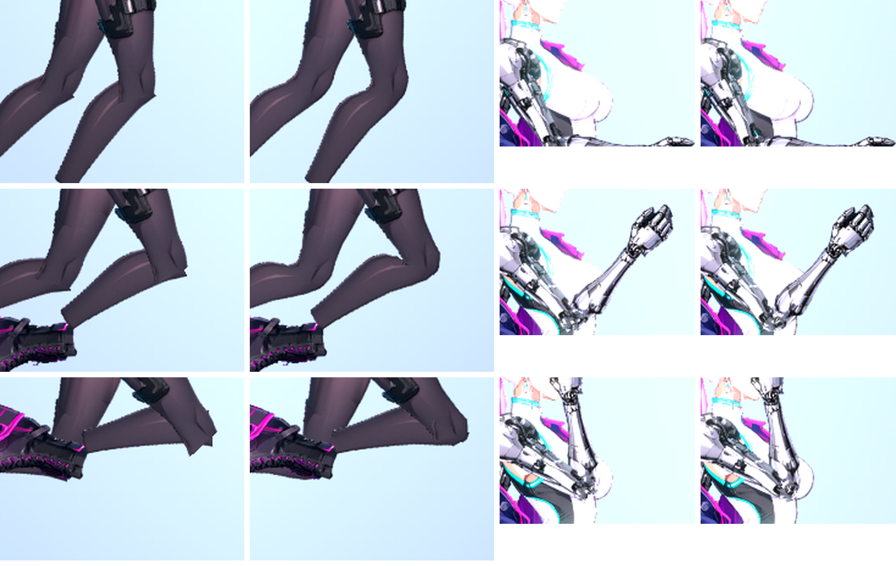
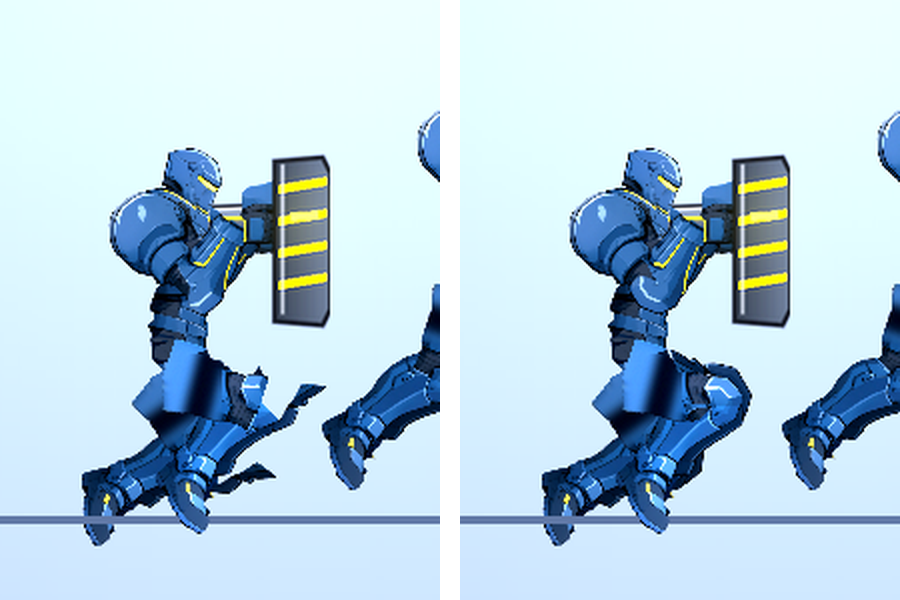

# [NE-204] 讓角色關節大幅彎曲時不破圖

> 狀態：完成（膝與肘；腕、踝、髖、肩改開 NE-220）

## 內文

### 需求
角色的腿、手臂在大角度彎曲時，關節處出現直線切口、缺角、重疊與反光不連續，立繪的精緻感在動起來之後消失。依 NE-203 選定的做法，讓凜的肢體在所有動作與姿勢（含過場倍率的特寫）都平順彎曲，保留原立繪的線條與配色；完成後延伸到全部人形的玩家、敵人與 NPC，並讓新角色走流程時自動得到同樣的效果。

### 來源
2026-10-05，使用者試玩第一章後回報（當舖過場截圖）：「女主在這個過場的動作還是很奇怪，為什麼套上骨架之後主角的各個部位的圖看起來都是破圖？那我當初繪製那麼好看的立繪就被浪費了，可以開票幫我處理到好嗎？看有什麼做法可以讓我套上骨架之後主角動起來的整體畫面還是好看且漂亮，然後所有 NPC 動起來不要那麼像機器人」。分析與做法見 `design/12-cast-redraw/RIG_QUALITY.md`。

### 驗收條件
- [x] 凜的膝、肘在其動作資料用到的最大彎曲角度下，過場倍率特寫看不到切口、缺角、色塊或反光斷層（腕、踝、髖、肩改開 NE-220）
- [x] 凜的所有既有動作（待機、走、跑、跳、落下、蹲、衝刺、格擋、受擊、死亡、持各種武器瞄準）逐一檢查通過，衣物脫落與破損底層、夾克下擺與頭髮的彈簧動態、發光層與法線打光都沒有退步
- [x] 全部人形角色（玩家、敵人、NPC）套用同一做法，逐一以預覽檢查彎曲最大的姿勢
- [x] 角色製作流程自動產生需要的資料，新角色不需要手工調整；流程文件更新
- [x] 自動檢查：對每個角色在關節極限角度下量測縫隙與穿插，超過標準就列出角色、關節、角度
- [x] 同屏十個人形的影格時間與貼圖記憶體不超過 NE-203 定出的預算
- [x] 修前修後的並排截圖存檔

- [x] 本票統整出的規則、數值、檢查方法與踩過的坑，寫進 skill `rig-animation`（`.claude/skills/rig-animation/`），資料來源與出處附在 skill 的參考資料裡；之後做骨架與動畫都必須先讀這份 skill

### 測試流程
1. 開預覽工具，載入凜，播放全部動作，用過場倍率看膝與肘
2. 逐一載入敵人與 NPC，播放蹲、坐、跪與攻擊動作
3. 進第一章當舖過場與第一個戰鬥區域，確認畫面
4. 執行自動檢查，確認沒有超標的關節

---

# 跟其他票的關係

- Blocks：NE-205
- Blocked by：NE-203
- Related：NE-220、NE-90、NE-152、NE-72、NE-98

---

---

# Commit-1

## 內文

膝與肘改用關節網格：上下段零件靠近關節的頂點依距離在兩根骨頭之間混合，彎起來是連續的圓弧，不再是兩塊剛體的直線切口與缺角。全部二十個人形角色（主角、敵人、NPC）自動套用，新角色不需要額外資料（骨頭命名成對就會被偵測）；外觀定義 `limb_bend: false` 可退回剛體。選擇網格變形（做法 A）的理由與畫面標準記錄在 `design/12-cast-redraw/RIG_QUALITY.md` 第 6 節。

**預算與實測**：同屏十個人形每格腳本成本多約 0.36 ms（每隻約 36 µs），網格頂點每隻約 220、沒有新增貼圖；骨頭沒動不重算、看不到的零件（脫落的裝甲、損傷底層）不算。
**稽核**：`AnimAudit` 新增 `mesh_fold`（折疊三角形比例 ≤ 0.4）與 `limb_pinch`（關節縮腰 ≤ 0.75），對所有角色的所有動作逐格量；`RigMeshSuite` 測合成骨頭（靜止不變形、遠端不動、接縫重合、骨頭沒動不重算）與全部角色在關節極限下的網格。

### 測試結果

| 項目 | 結果 |
|---|---|
| `RigMeshSuite`（新）、`AnimAuditSuite` | 通過 |
| 完整平行測試（44775 項） | 通過，新失敗 0 |

### 截圖

