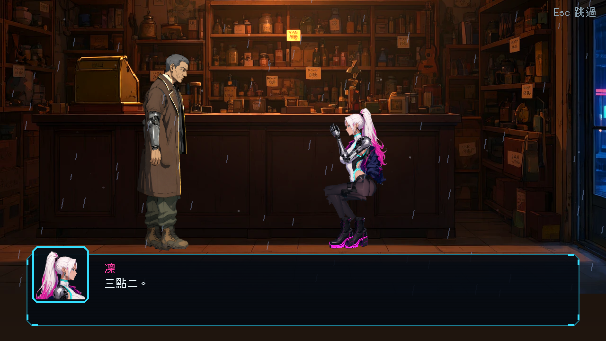
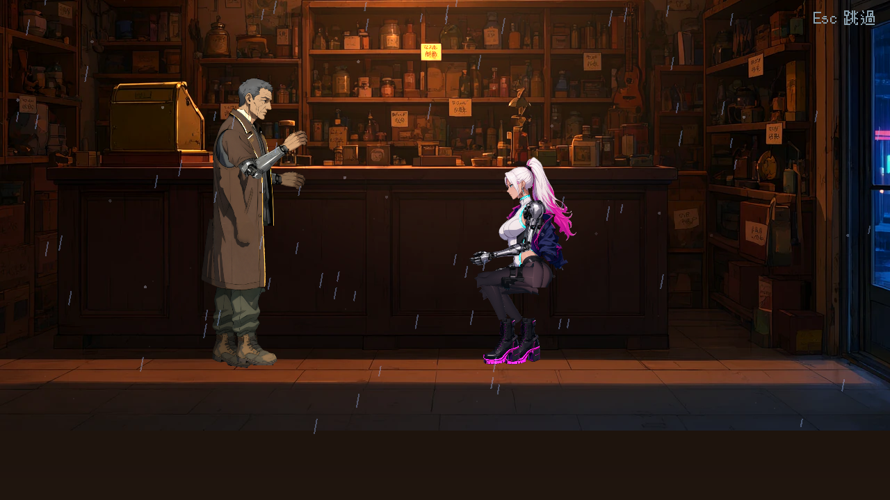
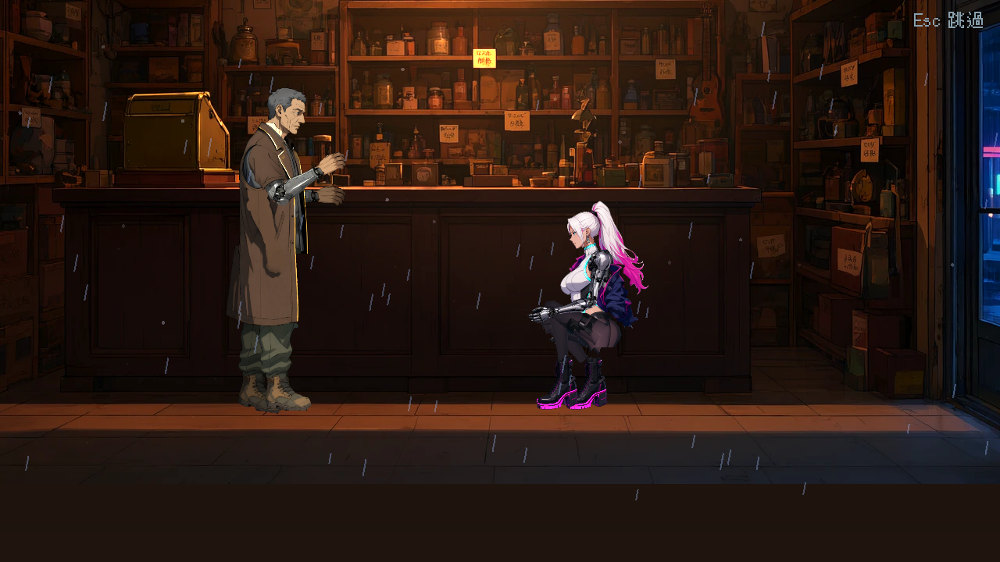
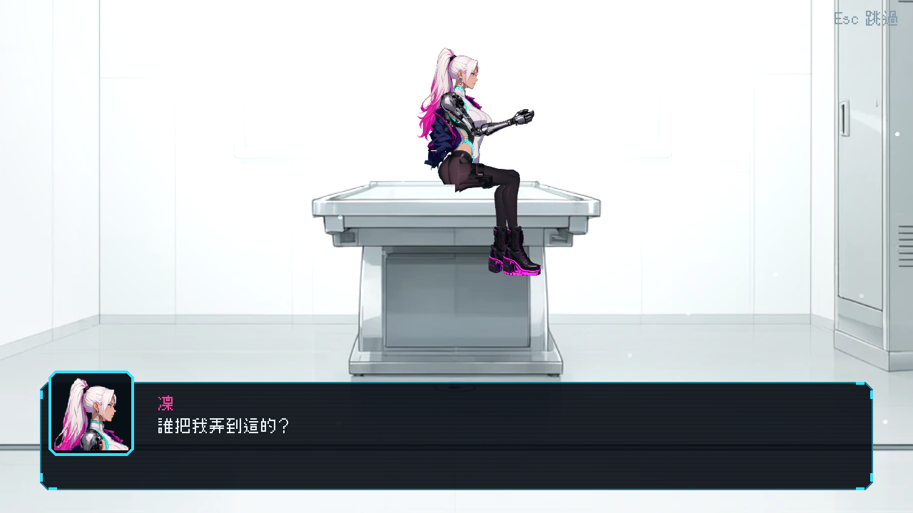
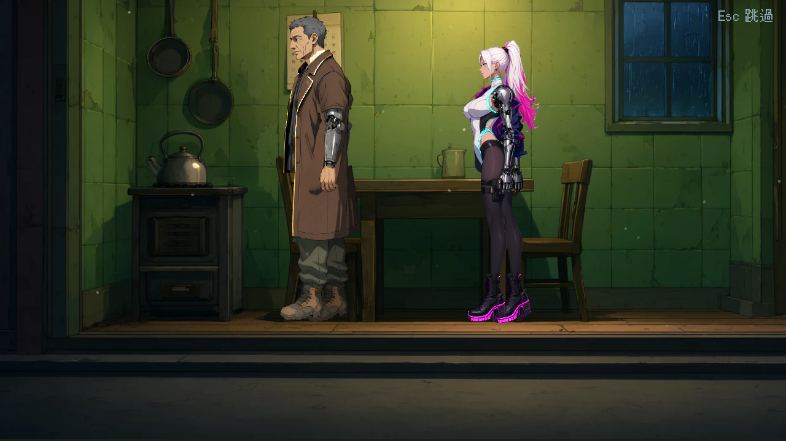

# [NE-205] 重做凜在過場裡的坐蹲跪靠姿勢

> 狀態：完成

## 內文

### 需求
第一章當舖過場裡凜「蹲在櫃台前」的姿勢沒有任何支撐：臀部懸空、雙腳不踩地，身體角度和櫃台沒有關係，看起來像在半空中半跳。需要為凜設計一組自然的過場姿勢（站、靠、坐、蹲、跪、遞東西、拿起東西），姿勢依凜自己的比例（腿長、厚底靴）與場景的地面、椅子、櫃台高度校正，讓重心落在支撐點上；並讓過場的檢查能提早發現懸空與穿模。

### 來源
2026-10-05，使用者試玩第一章後回報（當舖過場截圖）：「女主在這個過場的動作還是很奇怪，為什麼套上骨架之後主角的各個部位的圖看起來都是破圖？那我當初繪製那麼好看的立繪就被浪費了，可以開票幫我處理到好嗎？看有什麼做法可以讓我套上骨架之後主角動起來的整體畫面還是好看且漂亮，然後所有 NPC 動起來不要那麼像機器人」。分析與做法見 `design/12-cast-redraw/RIG_QUALITY.md`。

### 驗收條件
- [x] 凜有坐（椅子、箱子）、蹲、單膝跪、靠牆、靠櫃台、站著遞東西的姿勢，各自重心穩定、雙腳踩在地面或支撐物上
- [x] 第一章所有過場裡凜的姿勢逐一檢查：臀部、雙腳與地面或椅面的距離在容許範圍內，不懸空、不穿進家具
- [x] 當舖過場（`ch1_c01_shop`）的凜與老 K 位置、視線與手勢自然，畫面截圖附在票上
- [x] 姿勢切換（站 → 蹲、站 → 坐）有過渡，沒有瞬間跳動
- [x] 過場檢查加入「角色離地面高度」與「與家具的相對位置」的檢查，違反時指出場景與角色
- [x] 每個過場姿勢在過場倍率下的特寫沒有破圖（依 NE-203 的畫面標準）

- [x] 本票統整出的規則、數值、檢查方法與踩過的坑，寫進 skill `rig-animation`（`.claude/skills/rig-animation/`），資料來源與出處附在 skill 的參考資料裡；之後做骨架與動畫都必須先讀這份 skill
- [x] 本票涉及過場演員站坐位置的規則、尺寸比例、位置與檢查方法，寫進 skill `scene-staging`（`.claude/skills/scene-staging/`：關卡與過場的佈景、位置、比例、構圖、圖層），參考多個不同業界實例並附出處；之後做關卡、佈景與過場都必須先讀這份 skill

### 測試流程
1. 播放第一章每一個有凜出場的過場
2. 在姿勢切換的前後暫停，量腳與地面的距離
3. 對照截圖確認坐、蹲、靠的重心
4. 執行過場檢查

---

# 跟其他票的關係

- Blocks：無
- Blocked by：NE-203、NE-204
- Related：ST-9、NE-83、NE-38

---

# Commit-1

## 內文

已完成：NPC 動畫器的坐與蹲改用 IK 把腳平放在地上（骨盆下沉量用腿長的比例，不同身高共用資料），所有骨架（含凜與敵人）的坐、蹲姿勢腳底離地誤差 ≤ 0.8 像素、腳掌放平（自動測試逐骨架檢查）；當舖過場的凜蹲姿不再懸空。
尚待：單膝跪、靠牆、靠櫃台、站著遞東西等姿勢，姿勢切換的過渡，過場檢查中演員與家具的位置檢查。

### 測試結果

| 項目 | 結果 |
|---|---|
| 骨架姿勢（NPC 動畫）套件 | 通過，新失敗 0（每個骨架的坐、蹲各檢查腳底與腳掌） |

### 截圖

---

# Commit-2

## 內文

收尾：檢查第一章三場過場（開場、診間、章末）裡凜的每個姿勢並修正。
- 蹲姿原本是髖比膝高的「空氣椅子」，改成真正的蹲（臀部落在腳跟附近、膝蓋往前、上身前傾）：`crouch` 的腳踩實地參數 `sag` 0.55 → 0.75、前腳 x 0.5 → 0.6。姿勢報告：全部骨架的蹲、坐腳離地 0.00 px、腳掌角度 0。
- 診間：凜坐在檢查台邊緣、小腿垂下，腳底沒有穿進台面；開場的凜蹲在櫃台前、老 K 的視線與手勢對著她；截圖見下。
- 章末（`ch1_c14_home`）的鏡頭放大 1.9 倍時被「腳底要在對話框上方」規則夾住，畫面只剩腿與靴子、看不到臉，改成 1.05 倍、鏡頭置中兩人；規則與數字寫進 skill `scene-staging`。
- 姿勢切換的位置落回由 NE-214 處理；過場舞台的腳底檢查由 NE-210 的 `SceneAudit.audit_stages` 提供（演員腳底離地板線 ≤ 14 px，坐蹲跪倒除外）。
- 特寫無破圖：關節網格見 NE-204，截圖在過場倍率（3.4–3.8 倍）下看不到切口。

### 測試結果

| 項目 | 結果 |
|---|---|
| 受影響範圍的測試（42771 項） | 通過，新失敗 0 |

### 截圖

| 修正前：蹲得像坐在空氣上 | 修正後：真正的蹲 |
|---|---|
|  |  |

