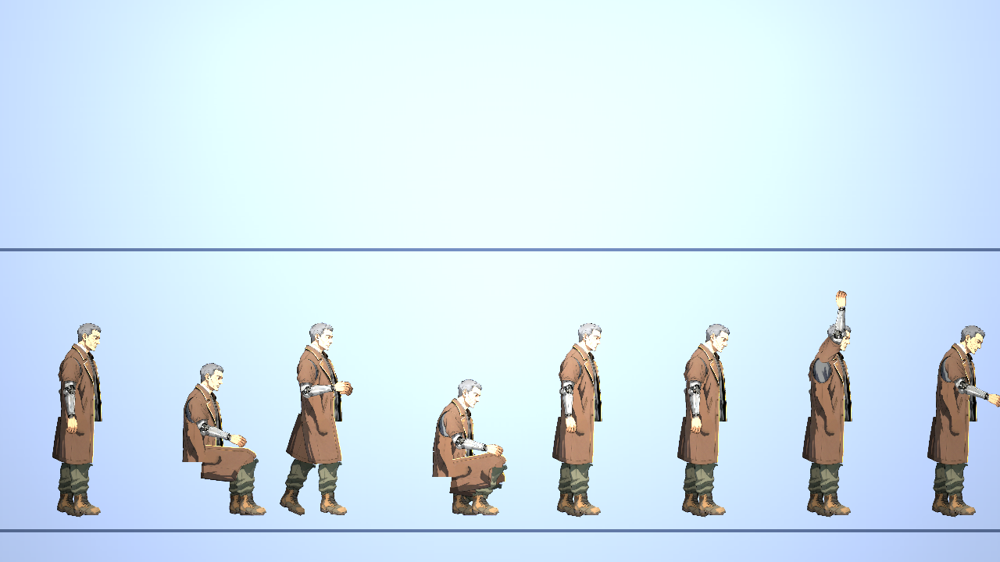

# [NE-206] 讓 NPC 與過場演員的動作不像機器人

> 狀態：完成（眨眼與衣物次級動態需要美術，見 NE-221；「像人在待著」待使用者過目）

## 內文

### 需求
NPC 與過場演員現在的動作是固定姿勢加固定週期的正弦擺動，各骨頭節奏同步、沒有重心轉移與呼吸、沒有預備與收尾、沒有視線與眨眼，說話的手勢是固定循環，看起來像機械式重複。需要讓 NPC 待著、聽、說、做事的時候像一個有重量、有個性的人，而且節奏與幅度是每個角色自己的資料。

### 來源
2026-10-05，使用者試玩第一章後回報（當舖過場截圖）：「女主在這個過場的動作還是很奇怪，為什麼套上骨架之後主角的各個部位的圖看起來都是破圖？那我當初繪製那麼好看的立繪就被浪費了，可以開票幫我處理到好嗎？看有什麼做法可以讓我套上骨架之後主角動起來的整體畫面還是好看且漂亮，然後所有 NPC 動起來不要那麼像機器人」。分析與做法見 `design/12-cast-redraw/RIG_QUALITY.md`。

### 驗收條件
- [x] 待機：呼吸牽動胸與肩（速率變化、偶爾嘆氣），重心偶爾從一腳移到另一腳，頭微微轉動、轉頭看一下，各骨頭週期不同且帶些微隨機（眨眼需要眼睛分層，見 NE-221）
- [x] 說話：手勢與點頭依台詞的重音與句尾出現，不是固定循環；說話前有預備、說完有收尾；聽的人視線看向說話的人
- [x] 動作有預備、過衝與跟隨（頭先動、身體跟上；手停下時前臂略有餘勢），不是等速線性或純正弦
- [x] 老 K、麵攤阿婆、維修員老陳、護理師、夜班工人、居民等現有 NPC 各自有不同的站姿、節奏與小動作（資料驅動，每個角色自己的檔）
- [ ] 大衣、圍裙等衣物有次級動態，動作時跟著擺動（NPC 骨架沒有衣襬骨頭與零件，需要美術，NE-221）
- [x] 資料有錯時（骨頭或循環不存在）照舊記錄具體位置並退回待機
- [x] 現有 NPC 動畫與過場的測試全過；新增的動作有測試鎖定（週期不重複、視線與眨眼會觸發）
- [ ] 使用者看過過場與場景中的 NPC 後認為「像人在待著」

- [x] 本票統整出的規則、數值、檢查方法與踩過的坑，寫進 skill `rig-animation`（`.claude/skills/rig-animation/`），資料來源與出處附在 skill 的參考資料裡；之後做骨架與動畫都必須先讀這份 skill

### 測試流程
1. 在場景中站在 NPC 旁錄 30 秒，觀察待機
2. 播放當舖過場，看老 K 說話與聽凜說話
3. 逐一載入所有 NPC，預覽待機、說話、聆聽與工作循環
4. 執行動畫檢查與測試

---

# 跟其他票的關係

- Blocks：無
- Blocked by：無
- Related：NE-221、NE-83、NE-90、NE-204、ST-9

---

---

# Commit-1

## 內文

NPC 待機與說話加上「生命感層」（`NpcLife`），全部資料驅動：
- 待機：各骨頭緩慢飄動（週期由角色與骨頭決定、不同步、不重複）、呼吸速率變化與偶爾較深的嘆氣、站著每隔幾秒換腳站（骨盆側移、腿反向轉讓腳不滑）、偶爾轉頭看一下。
- 說話：開口前吸一口氣、依重音隨機出現手勢與點頭、說完放鬆；聆聽者維持原本偏頭。
- 動作餘勢：頭、胸、前臂用欠阻尼彈簧追目標，停下時有一點過衝。
- 每個角色自己的節奏：老 K 慢而重（換腳間隔長、嘆氣深）、護理師警覺（常轉頭）、夜班工人疲倦（常嘆氣、少轉頭）、居民與渡好動，各自寫在 `art/motion/<角色>.json` 的 `npc.life`。
- 順手修好一個資料載入錯誤：各角色 `npc.stand` 的站姿微調以前因為合併邏輯（預設是空字典就逐鍵蓋過）從來沒有套用，現在只在站著時套用。
- 錯誤處理：life 資料缺漏或型別錯誤時退回預設值不報錯（測試用壞資料驗證）。

**實測**（`NpcLifeSuite`）：兩分鐘站著包含 6 次以上換腳、8 次以上轉頭、3 次以上嘆氣；八位 NPC 待機 40 秒，頭、胸、上下臂的角度兩兩相關係數都低於 0.97（沒有兩根骨頭的動作一樣）；換腳時站穩的腳滑動 ≤ 0.05 px，腳離地與陷地 ≤ 0.5 px；說話時手臂動作明顯大於待機；同一角色重現、不同角色不同步。

### 測試結果

| 項目 | 結果 |
|---|---|
| `NpcLifeSuite`（新）、`NpcAnimationSuite`、`AnimAuditSuite` | 通過 |
| 受影響範圍的測試（45047 項） | 通過，新失敗 0 |

### 截圖

