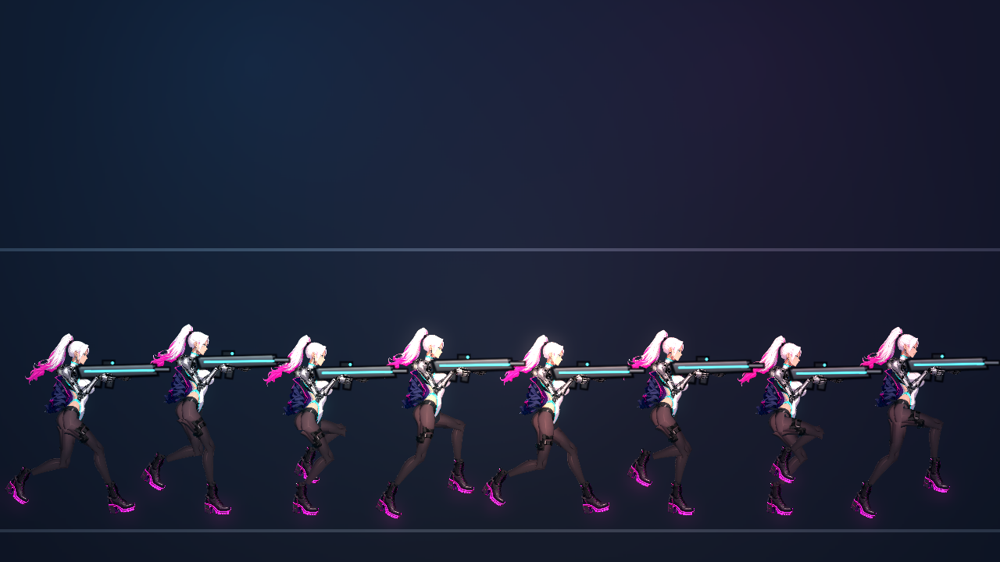
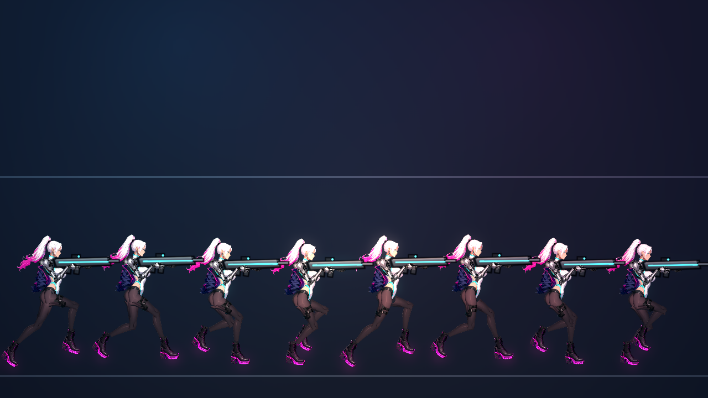
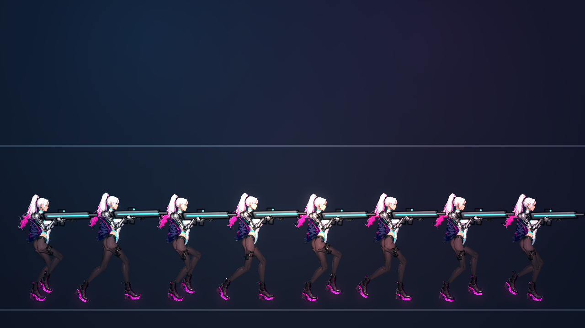

# [NE-208] 重新調整主角的移動動作並整理骨架動畫參考

> 狀態：完成

## 內文

### 需求
主角移動時身體一直上下抖，看起來不自然。原因是步伐太快、骨盆起伏幅度遠大於真人（目前約七像素，相當於站立身高的八分之一）。需要參考業界與生物力學的做法重新調整走、跑的步頻、步長、身體起伏、腳的落點與起跑煞車，讓移動平順、有重量感；並把查到的資料與可量測的檢查標準整理成文件與 skill，之後做任何骨架動作都要先參考。

### 來源
2026-10-06，使用者試玩第一章後回報：「走路的時候主角也會一直上下抖，可以幫我重新調整主角的移動動作嗎？請參考一下業界最佳實例們是怎麼樣讓骨架動起來會比較合理，可以把資料整理起來，然後做成 skill，之後做骨架都要參考」。

### 驗收條件
- [x] 整理業界與生物力學的移動動作資料（走跑循環、起伏幅度、步頻、落腳、頭穩定、次級動態、待機），標明出處與哪些是我們的建議值，放進設計文件
- [x] 做成 skill：之後新增或調整骨架動作時照著查規則、跑稽核、對照檢查清單
- [x] 提供可重複執行的量測工具：以固定速度移動，量出骨盆上下起伏幅度、主頻率、高頻比例、加速度峰值、單格變化、腳滑步
- [x] 主角各速度的移動通過量測門檻：起伏幅度在建議範圍內、沒有高頻抖動、踩地的腳不滑
- [x] 步頻隨速度連續變化，慢走與全速跑的步長、起伏、膝蓋彎曲都是平滑過渡，沒有速度門檻造成的跳變
- [x] 腳步聲仍對齊腳著地的瞬間；跳躍、落地、衝刺、蹲、瞄準時的姿勢沒有退步
- [x] 自動測試鎖定量測門檻，之後調動作資料超標會失敗

- [x] 本票統整出的規則、數值、檢查方法與踩過的坑，寫進 skill `rig-animation`（`.claude/skills/rig-animation/`），資料來源與出處附在 skill 的參考資料裡；之後做骨架與動畫都必須先讀這份 skill

### 測試流程
1. 執行移動量測工具，看各速度的數字
2. 進遊戲左右移動、起跑、煞車、轉身，觀察身體高度平順、腳不滑
3. 聽腳步聲與腳著地同步

---

# 跟其他票的關係

- Blocks：無
- Blocked by：無
- Related：NE-209、NE-192、NE-195

---

# Commit-1

## 內文

主角移動時身體一直上下抖：步伐週期太短（每秒 5.4 步）、骨盆起伏約 7 像素（站立高度的四分之一），腳的位置還會每格重算身體高度。
現在改成「等高跑法」：身體高度固定在腿剛好夠得到最大步幅的高度（膝蓋彎曲吸收），只留資料指定的小幅起伏；步長隨速度縮放，步頻從每秒 5.4 步降到 3.75 步；踩地的腳完全鎖定在世界座標。量測：滿速跑骨盆起伏 0.058 L（原本約 0.25 L）、單一頻率 3.75 Hz、垂直加速度是純正弦的 1.0 倍、踩地腳滑動 0。
新增量測工具（`tools/rig_locomotion_report.tscn`）與自動測試門檻（`LocomotionSuite`），整理業界與生物力學的參考資料（`LOCOMOTION_REFERENCE.md`、`SKELETON_REFERENCE.md`）並寫成 skill `rig-animation`。其他角色（敵人）的移動動作尚未調整，量測數字見工具輸出（起伏 0.03–0.16 L），已在 NE-209 的範圍內。

### 測試結果

| 項目 | 結果 |
|---|---|
| 受影響的測試套件（13 個） | 4,399 項通過，新失敗 0 |
| 完整測試套件（先跑一次） | 43,624 項，4 項新失敗都是舊測試的期望值（步頻、彈帶位置），已更新並重跑通過 |
| 執行 log | 無 SCRIPT ERROR（字型警告為既有的環境雜訊） |

### 截圖

