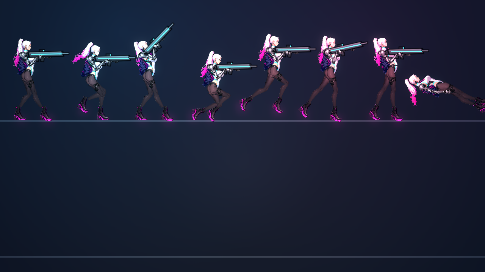
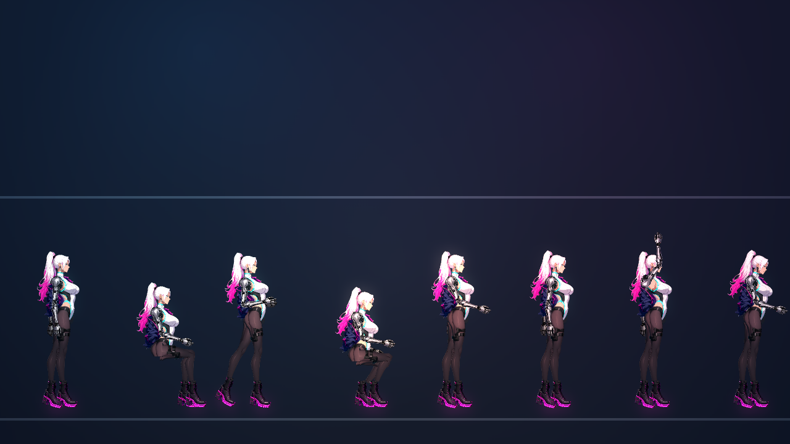

# [NE-209] 檢查主角骨架與動畫的整體品質

> 狀態：完成（腕、踝、髖、肩另見 NE-220；NPC 活起來另見 NE-206）

## 內文

### 需求
主角的骨架與動畫還有多處看起來不對，需要整體檢查並列出問題清單再逐項修。已知的現象：(1) 過場裡主角走路是大跨步前衝、雙腿拉很開的姿勢，看起來滑稽，不像走路；(2) 蹲姿臀部懸空；(3) 關節彎曲處有切口與缺角；(4) 走路時身體上下抖；(5) 零件分割與骨架對應仍可能有其他錯位。需要逐一檢查主角在遊戲內與過場的所有動作（站、走、跑、跳、落下、蹲、衝刺、格擋、受擊、死亡、持各種武器瞄準、坐、靠、說話、揮手），找出所有不自然的地方並建立修正清單。

### 來源
2026-10-06，使用者試玩第一章後回報（附走路過場截圖）：「這個走路動畫也太滑稽了吧，幫我開一張檢查主角骨架跟動畫的票」。

### 驗收條件
- [x] 主角所有動作（遊戲內與過場）逐一播放並截圖，每個不自然的地方記錄成問題清單（現象、動作名稱、截圖）
- [x] 每個問題分清楚原因：骨架關節與骨長、零件切割、動作資料、動畫器演算法，或圖層順序
- [x] 過場的走路與跑步動作改成自然的步幅與姿勢，不再是大跨步前衝
- [x] 問題清單裡每一項都有對應的修正（已修或已開票），修前修後截圖並排留存
- [x] 檢查標準寫進動畫稽核與測試，之後新角色與新動作自動套用

- [x] 本票統整出的規則、數值、檢查方法與踩過的坑，寫進 skill `rig-animation`（`.claude/skills/rig-animation/`），資料來源與出處附在 skill 的參考資料裡；之後做骨架與動畫都必須先讀這份 skill

### 測試流程
1. 用預覽工具與過場逐一播放主角所有動作並截圖
2. 對照問題清單逐項確認修正後的畫面
3. 執行動畫稽核與移動量測

---

# 跟其他票的關係

- Blocks：無
- Blocked by：無
- Related：NE-203、NE-204、NE-205、NE-208

---

---

# Commit-1

## 內文

逐一播放主角的站、走、跑、跳、落下、蹲、衝刺、格擋、受擊、死亡、各角度瞄準，以及 NPC 姿勢（站、坐、靠、蹲、說話、聆聽、揮手），並對全部人形角色跑動畫稽核與移動量測。問題清單：

| # | 現象 | 原因類別 | 處置 |
|---|---|---|---|
| 1 | 過場走路大跨步前衝、雙腿拉很開 | 動作資料（步幅不隨速度縮放） | NE-208：步長隨速度縮放、步頻固定；70 px/s 的過場走路截圖已在 NE-208 |
| 2 | 蹲姿臀部懸空 | 動作資料（姿勢沒有踩地） | NE-205：姿勢資料的 `feet` 讓腳用 IK 平放在地面；姿勢報告：坐、蹲的腳懸空 0.00 px、腳掌角度 0（全部 22 個骨架） |
| 3 | 關節大角度彎曲有切口與缺角 | 零件切割＋動畫器（剛體零件） | NE-204：膝與肘改用關節網格；腕、踝、髖、肩開 NE-220 |
| 4 | 走路時身體上下抖 | 動作資料 | 主角 NE-208；**本票**把 sniper、stalker、reclaimer、grenadier、trooper_elite 五隻敵人改成等高跑法，骨盆起伏由 0.10–0.16 L 降到 0.02 L 左右、腳滑不超過 0.03 L |
| 5 | 零件與骨架對應錯位 | 零件切割 | 動畫稽核（骨長、關節範圍、腳底離地、握槍、角度跳動、倒下後躺姿）對 12 個戰鬥角色與 14 組 NPC 全部在門檻內；未發現新的錯位。預覽的「死亡」列看起來飄在地線上方是預覽的排版（量測的躺姿最高點是站高的 0.31 倍，門檻 0.5） |
| 6 | NPC 動作像機器人 | 動畫器 | 不在本票範圍，NE-206 |

**檢查標準進了測試**：`LocomotionSuite` 新增對全部腳踩實地角色的起伏與腳滑檢查；`AnimAudit` 新增 `mesh_fold`、`limb_pinch`（NE-204）；skill `rig-animation` 補上「所有 grounding 角色都要啟用等高跑法」。

### 測試結果

| 項目 | 結果 |
|---|---|
| `LocomotionSuite`、`AnimAuditSuite`、`RigMeshSuite` | 通過 |
| 受影響範圍的測試（42580 項） | 通過，新失敗 0 |

### 截圖

