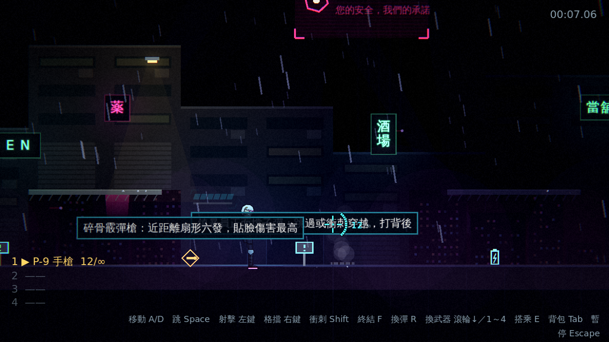
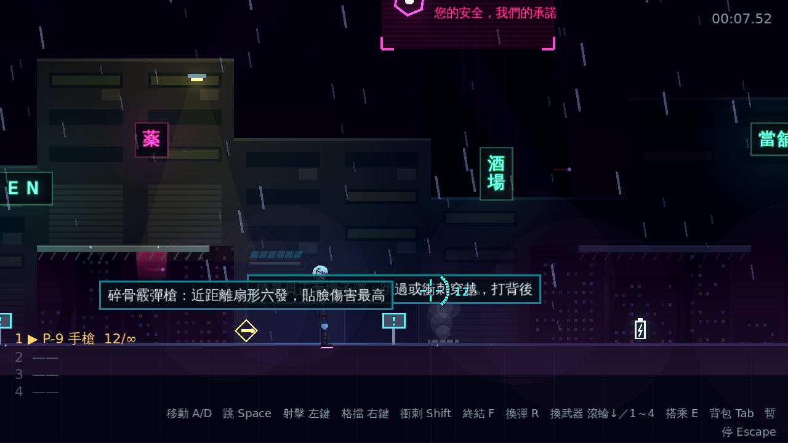
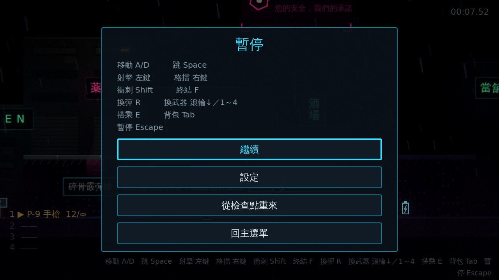
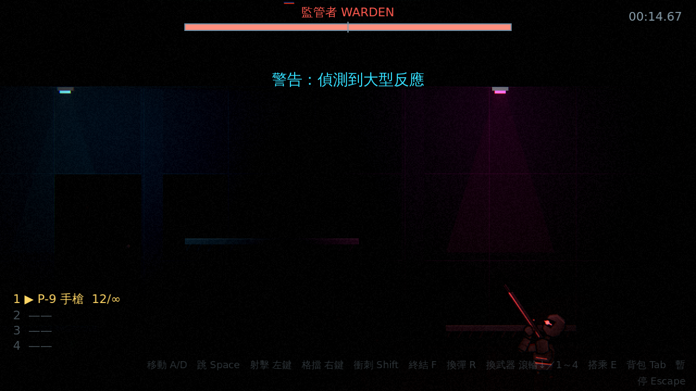

# [NE-20] 加入後製調色與暗角顆粒

> 狀態：完成

## 內文

### 需求
畫面太乾淨、數位感重，缺少「沉」的質感，而且霓虹以外的環境容易霧濛濛。加入統一的後製：調色、暗角、顆粒與極輕微的邊緣色差，並讓泛光只作用在真正的發光體上。設計見 `design/08-lighting/DESIGN.md` 的「架構」第 6 節。

### 來源
2026-10-02，使用者於開發對話中提出：「整個遊戲可以有完整的光影設計，請參考業界最佳實例」「整體的渲染跟場景應該要陰沉一點，遊戲希望整體沉重一點」；確認壓抑程度為重度壓抑、先做光影再做內容。

### 驗收條件
- [x] 畫面有統一的調色：去飽和、提高對比、陰影偏冷、亮部偏暖，數值由各區段的光影設定決定
- [x] 畫面邊緣有暗角，強度依區段而異
- [x] 有細微的底片顆粒，不影響瞄準與辨識敵人
- [x] 畫面邊緣有極輕微的色差，畫面中央保持清晰
- [x] 只有霓虹、子彈、爆炸等發光體會泛光，環境不會霧濛濛
- [x] 介面（HUD、暫停、背包、選單）不受暗角、顆粒與色差影響，維持清晰
- [x] Compatibility 渲染器下後製照常運作（泛光除外）

### 測試流程
1. 開始第一關，確認畫面有調色、暗角與顆粒，且 HUD 與準星依然清晰
2. 開啟暫停選單與背包，確認介面不受暗角與顆粒影響
3. 切換不同區段，確認調色與暗角隨區段變化
4. 執行完整測試套件，全部通過

---

# 跟其他票的關係

- Blocks：NE-19、NE-24、NE-25
- Blocked by：NE-18
- Related：無

---

# Commit-1

## 內文

畫面太乾淨、數位感重，缺少「沉」的質感。
現在整個畫面經過統一的後製：去飽和、提高對比、陰影偏冷、亮部偏暖，邊緣有暗角、細微的底片顆粒（暗部較明顯、子彈與霓虹保持乾淨）與極輕微的邊緣色差，畫面中央保持清晰；各項強度都由區段的光影設定決定，越往深處調色越重、暗角越深，頭目機庫最重。泛光門檻依區段提高，只有霓虹、子彈、爆炸等發光體會暈開。後製畫在場景之上、介面之下，HUD、暫停、背包與選單維持清晰；Compatibility 渲染器下後製照常運作（泛光除外）。順手修正暫停選單：操作提示因為多了背包按鍵撐滿畫面，改成兩欄排列。
驗收方式：冒煙測試驗證後製啟用、調色／暗角／顆粒／色差與陰影色調跟著區段、圖層順序（後製低於 HUD、暫停與背包）、shader 讀取畫面並提供參數、異常數值被回報、調色數值在區段間插值；自動截圖對照開關後製的同一畫面與暫停選單。

### 測試結果

| 項目 | 結果 |
|---|---|
| 完整測試套件 | 通過 652 / 652 |
| 資料驗證 | 0 錯誤 |
| 執行 log | 無非預期 ERROR |

### 截圖

