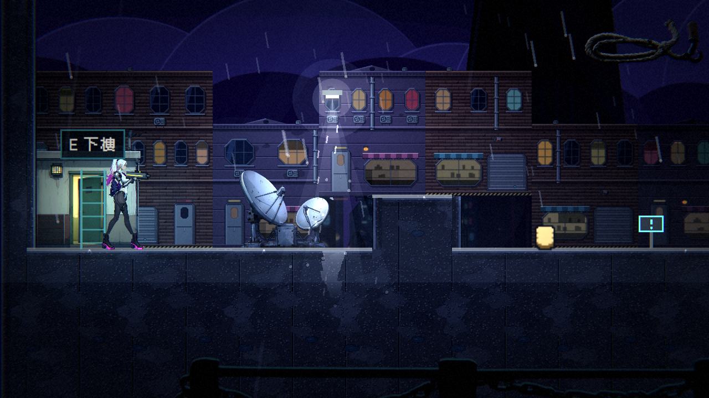
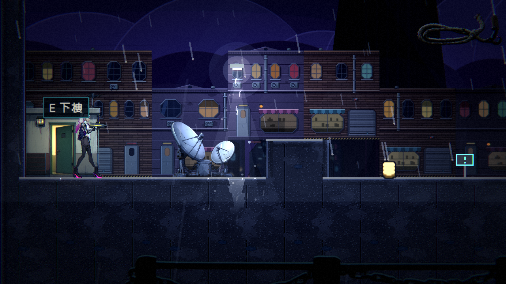

# [NE-210] 檢查所有場景裡的物件都合理

> 狀態：完成

## 內文

### 需求
場景裡出現不合理的東西，例如通往屋頂的梯子只有三格高，旁邊的空間卻有十格高。需要把所有關卡與過場舞台的每一樣東西逐項檢查一遍：尺寸與比例（梯子、門、樓梯、平台、家具相對角色的大小）、位置（懸空、陷進地面或牆、擋住路、跟背景對不上）、功能（看起來能爬的能爬、看起來是門的能進、出入口與提示位置合理）、可達性（所有該到得了的地方都到得了，沒有卡死）、圖層與前後關係、光影與可讀性。建立檢查清單與自動檢查，把找到的問題逐項修好或開成子票。

### 來源
2026-10-06，使用者試玩第一章後回報：「這個上樓頂的梯子也太短了，就像我說的，幫我開票檢查整個場景的所有東西都要合理」。

### 驗收條件
- [x] 列出檢查清單：尺寸比例、位置、功能、可達性、圖層、光影、提示與互動範圍
- [x] 逐一檢查第一章八個區域與第二章所有關卡，每個問題記錄（地點、物件、現象、截圖）
- [x] 自動檢查能抓到的盡量寫成測試：出入口與梯子的高度對應空間、物件不陷進地形、互動範圍與視覺一致、平台之間的跳躍距離可達
- [x] 每個問題都修好或開成子票（NE-219），修前修後截圖
- [x] 過場舞台同樣檢查家具與角色的比例、角色站坐的位置與地面、家具的接觸

- [x] 本票統整出的規則、尺寸比例、位置與檢查方法，寫進 skill `scene-staging`（`.claude/skills/scene-staging/`：關卡與過場的佈景、位置、比例、構圖、圖層），參考多個不同業界實例並附出處；之後做關卡、佈景與過場都必須先讀這份 skill

### 測試流程
1. 逐區域從頭走到尾，對照檢查清單
2. 執行自動檢查，確認沒有超標項目
3. 每個修正附修前修後截圖

---

# 跟其他票的關係

- Blocks：無
- Blocked by：無
- Related：NE-211、NE-219、ST-4、ST-6

---

---

# Commit-1

## 內文

建立通用的場景合理性檢查，對 `data/levels/` 底下全部十張關卡（第一章八個區域、level_01、level_02）與所有動畫過場自動執行，抓到的真實問題已修正。

**檢查清單與自動化**（規則表與代碼寫進 skill `scene-staging`）

| 類別 | 自動檢查 |
|---|---|
| 位置 | 敵人、人物、機關、出入口、可破壞物不陷進地形（尺寸取自各資料）、腳下有地、不站在尖刺上；擺設在地圖內、落在地表、陷進地形過多會警告 |
| 尺寸比例 | 梯子頂端離天花板不超過 1 格、門不矮於主角、露天梯子頂端要有可踏的平台、梯子兩端一樣高 |
| 功能與連結 | 出入口另一端存在；梯子可以接樓梯間的門 |
| 可達性 | 從起點走、跳（上 5 格、橫 7 格）、落下，到得了每個出入口、人物、商店、道具、檢查點（升降梯與水坑浮橋算平台） |
| 過場舞台 | 演員腳底貼著舞台地板線（坐、蹲、跪、倒除外）、同舞台同角色縮放一致 |

**找到的問題與處置**

| 地點 | 物件 | 現象 | 處置 |
|---|---|---|---|
| 屋頂（`ch1_rooftop`）第 3 欄 | 樓梯間出入口 `roof_stairs` | 樓梯間已經有一扇綠門，出入口又在門上疊了一條只有三格高的梯子，旁邊是露天（兩端梯子也不一樣高：當舖端 152、屋頂端 48） | 出入口新增 `hidden` 外觀（不畫東西，只留互動範圍與提示），屋頂端改用它；截圖見下 |
| `level_01` 第 199 欄 | 擬態箱 | 身體 34 像素寬，貼著右邊兩格高的箱牆，卡進牆裡 | 往左移兩格 |
| `level_01`、7 處 | 背景擺設（屋頂小屋、逃生梯、圍籬、吊纜、樹） | 與高牆或箱子重疊 11–48 像素；看過兩處截圖是景深（物件在牆後），不影響遊玩 | 保留為警告；其餘逐處確認開成 NE-219 |
| 第一章全部 | — | 產生器的地圖沒有其他問題（0 錯誤、0 警告） | 測試鎖住：第一章不允許任何警告 |

**工具**：`tools/scene_report.tscn` 印出每張地圖的問題；`--scenario=place:關卡id:欄[:標籤[:enemies]]` 把主角放在指定欄拍一張。

### 測試結果

| 項目 | 結果 |
|---|---|
| `SceneSanitySuite`（新，43 項：假地圖要抓得到、真資料不能有錯誤） | 通過 |
| 完整平行測試（44668 項） | 通過，新失敗 0 |

### 截圖

| 修正前：門上疊了一條梯子 | 修正後：只剩門與提示 |
|---|---|
|  |  |
