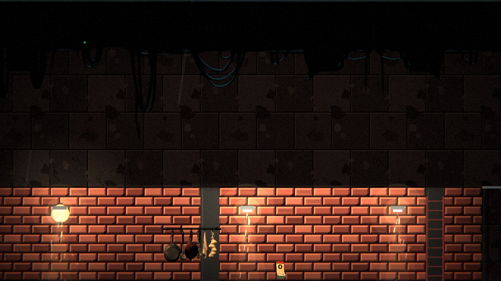

# [NE-211] 讓通往屋頂的梯子一路通到天花板

> 狀態：完成

## 內文

### 需求
當舖通往屋頂的梯子只有三格高（48 像素），但那個空間從地面到天花板有十格高，梯子看起來又短又突兀。梯子要從地面一路畫到天花板。

### 來源
2026-10-06，使用者試玩第一章後回報：「這個上樓頂的梯子也太短了，可以幫我修正一下嗎」。

### 驗收條件
- [x] 當舖通往屋頂的梯子從地面一路畫到天花板（含白天的當舖）
- [x] 提示文字仍在主角頭頂附近，互動範圍沒有因為變高而改變手感
- [x] 自動檢查：室內的梯子出入口高度不低於該處地面到天花板距離的八成

### 測試流程
1. 進當舖走到最右邊，看梯子是否到天花板
2. 在梯子旁按互動鍵可以上屋頂

---

# 跟其他票的關係

- Blocks：無
- Blocked by：無
- Related：NE-210、ST-5

---

# Commit-1

## 內文

當舖通往屋頂的梯子只有三格高，但那個空間有十格高。現在梯子（含天亮版）一路畫到天花板（152 像素），提示文字與互動範圍的位置不變。
自動檢查：室內的梯子出入口高度不低於地面到天花板距離的八成。

### 測試結果

| 項目 | 結果 |
|---|---|
| 第一章地圖套件 | 通過，新失敗 0 |

### 截圖

