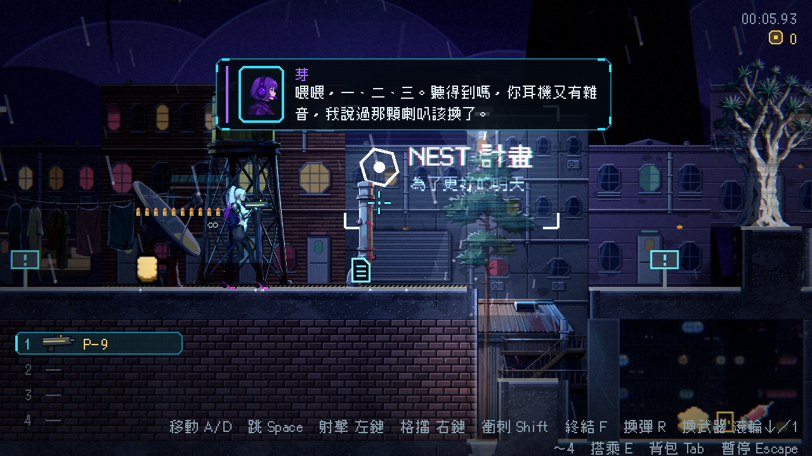
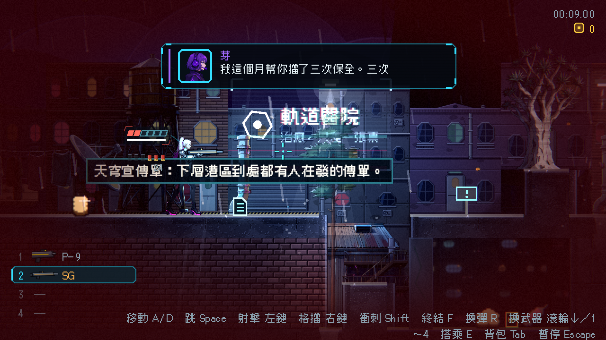

# [NE-212] 武器欄只顯示槍圖示，子彈改成常駐排在主角身旁

> 狀態：完成

## 內文

### 需求
目前左下角的武器欄顯示彈種圖示與「9/∞」這類子彈數量，子彈另外在主角身旁淡入淡出。要改成：左下角每一列只顯示槍的圖示與名稱，不顯示子彈數量；子彈一律常駐顯示在主角身邊，只排一排、固定十顆圖示（彈匣容量更大的槍，一顆圖示代表多發，長度一樣是十顆，圖示用該槍的子彈樣式），圖示可以比現在稍小。開槍時最靠近主角的那一顆彈出噴掉，其餘子彈用拖動的動畫往主角的方向補上空位；主角面向右時子彈排在身後（左側），射一發就往右補一格；面向左時相反。換彈時從遠端依序補回。

### 來源
2026-10-06，使用者試玩第一章後回報：「左下角不要顯示子彈數量，顯示槍的圖示就好了，子彈就常駐顯示在主角的身邊，顯示一排就好了……開了一槍子彈就噴掉然後往主角的方向補充」。

### 驗收條件
- [x] 武器欄每一列只有欄號、槍的圖示、名稱，不再顯示子彈數量；近戰武器照樣顯示
- [x] 武器欄的槍圖示是那把槍本身的外觀，不是子彈
- [x] 子彈常駐顯示在主角身邊（不再閒置淡出），只有一排、十顆圖示，彈匣大於十發的槍一顆代表多發
- [x] 子彈排在主角面向的相反側，面向改變時整排平順換邊
- [x] 開槍時最靠近主角的子彈彈出並淡出，其餘子彈用緩動動畫往主角方向補位；連續射擊時動畫不打結
- [x] 換彈時從遠端依序補回；空匣時提示換彈鍵；彈量低時變紅
- [x] 備彈量仍看得到（小字附在子彈排尾端），無限備彈用符號
- [x] 能量武器維持電池格，一樣常駐、一排
- [x] 提示一句講重點，和現有設定（HUD 自動淡出）相容：設定關閉淡出時行為不變，開啟淡出時其他 HUD 元件淡出但子彈排仍常駐

### 測試流程
1. 進遊戲看左下角武器欄，沒有子彈數字，只有槍的圖示與名稱
2. 看主角身邊有一排十顆子彈，不開槍也一直在
3. 開槍，最靠近主角的子彈噴掉，其餘往主角方向滑一格
4. 面向左右切換，子彈排換邊
5. 換有三十發彈匣的槍，仍是十顆圖示
6. 換彈，子彈從遠端依序補回

---

# 跟其他票的關係

- Blocks：無
- Blocked by：無
- Related：NE-41、NE-42、NE-141

---

# Commit-1

## 內文

左下角武器欄原本顯示彈種圖示與「9/∞」子彈數量。現在每一列只有欄號、槍本身的圖示（槍在手上的外觀）與名稱；近戰與沒有槍外觀的武器用彈種圖示代替。
子彈改成常駐排在主角身旁（不再閒置淡出，也不受 HUD 自動淡出影響），固定一排十顆圖示（彈匣更大的槍一顆代表多發，長度不變），圖示比以前小一點。開槍時離主角最近的那一顆彈出噴掉，剩下的子彈用緩動往主角方向滑一格補位，連續射擊時累積且有上限；換彈時從遠端依序補回；備彈量仍用小字顯示。

### 測試結果

| 項目 | 結果 |
|---|---|
| 受影響的測試套件（13 個） | 4,399 項通過，新失敗 0 |
| 完整測試套件（先跑一次） | 43,624 項，4 項新失敗都是舊測試的期望值（步頻、彈帶位置），已更新並重跑通過 |
| 執行 log | 無 SCRIPT ERROR（字型警告為既有的環境雜訊） |

### 截圖

