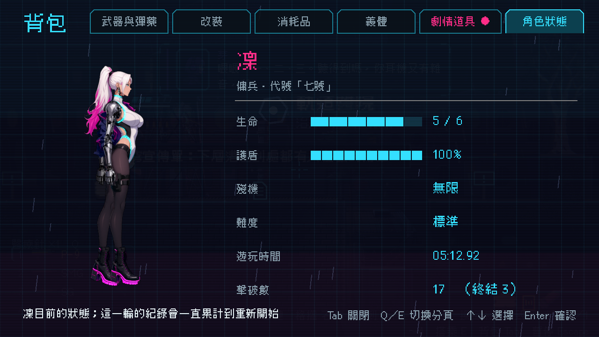
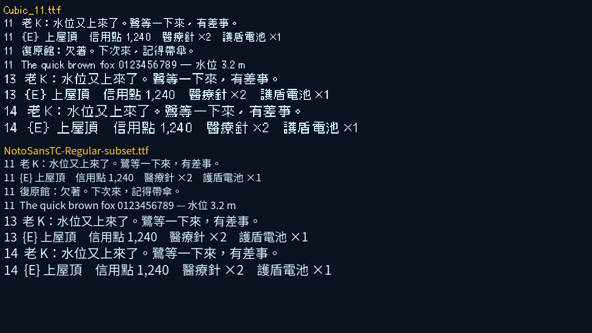
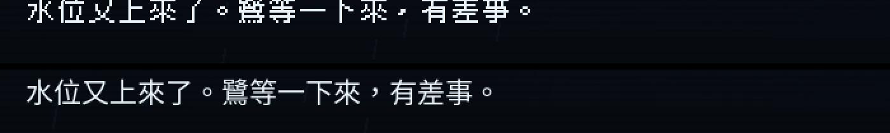
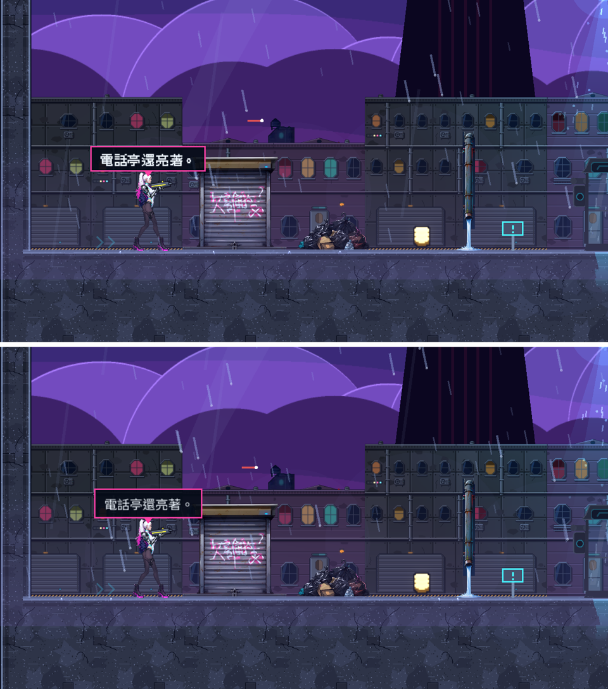
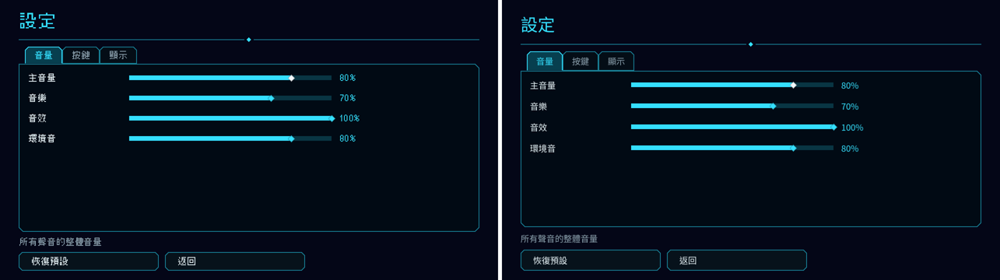

# [NE-215] 背包與角色畫面改用高解析立繪

> 狀態：完成

## 內文

### 需求
背包的角色頁把凜畫成低解析的像素小人（放大後有明顯的方塊鋸齒），和遊戲裡精緻的立繪與骨架角色完全不搭，浪費了立繪的品質。這個畫面不需要像素風：角色要用高解析立繪（或即時用骨架零件組出的高解析外觀）平滑顯示；如果某處真的要保留像素風格，解析度也要夠高、不能是低解析放大。需要檢查所有介面（背包、暫停、圖鑑、結算、主選單、對話頭像、HUD）裡的角色與圖示，凡是低解析放大成像素的都改成高解析。介面文字的字型風格是否保留像素字，需另外確認。

### 來源
2026-10-06，使用者試玩第一章後回報（附背包角色頁截圖）：「這個畫面也沒必要做成像素風，如果真的要做的話也要是超高清的像素，要不然就白白畫那麼好看的主角了」。

### 驗收條件
- [x] 背包角色頁的凜使用高解析立繪，邊緣平滑、無像素方塊；裝備改變的外觀（夾克、武器等）仍看得出來
- [x] 其他有角色圖像的介面（暫停、圖鑑、結算、主選單、對話頭像）逐一檢查，低解析放大的一律改成高解析來源與平滑縮放
- [x] 各種解析度（720p、1080p、4K）與縮放下角色圖都清晰，貼圖記憶體沒有明顯增加（共用同一份貼圖）
- [x] 若有刻意保留的像素風元素，記錄原因，且以整數倍高解析呈現
- [x] 修前修後截圖並排留存
- [x] 介面文字字型是否改成非像素字，列出選項與對照圖，由使用者決定（使用者 2026-10-06 委託決定：預設改平滑字型，設定可切回像素，見 Commit-3）

### 測試流程
1. 開背包角色頁，看凜的立繪是否清晰
2. 切換不同裝備，外觀同步
3. 在 720p、1080p、4K 各看一次
4. 逐一開暫停、圖鑑、結算畫面檢查角色圖

---

# 跟其他票的關係

- Blocks：無
- Blocked by：無
- Related：NE-16、NE-69、NE-209

---

---

# Commit-1

## 內文

背包角色頁的凜改成高解析立繪：新的 `HdPortrait` 把角色骨架（遊戲內同一份零件貼圖，原圖解析度）在子視窗以顯示大小的 2 倍解析度即時繪製，用平滑濾鏡（含 mipmap）縮到畫面上，所以邊緣平滑、沒有像素方塊，也不另外佔貼圖記憶體；子視窗只在可見時更新，還保有待機的呼吸與眨眼；找不到角色骨架時記錄錯誤、不崩潰。舊的 `PixelPortrait` 刪除。其他介面逐一檢查：對話與通訊頭像是 128 像素的原圖縮小顯示，通訊面板原本用最近鄰縮小（會有鋸齒）改成平滑濾鏡，其餘對話頭像本來就是平滑。刻意保留像素風的只有圖示卡（道具與槍的 24～32 像素圖示，整數倍放大）與介面字型。
字型選項（待使用者決定，目前沒改）：A 維持 Cubic 11 像素字（與圖示卡一致，辨識度高）；B 標題與角色名改用平滑的黑體（例如 Noto Sans TC），內文仍用像素字；C 全部改平滑字型。選 B 影響最小。

### 測試結果

| 項目 | 結果 |
|---|---|
| UiScreensSuite（新增 HdPortrait：2 倍解析度、只在可見時更新、平滑濾鏡、用真骨架、縮放、缺角色不崩潰） | 67 項通過 |
| 完整測試（平行） | 新失敗 0 |

### 截圖

---

# Commit-3

## 內文

字型決定（使用者委託「以業界最佳實例為主」）：介面文字預設改成平滑的黑體，設定畫面可切回像素字。

| 選項 | 優點 | 缺點 |
|---|---|---|
| 像素字 Cubic 11（原本） | 和 11 的整數字級、舊截圖一致 | 筆畫只有 11 像素格，「鷺」「麵」這類多筆畫字糊成一團；中文每字寬 12 像素 |
| 平滑黑體 Noto Sans TC（採用） | 筆畫清楚、多筆畫字可讀；中文每字寬 11 像素（比像素字窄，原本排得下的版面不會爆）；和高解析的立繪、場景風格一致 | 多一個字型檔（子集 約 1 MB） |
| 系統字型 | 不增加檔案 | 各平台長相不同、可能缺字，不採用（只留作缺字備援） |

做法：`UiKit.FONT_STYLES` 登記兩種樣式，公開的 `UiKit.font()` 是一層 `FontVariation`，切換樣式只換底下的字型，所有已經拿著它的控制項、繪圖節點（對話框、HUD、地圖氣泡、招牌、提示）立刻跟著換，不用重建畫面；設定裡 `display/ui_font` 存樣式，寫錯或缺少時退回預設；設定畫面的「平滑字型」開關即時生效，「恢復顯示預設」會改回預設。平滑字型檔是 Noto Sans TC（SIL OFL，授權檔在 `art/fonts/OFL-NotoSansTC.txt`）依專案文字（對話、資料、介面共 2,500 多個中文字）加常用符號切出的 Regular 子集；新增文字缺字時會退回系統字型備援，需要時重新用專案文字切一次。`tools/font_compare.tscn` 可以把兩個字型在幾個字級下並排看。

### 測試結果

| 項目 | 結果 |
|---|---|
| `UiKitSuite`（字型樣式、即時切換、亂寫的設定退回預設、中文字寬不比像素字寬、授權檔） | 通過 |
| 完整平行測試（45215 項） | 通過，新失敗 0 |

### 截圖

