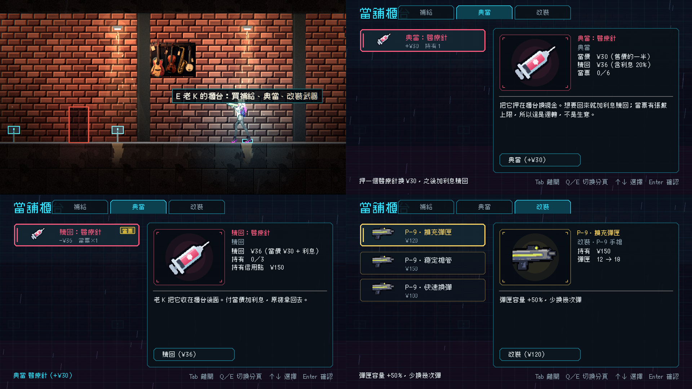

# [NE-216] 第一章加入貨幣與升級系統

> 狀態：完成

## 內文

### 需求
使用者覺得升級系統與貨幣系統還沒做。需要檢視現有系統（信用點、補給商店、武器改裝、義體能力）在第一章的呈現，並依業界做法補齊：第一章要有零錢掉落、老 K 的當舖（買、典當、贖回）、工作檯的武器改裝、劇情與探索給的能力；升級買下後立刻看得見；死亡扣款有上限、劇情必死不扣款；價格與收入用資料表對帳。商店與升級融入世界觀，不是冷冰冰的選單。

### 來源
2026-10-06，使用者試玩第一章後回報：「好像還沒做升級系統跟貨幣系統，可以的話都幫我做一下」。

### 驗收條件
- [x] 檢視現有的貨幣、商店、改裝、能力系統與第一章的整合現況，列出缺什麼
- [x] 貨幣：敵人與可破壞物掉零錢；第一次拿到錢在第一個敵人或第一個箱子；一兩處不在主路上的小額寶箱；HUD 顯示信用點
- [x] 老 K 的當舖是商店：先看到店與價格再買得起；賣補給與改裝件；可典當物品換錢並可贖回（贖回加利息）；老 K 的對話隨死亡次數與章節進度變化
- [x] 工作檯：一個武器改裝槽與兩三個價差明顯的選項；買下後槍上看得見差異，tooltip 顯示「之前 → 之後」
- [x] 能力解鎖（衝刺、格擋等）靠劇情與探索發放，不靠錢買
- [x] 死亡扣款不超過身上現金、不負債；劇情必死不扣款；取回機制與扣款只用一種
- [x] 價格與收入放資料表；腳本算出第一章「可得總金額」與「價目表總和」，必要升級約為主線收入的六到八成，放進測試或報表
- [x] 第一章的經濟曲線與購買流程截圖，存檔
- [x] 本票統整出的檢查項目與自動檢查方法，寫進 skill `continuity-qa`（`.claude/skills/continuity-qa/`），參考業界做法並附出處；之後涉及流程與狀態的工作都必須先讀這份 skill

### 測試流程
1. 新遊戲打幾隻敵人，確認掉錢與 HUD
2. 到當舖買東西、典當、贖回
3. 在工作檯改裝，確認槍的外觀與數值
4. 死亡後確認扣款規則

---

# 跟其他票的關係

- Blocks：無
- Blocked by：ST-11
- Related：NE-32、NE-33

---

---

# Commit-1

## 內文

現況檢視：系統本來就有信用點、補給點（買補給）、武器改裝（背包的改裝分頁）與義體能力，但第一章沒有任何地方能花錢、也沒有典當，敵人掉落與價目沒有對帳。本次補齊：
- 老 K 的櫃台（當舖櫃台，一個場景擺設旁的互動點）：三個分頁，補給（醫療針、護盾電池）、典當、改裝（工作檯，三項改裝顯示「之前 → 之後」）；櫃台資料 `ShopData` 新增 pawn、workbench、style、prompt，靠近時的提示依功能自動產生。
- 典當與贖回：當價是售價的一半、贖回加兩成利息（進位）、當票最多 6 張；錢與當票一起動，背包放不下或錢不夠都不扣款；當票跟著檢查點快照還原，舊存檔沒有欄位或資料壞掉時退回沒有當票；當了再贖一定淨虧利息，不能變成賺錢的辦法。
- 死亡扣款：單次有上限（區域 `death_credit_cap`，第一章 250），永遠不超過身上現金、不負債；劇情必死（第一次死亡建檔）不扣款（見 ST-13）。
- 老 K 對死亡的反應：場景人物的對話新增 `min_deaths` 條件，死亡一次與四次以上換句子。
- 掉落：清掃兵 8、看門狗 40、督察 90 等；第一章收入與必要花費由 `EconomyReport` 算出（`tools/economy_report.tscn`）：收入 ¥888（地上 270、箱子 20、敵人 538、增援 60），必要花費 ¥570（三項改裝 370、醫療針 ×2、護盾電池 ×1），占 64%，在六到八成之內，測試鎖在 60–80%。
- 能力解鎖（衝刺、格擋）本來就不用錢，維持由劇情與探索發放。

### 測試結果

| 項目 | 結果 |
|---|---|
| EconomySuite（新增：典當與贖回規則、當票上限、存檔還原與壞資料、死亡扣款上限與不負債、老 K 反應、收入與必要花費對帳、櫃台三分頁與失敗不扣款） | 69 項通過 |
| 完整測試（平行） | 新失敗 0 |

### 截圖

