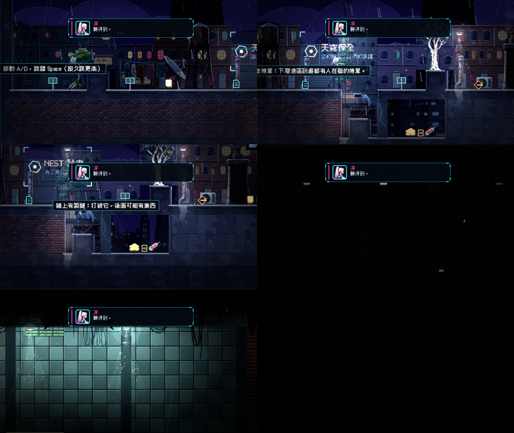

# [NE-219] 逐處確認舊關卡背景擺設與高牆重疊

> 狀態：完成

## 內文

### 需求
場景合理性檢查（NE-210）在 `level_01` 找到 7 處背景擺設與實心地形重疊 11–48 像素：第 25 欄屋頂小屋、第 29 欄逃生梯、第 212 欄圍籬、第 266 與 296 欄吊纜、第 7 欄孤島樹、第 27 欄前景松樹。已看過第 25 與 212 欄的畫面，物件在牆後、屬於景深；其餘 5 處沒有逐一確認。需要逐處看畫面，不合理的移位、換物件或縮小，合理的在資料標記，讓檢查不再報警告。

### 來源
2026-10-06，NE-210 的場景合理性報告（`tools/scene_report.tscn`）。

### 驗收條件
- [x] 7 處逐一看過畫面並記錄結論（修正或保留的理由）
- [x] 需要修的已修，修前修後截圖
- [x] 保留的有資料標記，`level_01` 場景檢查的警告為 0

### 測試流程
1. 執行場景報告，確認 `level_01` 沒有 `prop_buried` 警告
2. 走到上列各欄，目視確認擺設沒有穿過牆或卡進地面

---

# 跟其他票的關係

- Blocks：無
- Blocked by：無
- Related：NE-210

---

# Commit-1

## 內文

七處逐一看過畫面（`--scenario=place:level_01:<欄>`）：
| 欄 | 擺設 | 結論 |
|---|---|---|
| 25 | 屋頂小屋 | 立在屋頂後方，和高牆重疊的是後層，景深 |
| 29 | 逃生梯 | 掛在秘密房的牆上，本來就貼牆 |
| 212 | 圍籬 | 立在貨櫃牆前的後層，景深 |
| 266、296 | 吊纜 | 從天花板垂下，重疊的就是掛點 |
| 7 | 孤島樹 | 樹根陷進地面 11 像素，是樹根；畫面上看不出 |
| 27 | 前景松樹 | 樹幹貼著高牆，景深 |
全部在地圖 JSON 的該筆擺設加 `"allow_overlap": true`；`SceneAudit` 略過有標記的擺設，所有關卡的場景檢查現在是 0 錯誤、0 警告，測試改成任何關卡有未處理的警告就失敗。

### 測試結果

| 項目 | 結果 |
|---|---|
| `SceneSanitySuite`、`EnvironmentSuite`、`Chapter2ArtSuite`（6764 項） | 通過 |

### 截圖

