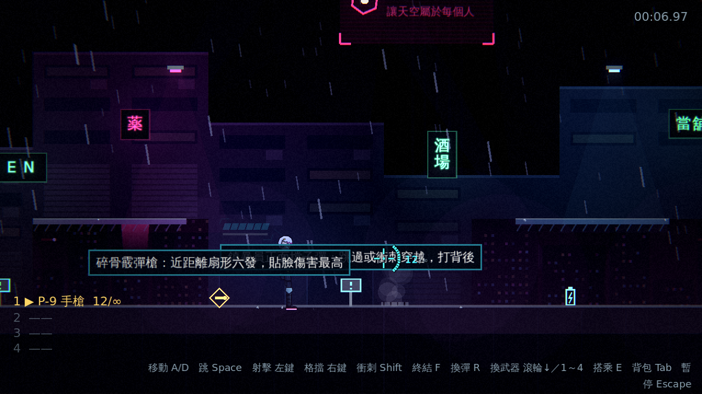
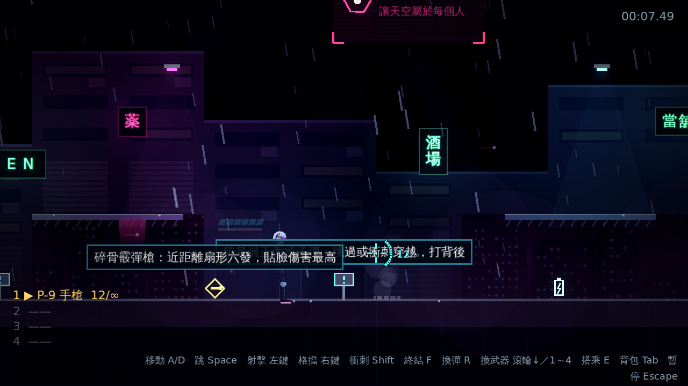
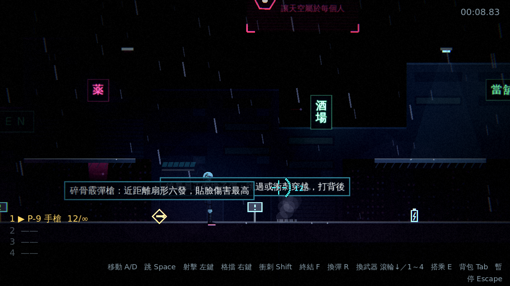
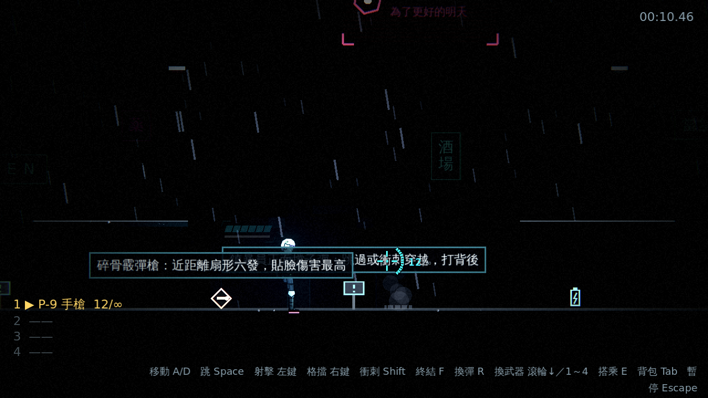
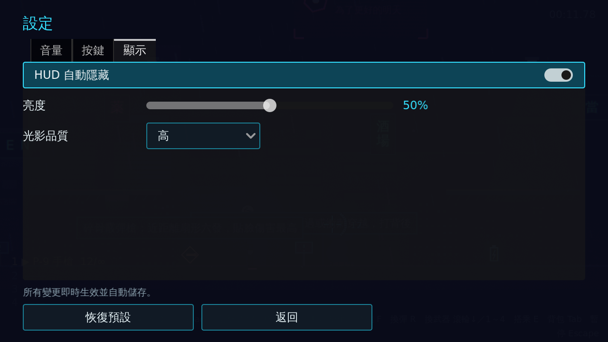

# [NE-21] 管理光源預算與品質分級

> 狀態：完成

## 內文

### 需求
光源越多越吃效能，目前沒有任何預算管理。要限制同時啟用的光源數量、停用鏡頭外的光源，讓場景燈能閃爍或熄滅，並提供光影品質三檔給效能較弱的機器。設計見 `design/08-lighting/DESIGN.md` 的「光源分級與預算」與「效能預算」。

### 來源
2026-10-02，使用者於開發對話中提出：「整個遊戲可以有完整的光影設計，請參考業界最佳實例」「整體的渲染跟場景應該要陰沉一點，遊戲希望整體沉重一點」；確認壓抑程度為重度壓抑、先做光影再做內容。

### 驗收條件
- [x] 同時啟用的陰影光源與點光源各有上限，超過時優先保留離玩家近、能量高的
- [x] 鏡頭外的光源自動停用，回到鏡頭附近再啟用
- [x] 場景燈可以閃爍或熄滅，並能由事件控制（例如停電）
- [x] 光影品質分高、中、低三檔，可在設定選單切換、即時生效並儲存
- [x] 每一檔的差異都有一句 tooltip
- [x] 測試保證任何時刻同時啟用的光源數不超過上限

### 測試流程
1. 在設定選單切換三檔品質，確認畫面效果與說明一致且即時生效
2. 快速跑過整個第一章，確認任何時候啟用的光源數量不超過上限
3. 觸發停電，確認場景燈依序熄滅
4. 執行完整測試套件，全部通過

---

# 跟其他票的關係

- Blocks：無
- Blocked by：NE-18
- Related：NE-22

---

# Commit-1

## 內文

光源越多越吃效能，原本沒有任何預算管理。
現在場景光源由預算統一管理：鏡頭外、照不到畫面的光源自動停用，剩下的依亮度、範圍與離鏡頭的距離排序，只啟用前幾盞，其中只有前幾盞想要陰影的才開陰影；自己熄滅的燈（停電、壞掉）不佔預算；玩家自己的光與戰鬥特效的光源池另外計算。場景燈與招牌有供電門檻：供電下降時各盞依序熄滅，恢復時依序亮起，停電事件把供電降到 0，所有燈滅掉。光影品質分高／中／低三檔，在設定選單的顯示分頁切換、即時生效並儲存：高＝全部效果（24 盞光源、4 組陰影）；中＝光源與陰影減半、關閉顆粒與色差；低＝8 盞光源、1 組陰影、關閉顆粒與色差、體積光與法線貼圖（後兩項由後續票使用）。每一檔都有一句 tooltip 說明，「恢復預設」會一併還原。
驗收方式：冒煙測試在六個位置驗證同時啟用的光源與陰影數量不超過上限且與預算統計一致、鏡頭外的燈停用而畫面內的燈啟用、玩家的光不受管理、供電門檻單調、降到低品質時上限變小且顆粒與色差關閉、品質設定的預設／損毀／夾限／重設、停電時所有可用的燈熄滅、部分供電時有的亮有的滅、供電恢復後全部亮起；自動截圖對照高低品質與停電熄燈過程。

### 測試結果

| 項目 | 結果 |
|---|---|
| 完整測試套件 | 通過 848 / 848 |
| 資料驗證 | 0 錯誤 |
| 執行 log | 無非預期 ERROR |

### 截圖

