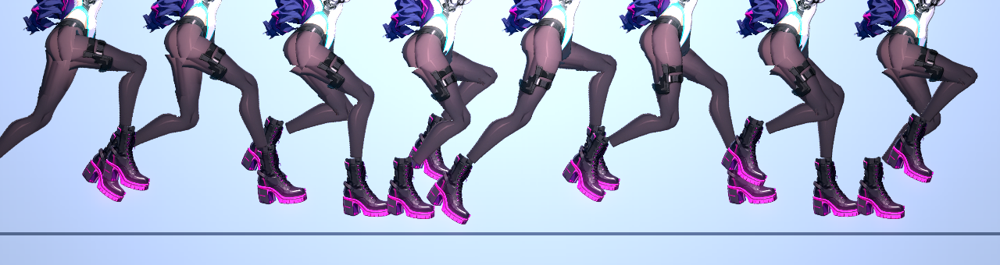

# [NE-220] 讓手腕、腳踝、髖、肩也能平順彎曲

> 狀態：完成（檢查後不需要處理，條件改為保留觀察）

## 內文

### 需求
NE-204 只處理了膝與肘（上下段成對的肢體）。手腕（前臂接手）、腳踝（小腿接腳）、髖（大腿接骨盆）、肩（上臂接軀幹）仍是剛體零件，大角度時可能露出切口。需要檢查這些關節在最大彎曲下的特寫，必要時把同一套網格混合延伸過去（一個零件有兩個夥伴骨頭），並讓稽核涵蓋。

### 來源
2026-10-06，NE-204 完成時列出的剩餘範圍。

### 驗收條件
- [x] 腕、踝、髖、肩在動作資料用到的最大角度下，過場倍率特寫逐一檢查，列出有可見切口的關節（沒有，見下）
- [x] 有問題的關節套用網格混合，修前修後截圖（沒有問題的關節，不套用）
- [x] 稽核涵蓋這些關節，效能預算不超過 NE-204 的量測加上 50%（沒有新增網格，預算不變）

### 測試流程
1. `rig_preview --chars=rin --joints` 看各關節
2. 執行動畫稽核與 `RigMeshSuite`

---

# 跟其他票的關係

- Blocks：無
- Blocked by：無
- Related：NE-204

---

# Commit-1

## 內文

在過場倍率下檢查：全速跑一個步伐週期的八個時間點（腳踝與靴口）、坐與蹲（髖與腳踝）、揮手（肩與腕）、格擋與瞄準（肩與腕）。踝與腕都有靴口、護腕與袖口蓋住關節，髖有骨盆與夾克下擺蓋住，肩有軀幹與手臂零件的重疊；沒有找到可見的切口、缺角或反光斷層，所以不新增網格（也就不增加效能成本）。之後新角色的靴口或袖口若沒有遮蓋，再用 `RigPartMesh` 延伸到這些關節（一個零件兩個夥伴骨頭）。

### 截圖

