# [NE-222] 逐一檢查主角動作與部件並修正

> 狀態：進行中

## 內文

### 需求
使用者認為主角的動畫大致沒問題，但「部件有很多奇怪的地方」。要把主角（凜）的**每一個動作、每一個姿勢、每一個部件**認真看過一遍，凡是看起來不對的都修好，不能再只在特寫下看過就結案（NE-204、NE-220 的結案被推翻）。範圍包含下面這些使用者明確指出的問題，以及檢查過程中發現的所有其他問題：

1. **開場姿勢**：遊戲一開始（`ch1_c01_open`）凜是蹲著的，看不出理由。要依劇情站著、靠著或坐著，並符合櫃台與老 K 的位置；整個過場與序章（ST-16）的所有姿勢都要有理由。
2. **蹲下的姿勢**：NE-205 已經把蹲姿改成臀部落到腳跟、膝蓋向前，但最近又看到奇怪的姿勢，要找出是哪個動作（遊戲內蹲下、過場蹲姿、蹲著瞄準、蹲著走）退化或沒套用，修好並鎖住不再退化。
3. **部件接縫與破圖**：關節交界（髖、肩、肘、腕、膝、踝）、臀部、腰（上半身與下半身交界）、頸、肩與軀幹，每個部件連接的地方在任何動作與過場倍率下都不能露出縫、缺角或直線切口。
4. **外套**：外套的形狀、分片與圖層順序要看起來是一件外套（領子、衣身、下擺），在站、跑、跳、蹲、瞄準、受擊時都合理，不再是一團破碎的藍色塊。
5. **左右手**：前手與後手的形狀、與槍的位置關係、手腕接縫要正確，握槍、持近戰武器、空手、打電話（握話筒）時都自然。
6. **發光效果**：主角的霓虹發光（鞋、軀幹、骨盆）要在 Forward+ 下確認仍然有「亮亮的」效果，且不會因為修正過曝（NE-213）而消失。

試作的多關節網格（旋轉混合）已存成 `pm/Nest-Egg/attachments/NE-222-multizone-joint-wip.patch`，原因與已知問題見 `design/12-cast-redraw/RIG_QUALITY.md` 的「補記（2026-10-07，NE-222）」；可以採用、修改或換成更好的做法，但要符合 CLAUDE.md 的品質要求（資料驅動、效能、容錯、不破壞原有功能）。

### 2026-10-08 使用者補充：外套、解剖與接合品質

1. 所有本組角色的動畫要合理且無破圖；分割不得帶入多餘的手、其他肢體或錯誤部件，支點、骨架與圖層綁定必須正確。
2. 動畫與實際操作須配合，參照可查證的業界原始資料；沒有可靠公開數字的參數標為專案建議值，需實測。輸入、攻擊、跳躍的既有時序不能因衣物或姿勢修正退化。
3. 立繪比例、解剖、衣物穿著與遮擋均須合理，去除明顯生成瑕疵；沿用 NE-17 已同意的 s33 定稿外觀，修復派生零件。
4. 凜的外套目前讀成披肩。須讓領口、肩線、袖窿、袖子與衣身形成穿著結構，衣襬有合適的彈簧動態；不可只搖動現有破碎藍塊。
5. 上下半身被切開、沒有正確接在一起也屬破圖。軀幹／腰、骨盆／髖與大腿須在所有動作保持合理連接，不能以色塊遮掩，需逐格接縫量測及圖像檢查。以下重裝角色截圖是此類問題的明確例子，個別美術修復承接 NE-181，共用骨架修復由本票負責。

### 2026-10-08 使用者補充：蹲姿臀部輪廓

蹲下時臀部圖形怪異也必須修復。即使腰髖已接合、没有大缺口，重複臀部、球狀凸塊、切斷輪廓、尖角、折片與不自然體積仍不通過；蹲入、蹲走、蹲瞄、蹲起與過場蹲姿都要檢查。

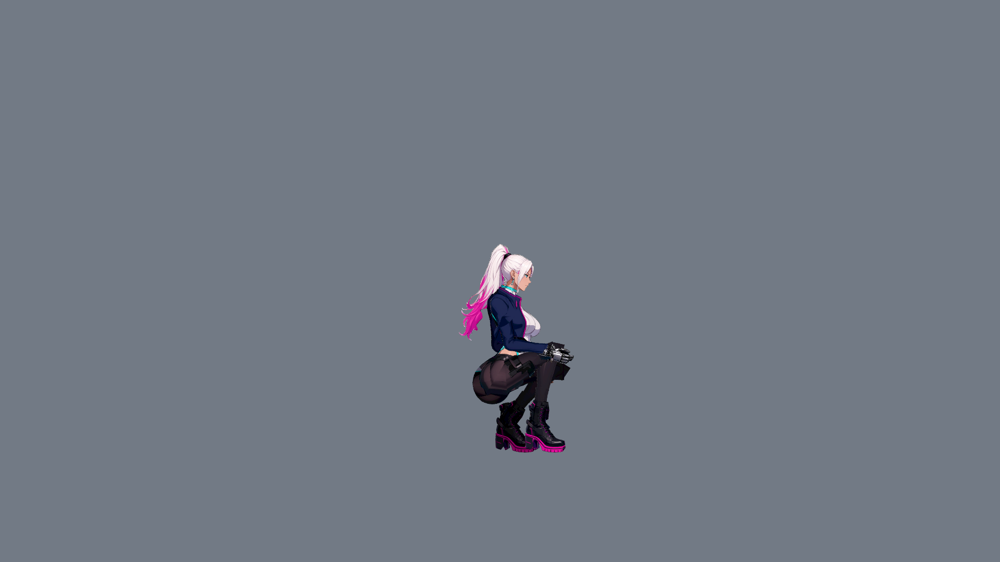

### 2026-10-08 使用者補充：持槍單膝跪姿

一般蹲姿由本 Session 決定；持槍靜止蹲瞄採合理單膝跪地姿勢，参考圖僅作姿態參考。前脚支撐、後膝接地、後小腿向後折，雙手正常握槍。低姿移動、換向、瞄準角、換槍、卸槍與蹲入／蹲起均需自然，所有部件仍須正確接合且没有細小破圖。

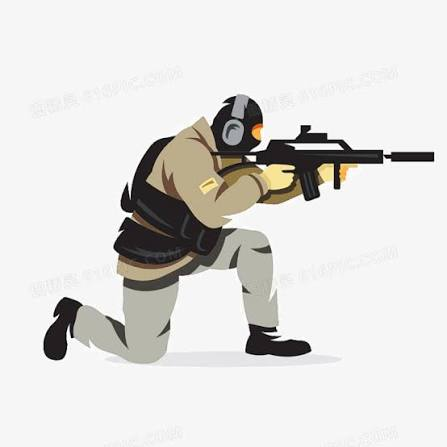

### 2026-10-09 使用者補充：過場走路異常

使用者指出過場移動時姿勢與動畫非常奇怪，一般關卡走路則較正常。過場走路、跑步須依演員實際移動速度與放大倍率播放，腳步與位移一致，左右方向、起步、停步、走跑切換及持槍／空手姿勢自然；實際過場與關卡均須對照驗證，不以一般關卡正常代替過場通過。

### 2026-10-09 使用者補充：完整仰躺與俯臥倒地動作

使用者明確拒絕「站著的模型轉平」作為倒地姿勢。依最後一擊的來源相對角色面向選擇仰躺或俯臥，完成失衡、重心下降、軀幹落地、四肢跟隨與最後停止的完整動作。仰躺須臉朝上、背部接地；俯臥須臉朝下、胸腹接地。頭頸、肩肘腕、髖膝踝的角度、遠近側肢體與前後遮擋需分別設計，不能只旋轉整隻模型或以最低一個像素碰地作為通過。

致命一擊的方向及力道須從實際戰鬥傳入凜與適用人形敵人；倒下後停止跑步、瞄準、握槍支撐及站姿的衣髮反應。檢查正面／背後攻擊、兩面向、輕重擊、空中落地、坡面／平台邊緣及缺少攻擊來源時的安全預設；所有部件仍不得有小裂縫、孔洞、碎片或穿地。

以下兩張是使用者提供的動作參考，不是本專案素材、授權來源證明或遊戲验收畫面；只參考姿態與分段時序，不直接切出角色圖。

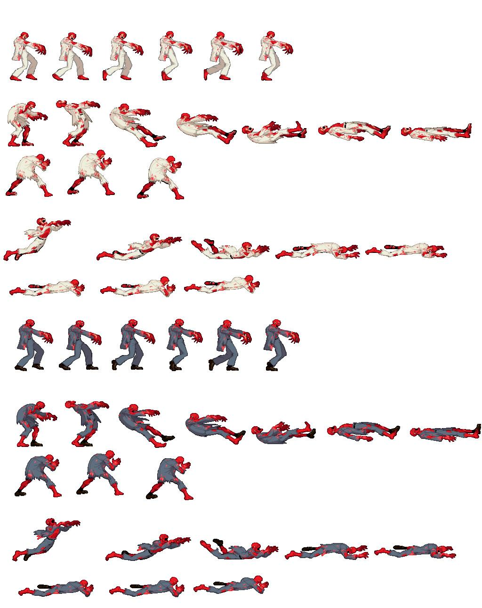

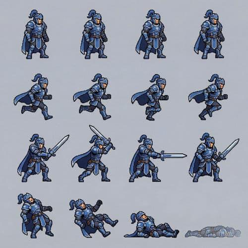

### 2026-10-09 使用者補充：致死後散落的身體零件

使用者詢問倒地畫面中散落的東西。現有衣物受損效果把凜的整張軀幹與腿部零件當成裝甲片拋出，造成身體被拆散的錯誤觀感。凜須保留完整身體與既有受傷衣物變化，不得把整段身體、衣物或重複肢體圖形當作物理碎片丟到地上。真正裝甲敵人的裝甲片脫落仍須正常，不能以全面停用受擊效果代替修復。

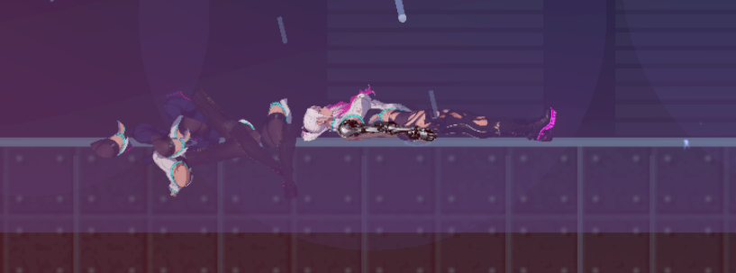

### 2026-10-09 使用者補充：體態像鴕鳥

使用者指出當前版本非常奇怪、不符合人體結構、很像鴕鳥。所有相關姿勢須重新檢查頭頸、軀幹、髖、膝與腳的相對位置、臀腿比例和支撐；過度前伸、髖過低、膝擠到胸前、臀部異常突出或支撐腿過直均不通過。接縫量測為零不能代替人體外觀檢視。沿用已批准的s33設計，修正來源校準、分割、綁定與必要局部姿態素材。

### 2026-10-10 使用者補充：跪姿臀部、握持與跨部件光影退件

使用者指出新跪姿的臀部視覺歪斜，問題來自立繪輪廓與明暗，而不只是上下半身接縫。臀部須與腰、骨盆及近遠側大腿形成單一合理體積，不能像另外貼上的球狀零件；褲料、槍套與臀腿輪廓須符合實際穿著及遮擋。

雙手須在實際武器可見的畫面確認握柄／護木接觸、掌指方向、大小、手腕與袖口。以下全身圖是隱藏武器的部件診斷，不能當作握槍通過證據。機械手、人體手、袖子及身體的畫風、明暗方向、材質反光与場景受光須一致；不能以接點數值正確代替外觀驗收。此候選已退件，接縫即使為零也不能交付。

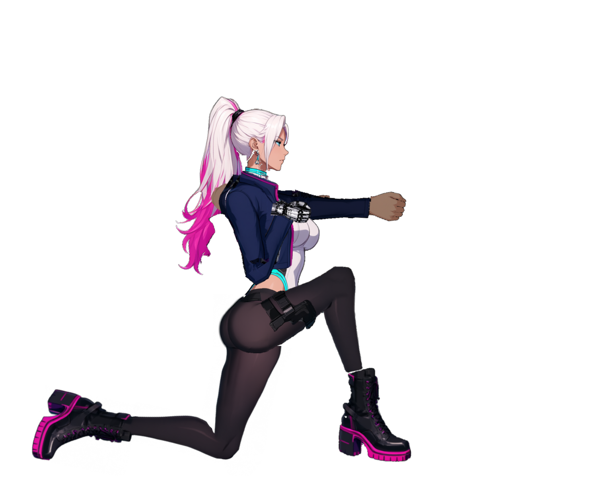

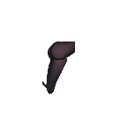

### 來源
- 2026-10-07 使用者回報（附過場開頭蹲姿與站姿特寫兩張截圖）：「最一開始的時候是蹲著的」「主角還是有很多破圖的地方，關節的交界處、屁股的地方、上半身跟下半身的交界處，每個部件連接在一起的時候都有很多破圖」「主角的外套、左右手都長得非常奇怪，現在動畫我覺得大致上沒問題」。
- 同日補充：「原本主角不是會亮亮的嗎？為什麼效果沒了」「蹲下的動畫不是有優化過，為什麼又變成這個奇怪的姿勢」，要求開票、認真仔細把所有動作與動畫看過一遍，花久一點沒關係。

### 驗收條件
- [ ] 2026-10-10退件問題已修正：跪姿臀部、腰髖及近遠側大腿形成單一自然體積；雙手在實際可見武器上合理握持，掌指、腕袖與圖層正確；跨部件畫風、材質反光及受光一致。兩面向、遊戲／過場倍率、瞄準及姿勢切換的原生全彩與逐格接點同時通過，保留本次退件圖作對照。
- [ ] 人體體態自然，頭頸、軀幹、髖膝踝與雙腳比例、角度與支撐合理；沒有像鴕鳥的前伸、髖過低、膝擠胸、異常臀部凸塊或支撐腿過直；原圖／底層校準及所有受影響姿勢的原生全彩、逐格接點與實機驗收同時通過。
- [ ] 凜受傷及致死後保留完整身體和合理衣物損傷，地面沒有整張軀幹、腿部、衣物或重複肢體碎片；實際致死的兩面向與前後攻擊有原生修前／修後畫面，敵人真正裝甲片的脫落未退化。
- [ ] 倒地是依最後一擊方向選擇的完整仰躺／俯臥動作：失衡、下降、軀幹接地、四肢跟隨與停止自然，頭臉方向、背／胸腹支撐、雙臂雙腿與衣髮均合理；正背攻擊、兩面向、輕重擊、空中落地與場景邊緣有實際戰鬥及原生逐格證據，沒有站姿整體轉平、浮空、穿地或任何小破圖。
- [ ] 過場走路與跑步的姿勢、步幅和頻率配合實際位移及演員倍率；凜返家與老 K 往返移動、兩方向與起停有原生連續畫面證據，沒有原地快踏、滑步或不合理姿勢，一般關卡移動未退化。
- [ ] 持槍靜止蹲瞄採合理單膝跪姿：前脚掌支撐、後膝承重、雙手握槍；兩面向、上下瞄準、移動起停、換槍／卸槍與蹲入／蹲起自然，實際部件接地、臀腿及外套輪廓合理，所有接點無一像素缺口、穿插或折片，原生遊戲畫面與逐格檢查同時通過。
- [ ] 蹲姿臀腿輪廓合理：骨盆臀部與近遠側腿没有重複體積、球狀凸塊、尖角、折片或穿插；蹲入、蹲走、蹲瞄、蹲起及過場蹲／坐在兩面向與遊戲／過場倍率均有原生修前修後證據，逐格接點與全彩外觀同時通過。
- [ ] 凜的高解析來源細節從分件到遊戲、過場及背包均保留：記錄來源／輸出／Godot 載入／實際螢幕像素，修正不必要降採樣與 UI 子視窗放大；原生高解析修前／修後截圖比較臉、眼、髮絲、衣物與接點，不把 PNG 插值放大當清晰度修復。
- [x] 固定生成至交付 SOP：Qwen 原生 RGBA、來源與快取、骨架校準、正確單件分割、底層補全、尺寸／pivot／貼圖密度、重新組合、逐格接點與全動作、Forward+ 實機品質；串接 rig-animation，.agent／.agents／.claude 三份一致。
- [ ] 小裂縫、單像素孔洞、缺角、切斷輪廓與漂浮碎片均已解決；不得因大缺口消失就給過。保留逐格失敗紀錄與修後證據。
- [ ] 所有適用角色的所有部件正確接合：依 rig-animation 的部件帳本與接點表逐角色驗證，包含頭頸、眼睛、髮根、衣物固定邊、雙臂雙腿、手與持物、護甲及非人形附件，不得以只驗腰髖或只驗凜替代
- [ ] 建立「動作與姿勢清單」：主角所有遊戲內動作（待機、走、跑、跳、下落、落地、蹲、蹲走、衝刺、各角度瞄準與射擊、近戰全部招式、格擋、完美格擋、受擊、硬直、死亡、爬梯、上下載具、打電話、換彈、換武器）與所有過場姿勢（站、靠、坐、蹲、跪、倒下、起身等），清單放在票上，每一項都有檢查結果
- [ ] 每一項動作與姿勢在**過場倍率（約 3.4 倍）與遊戲倍率**各逐格看過（每個動作至少起始、峰值、結束三格，循環動作至少四格），問題與處置記在票上並附前後截圖
- [ ] 開場（`ch1_c01_open`）凜的姿勢有明確理由且與場景吻合，不再無故蹲著；三場過場的所有演員姿勢逐一確認；有自動檢查擋住「沒有理由的蹲、坐、跪」
- [ ] 蹲下相關的所有動作（遊戲內蹲、蹲走、蹲瞄、過場蹲姿）的姿勢正確：依2026-10-08使用者授權，一般蹲姿採合理且有支撐的蹲姿，持槍靜止蹲瞄採前腳掌與後膝承重的單膝跪姿；重心、臀腿、外套與上身沒有穿插，找出退化原因並加回歸測試
- [ ] 所有部件接縫在全部動作與兩種倍率下沒有可見的縫、缺角、直線切口、露出背景；有自動檢查（沿每個關節取剖面，輪廓內不得出現背景像素的洞，所有動作逐格量測，違規數為 0）
- [ ] 軀幹手臂洞、腰部帶子與骨盆、臀部與大腿、肩與軀幹的接合處修好（網格、補遮蓋零件，或修改零件圖，擇適合者），修前修後截圖並排留存
- [ ] 外套重新整理：分片、骨頭、圖層順序與下擺擺動（彈簧骨）都合理；站、跑、跳、蹲、瞄準、受擊、死亡的截圖通過檢視；若現有零件圖無法做到，另開美術票（BG 或 NE-221 補充）並在票上寫清楚缺什麼，不得以「看起來還好」帶過
- [ ] 左右手：前後手的形狀、大小、與槍及近戰武器的相對位置、手腕接縫正確；握槍、近戰、空手、握話筒都通過檢視；前後手圖層順序在所有姿勢下不出錯
- [ ] 主角的霓虹發光（鞋、軀幹、骨盆）在 Forward+ 實機畫面下看得到亮亮的效果與適度泛光；與 NE-213 的過曝修正並存，有量測數據證明兩者同時成立
- [ ] 以上修正套用到所有人形角色（敵人與 NPC），不破壞原有功能；AnimAudit、網格、圖層順序、動作與 NPC 動畫的相關測試全部通過，`mesh_fold` 等指標的上限依實測重新校準並記錄理由
- [ ] 效能：人形角色每格動畫的額外成本不超過 NE-204 基線的 50%（`tools/rig_perf_probe.tscn` 量測），頂點與記憶體預算寫在票上
- [ ] 更新 skill `rig-animation`（流程、檢查清單、使用者在意的事項），並把本票結論補進 `design/12-cast-redraw/RIG_QUALITY.md`

### 測試流程
1. 執行 `tools/rig_preview.tscn`（`--chars=rin --closeup --zoom=…`、`--joints`、`--gait`、`--action=…`、`--rigid` 對照），逐項勾選動作清單
2. 到遊戲開頭看過場，確認開場姿勢；到各場過場確認所有演員姿勢
3. 用 Forward+（實機或 lavapipe 軟體 Vulkan）看發光與泛光
4. 執行 AnimAudit 與接縫自動檢查，違規數為 0
5. 完整平行測試無新失敗

---

# 跟其他票的關係

- Blocks：無
- Blocked by：無
- Related：NE-203、NE-204、NE-205、NE-206、NE-209、NE-213、NE-214、NE-218、NE-220、NE-221、ST-16

---

# Commit-1

## 內文

2026-10-08 使用者再次指出所有角色的所有部件都必須正確接合，並要求把完整驗證流程寫成共用 Skill。現在提供立繪與分割、骨架與支點、全接點、逐格像素量測、圖層與掛點、動作、操作手感、Forward+、效能及證據的驗收流程，並同步到 .agent、.agents 與 .claude。使用者提供的重裝角色斷裂實例已連結到本票；凜外套讀成披肩也已記錄。

本次提交只交付需求及 Skill，角色修復與實機驗收尚在進行，原有未驗收條件保持未勾選。

### 檢查結果

- 三份 Skill 與詳細驗證文件內容一致；格式、相對引用及文件預覽已檢查。
- 文件提交沒有執行遊戲測試；不把既有的程式測試或暫時預覽當成本票全角色驗收。

### 文件預覽與問題實例

# Commit-2

## 內文

高解析的角色在背包放大後變模糊，因為角色預覽的渲染尺寸固定，沒有跟上實際 UI 的顯示倍率。現在預覽依實際螢幕密度調整，在本次原生擷取的 2515×1415 視窗中，角色渲染尺寸從 384×512 增為 755×1007；相同來源、姿勢與光照的臉部裁切可看到細節改善。要求的 3840×2160 視窗受到桌面限制，實際擷取尺寸是 2515×1415，不將它記為 4K。

新增生成至遊戲的固定 SOP，與既有全部件／動畫驗證流程串接，三組 Skill 副本一致。內容包括 Qwen 原生 RGBA、來源與快取依據、骨架校準、單件分割、補底層、貼圖與支點密度、重新組合、逐格接點、完整動作及 Forward+ 實機品質。文件不把生成成功或測試通過視為美術已通過。

本段交付 UI 清晰度修正與 SOP；全角色接合、凜外套及全動作驗收未完成，票維持進行中，其餘條件保持未勾選。局部穿著外套試作已取得原生透明圖與遮罩，但逐格檢查仍抓到肩、腕、衣襬及小孔，試作不得當作已通過的角色交付。

### 檢查結果

- 固定基準 b411d206 的受影響測試共 2073 項通過，0 新失敗、0 已知失敗（9 組，101 秒）；UI 專項回歸另有 70 項通過。UI 回歸涵蓋父層縮放、不改邏輯尺寸的縮放、視窗 stretch 及縮回時釋放多餘渲染尺寸。
- 三份新 Skill 的格式驗證、內容一致與相對引用檢查通過；文件預覽已檢视。
- 原生修前與修後 PNG 均為 2515×1415，並排圖為相同區域裁切，未插值放大。此比較沿用相同修復前的凜素材，沒有混入外套试作。
- 角色試作的 30 格快速診斷仍有失敗，完整角色驗收未通過；不降低单像素孔洞或接合门槛。

### 原生畫面與文件預覽

# Commit-3

## 內文

開場凜原本無故蹲在櫃台前，現在站著與老 K 對話。角色站位、朝向、舞台比例與文字保留，原生修前／修後畫面確認此改變。

第一章三場動畫過場加入姿勢理由與支撐檢查：蹲、坐、靠、倒下等姿勢缺少理由、支撐、只有空白或型別錯誤時，資料檢查會失敗。檢查包含進場、換姿勢、移動及到達姿勢與分支。診間坐姿記錄復原後醒來的理由與檢查台座面；另外保留三場的原生自動播放畫面。

本段交付開場修正與可重跑的姿勢交接基線，釋放故事產生器供後續故事 Session 從最新 main 接手。資料檢查不等於語意與家具接觸自動驗收；全過渡、衣物、接縫與未生成的序章未計入完成，票維持進行中。

### 檢查結果

- 固定基準 c4b429f0 的受影響測試共 43691 項通過（42 組，163 秒），0 新失敗、0 已知失敗。過場專項先驗 247 項通過；負向案例證明缺理由／缺支撐會失敗，包含移動到達坐姿。
- 重跑產生器後核對原始文字、旗標、場景與演員配置一致；舞台內容與已合入的來源比例 metadata 保持一致。
- 原生 Forward+ 圖像為 1920×1080：開場修前 8 張、修後 8 張、診間 16 張、回家 18 張。已檢視開場站姿、診間坐姿與起身、回家談話畫面；這些自動播放擷取不是人工操作手感驗收，也不代稱完整逐格接縫驗收。
- 新第一章三場均保留姿勢政策，腳底字幕構圖檢查通過。後續故事基線與介面記在姿勢文件，兩組 scene-staging Skill 同步。

### 實際畫面

# Commit-4

## 內文

優先修復本票推送後出現的兩項 CI 時序失敗，保持原有焦點與亮度斷言。設定關閉測試改為等到 overlay 確實離開場景及 idle 延後焦點完成；閃光測試在時間尚未衰減前套用並量測峰值，避免繁忙 runner 的首影格已超過短閃光生命期。沒有更改 UI／光照執行行為，也沒有新增已知失敗豁免。

### 檢查結果

- 固定基準 4f425a65 的完整受影響測試：78 組、50441 項檢查，0 新失敗、0 已知失敗，162 秒。
- CI 37714436408 曾有兩項新失敗；後續 37715057530 已成功，但仍保留此次時序修正，讓同一斷言不依賴 CI 排程快慢。
- 原生 Forward+ 設定畫面 1920×1080 已檢視；此畫面只確認設定 UI 回歸，焦點還原由測試斷言驗證。擷取程序正常退出，另有既有 ObjectDB 退出警告，如實保留於日誌。
- 本票仍在進行中；凜的外套與全接點逐格驗收尚未完成。

完整測試紀錄：[NE-222-ci-regression-tests.txt](images/NE-222-ci-regression-tests.txt)

# Commit-5

## 內文

ST-8 推送後 CI 37756627628 出現閃光衰減斷言失敗。此段優先修復其驗證時序：同一個同步訊號觸發閃光後，以固定時間分別檢查峰值、150 ms 的衰減中與 310 ms 的結束狀態，避免等待期間的戰鬥事件或死亡暫停干擾被量測的生命期。正式光照行為與亮度斷言保留，新增衰減中斷言，沒有新增已知失敗豁免。

### 檢查結果

- 固定基準 bdf8cc95 的完整受影響測試：78 組、50,524 項檢查，新增失敗 0、已知失敗 0，298 秒。執行時取得共享 GPU 鎖，沒有角色擷取或生成同時運算；本機角色修復試作尚未計入本段交付。
- 主流程與爆炸專項：1,534 項檢查通過。第一次並行完整測試曾有爆炸額外成本 12.84 ms 超過 6 ms；保留失敗日誌，鎖下完整重驗為 1.06 ms 靜止／1.22 ms 十二個爆炸，沒有放寬預算。
- 原生 1920×1080 Forward+ 戰鬥閃光擷取正常退出、無腳本或渲染錯誤，保留 8 個 ObjectDB 退出警告。此圖使用舊擷取的線性色彩輸出，顏色偏暗；僅記錄閃光回歸，不能代表螢幕色彩或角色美術通過。
- 本票仍為進行中；全接點與完整角色外觀維持未驗收。

[鎖下完整測試](images/NE-222-ci-flash/full-tests.txt)、[專項重驗](images/NE-222-ci-flash/focus-tests.txt)、[初次效能失敗](images/NE-222-ci-flash/initial-tests.txt)、[原生擷取日誌](images/NE-222-ci-flash/capture.txt)。

# Commit-6

## 內文

原生 HDR 2D 截圖直接保存線性色彩，PNG 看起來比實際螢幕偏暗，容易誤判角色材質與清晰度。現在彩色擷取依實際 viewport 編碼成 sRGB；非 HDR 畫面保持原始資料，解析度、透明度、光照與曝光均不改動。生成至遊戲 SOP 的三份副本同步補入此檢查，保留舊線性 PNG 作為失敗證據。

### 檢查結果

- 固定基準 06d71169 的完整受影響測試：78 組、50,523 項檢查，0 新失敗、0 已知失敗，298 秒。取得共享 GPU 鎖，無生成或額外擷取同時運算；本機角色試作不計入本段美術交付。
- 原生 Forward+ 的 HDR／非 HDR 色塊均通過：已知 #737b86 回存差異不超過每通道 1/255，非 HDR 位元組完全相同；64×64 尺寸、透明背景 alpha=0 與半透明 alpha 約 0.37 均保留。
- 原生 1920×1080 的選單、五處關卡與死亡畫面重新擷取，正常退出、無 SCRIPT ERROR／ERROR；保留既有控制項 anchor 與 8 個 ObjectDB 退出警告。已檢視屋頂實機圖，未將這批角色試作畫面列為全接點、衣物或美術通過。
- 三份 SOP 的已提交內容一致，文件預覽已檢查。本票維持進行中，角色與全動作驗收條件保持未勾選。

[完整測試](images/NE-222-hdr-capture/full-tests.txt)、[原生色塊檢查](images/NE-222-hdr-capture/color-check.txt)、[實機擷取紀錄](images/NE-222-hdr-capture/game-capture.txt)。

# Commit-7

## 內文

使用者指出凜蹲下時臀部圖形怪異。現在把臀腿輪廓納入明确驗收：没有裂縫仍不能讓重複臀部、球狀凸塊、尖角、折片或不合理體積通過，並保留實際 Forward+ 試作失敗畫面供其他 Session 對照。

三組生成／分割 SOP、骨架 Skill 與詳細驗收同步加入骨盆和腿的素材歸屬、來源拼合、髖支點、權重、深蹲局部修正與完整切換的檢查方式。這段只交付需求、驗收規範與失敗證據；角色試作仍在修復，票保持進行中，相關驗收不勾選。

### 檢查結果

- 文件格式、相對連結與三組此次提交內容一致已檢查；未執行遊戲測試，未將試作計為美術通過。
- 失敗畫面為原生 1920×1080 Forward+，色彩依實際 HDR viewport 編碼，沒有插值放大；已檢視蹲姿臀腿輪廓。

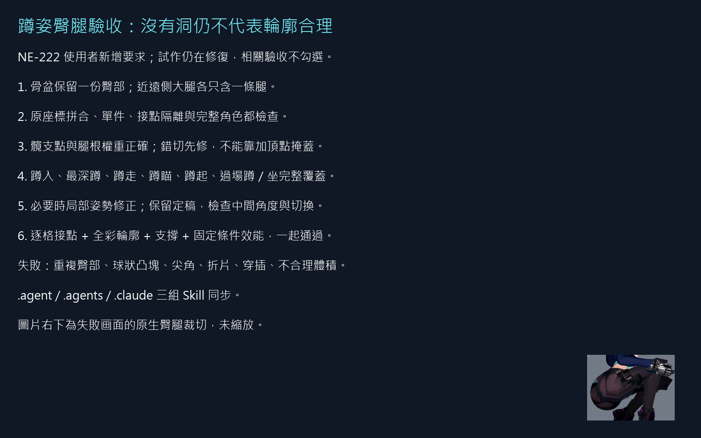

# Commit-8

## 內文

使用者指定持槍靜止蹲瞄採合理單膝跪姿，一般蹲姿由本 Session 決定。已保存原始參考圖並補進需求、驗收條件及三組製作／骨架規範；前腳掌與後膝須按實際材質接地，移動時解除跪姿，換向、換槍、卸槍、上下瞄準及蹲入／蹲起也須合理。

附原生 Forward+ 單膝跪姿試作作為需求對照；逐格檢查仍找到細小孔洞，因此這張圖不計為修復通過。此次只交付需求、來源與驗收文件，角色程式與部件試作仍在本 Session 修復，票保持進行中，相關條件不勾選。

### 檢查結果

- 文件格式、圖片來源與相對連結已核對；三組此次提交內容一致。
- 原始參考圖按位元組保留；試作圖為原生 1920×1080 Forward+ 全彩、正確 HDR 色彩編碼，無插值放大。
- 此次文件提交未執行遊戲测试；不以本地試作測試代替本次提交或美術驗收。

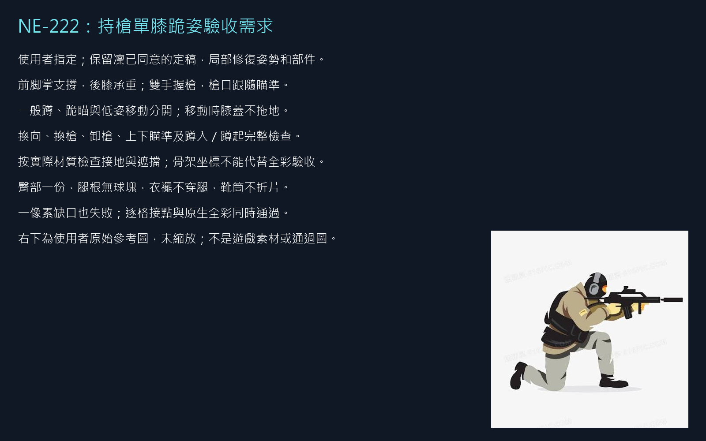

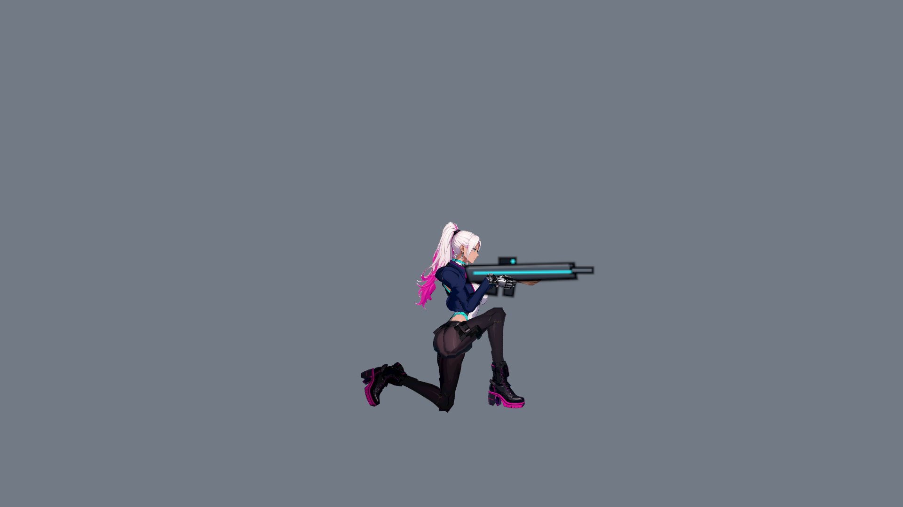

# Commit-9

## 內文

2026-10-09 使用者指出過場走路姿勢與動畫奇怪，而一般關卡較正常。過場原先以固定速度播放步態，角色放大後的步幅與舞台位移不一致。現在凜與其他骨架演員依實際位移、影格時間及演員倍率播放走跑，停止時不再持續踏步，首次出場不產生瞬間大步，兩方向都使用實際移動方向。

返家段落凜的步態速度從固定 70 修正為約 21.56（骨架空間）；舞台移動仍維持原來的 245 像素／2.6 秒。老 K 兩段往返也沿用原距離與時間。補入過場問題的需求與驗收條件，三組角色驗收 Skill 同步加入速度空間、鏡頭移動與連續原生演出的檢查規則。

此次交付過場速率修正，對照使用 main 的同一組既有立繪；外套及其他角色部件的素材修復另在進行。外觀仍有未驗收項目，本票維持進行中，不把速度與程式測試通過當作所有動畫及立繪已通過。

### 檢查結果

- 相對固定基準 746f7a55 的受影響測試：43 組、43,774 項，0 新失敗、0 已知失敗（318 秒）。
- 完整測試：78 組、50,526 項，0 新失敗、0 已知失敗（398 秒）。
- 回歸涵蓋凜與老 K、倍率 1／3.8／4.2、兩方向、出場、停止與跑步；一般關卡的動作測試亦包含在完整套件中。
- 實際 CutscenePlayer 的凜返家與老 K 往返，Forward+ 原生 1920×1080、連續擷取後按原時間編碼成影片，沒有插值放大。診斷播放只縮短淡入並略過對白，保留原舞台、演員、距離與移動時間，故事檔沒有更動。
- 影片、原生取樣、逐格位移資料、來源雜湊與測試紀錄保存在以下目錄；所有驗收條件保持實際狀態。

### 原生畫面與連續演出

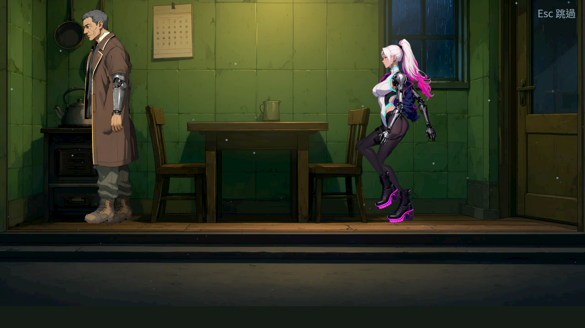

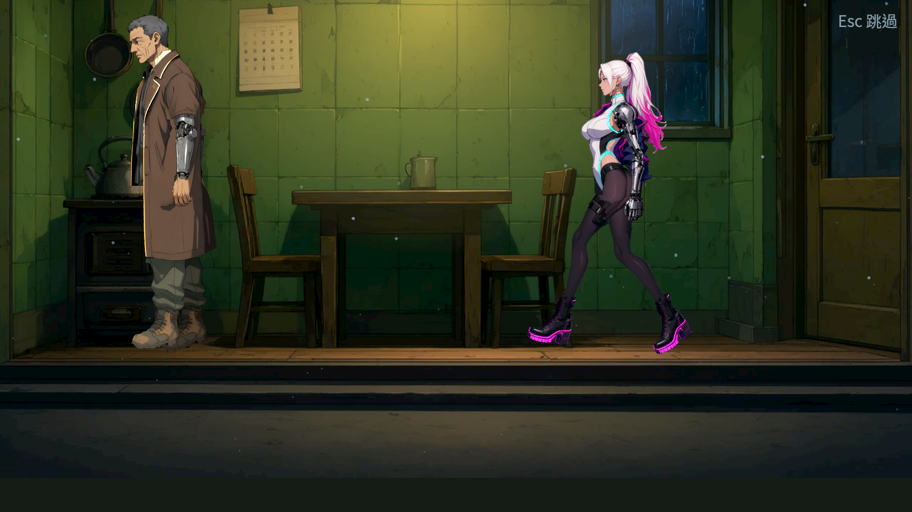

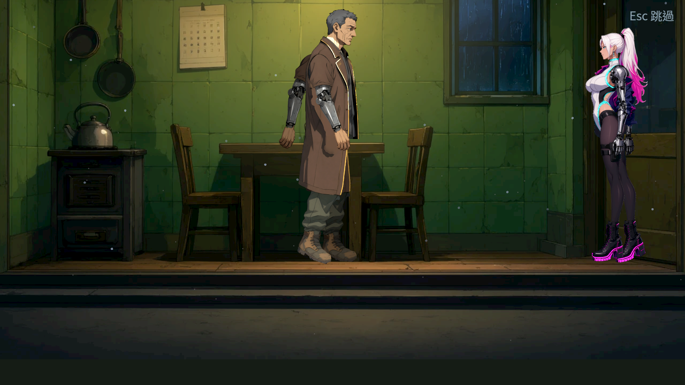

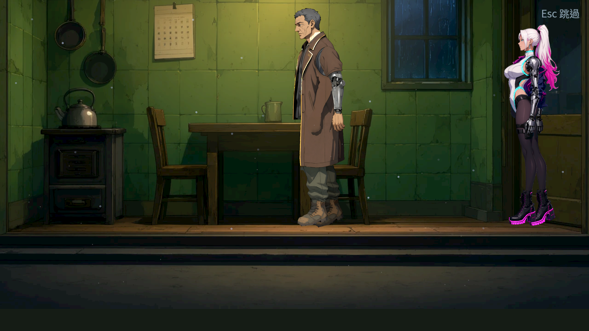

[凜修前影片](images/NE-222-cutscene-walk/before.mp4)／[凜修後影片](images/NE-222-cutscene-walk/after.mp4)

[老 K 修前影片](images/NE-222-cutscene-walk/old-k-before.mp4)／[老 K 修後影片](images/NE-222-cutscene-walk/old-k-after.mp4)

# Commit-10

## 內文

依使用者補充更新倒地驗收：仰躺與俯臥須有獨立的全身姿勢與落地過渡，由最後一擊來源選擇，不能以站姿整體轉平交付。使用者提供的兩張參考圖已原尺寸保留並連結，共用的全部件驗收流程同步加入倒地檢查。

目前轉平試作仍不符合這項要求，原生畫面保留為拒收例子，票維持進行中；參考圖與文件交付不代表倒地動作已通過。

### 文件檢查

- 兩張參考圖與附件原檔 SHA-256 一致，解析度分别為1024×1291與500×500。
- 三份共用驗收文件內容相同；票、設計文件與圖片引用檢查通過，文件預覽已產生並檢視。
- 本段只更新文件及證據，沒有執行遊戲測試或宣稱動作已實測通過。

### 參考與文件預覽

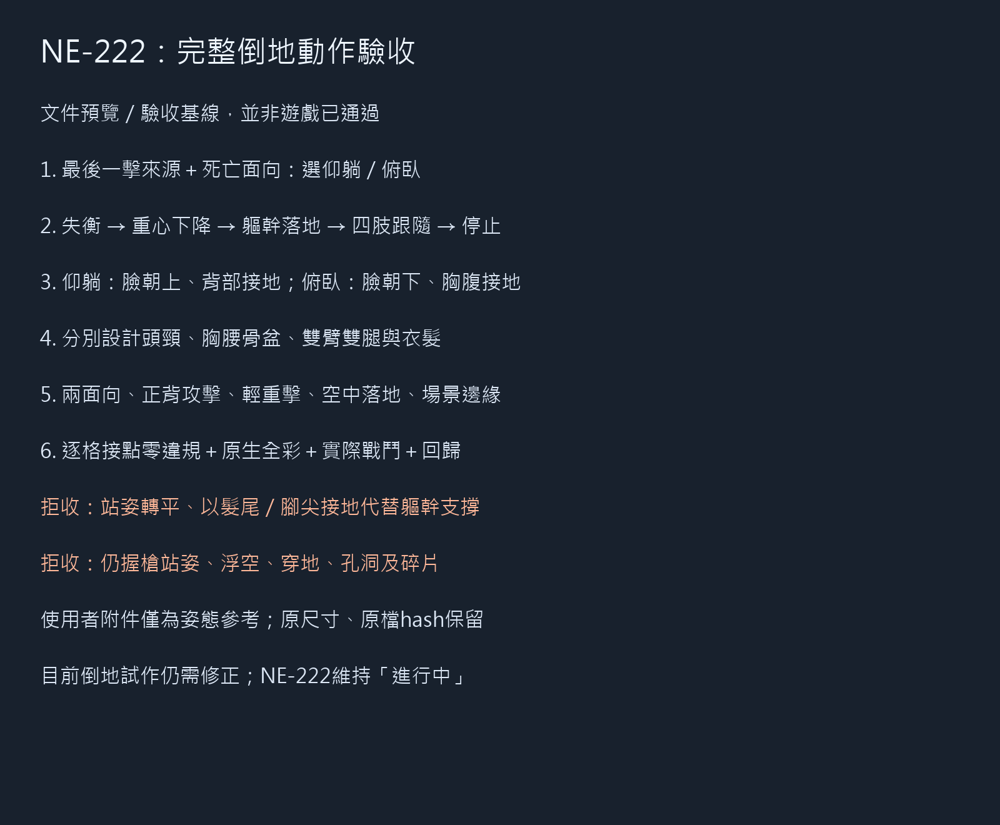

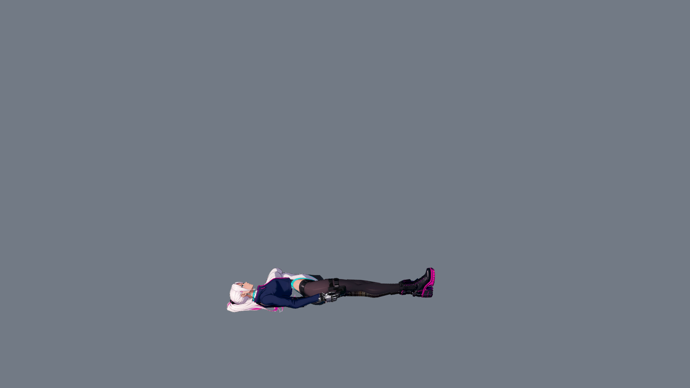

# Commit-11

## 內文

凜受傷時原本把整張衣物、軀幹與腿的圖形拋出，地上出現像身體被拆散的零件。現在凜保留原有衣物受損與回血恢復，整張角色零件不再成為飛散物；命中粒子與真正裝甲敵人的装甲片脫落維持運作。使用者提供的原尺寸問題圖已連結，角色來源與零件PNG沒有重新生成或改寫。

實際受傷、回血及致命傷回歸涵蓋兩面向與前後來源，敵人裝甲飛散另有回歸。四個原生HP歸零案例各保留五張影格；修前每例拋出10張完整零件，修後四例均為0。對照使用相同已發布的美術與光照，修前開啟舊飛散行為，來源與每張PNG的雜湊保存在圖片資料夾的manifest。

本段圖像只驗證飛散分類：沿用的舊倒地仍浮空，是拒收姿態，不能當作仰躺／俯臥或全部件接合通過。本票保持進行中，完整倒地及其他動作依各自驗收條件判定。

### 測試結果

| 項目 | 結果 |
|---|---|
| 受影響測試，固定基準6029f21c；選擇器擴為全部78組 | 50,569項，零新失敗、零已知失敗，162秒 |
| 另跑完整78組 | 50,562項，零新失敗、零已知失敗，163秒 |
| 配方與切圖資料回歸 | 布林值、錯誤型別拒絕、預設／停用／啟用交付皆通過；凜配方0錯誤、0警告 |
| 真正受傷／回血／致命傷與敵人裝甲 | 通過；錯誤執行期資料有安全預設 |
| Forward+ HDR 2D原生對照 | RTX 4070 SUPER，40張1920×1080原圖；修後四例完整零件飛散數均為0 |
| 技能與來源 | 三組驗收文件一致；角色PNG、骨架、動作及原定稿未改寫；本次沒有生成工作 |

首次受影響測試有一項舊断言仍要求凜衣物飛散（49,236項，一項失敗），已改為檢查坑洞傷害不散落整張身體圖形，同時保留敵人裝甲飛散測試；失敗與重跑紀錄均保留在test-logs.zip，沒有加入known_failures。無頭測試的本機探針確認沒有GPU裝置；原生擷取與匯入使用共享鎖。

### 截圖

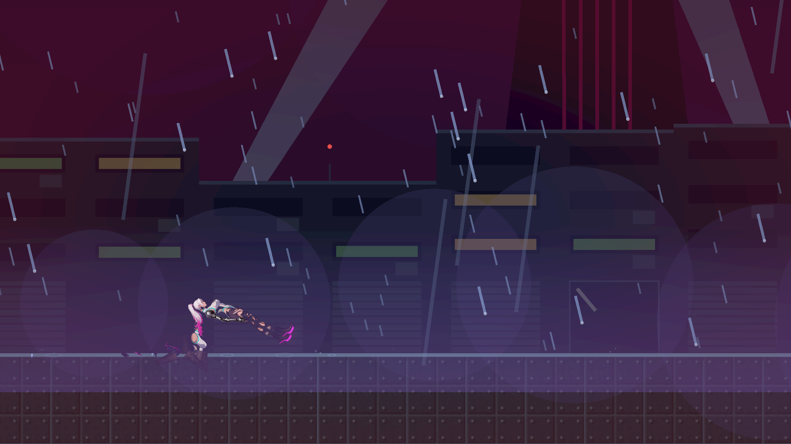

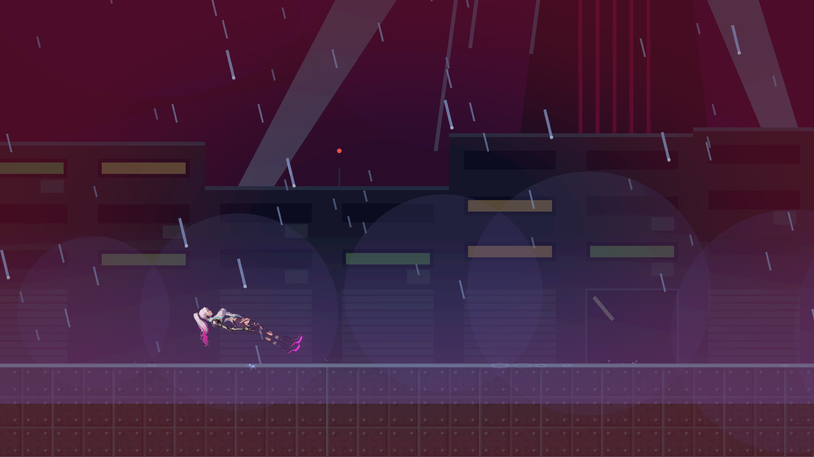

[完整四例原生影格與來源](images/NE-222-body-debris/manifest.json) · [受影響測試](images/NE-222-body-debris/changed-tests.txt) · [完整測試](images/NE-222-body-debris/full-tests.txt) · [含首次拒收結果的完整log](images/NE-222-body-debris/test-logs.zip)

# Commit-12

## 內文

補入使用者「體態像鴕鳥」的回報及獨立人体姿勢驗收，三組骨架檢查文件同步加入原圖／補全底層校準、髖膝踝與鞋底的坐標區分、身體下沉不能重算、承重與完整輪廓檢查。接縫沒有洞，仍不能讓不合理體態過關。

以下原生圖是本Session保留的拒收試作，用於說明需要檢查的輪廓問題；並未確認它們就是使用者當時看到的同一版本。骨盆前傾試作已從實作工作目錄撤回。新的來源校準試作仍有臀腿凸塊與前腿問題，也不計為通過。本段只交付需求、拒收規則與圖像證據，票維持進行中，人體姿勢及相關動作條件保持未勾選。

### 文件檢查

- 三組本次新增驗收規則一致；Markdown圖片與文件引用、原圖尺寸與SHA-256均已核對。
- 原生圖為RTX 4070 SUPER／Forward+的1920×1080全彩PNG，按原始位元組保存，沒有插值放大。
- 文件提交沒有執行遊戲測試，不把本機未交付試作的測試數據算入此次交付，也不把試作當作美術通過。

### 拒收畫面

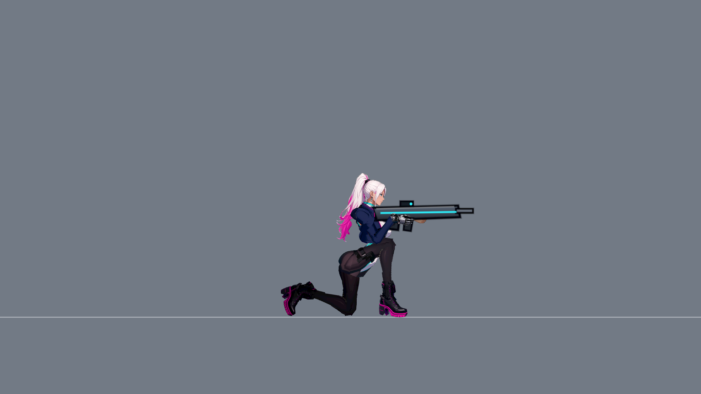

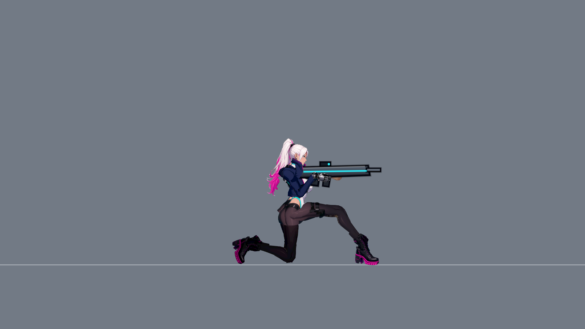

# Commit-13

## 內文

角色局部修復原本可能重新覆寫無關零件，尺寸不符的覆蓋圖則只被略過，容易讓新舊素材混用。現在局部重跑保留無關零件的原始位元組，相關遮罩會重新計算；人工修補的來源圖與最後覆蓋圖在交付前檢查名稱、原画布或切圖尺寸與RGBA格式，不合要求時停止並保留既有遊戲素材。

三組素材流程技能同步補入可重跑與來源記錄規則，明確區分來源修復、貼圖交付、獨立重建與實機驗收。此次只交付流程工具子範圍，不將離線工具檢查當成角色體態、動畫或接縫通過；票維持進行中，各動作的驗收仍依實際結果判定。

### 測試結果

| 項目 | 結果 |
|---|---|
| 離線素材流程回歸 | 通過；涵蓋快取、共享鎖、遮罩對應、資料驗證、Godot錯誤偵測、局部保留、相依重算及無效覆蓋拒絕 |
| 非法輸入 | 空名稱、未知名稱、空清單項、未知部件、錯誤尺寸與RGB圖均拒絕；既有交付PNG與骨架資料保持一致 |
| 受影響測試，固定基準e468251a | 選擇器沒有選出遊戲套件；直接執行上述工具回歸，沒有宣稱遊戲測試通過 |
| 技能與文件預覽 | 三組技能位元組一致、引用檢查通過；實際瀏覽器擷取文件與測試輸出 |
| GPU與生成 | 此次離線驗證不載入模型、不使用GPU，沒有重新生成角色 |

### 文件預覽

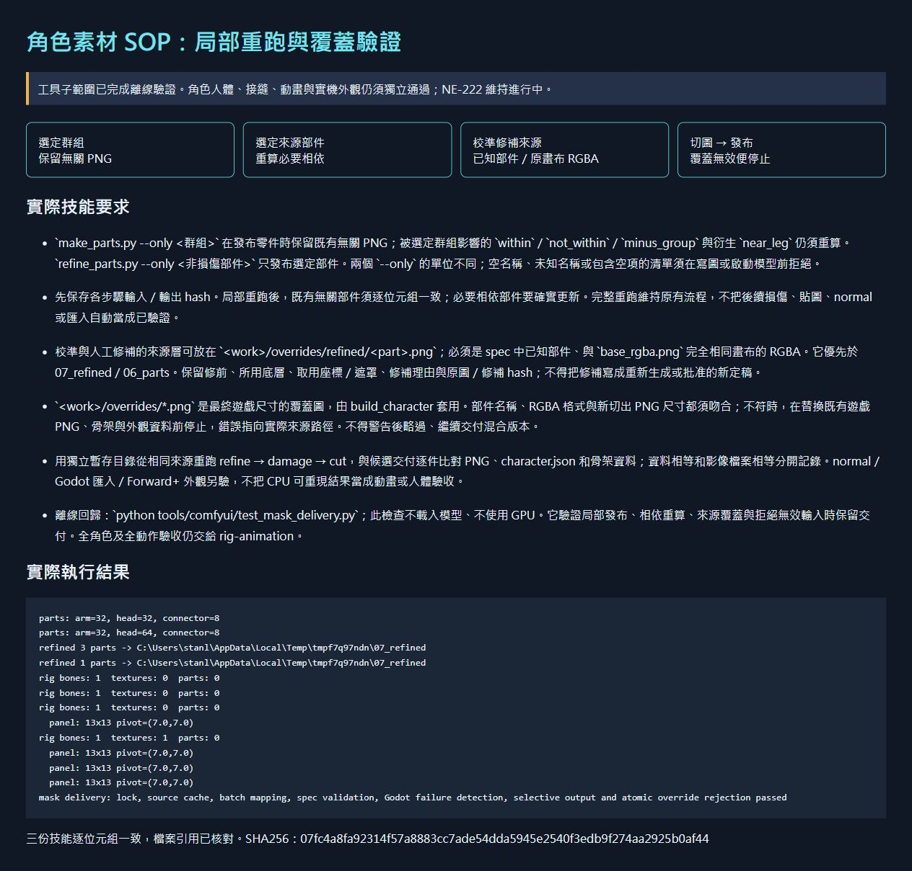

[離線回歸紀錄](images/NE-222-selective-pipeline-tests.txt) · [固定基準受影響測試選擇紀錄](images/NE-222-selective-pipeline-changed.txt)

# Commit-14

## 內文

依使用者要求暫停動作調參，實際查閱Godot、Spine官方製作文件、版本討論與遊戲作者的手感說明，對照目前正式程式及拒收试作。研究整理各接點、臀腿、單膝跪姿、倒地、外套與清晰度的可行做法，以及工具取捨與先驗兩個姿勢的小樣門檻，供恢復實作前審查。

研究與文件可審查，不代表姿勢、動畫或全部件已通過；票維持進行中，原驗收條件未新增勾選。

[角色骨架與動作製作方法研究](../../design/12-cast-redraw/RIG_WORKFLOW_RESEARCH_2026-10-09.md)

### 文件檢查

- 一手來源連結已實際開啟查閱，製作原則、專案推論與待執行驗證分開標示；舊教程的4.7版本提示及實驗性介面保留說明。
- 本輪只更新研究與票的交付紀錄，沒有修改角色素材、動畫、玩法或共用技能，沒有執行或宣稱遊戲測試通過。
- 文件與圖片引用、Markdown差異及實際瀏覽器文件預覽均檢查。

### 文件預覽

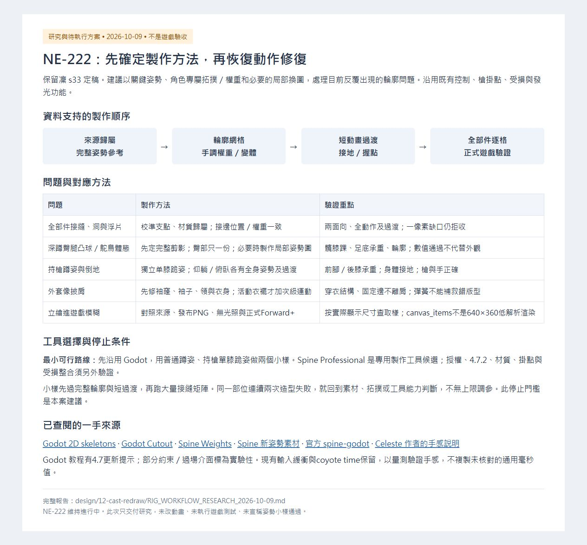

# Commit-15

## 內文

依使用者同意開始為新姿勢製作新部件。保留凜s33定稿、臉與已發布的角色素材，另製普通蹲及持槍單膝跪的腰髖腿部候選，完成12張可見部件的原尺寸分割、來源與原生組合小樣。第一輪仍接近站姿或不能承重的生成已拒收；各輪提示詞、種子、完整原圖、局部衣料修正、遮罩和分割依據均保留。

普通蹲的灰底與誤切鞋跟、後鞋內多出的鞋帶，以及跪姿鞋旁的游離鞋帶小片已處理。腰部依原上衣實際材質接邊校準，候選圖的中心不再當成腰支點。這是來源與組合工具子範圍；原生圖明示候選，沒有替換正式遊戲動畫。

候選的完整遠側底層、正式固定骨長、接點逐格、進出姿勢、光照／發光及操作檢查尚未通過，對應驗收條件保持未勾選；預覽中的後鞋調整亦不計為綁定通過。本票維持進行中。三組技能同步補上已彎曲素材不能二次折彎、圖中心與接邊坐標區分，以及候選骨長／隱藏層不得當成正式通過的檢查。

[候選來源、已檢查範圍與可重跑步驟](../../art_src/characters/rin_pose_variants/README.md)

### 測試結果

| 項目 | 結果 |
|---|---|
| 固定基準a85b23f9的受影響測試 | 選擇器為空；未修改正式角色／動畫／玩法，另執行工具回歸與完整測試 |
| 離線來源／分割回歸 | 3項通過：原尺寸裁切與支點還原、12件無游離連通片與來源alpha全認領、局部修改區外保留、重跑相同，以及錯誤雜湊／畫布／分割不覆寫前次輸出 |
| 完整78組遊戲測試 | 50,561項，零新失敗、零已知失敗，165秒；不能代替新動畫的實機驗收 |
| 原生組合截圖 | Godot4.7.2／RTX4070SUPER／Forward+ HDR2D；1920×1080、兩面向3.4倍與1倍小樣；沒有插值放大截圖 |
| 來源與技能 | 批准原圖及正式角色來源未覆寫；三組新增技能內容一致；模型目錄確認為D:/ComfyUI，生成與Godot工作使用共享鎖並依序執行 |

### 截圖

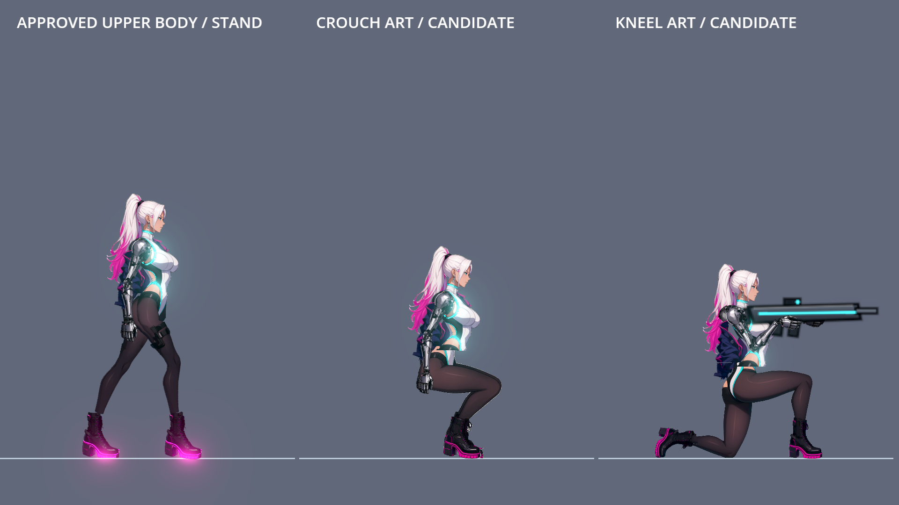

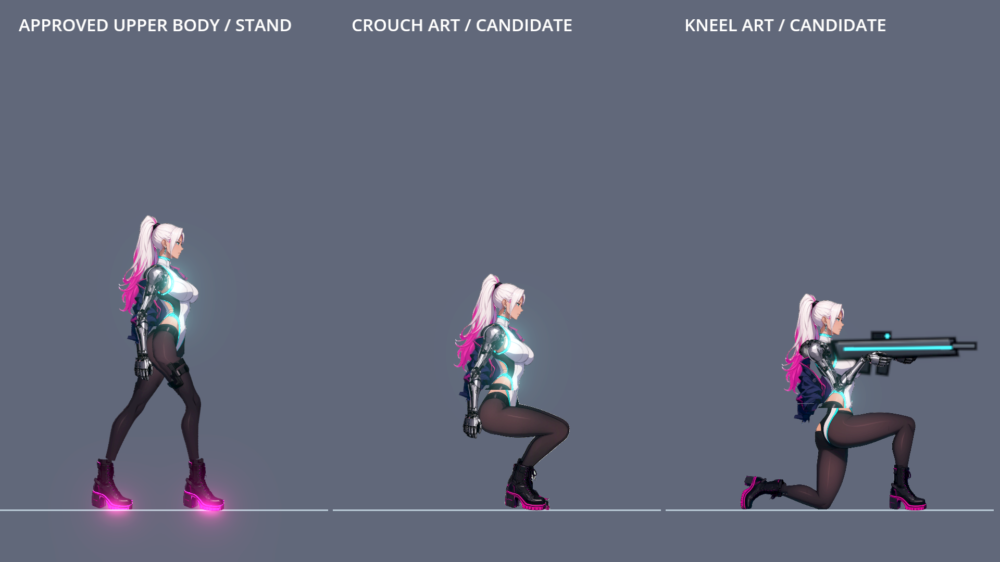

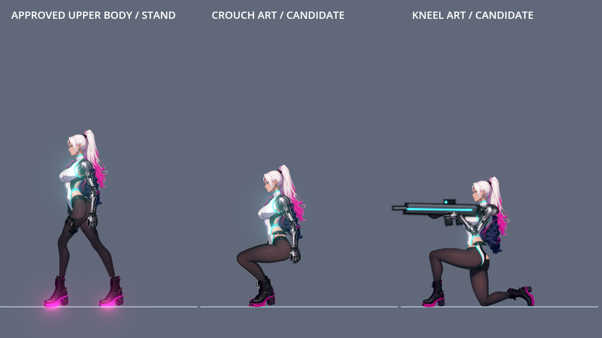

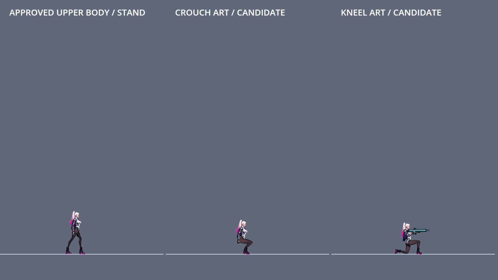

[來源工具回歸](images/NE-222-new-pose-source-tests.txt) · [受影響測試選擇](images/NE-222-new-pose-changed-tests.txt) · [完整測試](images/NE-222-new-pose-full-tests.txt) · [含骨長差值的原生預覽紀錄](images/NE-222-new-pose-native-review.txt)

# Commit-16

## 內文

姿勢參考原本在畫面中畫出了網格部件，但分件索引只記錄9件，身體與完整衣物的參考也完全相同。現在同姿勢的完整衣物索引包含16件，坐、蹲雙側參考各包含22件；各部件的原圖與實際彎曲後位置可核對，全部子骨維持正式骨架長度。

切圖依實際彎曲形狀對位，直接取樣至交付尺寸，避免重複縮放與預設銳化。近遠側共用來源時拒絕互相覆寫，無效第二份參考也不會留下半套輸出。保留修前及修後的原生透明參考、來源雜湊與重跑紀錄；參考中的既有衣物、臀腿與姿勢仍不作美術或動畫通過，本票維持進行中，驗收條件未新增勾選。

[姿勢參考來源與重跑說明](../../art_src/characters/rin_pose_variants/00_bind_reference/README.md)

### 測試結果

| 項目 | 結果 |
|---|---|
| 固定基準861b09d0的受影響測試 | 148項，零新失敗、零已知失敗 |
| 來源與切圖回歸 | 5項通過，涵蓋彎曲對位、損壞資料、第二份輸入失敗保留舊交付、近遠側覆寫拒絕及既有參考相容性 |
| 完整78組遊戲測試 | 50,596項，零新失敗、零已知失敗，162秒 |
| 原生參考與畫面 | Godot4.7.2／RTX4070SUPER／Forward+；8张832×1216透明參考無裁掉邊界，1920×1080原生檢視圖；屬工具核對，非遊戲姿勢驗收 |
| 共用SOP | 三組角色製作技能同步，凜批准來源未覆寫 |

### 截圖

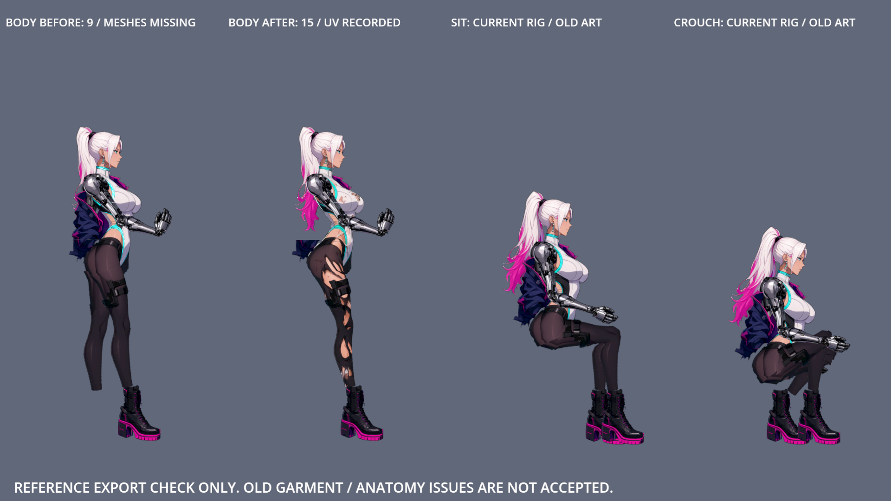

[受影響測試](images/NE-222-bind-reference-changed-tests.txt) · [完整測試](images/NE-222-bind-reference-full-tests.txt) · [來源切圖回歸](images/NE-222-bind-reference-source-tests.txt)

# Commit-17

## 內文

凜的外套原本披在肩背，手臂從破碎衣片中滑出。現在肩領與本體固定，兩側衣袖隨上臂和前臂活動，連續短衣襬保留布料重疊並有小幅彈簧動態。沿用已保存的局部衣物來源；批准的s33原圖、臉與所有非外套貼圖保持逐位元組一致。原始圖、提示詞、seed22261、模型、遮罩、對位與重建依據均保留。

衣襬接點的八狀態、兩面向、1倍與3.4倍共3840個逐格樣本沒有孔洞或斷開。這項結果只涵蓋衣襬；肩袖與手腕的獨立診斷仍有失敗，完整人體、蹲跪及全部件驗收維持未勾選，狀態仍為進行中。修前與修後採相同視窗、姿勢、裝備、尺度和光照，照片為實際Godot原生擷取。

[局部外套來源與重建說明](../../art_src/characters/rin_worn_coat/README.md)

### 測試結果

| 項目 | 結果 |
|---|---|
| 固定基準d8087fe7的受影響測試 | 49,060項，零新失敗、零已知失敗，164秒 |
| 完整78組遊戲測試 | 50,597項，零新失敗、零已知失敗，166秒 |
| 来源與離線建置 | 三層重建一致；損壞來源於寫入前拒絕；非外套貼圖不變；切件、人物與骨架資料可重現；既有離線流程回歸通過；規格0錯誤、0警告 |
| 衣襬原生接點稽核 | 3840樣本，零違規；完整原生alpha影格、metadata與報告附壓縮檔，可解開重驗 |
| 根部與衣襬重點測試 | 648項，涵蓋肩根位移、固定接合、直接子骨及錯誤綁定安全退回、AnimAudit、主角動作與圖層 |
| 相同條件CPU成本 | 10角色、暖機120格、3000格、3次；平均每角色181.45→190.43µs，增加8.98µs；中位數增加8.14%；429頂點，未提高500頂點上限。此為局部衣物成本，不代表整票GPU／記憶體與NE-204總預算驗收 |
| 原生對照 | Godot4.7.2、RTX4070SUPER、Forward+ HDR2D、1920×1080；生成停止，GPU工作使用共享鎖；沒有插值放大截圖 |
| 共用流程 | 三組角色製作及骨架技能一致；明確區分固定肩領、袖根、連續衣襬與獨立接點驗收 |

### 截圖

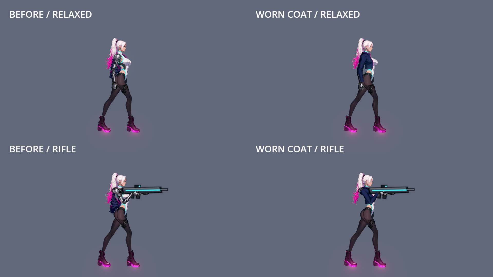

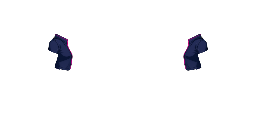

[受影響測試](images/NE-222-worn-coat-changed-tests.txt) · [完整測試](images/NE-222-worn-coat-full-tests.txt) · [來源及重建](images/NE-222-worn-coat-source-tests.txt) · [CPU量測](images/NE-222-worn-coat-perf.json) · [衣襬逐格完整原生資料](images/NE-222-worn-coat-hem-audit.zip) · [衣襬報告](images/NE-222-worn-coat-hem-report.json) · [肩袖診斷：未通過](images/NE-222-worn-coat-shoulder-diagnostic.json)

# Commit-18

## 內文

高解析來源在切成遊戲零件前被縮為約84.1%，造成可避免的細節損失。現在同一批來源以原圖密度重切，頭部從113×120變為133×141；其他部件、支點、法線、發光和眨眼位置一併更新。批准原圖保持不變，身體骨架、武器掛點及部件掛載／圖層／明暗資料完全相同，沒有以低解析貼圖插值放大代替。

頭像原本略過已核對的來源修補層，與遊戲可能使用不同衣物。現在兩者讀取相同來源；凜從280×280的原圖裁切輸出256×256頭像，無效來源在寫入前拒絕。其他角色的既有預設尺寸保持相同。

原生背包畫面確認角色子視窗為576×768，實際視窗1920×1080；開場亦以原生Forward+重新擷取。接縫、左右手、蹲跪與倒地仍依原未勾選條件驗收，本段不宣稱全姿勢或全部件完成，狀態維持進行中。

### 測試結果

| 項目 | 結果 |
|---|---|
| 固定基準5045de7f的受影響測試 | 3299項，零新失敗、零已知失敗，53秒；包含人物貼圖密度、實際載入diffuse／normal尺寸、頭像及衣襬接合 |
| 完整78組遊戲測試 | 50,652項，零新失敗、零已知失敗，167秒 |
| 頭像離線回歸 | 修補層優先、指定尺寸、錯誤尺寸／RGB來源拒絕並保留交付、未指定尺寸的舊角色行為通過 |
| 來源及尺度契約 | 批准原圖hash不變；骨架、武器掛點與掛載資料相同；k由0.841→1，texture_scale同步0.05→0.04205；十九組diffuse／normal及三組glow尺寸吻合 |
| 貼圖記憶體計數 | diffuse／normal／glow的RGBA解碼資料3,319,396→4,597,864 bytes；不含mipmap與引擎額外資料，不冒充GPU記憶體實測 |
| 原生畫面 | RTX4070SUPER、Godot4.7.2、Forward+ HDR2D、1920×1080；來源密度修前／修後相同姿勢與光照，背包及開場採實際UI／過場 |
| 流程及來源 | 只重跑切件、法線、匯入與頭像，保留既有manifest歷史；三组製作技能一致 |

### 截圖

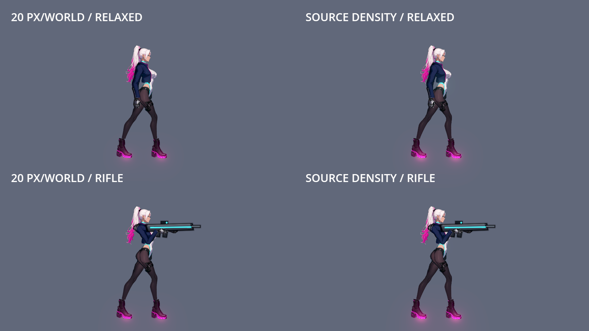

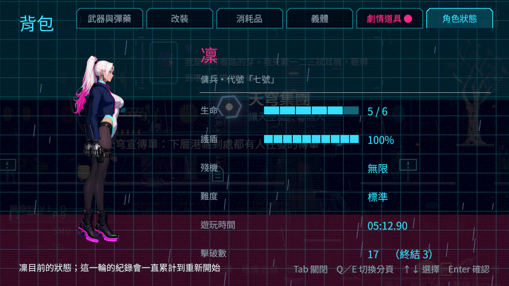

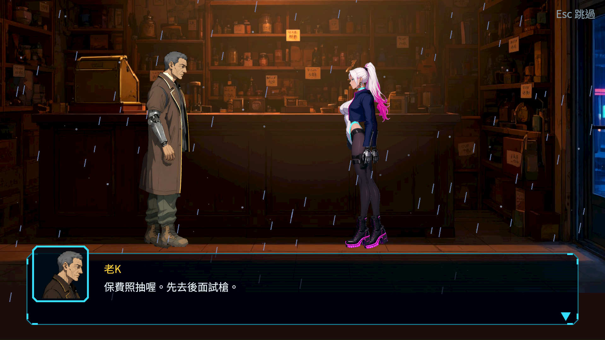

[来源與尺寸契約](images/NE-222-source-density-contract.json) · [受影響測試](images/NE-222-source-density-changed-tests.txt) · [完整測試](images/NE-222-source-density-full-tests.txt) · [頭像回歸](images/NE-222-source-density-portrait-tests.txt) · [原生GPU紀錄](images/NE-222-source-density-native.txt)

# Commit-19

## 內文

凜的前後手原本共用機械手，手腕被當成槍柄握點，後手也夠不到護木。現在右手機械義肢與左側人體手臂各有獨立素材；休息／握持只在原有兩個手部節點切換。手腕按原圖接頭中心校準，掌心實際握住槍柄、護木和話筒，武器材質握點不變。其他沒有握持附件的角色沿用原有外觀。

精修曾將原圖的金屬粉紅反光當成洋紅雜點，挖出上臂41個及腕部9個透明像素；已按保存的原始分件逐點恢復。袖子按上臂與前臂各自的來源軸切開，保留肘部35來源像素重疊；SAM漏掉的533個深藍描邊像素從原圖受限邊界恢復。關節切圖保留第一與最後的實際材質列，重跑不再裁掉兩端重疊。批准s33原圖hash保持相同，新的局部握持來源、提示詞、seed22275、實際工作流及遮罩完整保留。

原生逐格檢查包含八狀態、左右面向、1倍／3.4倍和120格。六個腕／袖口／肘接点的23040個樣本仍有860個違規；腕與袖口四接點的同範圍子集為240／15360。主要是近側袖子的小孔或邊界碎點，及左向倒地起始兩格的腕部覆蓋。本次結果不作全部件通過，原驗收條件未新增勾選，票維持進行中。完整原生alpha影格、metadata、報告附壓縮檔，可解開後重驗。

[左右手來源及重建](../../art_src/characters/rin_hands/README.md) · [外套來源及重建](../../art_src/characters/rin_worn_coat/README.md)

### 測試結果

| 項目 | 結果 |
|---|---|
| 固定基準ebc65bf5的受影響測試 | 49,168項，零新失敗、零已知失敗，161秒 |
| 完整78組遊戲測試 | 50,704項，零新失敗、零已知失敗，164秒 |
| 無頭測試環境 | Godot4.7.2、Dummy音訊驅動；首輪斷言無失敗但音訊退出卡住，停止後重新完整執行，首輪不作驗證完成 |
| 握持與退回回歸 | 两面向、單／雙手、上下瞄準、空手、電話與死亡切換；兩個手節點不變，掌心與物件握點誤差小於0.025世界像素；未配置角色行為保持原有契約 |
| 離線來源與切圖回歸 | 無效附件、錯誤骨頭、非有限握點與無效來源腳本拒絕；損壞來源在任何覆寫前拒絕，兩次重建逐位元組相同；50個原始金屬像素及所有切口材質列保留 |
| 最新接點逐格 | 860／23040違規，未通過；沒有提高alpha門檻、忽略單像素孔洞或修改已知失敗清單 |
| 相同條件CPU對照 | 生成停止，無其他Godot；10角色、暖機120格、3000格、3次，平均增加11.82µs／角色，中位數增加5.96%；429→477頂點，低於既有500上限；只代表本次局部CPU成本 |
| 原生畫面 | RTX4070SUPER、Forward+ HDR2D、1920×1080；相同尺度／姿勢／光照，保存的舊素材與新素材比較，沒有擷取後放大 |
| 共用流程 | .agent／.agents／.claude三組製作及骨架技能一致，登記局部來源隨textures自動恢復，不重跑已完成生成 |

### 截圖

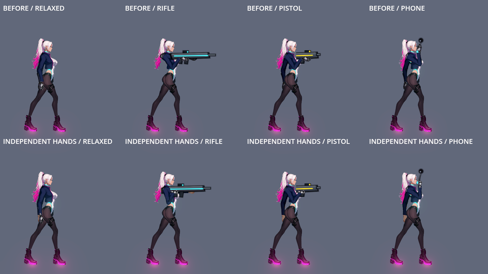

[受影響測試](images/NE-222-hand-attachments-changed-tests.txt) · [完整測試](images/NE-222-hand-attachments-full-tests.txt) · [來源回歸](images/NE-222-hand-attachments-source-tests.txt) · [原生GPU紀錄](images/NE-222-hand-attachments-native.txt) · [CPU量測](images/NE-222-hand-attachments-perf.json) · [未通過的逐格報告](images/NE-222-hand-attachments-joint-report.json) · [完整原生逐格alpha資料](images/NE-222-hand-attachments-joint-audit.zip)

# Commit-20

## 內文

最近CI兩次在「設定關閉後焦點還原」失敗，本機低畫面更新率也重現。GUI檢查原本用物理步進等待，最後一次方向鍵還沒處理就可能關閉畫面；現在等實際GUI更新，完整送出按下與放開，並按控制項文字找到設定按鈕，避免新增選單項目後仍把第二顆按鈕當設定。原有焦點、覆蓋與章節標題卡斷言保留，增加開啟前焦點確認；未變更選單或遊戲行為、未加入已知失敗。

這次只修正必要回歸的驗證時序。姿勢專用素材仍在製作，全部接點、動作、倒地與操作驗收未因此勾選，NE-222維持進行中。

### 測試結果

| 項目 | 結果 |
|---|---|
| 低畫面更新率回歸 | 相同Godot4.7.2、10FPS，修前70項中焦點及章節卡兩項失敗；修後71項零失敗。完整方向鍵按下／放開，不放寬焦點斷言 |
| 固定基準afdb70cc受影響測試 | UiScreensSuite，71項，零新失敗、零已知失敗，16秒 |
| 完整78組測試 | 50,706項，零新失敗、零已知失敗，162秒 |
| 首輪完整執行限制 | Windows測試資料目錄傳入相對路徑，目錄fixture建立失敗；改用隔離的絕對資料目錄後重跑以上完整結果，首輪不作通過證據 |
| 原生畫面 | RTX4070SUPER、Godot4.7.2、Forward+、1920×1080，實際關卡暫停／設定、方向鍵導航與關閉後原設定按鈕的焦點；附原生擷取及可重跑檢查來源 |
| 截圖退出紀錄 | 擷取與焦點斷言成功；工具退出仍報ObjectDB及8個資源未釋放，原log完整保留，不宣稱退出完全無警告／錯誤 |

### 截圖

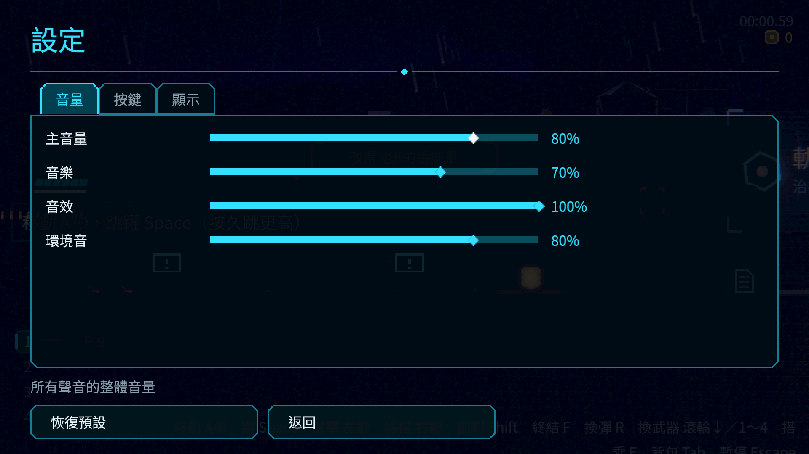

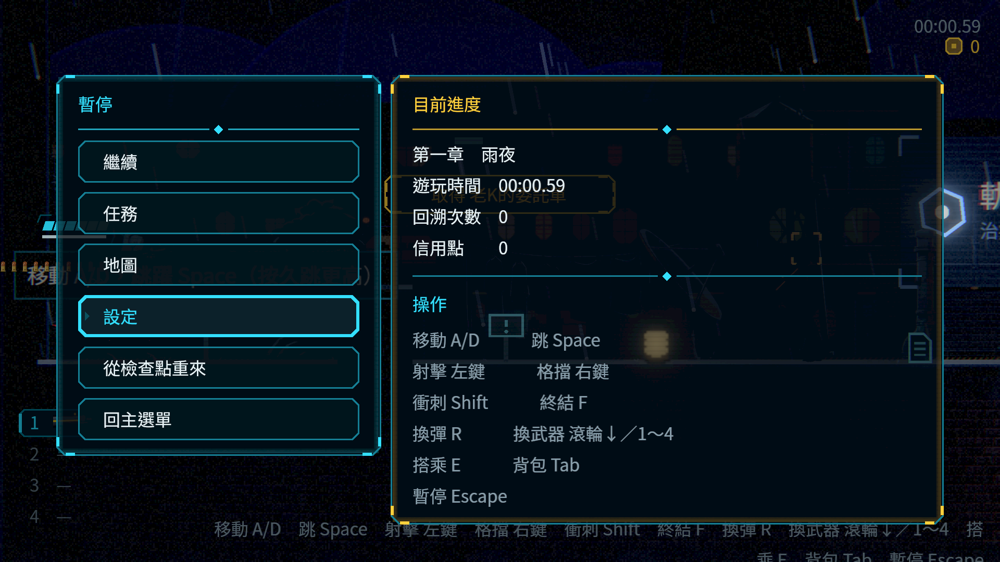

[受影響測試](images/NE-222-ci-focus-changed-tests.txt) · [完整測試](images/NE-222-ci-focus-full-tests.txt) · [低FPS修前](images/NE-222-ci-focus-low-fps-before.txt) · [低FPS修後](images/NE-222-ci-focus-low-fps-after.txt) · [原生擷取](images/NE-222-ci-focus-native.txt) · [擷取檢查來源](attachments/NE-222-ci-focus-capture.gd)

# Commit-21

## 內文

保留使用者2026-10-10提供的兩張原始PNG，記錄新跪姿候選因臀部體積歪斜、雙手外觀與跨部件明暗不一致而退件。補入可觀察的驗收條件：全彩外觀、實際可見武器握持與全部接點均須通過，隱藏武器的诊斷圖及接點數值不能替代。票維持進行中，本次未新增任何通過勾選。

### 測試結果

| 項目 | 結果 |
|---|---|
| 圖像與來源 | 兩張使用者PNG逐位元組保留，來源與票內副本SHA256一致，未縮放或修圖 |
| 文件檢查 | 圖片可解碼、相對連結存在，Commit-21接續原Commit-20，既有驗收勾選不變；新增條件未勾選 |
| 遊戲與姿勢驗收 | 本次只記錄退件及驗收需求，未修改遊戲或正式角色素材，不宣稱遊戲測試、修復畫面或人工驗收通過 |

### 截圖

# Commit-22

## 內文

五組雙手武器敵人的扶槍手原先離開握點約1.5～4.4世界像素。現在雙手都在固定臂長可達範圍內，左右面向、實際巡邏與跑步取樣的握點誤差接近零；原武器握點、骨長及槍口資料保留。凜的五個遠側手臂、手掌與袖子取消額外0.62壓暗，讓原圖陰影與法線按實際場景受光。配方與正式外觀一致，切圖、支點、法線及發光來源未改。

本段交付握點求解與明暗修正；使用者退件的跪姿臀部、掌指外觀及全部接縫條件保持未勾選，票維持進行中。握點數值不代表手指已自然包住槍柄，隔離步態不代替全部動作或實際戰鬥驗收。

### 測試結果

| 項目 | 結果 |
|---|---|
| 首次受影響測試，固定基準4a754af0 | 50,407 checks、0新增／已知失敗；58組被選取、實際57組，未登記的私有診斷套件不計執行 |
| 同步最新main後的受影響測試，固定基準4b32e788 | 39,083 checks、0新增／已知失敗；52組被選取、實際51組，163秒；巡邏與滿速使用遊戲同一速度上限 |
| 額外敵人與合併回歸 | 11,379 checks、0新增／已知失敗，63秒；實際6套件，含突擊、重裝、偵察敵人及第二章、環境檢查；請求清單重複一次第二章美術，未重複計執行套件 |
| 握點與骨長 | 五組實際皮膚／武器、兩面向、兩速度，每組60格；前後手維持既有0.025世界像素容差，兩條手臂骨長不變；凜、空手、手槍、護盾與NPC控制通過 |
| 配方重跑 | 同來源的30張PNG含3張發光圖逐位元組一致；20骨、尺寸、支點、兩個掌心偏移與掛點一致，只有五個tint變動；155來源／正式檔案hash不變。未執行normal builder，不宣稱重建法線通過 |
| 受控原生明暗 | Forward+、HDR 2D、RTX 4070 SUPER；8/8對照通過，未變動部件取樣RGB一致、法線與材質仍在；後掌握點殘差最大約0.000069世界像素 |
| 原生畫面 | 五組敵人修前／修後各32相位、倍率3.4；凜三種關卡光照修前／修後，均保留原生PNG及完整日誌。關卡after退出時有16個ObjectDB與4個資源仍使用訊息，未宣稱零ERROR；無SCRIPT ERROR |
| 相同條件CPU效能 | 每組10演員、120格暖機、3000固定格、三次前後交替；五組增幅2.03%～7.89%，頂點222～300不變，30樣本通過。只量動畫CPU，不代表渲染FPS或全票效能验收 |
| 文件與Skill | 三組全部件驗證文件一致；補入解剖、實際來源歸屬、可見武器握持與diffuse／normal／glow檢查，連結及檔案hash檢查通過 |

完整日誌保留負向測試與退出資源訊息，未更動known failures。完整測試交由CI執行；[證據、原生尺寸、重現方法與範圍](images/NE-222-grip-lighting/README.md)及[各次實際套件與SHA256](images/NE-222-grip-lighting/manifest.json)可供其他Session核對。

### 原生對照

以下特寫只檢查雙手、袖子與受光，不計全身或跪姿驗收。

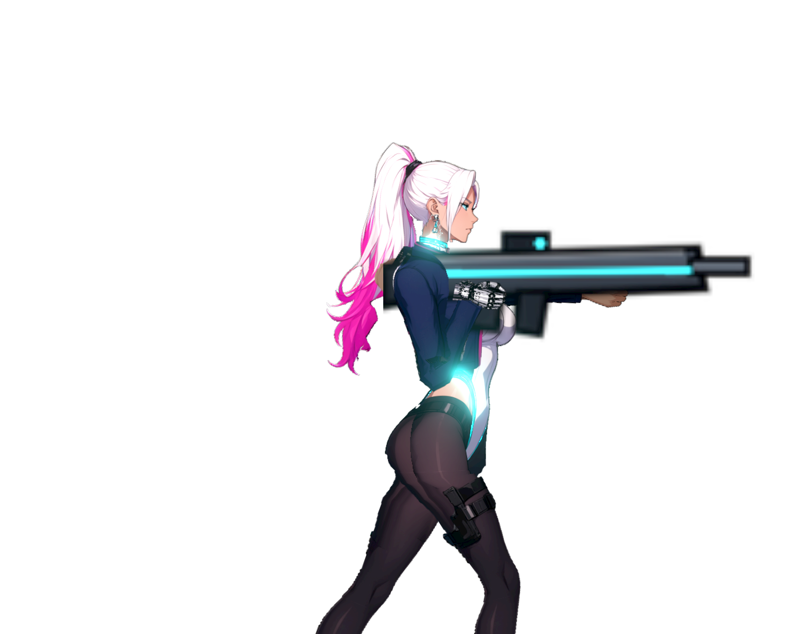

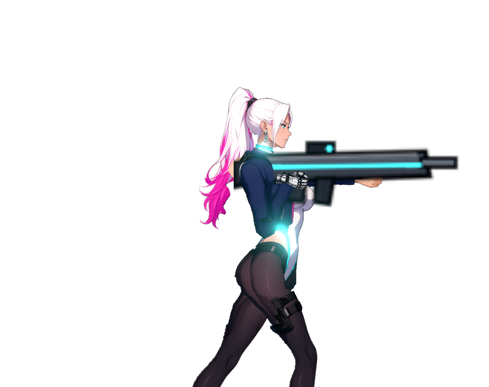

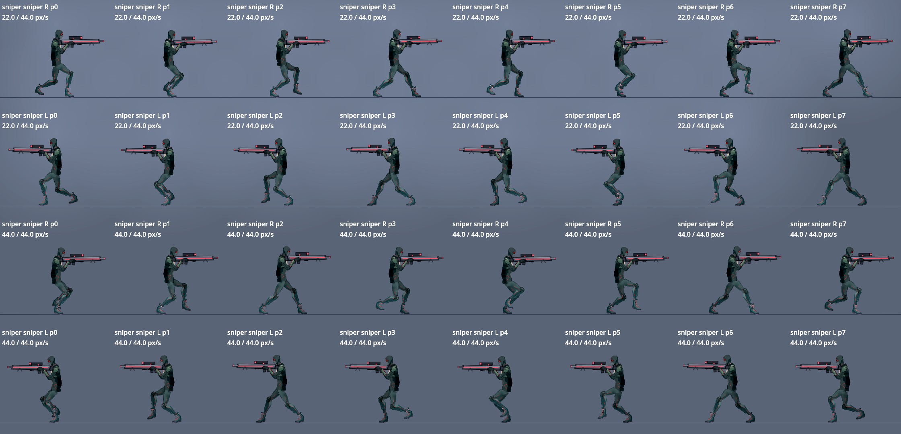

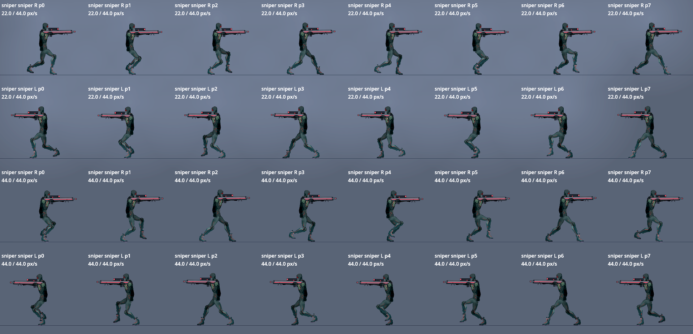

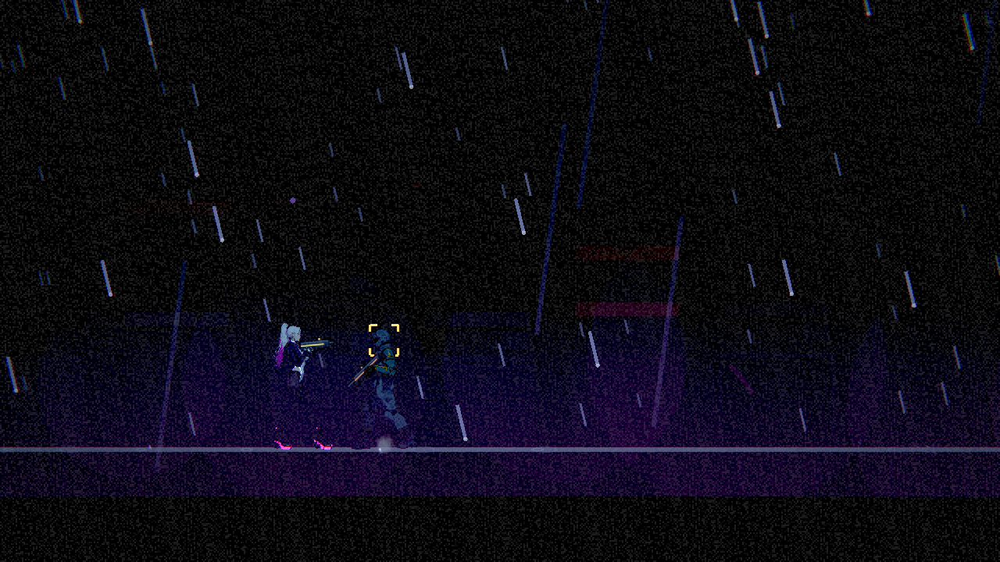

# Commit-23

## 內文

新跪姿的骨架定位揭露共用腿部解算的角度分支問題：同一個正常彎膝可能記成超過一圈的負角，造成反膝稽核誤判。現在兩條腿使用等價的最短角差，固定骨長、端點及腳掌方向保持不變，真反膝的負控制仍被抓到。修正涵蓋其他使用共用人形解算的角色，不放寬任何稽核限制。

以凜實際二十骨父鏈與 rest 核對，涵蓋兩面向、前後腿、四象限、角度分支與旋轉父骨，並保存修前反例及修後原生定位圖。這次交付供新素材製作使用的正確骨架基線；定位圖沿用現有部件，不能當成臀腿、手、接縫或完整跪姿外觀通過。全票狀態與未勾選條件保持進行中。詳見[範圍與可重跑證據](attachments/NE-222-leg-ik/README.md)。

### 測試結果

| 項目 | 結果 |
|---|---|
| 修前初版回歸 | 100 checks／2 failures：局部角度範圍與膝蓋方向；端點及腳掌方向已通過 |
| 修後完整回歸 | PostureSuite 101 checks／0 failures；72 組 IK，全部 rest／父鏈不變，真反膝 -0.2 rad 仍超過原 0.1 rad 門檻 |
| 受影響測試 | 固定基準 e6c7424e、SHARDS=2，selector 53 群、39,445 checks，0 新／已知失敗，390 秒；未註冊的 EnemyArtDeliverySuite 不計驗收 |
| 最新 main 合併回歸 | 同步 727dd8e1 的槍彈修正；姿勢、動作、操作與投射物四套件 3,220 checks，0 新／已知失敗，18 秒 |
| 原生定位 | 四張 PNG，兩面向 1×／23.78×，最大 1198×1049；Godot 4.7.2、Forward+、RTX 4070 SUPER，exit 0 無 SCRIPT ERROR |
| 完整遊戲與美術驗收 | 本次未宣稱通過；完整測試交 CI，外觀條件保留未勾選 |

### 截圖

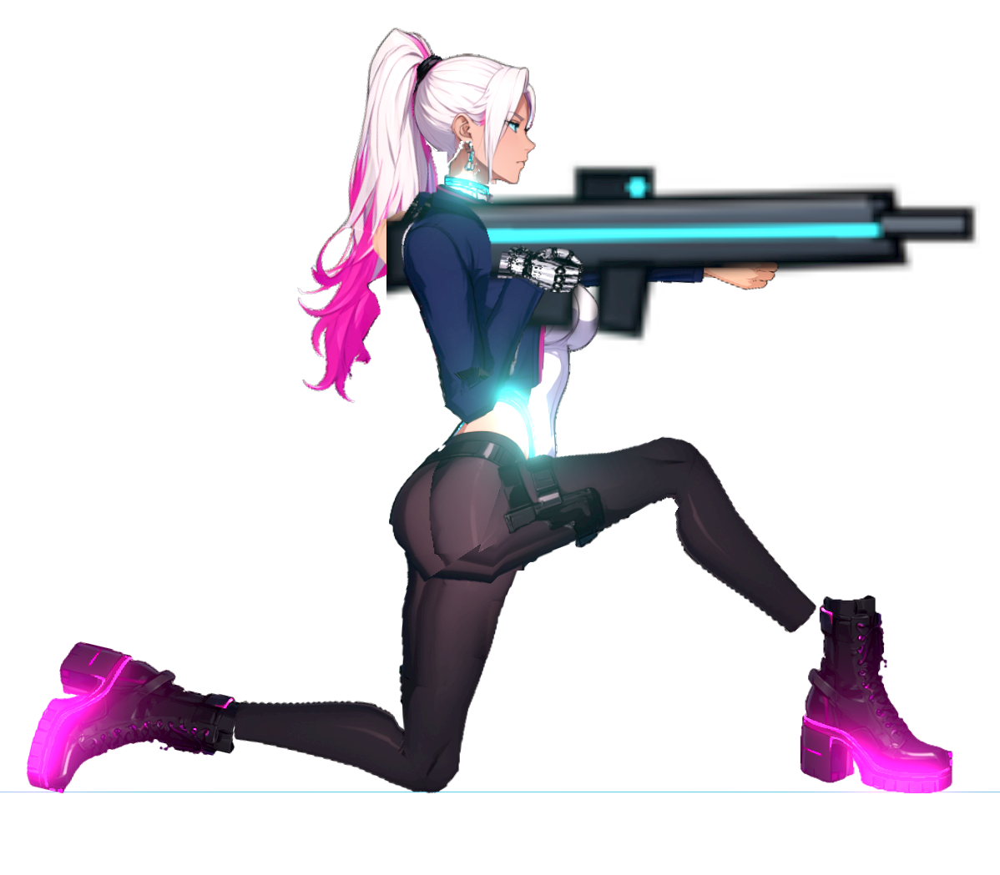

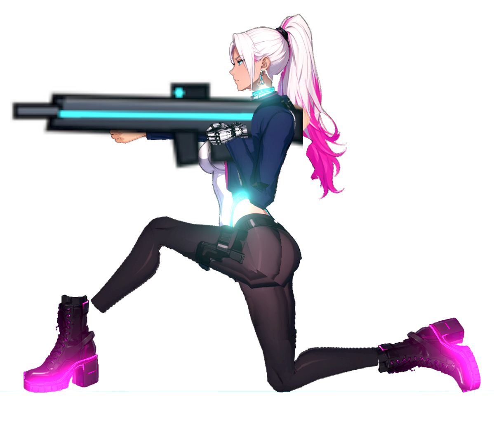

# Commit-24

## 內文

新跪姿需要獨立部件，既有外觀原先沒有完整替換與還原的支援。現在同一部件可選擇姿勢專用圖，保留原骨頭、圖層及光照；每個邏輯部件只顯示一件，損傷時顯示相應姿勢的底層，清除後還原目前護甲狀態。錯誤或不完整的一組素材拒絕使用，原角色仍可運作。製作 SOP 三份同步補入替換件的幾何及驗收限制。

本段交付共用替換支援，原生驗證使用明確標記的合成控制與既有圖。正式新姿勢素材、玩家動作與完整外觀條件未因此勾選，票維持進行中。[範圍、原始失敗、測試及重跑方法](attachments/NE-222-pose-parts/README.md)。

### 測試結果

| 項目 | 結果 |
|---|---|
| 固定基準 7d22ad92 的受影響測試 | 乾淨 checkout，41,177 checks，零新增／已知失敗，212 秒 |
| 專項四套及負控制 | 2,779 checks，零失敗、無 SCRIPT ERROR；錯誤來源、尺寸、支點、骨頭、法線、重複部件與損傷配對均拒絕 |
| 原生含網格對照 | 清除後六列精確還原；相同來源 selected／base 比較六列失敗，差異僅在骨盆。保留原結果，不列為同幾何通過 |
| 原生同幾何控制 | Forward+／RTX 4070 SUPER／HDR 2D，92 checks、零失敗、退出 0；六組面向／護甲狀態 RGBA 一致，normal／glow 與二十骨保持不變 |
| 同條件動畫 CPU | 十名角色、3,000 格、三次交替，既有未配置角色平均增幅 4.43%，477 頂點不變；不代表新姿勢或渲染效能驗收 |
| 退出紀錄對照 | 四套基線有 233 個 ObjectDB 警告及 3 個資源仍使用；候選 221 個 ObjectDB 警告、無該資源錯誤，完整 log 保留 |

### 截圖

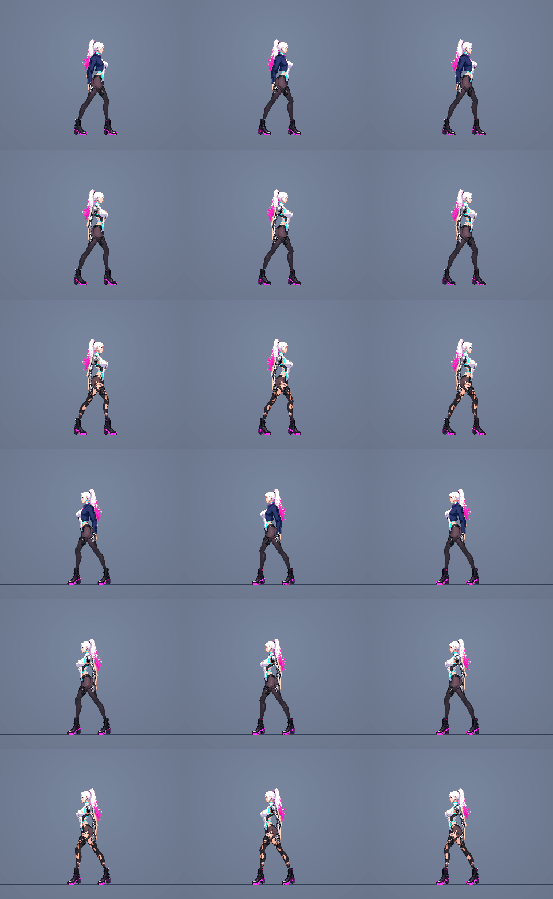

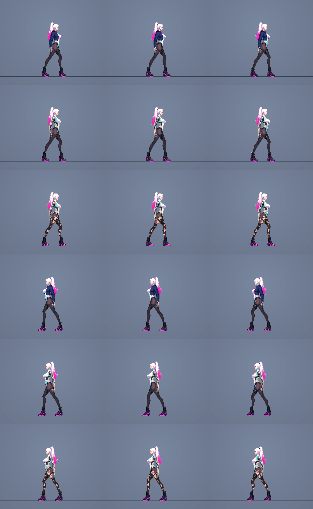

# Commit-25

## 內文

新跪姿的前膝分件在小幅動作時仍會露出單像素孔洞；單純增加來源重疊也沒有通過。現在已彎曲的姿勢素材可沿用正式骨架，以共同接邊變形，切換後保留目前動作，清除後還原原綁定。每個部件保留自己的原圖像素，原解析度、正常圖層及損傷配對規則維持；錯誤的一組資料整組拒絕，不留下半套替換件。

本次交付共用綁定支援與前膝的局部來源對照。原生逐格接點失敗由64／480降為0／480，公開附件重新執行的480張PNG也與首次成功版本逐張hash相同；單像素門檻沒有改動。原始生成圖、提示詞／種子／工作流程、七件來源歸屬、失败控制及重跑方法保存在[公開證據](attachments/NE-222-native-pose/README.md)。全票維持進行中，本段不勾選完整角色外觀或玩法條件。

### 測試結果

| 項目 | 結果 |
|---|---|
| 固定c744a44f基準受影響測試 | 16,163 checks，0新增／已知失敗，204秒；沿用基準註冊表，未註冊的新套件不計本輪驗收 |
| 正式註冊與骨架回歸 | 五套3,295 checks、0失敗，含新套件117項；最後嚴格索引修正後五套3,299 checks、0失敗，含新套件121項 |
| 極小小數索引負控制 | 修前121 checks／1 failure，修後拒絕該組；原失敗log保留 |
| 最新main合併 | 保留951f3add的其他Session成果；核心流程及五套骨架4,785 checks，0新增／已知失敗，99秒 |
| 來源與可重跑性 | 1440×736原始RGBA、211,990保留來源像素，七件互斥歸屬；115份生成輸出兩次重建byte-identical，前膝每件25頂點，500預算不變 |
| 公開附件原生重跑 | Godot4.7.2／Forward+／HDR2D／RTX4070SUPER，共享GPU鎖；2,018 checks、0失敗，exit0，無SCRIPT ERROR；480張PNG逐張hash一致 |
| 原生逐格接點 | 兩面向、1×／3.4×、每組120格；原剛體64／480失敗，先前來源重疊試作46／480失敗，本次0／480；alpha與單像素拒收規則不變 |
| 驗收範圍 | 本輪為前膝幾何對照；來源候選、合成損傷控制及無陰影接點圖不計全身解剖、材質光照、完整姿勢進出或操作手感通過 |

### 截圖

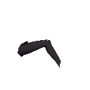

# Commit-26

## 內文

新姿勢網格原先沒有納入外觀範圍與動畫翻面檢查，可能讓未接好的新部件漏驗。現在可見的新網格與原部件一樣參與檢查，隱藏替代件和發光子層不重複計算；故意翻面的新網格，即使沒有舊肢體網格，也會超過原門檻而被拒收。製作驗收規則三份同步補上這項反例與檢查限制。

本段交付共用檢查修正。相同來源的前膝原生逐格對照仍是0／480失敗，480張圖與已公開來源對照逐張hash相同；全票保持進行中，完整角色外觀與動作條件不因此勾選。[範圍、原始測試與重跑方法](attachments/NE-222-native-mesh-audit/README.md)。

### 測試結果

| 項目 | 結果 |
|---|---|
| 修前有效負控制 | 乾淨48f94b12基準，140 checks／8 failures，無SCRIPT ERROR；漏驗外觀範圍、加權變形、損傷與翻面均實際被揭露 |
| 修後專項 | 141 checks／0 failures；非零綁定、兩骨不同動作的獨立數值對照、根變換、隱藏、損傷、切換與還原通過 |
| 最新main受影響測試 | 固定3b14844a乾淨checkout，60個已註冊群、16,409 checks，0新增／已知失敗，exit0，347秒；不包含其他未交付素材 |
| 原生回歸 | Godot4.7.2／Forward+／HDR2D／RTX4070SUPER、共享GPU鎖；2,033 checks／0 failures、exit0，無SCRIPT ERROR |
| 原生接點 | 兩面向、1×／3.4×、120格；原門檻0／480失敗，480張PNG逐張與公開來源對照hash一致 |
| 檢查範圍 | 翻面不代表縮窄、面積壓縮、接縫、全身解剖或操作手感通過；各自維持原驗收門檻 |

### 截圖

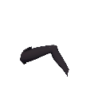

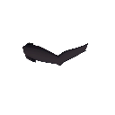
