# [NE-222] 逐一檢查主角動作與部件並修正

> 狀態：進行中

## 內文

### 需求
使用者認為主角的動畫大致沒問題，但「部件有很多奇怪的地方」。要把主角（凜）的**每一個動作、每一個姿勢、每一個部件**認真看過一遍，凡是看起來不對的都修好，不能再只在特寫下看過就結案（NE-204、NE-220 的結案被推翻）。範圍包含下面這些使用者明確指出的問題，以及檢查過程中發現的所有其他問題：

1. **開場姿勢**：遊戲一開始（`ch1_c01_open`）凜是蹲著的，看不出理由。要依劇情站著、靠著或坐著，並符合櫃台與老 K 的位置；整個過場與序章（ST-16）的所有姿勢都要有理由。
2. **蹲下的姿勢**：NE-205 已經把蹲姿改成臀部落到腳跟、膝蓋向前，但最近又看到奇怪的姿勢，要找出是哪個動作（遊戲內蹲下、過場蹲姿、蹲著瞄準、蹲著走）退化或沒套用，修好並鎖住不再退化。
3. **部件接縫與破圖**：關節交界（髖、肩、肘、腕、膝、踝）、臀部、腰（上半身與下半身交界）、頸、肩與軀幹，每個部件連接的地方在任何動作與過場倍率下都不能露出縫、缺角或直線切口。
4. **外套**：外套的形狀、分片與圖層順序要看起來是一件外套（領子、衣身、下擺），在站、跑、跳、蹲、瞄準、受擊時都合理，不再是一團破碎的藍色塊。
5. **左右手**：前手與後手的形狀、與槍的位置關係、手腕接縫要正確，握槍、持近戰武器、空手、打電話（握話筒）時都自然。
6. **發光效果**：主角的霓虹發光（鞋、軀幹、骨盆）要在 Forward+ 下確認仍然有「亮亮的」效果，且不會因為修正過曝（NE-213）而消失。

試作的多關節網格（旋轉混合）已存成 `pm/Nest-Egg/attachments/NE-222-multizone-joint-wip.patch`，原因與已知問題見 `design/12-cast-redraw/RIG_QUALITY.md` 的「補記（2026-10-07，NE-222）」；可以採用、修改或換成更好的做法，但要符合 CLAUDE.md 的品質要求（資料驅動、效能、容錯、不破壞原有功能）。

### 2026-10-08 使用者補充：外套、解剖與接合品質

1. 所有本組角色的動畫要合理且無破圖；分割不得帶入多餘的手、其他肢體或錯誤部件，支點、骨架與圖層綁定必須正確。
2. 動畫與實際操作須配合，參照可查證的業界原始資料；沒有可靠公開數字的參數標為專案建議值，需實測。輸入、攻擊、跳躍的既有時序不能因衣物或姿勢修正退化。
3. 立繪比例、解剖、衣物穿著與遮擋均須合理，去除明顯生成瑕疵；沿用 NE-17 已同意的 s33 定稿外觀，修復派生零件。
4. 凜的外套目前讀成披肩。須讓領口、肩線、袖窿、袖子與衣身形成穿著結構，衣襬有合適的彈簧動態；不可只搖動現有破碎藍塊。
5. 上下半身被切開、沒有正確接在一起也屬破圖。軀幹／腰、骨盆／髖與大腿須在所有動作保持合理連接，不能以色塊遮掩，需逐格接縫量測及圖像檢查。以下重裝角色截圖是此類問題的明確例子，個別美術修復承接 NE-181，共用骨架修復由本票負責。

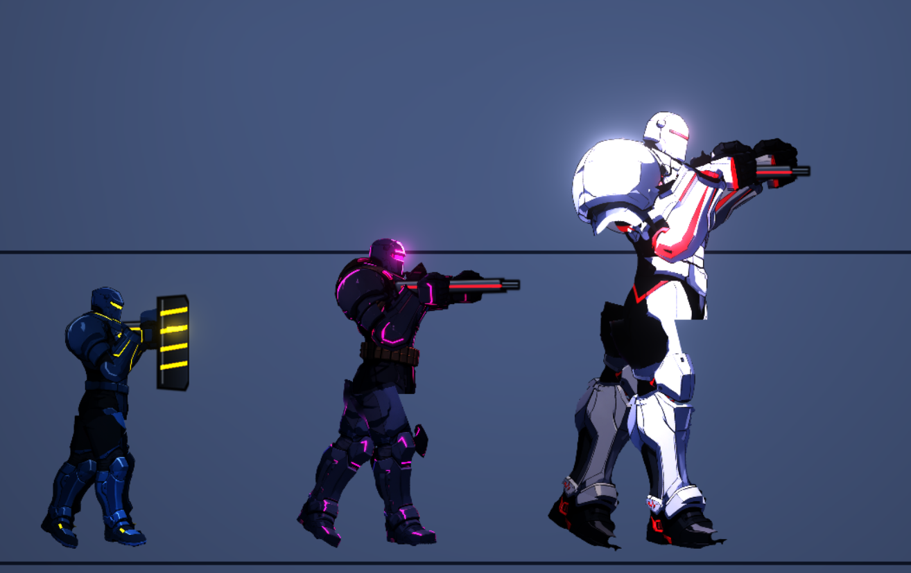

### 來源
- 2026-10-07 使用者回報（附過場開頭蹲姿與站姿特寫兩張截圖）：「最一開始的時候是蹲著的」「主角還是有很多破圖的地方，關節的交界處、屁股的地方、上半身跟下半身的交界處，每個部件連接在一起的時候都有很多破圖」「主角的外套、左右手都長得非常奇怪，現在動畫我覺得大致上沒問題」。
- 同日補充：「原本主角不是會亮亮的嗎？為什麼效果沒了」「蹲下的動畫不是有優化過，為什麼又變成這個奇怪的姿勢」，要求開票、認真仔細把所有動作與動畫看過一遍，花久一點沒關係。

### 驗收條件
- [ ] 凜的高解析來源細節從分件到遊戲、過場及背包均保留：記錄來源／輸出／Godot 載入／實際螢幕像素，修正不必要降採樣與 UI 子視窗放大；原生高解析修前／修後截圖比較臉、眼、髮絲、衣物與接點，不把 PNG 插值放大當清晰度修復。
- [x] 固定生成至交付 SOP：Qwen 原生 RGBA、來源與快取、骨架校準、正確單件分割、底層補全、尺寸／pivot／貼圖密度、重新組合、逐格接點與全動作、Forward+ 實機品質；串接 rig-animation，.agent／.agents／.claude 三份一致。
- [ ] 小裂縫、單像素孔洞、缺角、切斷輪廓與漂浮碎片均已解決；不得因大缺口消失就給過。保留逐格失敗紀錄與修後證據。
- [ ] 所有適用角色的所有部件正確接合：依 rig-animation 的部件帳本與接點表逐角色驗證，包含頭頸、眼睛、髮根、衣物固定邊、雙臂雙腿、手與持物、護甲及非人形附件，不得以只驗腰髖或只驗凜替代
- [ ] 建立「動作與姿勢清單」：主角所有遊戲內動作（待機、走、跑、跳、下落、落地、蹲、蹲走、衝刺、各角度瞄準與射擊、近戰全部招式、格擋、完美格擋、受擊、硬直、死亡、爬梯、上下載具、打電話、換彈、換武器）與所有過場姿勢（站、靠、坐、蹲、跪、倒下、起身等），清單放在票上，每一項都有檢查結果
- [ ] 每一項動作與姿勢在**過場倍率（約 3.4 倍）與遊戲倍率**各逐格看過（每個動作至少起始、峰值、結束三格，循環動作至少四格），問題與處置記在票上並附前後截圖
- [ ] 開場（`ch1_c01_open`）凜的姿勢有明確理由且與場景吻合，不再無故蹲著；三場過場的所有演員姿勢逐一確認；有自動檢查擋住「沒有理由的蹲、坐、跪」
- [ ] 蹲下相關的所有動作（遊戲內蹲、蹲走、蹲瞄、過場蹲姿）的姿勢正確：腳掌平放、臀部落到腳跟附近、膝蓋向前、上身不穿插；找出退化原因並加回歸測試
- [ ] 所有部件接縫在全部動作與兩種倍率下沒有可見的縫、缺角、直線切口、露出背景；有自動檢查（沿每個關節取剖面，輪廓內不得出現背景像素的洞，所有動作逐格量測，違規數為 0）
- [ ] 軀幹手臂洞、腰部帶子與骨盆、臀部與大腿、肩與軀幹的接合處修好（網格、補遮蓋零件，或修改零件圖，擇適合者），修前修後截圖並排留存
- [ ] 外套重新整理：分片、骨頭、圖層順序與下擺擺動（彈簧骨）都合理；站、跑、跳、蹲、瞄準、受擊、死亡的截圖通過檢視；若現有零件圖無法做到，另開美術票（BG 或 NE-221 補充）並在票上寫清楚缺什麼，不得以「看起來還好」帶過
- [ ] 左右手：前後手的形狀、大小、與槍及近戰武器的相對位置、手腕接縫正確；握槍、近戰、空手、握話筒都通過檢視；前後手圖層順序在所有姿勢下不出錯
- [ ] 主角的霓虹發光（鞋、軀幹、骨盆）在 Forward+ 實機畫面下看得到亮亮的效果與適度泛光；與 NE-213 的過曝修正並存，有量測數據證明兩者同時成立
- [ ] 以上修正套用到所有人形角色（敵人與 NPC），不破壞原有功能；AnimAudit、網格、圖層順序、動作與 NPC 動畫的相關測試全部通過，`mesh_fold` 等指標的上限依實測重新校準並記錄理由
- [ ] 效能：人形角色每格動畫的額外成本不超過 NE-204 基線的 50%（`tools/rig_perf_probe.tscn` 量測），頂點與記憶體預算寫在票上
- [ ] 更新 skill `rig-animation`（流程、檢查清單、使用者在意的事項），並把本票結論補進 `design/12-cast-redraw/RIG_QUALITY.md`

### 測試流程
1. 執行 `tools/rig_preview.tscn`（`--chars=rin --closeup --zoom=…`、`--joints`、`--gait`、`--action=…`、`--rigid` 對照），逐項勾選動作清單
2. 到遊戲開頭看過場，確認開場姿勢；到各場過場確認所有演員姿勢
3. 用 Forward+（實機或 lavapipe 軟體 Vulkan）看發光與泛光
4. 執行 AnimAudit 與接縫自動檢查，違規數為 0
5. 完整平行測試無新失敗

---

# 跟其他票的關係

- Blocks：無
- Blocked by：無
- Related：NE-203、NE-204、NE-205、NE-206、NE-209、NE-213、NE-214、NE-218、NE-220、NE-221、ST-16

---

# Commit-1

## 內文

2026-10-08 使用者再次指出所有角色的所有部件都必須正確接合，並要求把完整驗證流程寫成共用 Skill。現在提供立繪與分割、骨架與支點、全接點、逐格像素量測、圖層與掛點、動作、操作手感、Forward+、效能及證據的驗收流程，並同步到 .agent、.agents 與 .claude。使用者提供的重裝角色斷裂實例已連結到本票；凜外套讀成披肩也已記錄。

本次提交只交付需求及 Skill，角色修復與實機驗收尚在進行，原有未驗收條件保持未勾選。

### 檢查結果

- 三份 Skill 與詳細驗證文件內容一致；格式、相對引用及文件預覽已檢查。
- 文件提交沒有執行遊戲測試；不把既有的程式測試或暫時預覽當成本票全角色驗收。

### 文件預覽與問題實例

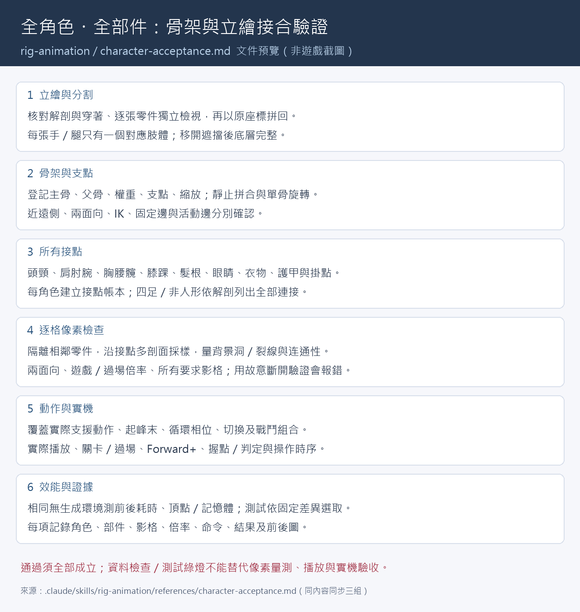

# Commit-2

## 內文

高解析的角色在背包放大後變模糊，因為角色預覽的渲染尺寸固定，沒有跟上實際 UI 的顯示倍率。現在預覽依實際螢幕密度調整，在本次原生擷取的 2515×1415 視窗中，角色渲染尺寸從 384×512 增為 755×1007；相同來源、姿勢與光照的臉部裁切可看到細節改善。要求的 3840×2160 視窗受到桌面限制，實際擷取尺寸是 2515×1415，不將它記為 4K。

新增生成至遊戲的固定 SOP，與既有全部件／動畫驗證流程串接，三組 Skill 副本一致。內容包括 Qwen 原生 RGBA、來源與快取依據、骨架校準、單件分割、補底層、貼圖與支點密度、重新組合、逐格接點、完整動作及 Forward+ 實機品質。文件不把生成成功或測試通過視為美術已通過。

本段交付 UI 清晰度修正與 SOP；全角色接合、凜外套及全動作驗收未完成，票維持進行中，其餘條件保持未勾選。局部穿著外套試作已取得原生透明圖與遮罩，但逐格檢查仍抓到肩、腕、衣襬及小孔，試作不得當作已通過的角色交付。

### 檢查結果

- 固定基準 b411d206 的受影響測試共 2073 項通過，0 新失敗、0 已知失敗（9 組，101 秒）；UI 專項回歸另有 70 項通過。UI 回歸涵蓋父層縮放、不改邏輯尺寸的縮放、視窗 stretch 及縮回時釋放多餘渲染尺寸。
- 三份新 Skill 的格式驗證、內容一致與相對引用檢查通過；文件預覽已檢视。
- 原生修前與修後 PNG 均為 2515×1415，並排圖為相同區域裁切，未插值放大。此比較沿用相同修復前的凜素材，沒有混入外套试作。
- 角色試作的 30 格快速診斷仍有失敗，完整角色驗收未通過；不降低单像素孔洞或接合门槛。

### 原生畫面與文件預覽

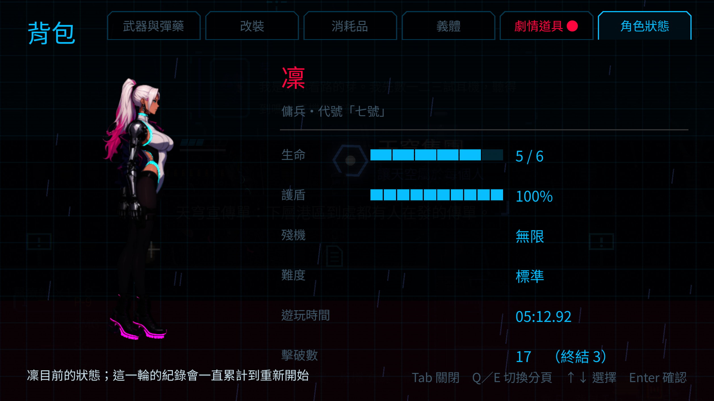

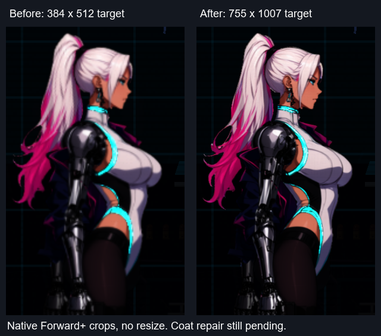

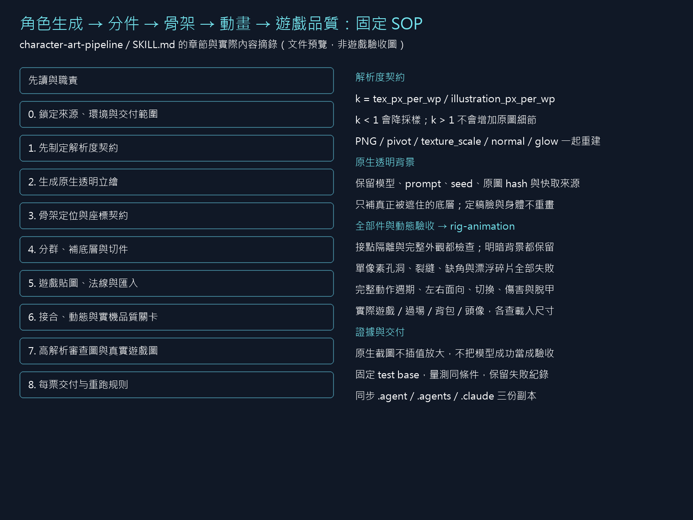

# Commit-3

## 內文

開場凜原本無故蹲在櫃台前，現在站著與老 K 對話。角色站位、朝向、舞台比例與文字保留，原生修前／修後畫面確認此改變。

第一章三場動畫過場加入姿勢理由與支撐檢查：蹲、坐、靠、倒下等姿勢缺少理由、支撐、只有空白或型別錯誤時，資料檢查會失敗。檢查包含進場、換姿勢、移動及到達姿勢與分支。診間坐姿記錄復原後醒來的理由與檢查台座面；另外保留三場的原生自動播放畫面。

本段交付開場修正與可重跑的姿勢交接基線，釋放故事產生器供後續故事 Session 從最新 main 接手。資料檢查不等於語意與家具接觸自動驗收；全過渡、衣物、接縫與未生成的序章未計入完成，票維持進行中。

### 檢查結果

- 固定基準 c4b429f0 的受影響測試共 43691 項通過（42 組，163 秒），0 新失敗、0 已知失敗。過場專項先驗 247 項通過；負向案例證明缺理由／缺支撐會失敗，包含移動到達坐姿。
- 重跑產生器後核對原始文字、旗標、場景與演員配置一致；舞台內容與已合入的來源比例 metadata 保持一致。
- 原生 Forward+ 圖像為 1920×1080：開場修前 8 張、修後 8 張、診間 16 張、回家 18 張。已檢視開場站姿、診間坐姿與起身、回家談話畫面；這些自動播放擷取不是人工操作手感驗收，也不代稱完整逐格接縫驗收。
- 新第一章三場均保留姿勢政策，腳底字幕構圖檢查通過。後續故事基線與介面記在姿勢文件，兩組 scene-staging Skill 同步。

### 實際畫面

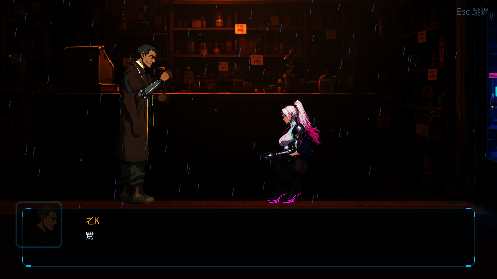

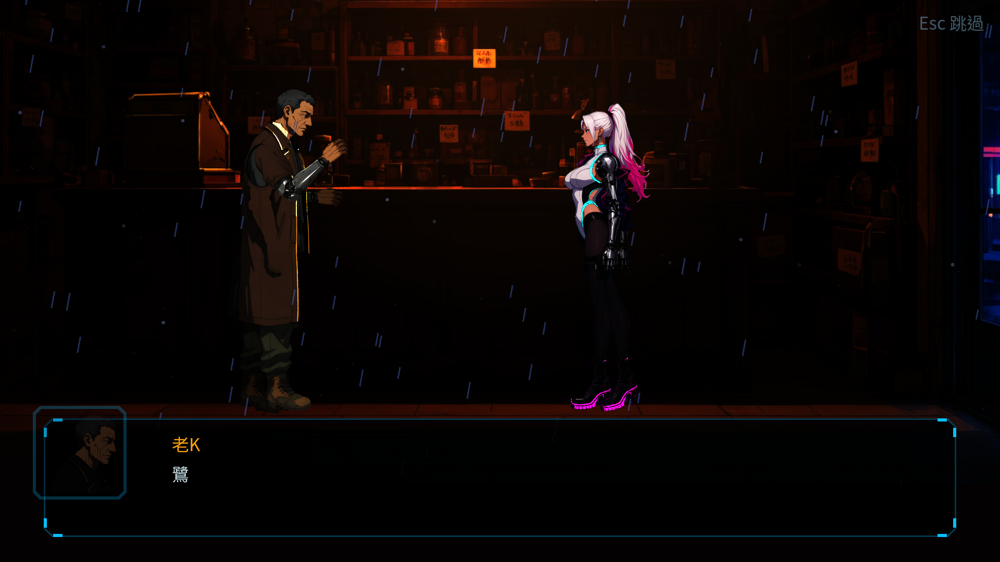

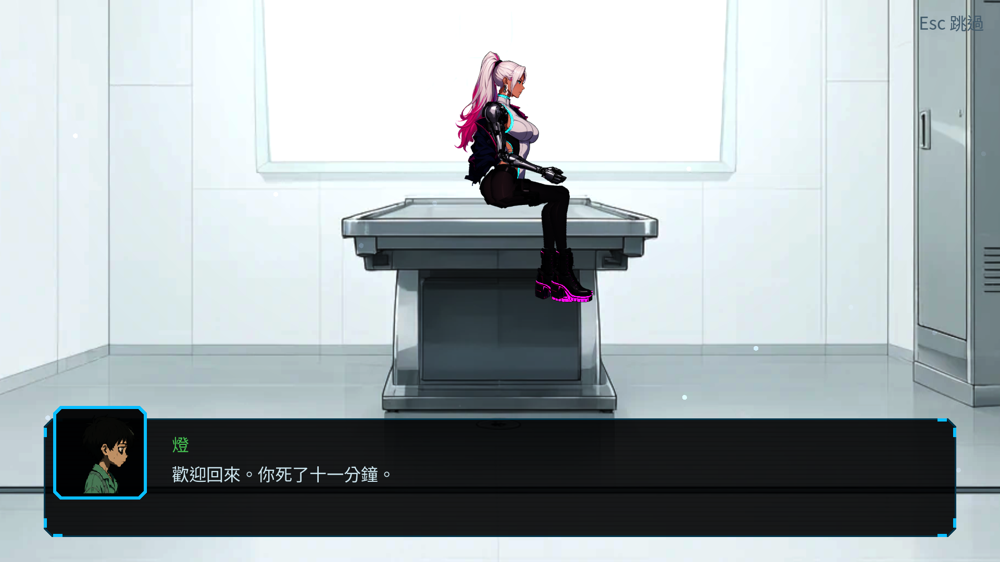

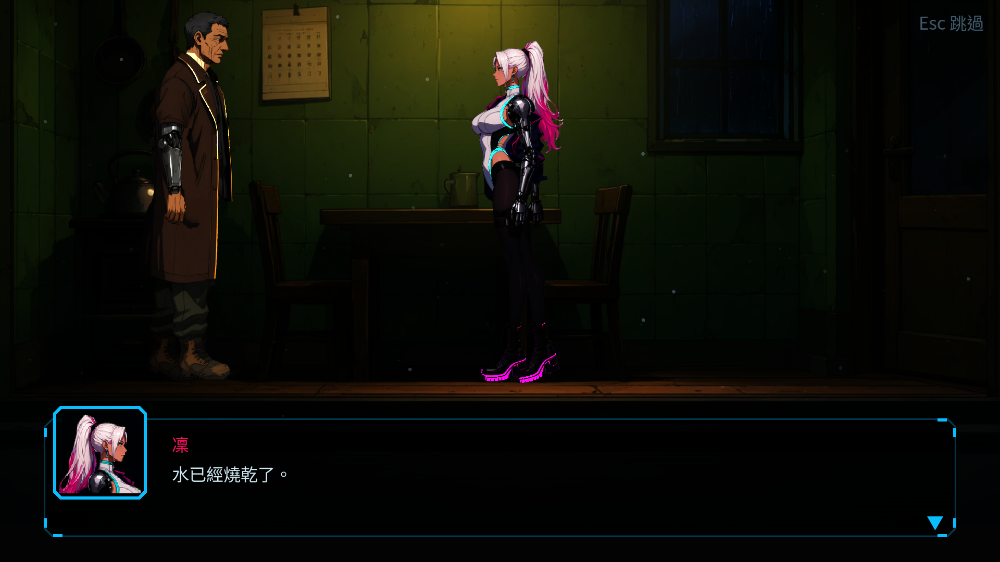

# Commit-4

## 內文

優先修復本票推送後出現的兩項 CI 時序失敗，保持原有焦點與亮度斷言。設定關閉測試改為等到 overlay 確實離開場景及 idle 延後焦點完成；閃光測試在時間尚未衰減前套用並量測峰值，避免繁忙 runner 的首影格已超過短閃光生命期。沒有更改 UI／光照執行行為，也沒有新增已知失敗豁免。

### 檢查結果

- 固定基準 4f425a65 的完整受影響測試：78 組、50441 項檢查，0 新失敗、0 已知失敗，162 秒。
- CI 37714436408 曾有兩項新失敗；後續 37715057530 已成功，但仍保留此次時序修正，讓同一斷言不依賴 CI 排程快慢。
- 原生 Forward+ 設定畫面 1920×1080 已檢視；此畫面只確認設定 UI 回歸，焦點還原由測試斷言驗證。擷取程序正常退出，另有既有 ObjectDB 退出警告，如實保留於日誌。
- 本票仍在進行中；凜的外套與全接點逐格驗收尚未完成。

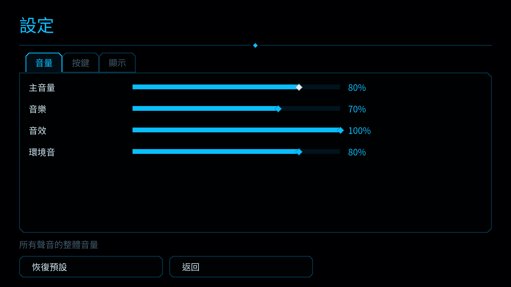

完整測試紀錄：[NE-222-ci-regression-tests.txt](images/NE-222-ci-regression-tests.txt)

# Commit-5

## 內文

ST-8 推送後 CI 37756627628 出現閃光衰減斷言失敗。此段優先修復其驗證時序：同一個同步訊號觸發閃光後，以固定時間分別檢查峰值、150 ms 的衰減中與 310 ms 的結束狀態，避免等待期間的戰鬥事件或死亡暫停干擾被量測的生命期。正式光照行為與亮度斷言保留，新增衰減中斷言，沒有新增已知失敗豁免。

### 檢查結果

- 固定基準 bdf8cc95 的完整受影響測試：78 組、50,524 項檢查，新增失敗 0、已知失敗 0，298 秒。執行時取得共享 GPU 鎖，沒有角色擷取或生成同時運算；本機角色修復試作尚未計入本段交付。
- 主流程與爆炸專項：1,534 項檢查通過。第一次並行完整測試曾有爆炸額外成本 12.84 ms 超過 6 ms；保留失敗日誌，鎖下完整重驗為 1.06 ms 靜止／1.22 ms 十二個爆炸，沒有放寬預算。
- 原生 1920×1080 Forward+ 戰鬥閃光擷取正常退出、無腳本或渲染錯誤，保留 8 個 ObjectDB 退出警告。此圖使用舊擷取的線性色彩輸出，顏色偏暗；僅記錄閃光回歸，不能代表螢幕色彩或角色美術通過。
- 本票仍為進行中；全接點與完整角色外觀維持未驗收。

[鎖下完整測試](images/NE-222-ci-flash/full-tests.txt)、[專項重驗](images/NE-222-ci-flash/focus-tests.txt)、[初次效能失敗](images/NE-222-ci-flash/initial-tests.txt)、[原生擷取日誌](images/NE-222-ci-flash/capture.txt)。

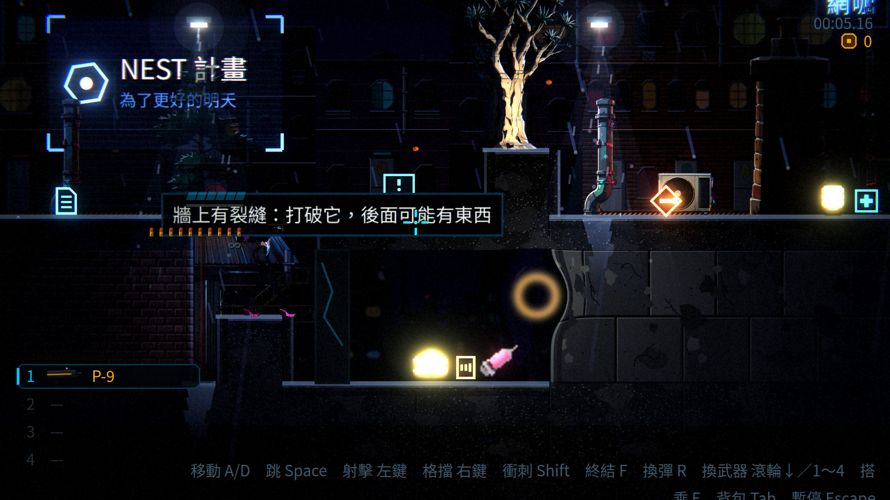

# Commit-6

## 內文

原生 HDR 2D 截圖直接保存線性色彩，PNG 看起來比實際螢幕偏暗，容易誤判角色材質與清晰度。現在彩色擷取依實際 viewport 編碼成 sRGB；非 HDR 畫面保持原始資料，解析度、透明度、光照與曝光均不改動。生成至遊戲 SOP 的三份副本同步補入此檢查，保留舊線性 PNG 作為失敗證據。

### 檢查結果

- 固定基準 06d71169 的完整受影響測試：78 組、50,523 項檢查，0 新失敗、0 已知失敗，298 秒。取得共享 GPU 鎖，無生成或額外擷取同時運算；本機角色試作不計入本段美術交付。
- 原生 Forward+ 的 HDR／非 HDR 色塊均通過：已知 #737b86 回存差異不超過每通道 1/255，非 HDR 位元組完全相同；64×64 尺寸、透明背景 alpha=0 與半透明 alpha 約 0.37 均保留。
- 原生 1920×1080 的選單、五處關卡與死亡畫面重新擷取，正常退出、無 SCRIPT ERROR／ERROR；保留既有控制項 anchor 與 8 個 ObjectDB 退出警告。已檢視屋頂實機圖，未將這批角色試作畫面列為全接點、衣物或美術通過。
- 三份 SOP 的已提交內容一致，文件預覽已檢查。本票維持進行中，角色與全動作驗收條件保持未勾選。

[完整測試](images/NE-222-hdr-capture/full-tests.txt)、[原生色塊檢查](images/NE-222-hdr-capture/color-check.txt)、[實機擷取紀錄](images/NE-222-hdr-capture/game-capture.txt)。

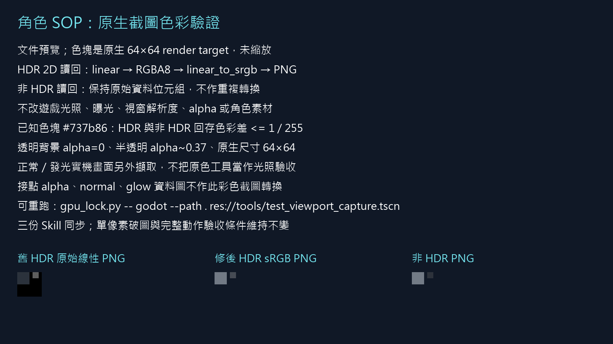

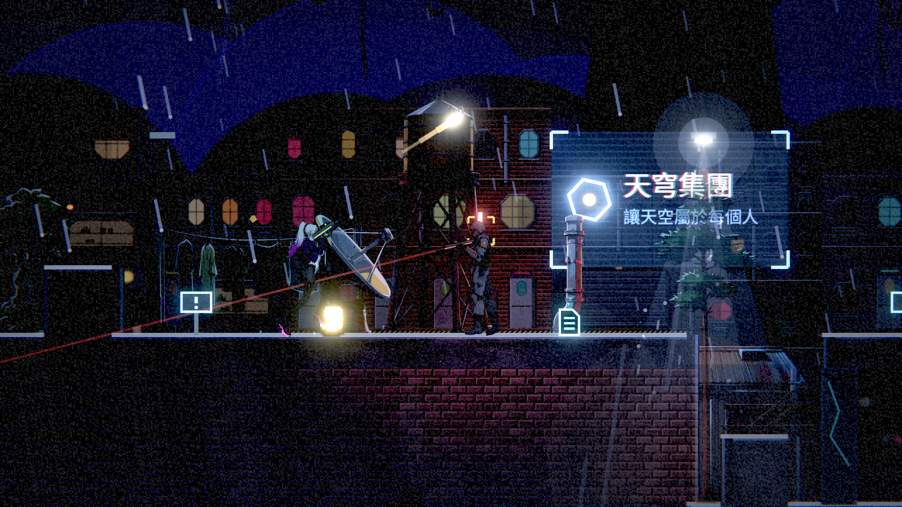
