# [NE-223] 設計任務目錄與地圖指引介面

> 狀態：進行中

## 內文

### 需求
玩家目前沒有任何「現在要做什麼、去哪裡、為什麼過不去」的指引：沒有任務目錄、沒有地圖畫面、沒有常駐目標。要設計並實作好看、好用的任務與地圖介面，涵蓋整個任務環節，讓玩家在任何時刻都能回答五個問題：現在要做什麼、為什麼、去哪裡、走過哪裡、這條路為什麼過不去（設計見 `design/18-quest-map-ux/DESIGN.md`）。

包含：
1. **任務目錄**：進行中與已完成分頁、主線與支線、任務細節（一句話目標、背景、步驟清單、地點、獎勵）、阻塞原因與建議、釘選追蹤。
2. **地圖**：目前地圖的區域地圖與九張地圖的世界地圖，標出玩家、出入口、存檔點、商店、拾取點、目標與鎖住的門，已探索範圍，圖例與 tooltip。
3. **HUD 目標列與方向箭頭**：一行目標、換目標時提示、目標在螢幕外或別張地圖時的指示、可在設定關閉。
4. **鎖住的路的說明**：鎖住的出入口與機關要講出原因與取得方式。
5. 視覺設計要好看：沿用 UI 元件庫與賽博風格，在任何背景下讀得清楚，支援鍵盤與手把。

### 來源
2026-10-07 使用者回報：「整體設計得還不錯，但沒有詳細的地圖指引跟任務的目錄，可以的話幫我設計好看的 UIUX 針對整個任務的環節。」並要求「確實修復相關的所有問題，或是實作相關的所有功能，在票裡面講清楚驗收目標，請確保能夠解決問題」。

2026-10-10需求補充：先完成序章至第三章，逐章劇本審查、正式主支線與演出、累積單檔發行；詳見[整體設計](../../design/20-campaign-experience/DESIGN.md)。

2026-10-10，正常遊玩閉環審查补充；需求與來源見[序章至第一章檢查](../../design/20-campaign-experience/CH01_PLAYABLE_REVIEW.md)。

### 驗收條件
- [ ] 暫停選單新增「任務」與「地圖」，並有快捷鍵與 tooltip；手把與鍵盤都能完整操作，返回鍵一律回上一層
- [x] 任務目錄：主線、支線、進行中、已完成分頁；每項任務有標題（動詞開頭、完整句、一行內）、背景、步驟清單（完成的打勾）、地點、獎勵；選中任務可跳到地圖上的位置
- [x] 阻塞中的任務顯示卡住的原因與建議先做的事；可釘選一項任務，HUD 與方向箭頭跟著它，沒釘選就跟著主線
- [x] 任務由資料描述（編號、標題、背景、步驟、完成旗標、地點、獎勵、前置），第一章的任務對照故事資料與關卡設計，**沒有手寫的第二份可能不同步的資料**；新增任務只改資料不改程式
- [x] 區域地圖：顯示玩家位置、出入口與去向、存檔點、商店、拾取點、目標、鎖住的門；已探索範圍；未探索只顯示輪廓；秘密處不顯示直到發現
- [x] 世界地圖：九張地圖的連接關係，標出去過、目前所在、目標所在地圖，與可傳送的存檔點（如已啟用）
- [x] HUD 目標列：一行文字，閒置時淡出，換目標時淡入；目標在螢幕外時邊緣有箭頭；目標在別張地圖時指向出口並顯示地圖名稱；設定中可以分別關閉
- [x] 鎖住的出入口、機關、關閉的門都有「原因」與「去哪裡取得」的文字，並在地圖與遊戲內提示一致
- [x] 所有文字使用完整句子，沒有兩三個字的斷句口號（通過 ST-15 的可讀性檢查）；每個按鈕與圖示有 tooltip
- [x] 自動檢查：用旗標模擬從新遊戲到第一章結束，每一刻至少一個進行中主線任務且目標列非空；每個步驟的完成旗標存在且可達；每個任務地點對得到真實地圖與座標；每個鎖住的出入口有原因與取得方式
- [x] 1280×720 與 1920×1080 下沒有文字被截斷或重疊（版面檢查加截圖）；各分頁、地圖、HUD 在亮場景與暗場景的截圖附在票上
- [x] 讀檔、死亡重來、章節切換後，任務、地圖探索與釘選的狀態正確；存檔資料損毀時記錄具體位置並退回安全預設，不使遊戲崩潰
- [ ] 效能與記憶體：地圖圖形由資料產生並快取，不在每影格重畫；暫停畫面開啟不造成可見卡頓
- [x] 新增相關的 skill 說明（任務與地圖資料格式、新增任務的步驟、使用者在意的可讀性規則）

- [ ] 正式主支線由每章故事來源供應，支線可選、目標與獎勵一致；新增章節與續玩後沿用同一任務真相。

- [x] 實際清完街道路障、打倒看門狗與開水閘後，目標立即推進到正確步驟；死亡、退出與繼續後仍一致，取得資料盤不掩蓋中途指引。
- [x] 電話亭的錄音與自願追問支線以真正完成行為推進，未聽與未選擇時不提前完成。

### 測試流程
1. 新遊戲開始，確認目標列有第一個目標；走完序章進入第一章，目標列更新
2. 開任務目錄，檢視各分頁與細節，釘選一項任務，回到遊戲看方向箭頭
3. 開地圖，檢視區域與世界地圖，走到鎖住的門前確認原因提示
4. 死亡重來與讀檔，確認狀態保留
5. 執行旗標模擬與版面檢查，受影響範圍測試無新失敗

---

# 跟其他票的關係

- Blocks：NE-233、BG-22
- Blocked by：ST-3、ST-2、ST-6、ST-9、ST-16
- Related：ST-15、ST-16、ST-5、ST-9、NE-215、NE-217

---

# Commit-1

## 內文

玩家現在可以從暫停選單或可改鍵的 O／M 快捷鍵打開任務與地圖。介面提供主線、支線、進行中、已完成的篩選，任務背景、完成步驟、獎勵、阻塞建議、釘選與跳到地圖；返回會回到上一層並恢復焦點。手把 A／B、方向鍵與左搖桿可以操作，聚焦圖示時會在底部顯示說明。

區域與世界地圖使用第一章九份真實區域資料，顯示出入口、復原點、商店、拾取點、閘門與玩家位置。探索只揭露附近可見格子，地形與未破壞的秘密牆會遮擋視線；出入口的鎖住提示沿用遊戲內的文字。地圖按章節與探索版本快取。HUD 可顯示目前步驟、換目標提示、螢幕外箭頭與跨區出口方向，目標列及箭頭可以分別關閉。

本次交付的是可獨立驗證的介面與導覽接點。正式故事來源目前仍沒有任務資料，正式遊戲顯示真實空目錄，未用測試任務替代主線。任務樣本僅用於介面驗證，所有樣本截圖均有「驗證樣本」標示。來源稽核確認九區可達、正式任務數為 0，因此本票維持進行中，沒有改成審查中，也沒有勾選正式主線、整輪讀檔、序章、全部提示與效能驗收。

原始故事產生器欄位、旗標生產者、主線順序模擬與正式讀檔的一次接線說明已整理成[交接文件](../../design/18-quest-map-ux/SESSION3_INTERFACE.md)。任務與地圖技能已同步到兩組技能目錄。

### 測試結果

| 項目 | 結果 |
|---|---|
| Godot 版本 | 官方 4.7 stable |
| 受影響範圍與完整平行測試 | rebase 到 ST-3 的 319eaf87 後，以該明確基準執行；77 組、4 程序、45,577 項檢查，0 新失敗、0 已知失敗 |
| 最新名單／音樂合併複驗 | rebase 到 aae089c8 後，主流程、第一／二章地圖、音樂、偵察／突擊敵人與導覽，共 7 組、3,663 項，0 新失敗、0 已知失敗 |
| 追加導覽與鍵盤／手把事件測試 | 221 項、0 失敗；確認、篩選、細節、釘選、跳圖、返回及焦點恢復均以實際輸入事件驗證 |
| 真實地圖與路線 | 九區索引、真實位置、鎖門文字一致、可達出口、秘密牆破壞前後的視線遮蔽通過 |
| 導覽狀態 | 快照往返、損毀資料的具體欄位警告與安全退回、新遊戲清除、死亡及章節切換保留通過；未將快照測試當作正式讀檔驗收 |
| 正式任務來源稽核 | 任務數 0；街道與倉庫部分閘門缺少 hint，已列出具體來源；交付就緒與逐狀態模擬均為 false，未宣稱主線模擬通過 |
| 版面與渲染 | Forward+／Vulkan／llvmpipe；720p、1080p 亮暗場景的樣本分頁、地圖與 HUD 均實際擷取，版面檢查 0 溢出 |
| CI 查核 | GitHub Actions 查詢遭 Forbidden 拒絕，未重試或繞過；未宣稱 CI 通過 |
| 同機 GPU、實體手把與效能 | 雲端沒有硬體 GPU 或實體手把；未操作 ComfyUI。Windows 共享鎖依賴 msvcrt，不適用此獨立 Linux 軟體渲染環境，未宣稱同機 GPU 效能或人工手把驗收 |

首輪完整測試曾出現終結技計數斷言及新介面的延後焦點錯誤。焦點錯誤已修復；實際截图另發現小地圖圖示沿用 180px 按鈕快取尺寸而互相遮蔽，已在主題尺寸更新後縮回圖示大小，補上邊界測試並重拍區域／世界地圖；終結技測試現在等玩家退出受擊硬直再送出輸入，既有戰鬥行為沒有改動。修正後完整測試通過。其後八程序與軟體渲染截圖同時執行的批次有一個 Godot 程序以 `free(): chunks in smallbin corrupted` 中止，該批次不算通過；[中止摘要](attachments/NE-223-interrupted-tests.log)保留供審查。最新 main 合併後另以四程序、與截圖分開複驗，45,577 項全過，未重現該引擎中止；沒有把未重現宣稱為已修復引擎缺陷。已知失敗清單沒有新增任何項目。

[最新 main 合併複驗](attachments/NE-223-latest-merge-tests.log)、[ST-3 合併後完整測試摘要](attachments/NE-223-rebased-tests.log)、[合併前完整測試摘要](attachments/NE-223-full-tests.log)、[首輪測試摘要](attachments/NE-223-first-tests.log)、[追加導覽測試](attachments/NE-223-navigation-tests.log)、[正式來源稽核](attachments/NE-223-source-audit.json)。輸出仍有專案既有規則允許的刻意容錯訊息與引擎退出資源診斷；沒有未預期的腳本錯誤。

### 截圖

以下都是 Godot Forward+ 實際擷取的畫面。地圖採真實關卡與視線取樣的探索狀態；樣本任務、旗標與探索取樣不等於人工走完正式主線。詳細圖片索引見[截圖矩陣](attachments/NE-223-screenshot-index.md)。

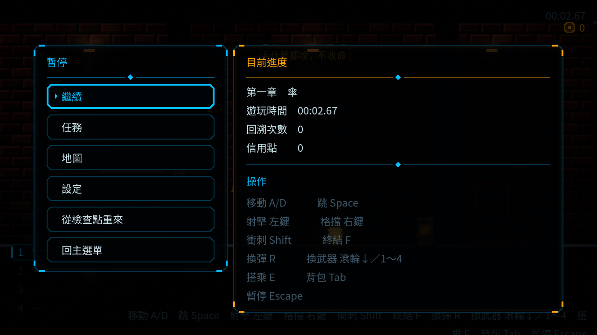

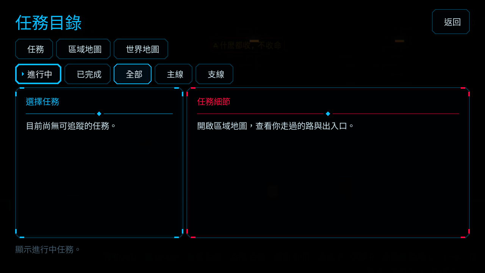

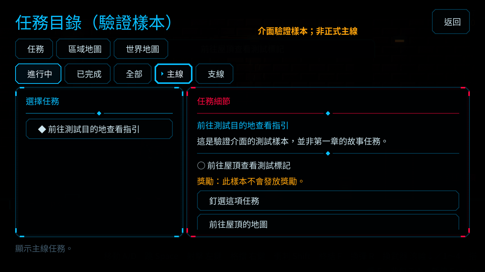

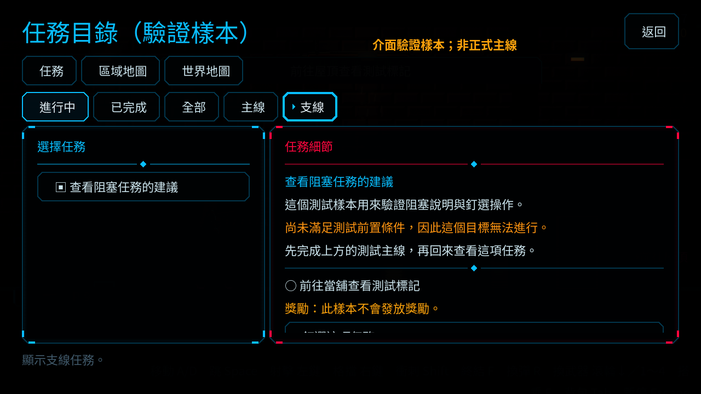

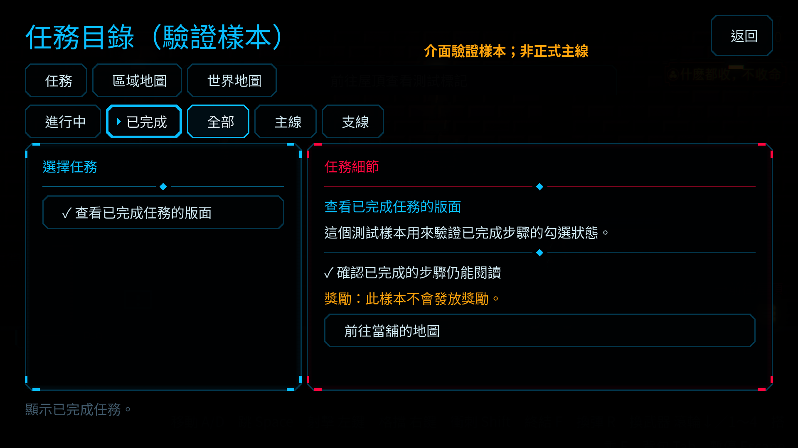

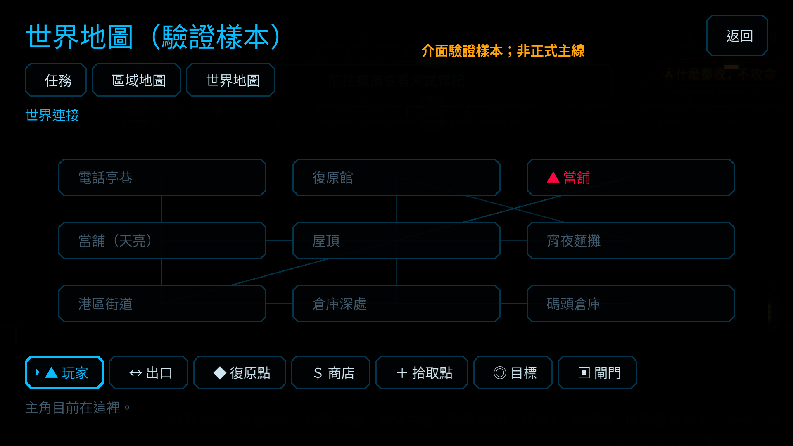

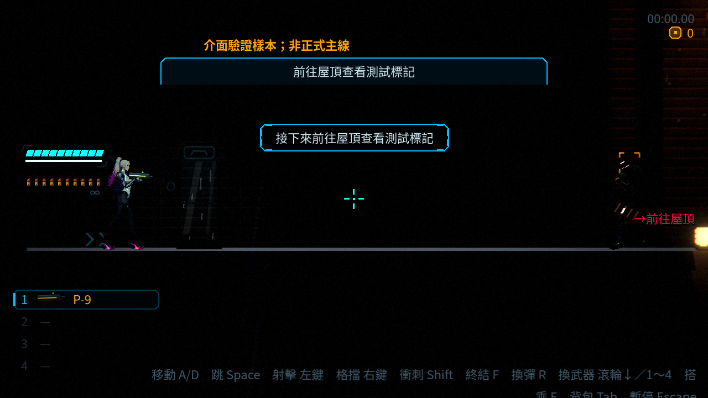

---

# Commit-2

## 內文

恢復工作時沿用已交付的任務／地圖介面，核對最新 main 的可讀性、地圖與純量旗標成果。原驗證截圖直接將 HDR 2D 的線性色彩存成 PNG，圖片會比遊戲顯示暗；現在沿用已合入的共用色彩轉換接點，保留原尺寸與透明度，重新擷取全部分頁，沒有改遊戲亮度或場景。

這次共 34 張實際圖片：720p／1080p 亮暗場景的 28 張介面樣本、當前正式入口五張，以及同場景修前對照一張。五份版面檢查均 0 溢出，樣本均標示非正式主線。兩組任務／地圖技能同步補上 HDR 截圖規則與正確的可讀性文件位置；交接文件確認字串旗標問題已由故事 Session 修復，沿用其成果。

正式來源稽核仍為任務 0、九區可達，來源尚缺部分閘門說明，交付就緒與逐狀態主線模擬均為 false。本票維持進行中，驗收勾選沒有擴大；沒有把既有 UI 樣本、故事進度區塊或軟體渲染當成正式主線、整輪讀檔、序章兩條路線或實機效能驗收。

### 測試結果

| 項目 | 結果 |
|---|---|
| 最新合併基線 | 完整驗證 dfacf916；推送前再整合 127628ed 的 NE-71／NE-88 文檔與圖片，無程式差異，引用與差異檢查通過；保留 ST-3 293fcebb、ST-15 e2d92f30、ST-6 3c7eda28 |
| 受影響範圍與票要求的完整回歸 | 固定基準 a471fd91，78 組／2 程序、50,706 項，0 新失敗、0 已知失敗，594 秒；SCRIPT ERROR 0 |
| HDR 色彩基準 | LDR 原始位元保持不變；HDR 的已知顏色誤差小於 0.012，透明度與尺寸保留；實際 Forward+ 檢查通過 |
| 現有全文檢查 | 2,688 條來源，0 錯誤、0 警告、結構問題 0；正式任務仍未生成，不算已覆蓋 |
| 正式來源稽核 | 預期退出 1，正式任務 0、真實區域 9／可達區域 9；不是主線驗收通過 |
| 圖片／版面 | Godot 4.7、Forward+／Vulkan／llvmpipe；33 張修後與一張修前，五份報告 0 溢出 |
| 實體裝置與 CI | 無硬體 GPU／實體手把，未作硬體效能與人工手把驗收；先前 CI API 權限拒絕後未重試或繞過，遠端 CI 未確認 |

[完整回歸摘要](attachments/NE-223-resume-tests.log)、[HDR 色彩檢查](attachments/NE-223-hdr-capture-check.log)、[全文檢查](attachments/NE-223-resume-story-lint.log)、[正式來源稽核](attachments/NE-223-resume-source-audit.json)、[全部截圖與版面報告](attachments/NE-223-hdr-screenshot-index.md)。截圖仍有既有退出時資源診斷，沒有 SCRIPT ERROR。渲染與匯入沿用新合入的跨 worktree 共享鎖，未啟停 ComfyUI。

### 截圖

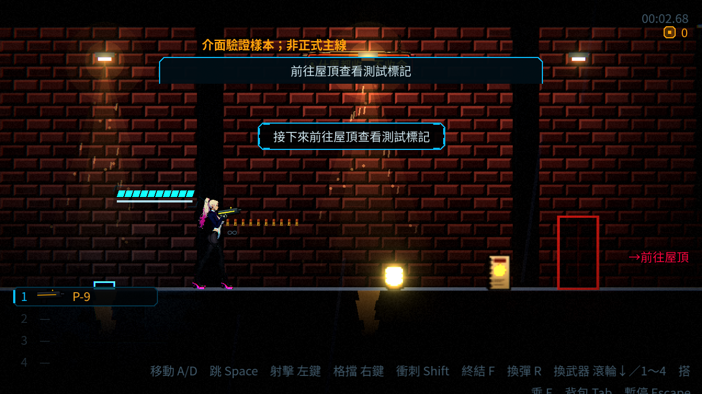

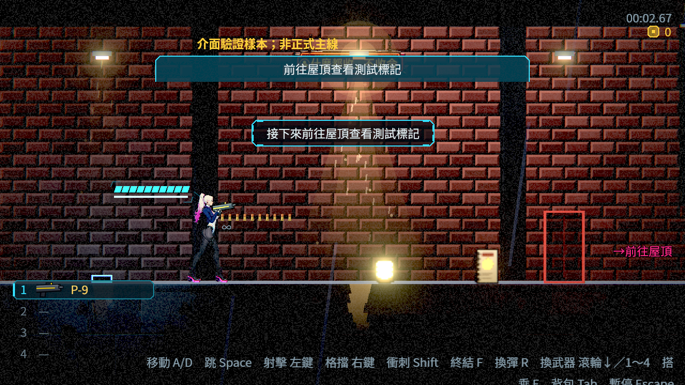

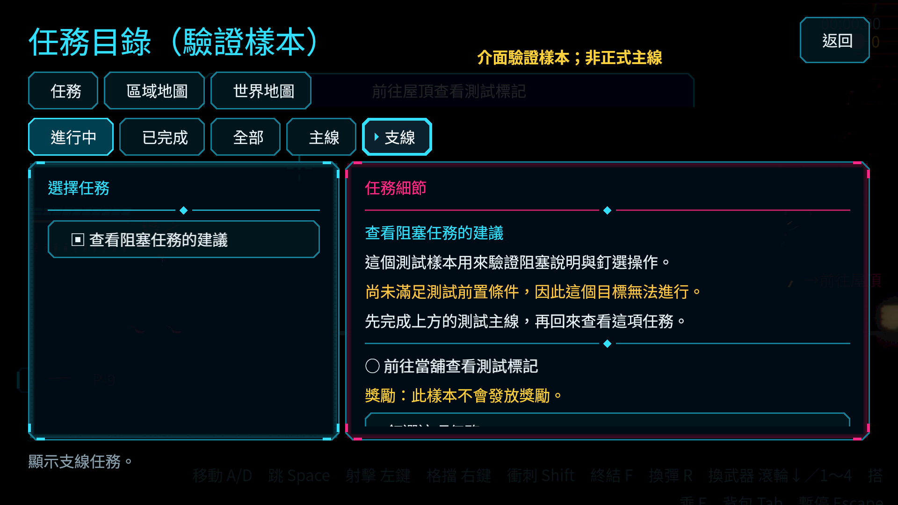

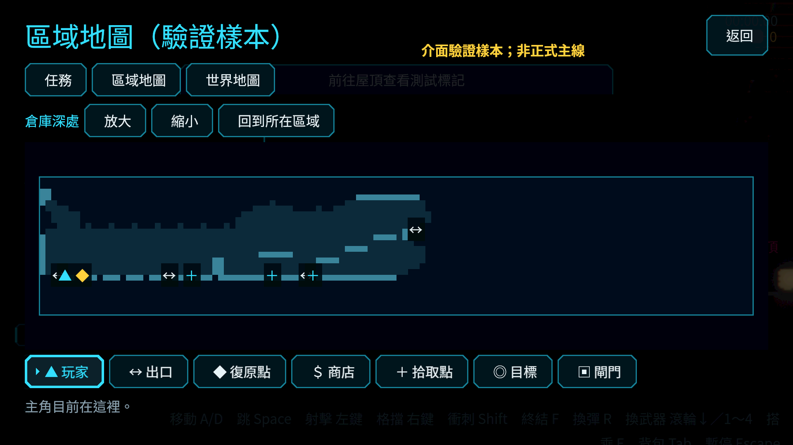

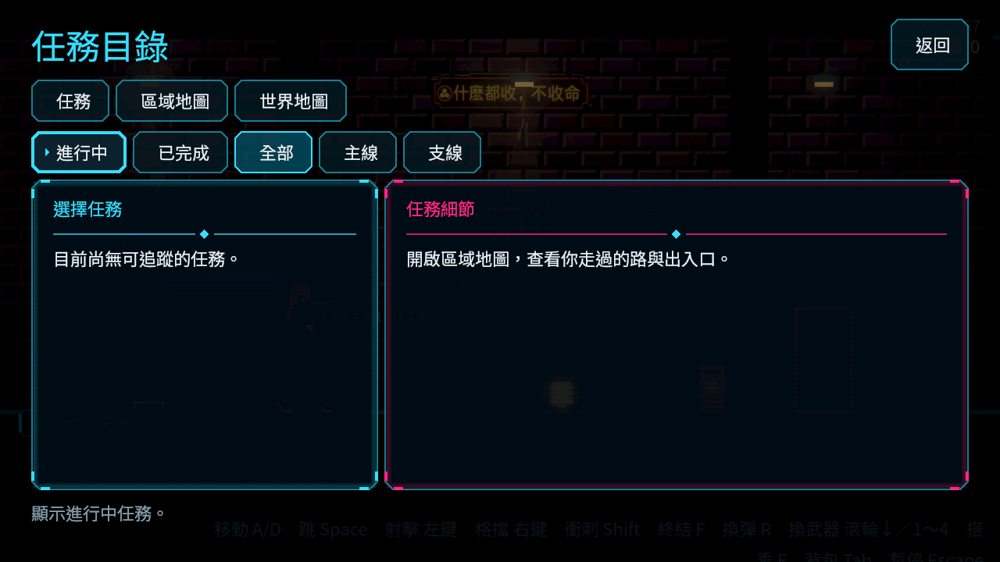

---

# Commit-3

## 內文

對照最新 main 重新稽核：正式任務仍是 0 項，主線組的序章與任務來源還沒有合入，所以任務目錄與 HUD 繼續顯示真實空狀態，沒有用樣本代替。介面與資料介接沿用已交付的部分。

這次稽核另外抓到四道「缺少鎖門說明」的閘門，追下去發現它們是第一章已停用的一般遭遇門：使用者先前要求一般戰鬥不封路，遊戲裡這些門不會出現也不會關，但地圖仍把它們畫成「這道閘門目前可以通行」的出口圖示，等於在街道中間標了一個不存在的出入口。現在遊戲、地圖與稽核共用同一條規則判斷停用的遭遇門：地圖不再標示，稽核也不再要求它們寫說明。另外閘門的原因說明改成只在關著時顯示，打開後收起，避免門開了還掛著「為什麼關」的字。

稽核結果：真實區域 9／可達 9，地圖上的鎖門來源從 21 筆降為 13 筆真實鎖門，全部有遊戲內說明；剩下的問題只有「故事來源沒有任務」與「主線逐狀態模擬尚未接線」，都要等主線組的正式任務。本票維持進行中。

### 測試結果

| 項目 | 結果 |
|---|---|
| 受影響範圍（基準 68f679b0） | 37 組、8,796 檢查；0 新失敗、0 已知失敗，199 秒。首輪有一項音效閃避的計時檢查在平行負載下失敗，與本次改動無關，單跑兩次皆通過，整組重跑通過 |
| 遭遇與閘門 | 163 檢查、0 失敗；含「原因只在關著時顯示」與「地圖沒有停用遭遇門標記」 |
| 正式來源稽核 | 任務 0、真實區域 9、可達 9、鎖門 13 筆皆有說明；閘門類問題 0 |
| 原生 Forward+ | 1280×720 港區街道區域地圖修前修後（Vulkan／llvmpipe 軟體渲染） |
| 待主線組 | 正式主支線、逐狀態主線模擬、整輪讀檔與序章兩條路線 |

分支 `claude/nest-egg-ui-quest-map-wgwwvw`，[提交紀錄](https://github.com/deadline314/Nest-Egg/commits/claude/nest-egg-ui-quest-map-wgwwvw)。動到關卡組的閘門與機關資料定義各一處，只加共用判斷，不改既有行為。

### 截圖

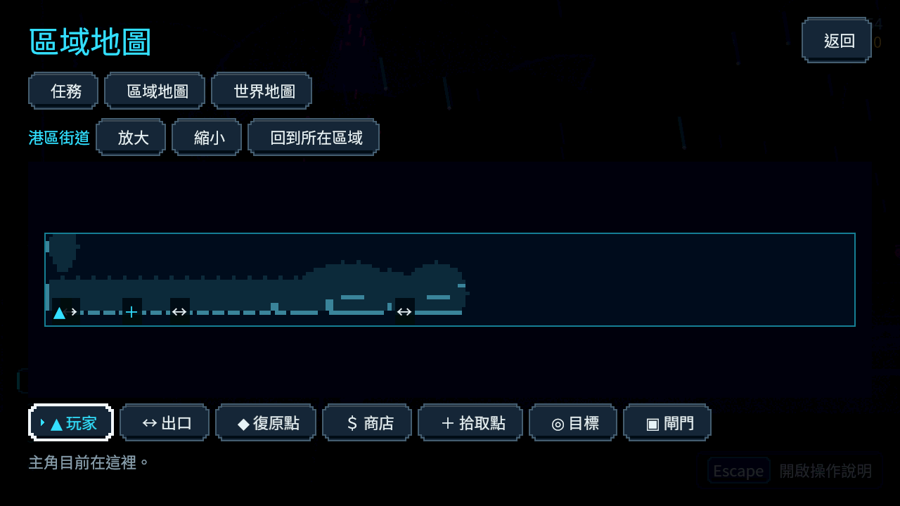

---

# Commit-4

## 內文

文字放大到 120% 時，任務細節的「釘選這項任務」按鈕被細節區的捲動範圍切掉一半，「前往某地的地圖」完全在畫面外，要先捲動才看得到主要操作。

現在這兩個操作固定在任務細節下方並排顯示，背景與步驟較長時只有上方內文捲動；方向鍵上下與左右都能在兩個按鈕之間移動，原本鍵盤與手把的操作習慣不變。截圖工具也能指定文字大小，方便之後重拍放大文字。

畫面使用標示為「驗證樣本」的介面樣本，只驗證版面，不代表正式任務內容。

### 測試結果

| 項目 | 結果 |
|---|---|
| 受影響範圍（基準 e1b2d662） | 13 組、2,821 檢查；0 新失敗、0 已知失敗，172 秒 |
| 任務與地圖套件 | 213 檢查、0 失敗；鍵盤與手把的釘選、移到地圖操作、跳圖與返回恢復焦點都通過 |
| 版面檢查 | 100%／120% 版面報告 0 溢出 |
| 原生 Forward+ | 1280×720 任務分頁（Vulkan／llvmpipe 軟體渲染） |

分支 `claude/nest-egg-ui-quest-map-wgwwvw`，[提交紀錄](https://github.com/deadline314/Nest-Egg/commits/claude/nest-egg-ui-quest-map-wgwwvw)。

### 截圖

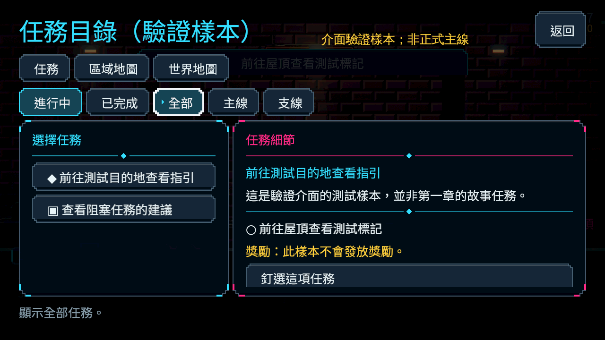
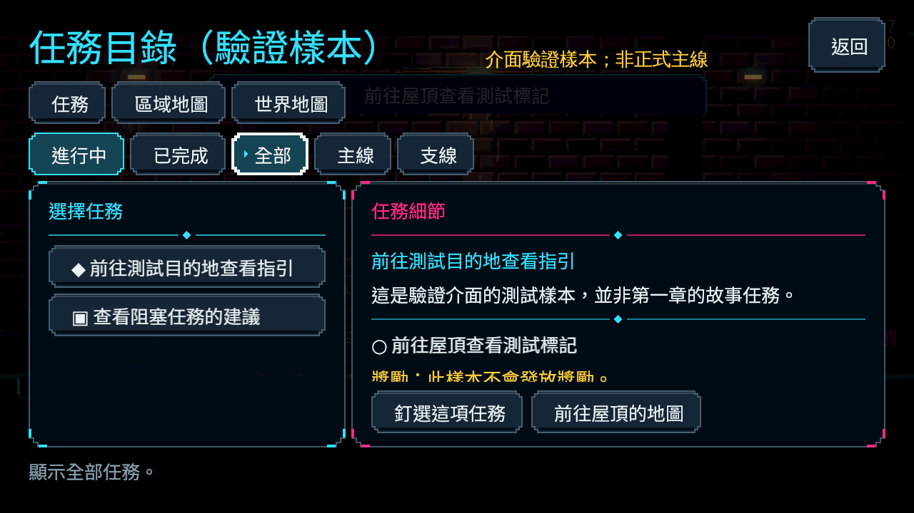
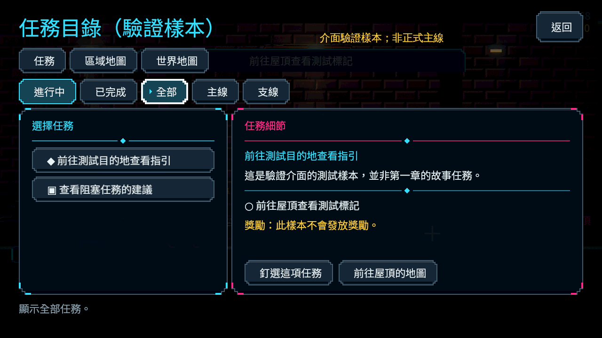

# 本機原生驗收（2026-10-11）

## 內文

在本機 Godot 4.7.2、Forward+、Intel Arc B580 補驗雲端做不到的畫面，來源是分支 `claude/nest-egg-ui-quest-map-wgwwvw` 的 7dffe868，沒有改動程式。故事來源目前沒有正式任務，以下用的是介面驗證樣本，畫面上有標示，不能當成正式任務的驗收。

文字 120% 時，「釘選這項任務」與「前往…的地圖」固定在細節下方，1280×720 與 1920×1080 都完整在畫面內；用方向鍵事件實測，左右與上下都能在兩個按鈕之間移動。街道的區域地圖在已探索的範圍內（地圖左半到中段）只有回當舖與往電話亭巷兩個出入口，中段沒有不存在的出入口圖示；右半還沒探索，這次沒有看到。

另外看到兩件事，沒有動手修：1280×720、120% 時任務細節最下面那一行獎勵文字被捲動區切掉一半；任務頁與地圖頁的分頁列後面，隱約看得到 HUD 的目標列。

正式任務要等主線的 ST-16 合入後再驗：任務資料檢查、逐狀態主線模擬、整輪讀檔與序章兩條路線。

### 測試結果

| 項目 | 結果 |
|---|---|
| 兩個操作按鈕完整在畫面內、位於細節下方（兩種解析度） | 符合 |
| 方向鍵左右、上下在兩個按鈕之間移動（兩種解析度） | 8／8 |
| 版面檢查工具（任務四個分頁、區域地圖、世界地圖、HUD） | 兩種解析度都沒有版面問題 |

### 截圖

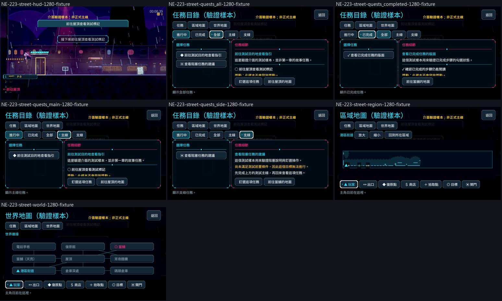

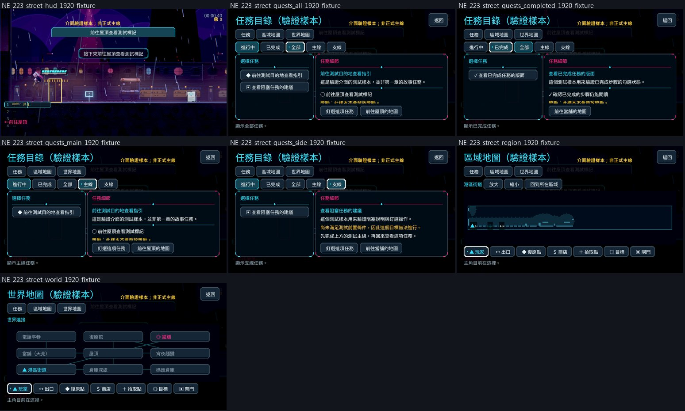

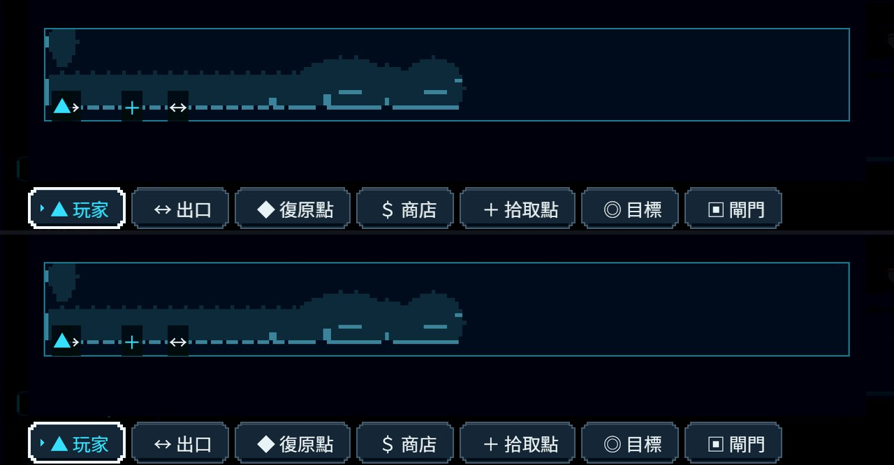

# Commit-5

## 內文

使用者看了任務目錄截圖後指出版面簡陋、字太大、缺乏設計感。原畫面是一排排同樣重量的大按鈕與框，頁面標題用最大的字級，地圖頁的圖例也是一排大按鈕；本機原生驗收另外看到：文字放大到 120% 時，任務細節最下面的獎勵被切掉一半，分頁列後面還隱約透出 HUD 的目標列。

先查業界實例：在 interfaceingame.com 看了 27 款作品的 130 張任務、日誌、地圖畫面，加上 Leyla In Veil、Hollow Knight、Hades 的官方截圖（gameuidatabase.com 被人機驗證擋住，沒有使用），整理成[研究與範本](../../design/18-quest-map-ux/VISUAL_RESEARCH.md)，做了三個範本請使用者選。使用者選「終端機雙欄為主，混搭場景疊層」，依此重做：暫停當下的遊戲畫面模糊壓暗當底，背景的 HUD 字讀不出來，不會再透到分頁列後面；頁首一條分頁列，兩側標出切換鍵；頁尾一條按鍵提示列。任務頁左邊是狀態與種類的分段切換，加上分主線、支線的清單，每列一行標題、下方小字寫地點與進度，追蹤中的任務另外標示，焦點列整列反白；右邊依序是分類、標題、目的地、斜切的「目前步驟」橫幅、背景、目標勾選清單與獎勵，內文比畫面長時底緣淡出，並提示用右搖桿或 PageDown 往下讀。地圖頁左邊放區域名稱、探索百分比、縮放與圖例，右邊是地圖：只畫已探索地形的邊緣，寬而矮的區域依高度放大並以主角為中心，下方附整區縮圖與目前的視窗框，出口標出通往哪裡，畫面外的出口與目標貼在邊緣標出名稱；世界地圖依出入口在區域裡的方向排出相對位置，連線走直角。HUD 的目標列改成同樣的斜切橫幅，換目標時本身短暫放大，不再另外在畫面中央彈出同一句話；方向箭頭靠左時不壓到武器欄。字級分三階：內文不變，標題 14、說明小字 9；換成像素字體時自動改用內文字級，維持銳利。

驗收在 Forward+（雲端軟體 Vulkan）拍了亮的當舖、暗的碼頭倉庫與寬的港區街道，涵蓋 1280×720、1920×1080 與文字 100%、120%，版面檢查都沒有問題；鍵盤與手把切分頁、釘選、跳到地圖、返回並恢復焦點，以及右搖桿、PageUp 捲動任務細節的自動檢查都通過。故事來源目前仍沒有正式任務（來源稽核：真實區域 9、可達 9、正式任務 0），畫面中的任務是標示「驗證樣本」的介面樣本，不能當正式任務驗收；正式任務、逐狀態主線模擬、真正退出再讀檔，以及實機 GPU 的開啟卡頓量測都還沒完成，本票維持進行中，驗收勾選不變。

### 測試結果

| 項目 | 結果 |
|---|---|
| 受影響範圍（基準 ccb16f87） | 55 組、24,128 檢查；0 新失敗、0 已知失敗，168 秒 |
| 任務與地圖、元件庫、文字可讀性套件 | 470 檢查、0 失敗（含長內文捲動、獎勵位置、焦點恢復） |
| 版面檢查（最終程式：當舖與碼頭倉庫 1280×720 100%、港區街道 1920×1080 120%；改版過程另 9 組） | 全部 0 問題 |
| 正式任務來源稽核 | 真實區域 9／可達 9，正式任務 0 |

分支 `feature/ui-quest`，[提交紀錄](https://github.com/deadline314/Nest-Egg/commits/feature/ui-quest)。

### 截圖

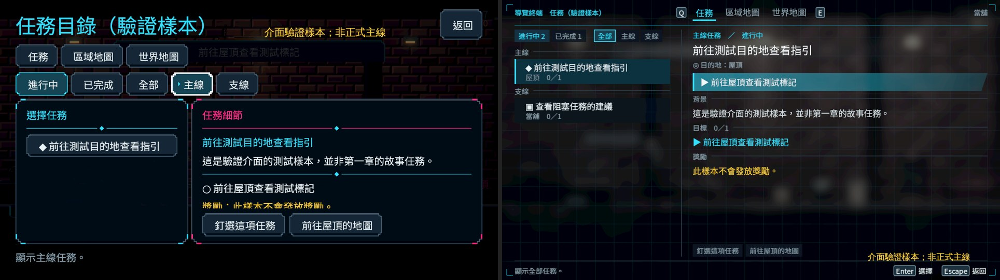

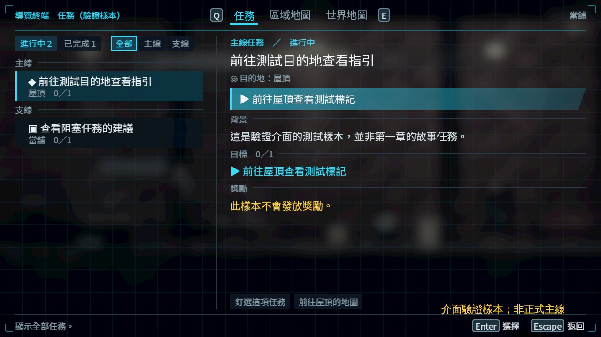

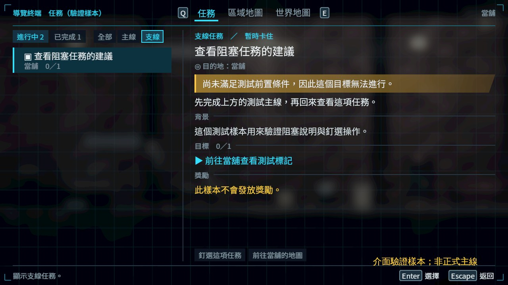

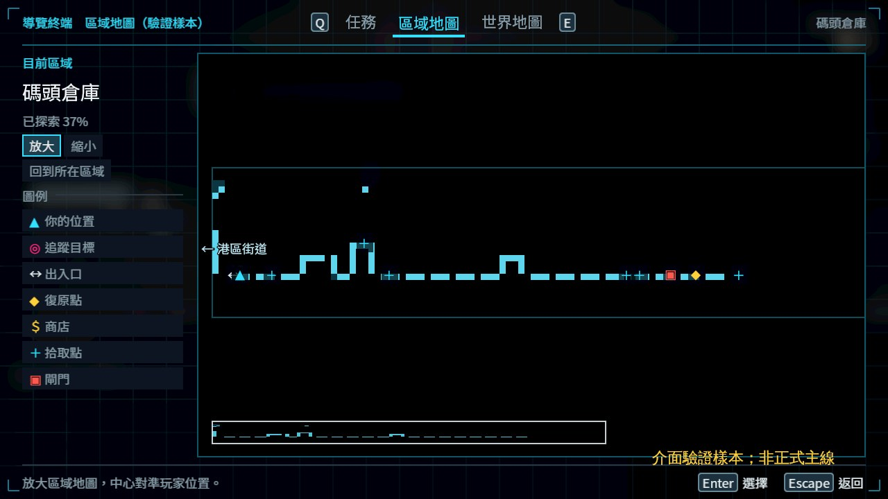

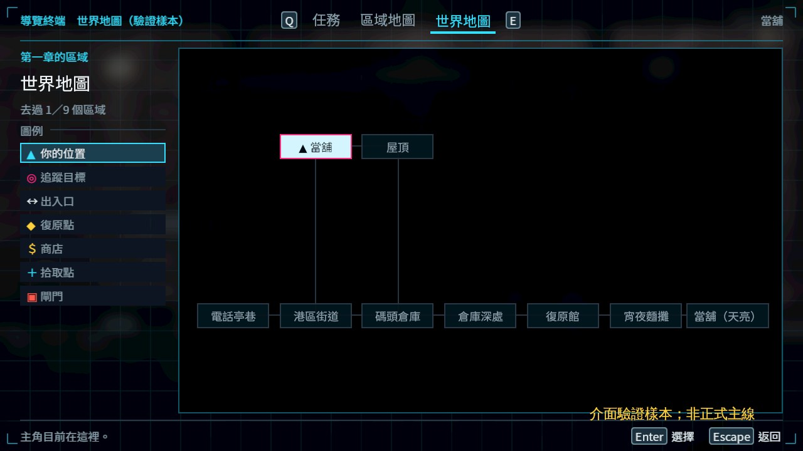

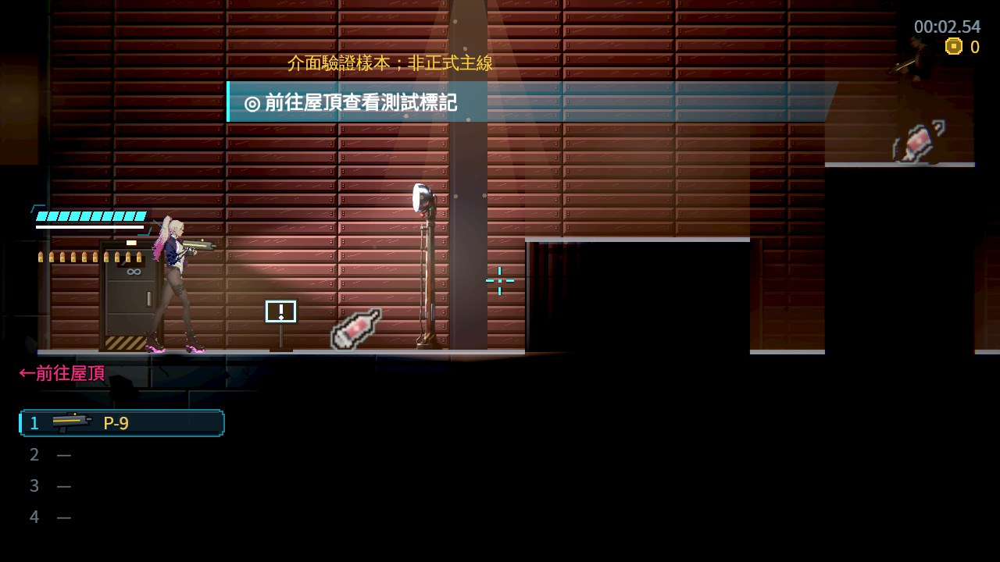

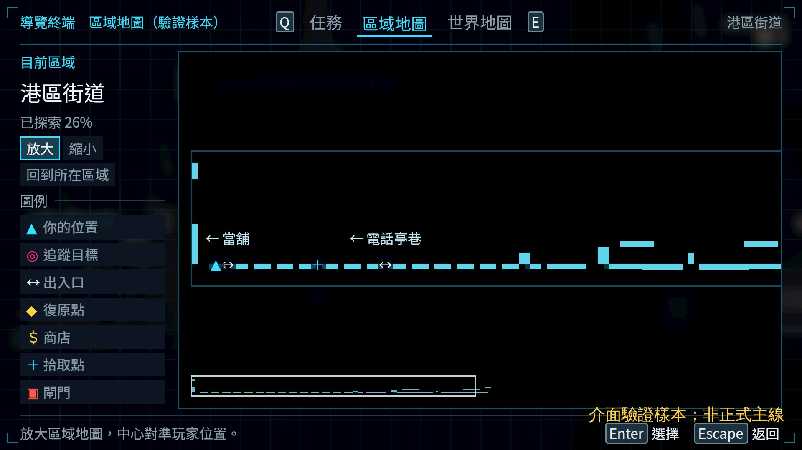

# Commit-6

## 內文

正式任務還在故事分支 `feature/story`，main 上仍是 0 項，所以「自動檢查：從新遊戲到第一章結束每一刻都有主線與目標」一直沒有工具能證明。原本的稽核只做靜態可達性：起點固定是當舖，序章練習站、衍生旗標（例如「序章結束或跳過」）、復原點第一次啟用時播的錄音都不認得，於是把它們報成不可達，最後還固定附一句「尚未接線」。拿故事分支的資料試排版時另外看到兩件事：第一章擴成 11 區後，世界地圖一排放不下，區名被切掉；文字 120% 時任務頁的篩選列把「支線」單獨擠到第二行。

改動：新增逐狀態主線檢查工具，新遊戲開始後每次旗標改變，都確認至少有一項進行中的主線，而且目標列有一句完整的話。共有四條路線：序章正常完成、序章長按跳過、第一章留下、第一章離開。後兩條在旁邊跑故事組原有的第一章流程探針，本工具只旁聽旗標，不改探針也不寫故事資料。稽核改成一次檢查一章：章節入口取「本章沒有其他區域通往的區域」（第一章就是序章），衍生旗標的條件有可能成立就算拿得到，復原點事件的場景算播得出，只檢查該章的任務，拿掉固定附的那一句。世界地圖依最長的區名決定欄寬，一排放不下時蛇形折行。篩選按鈕分成「狀態」與「種類」兩組，放不下時整組換行。任務截圖工具可以先寫入故事旗標，拍章節中段的任務狀態。

驗收在本機暫存工作區進行：把 `feature/story`（f13dc153）合進本分支，只在本機跑，不推送。四條路線都沒有缺口；兩章稽核都是 0 問題；正式任務的截圖在 1280×720 100% 與 1920×1080 120% 版面檢查都是 0 問題。main 目前的資料上，稽核如實回報「第一章沒有主線任務」並以失敗結束。正式任務合進 main 以前，這些都只是預先驗證，驗收勾選不變；合入後要在 main 上重跑同樣的檢查，再勾選任務資料、逐狀態模擬與截圖相關的條件。真正退出再讀檔，以及實機 GPU 的開啟卡頓量測也還沒完成。本票維持進行中。

另外看到一件不屬於本票的事：故事組的流程探針在「留下」路線進交接櫃區域時，要求的出入口 `wh_vault` 在該區不存在，關卡記錄錯誤後改用起點，流程仍然走完。這部分留給故事 Session 判斷。

### 測試結果

| 項目 | 結果 |
|---|---|
| 逐狀態主線（故事分支資料） | 序章 17 個狀態、跳過 4 個、留下 34 個、離開 32 個；缺口都是 0，留下與離開都走到第一章完成，各經過 13 句目標 |
| 任務稽核（故事分支資料） | 第一章 11 區、10 項任務，0 問題；第二章 10 區、10 項任務，0 問題 |
| 任務稽核（main 資料） | 回報「第一章沒有主線任務」，以失敗結束（符合預期） |
| 正式任務截圖版面檢查 | 港區街道 1280×720 100%、碼頭倉庫 1920×1080 120%，都是 0 問題 |
| 任務與地圖套件 | 227 檢查、0 失敗（含文字 120% 時篩選兩組各自整組換行；改前會失敗） |
| 受影響範圍 | 20 組、5,677 檢查；0 新失敗、0 已知失敗，163 秒 |

分支 `feature/ui-quest`，[提交紀錄](https://github.com/deadline314/Nest-Egg/commits/feature/ui-quest)。

### 截圖

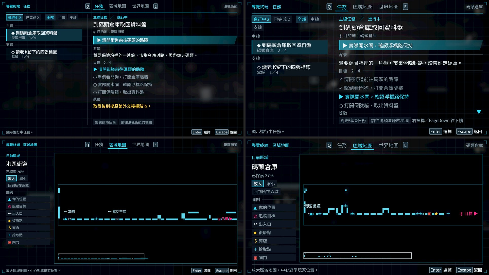

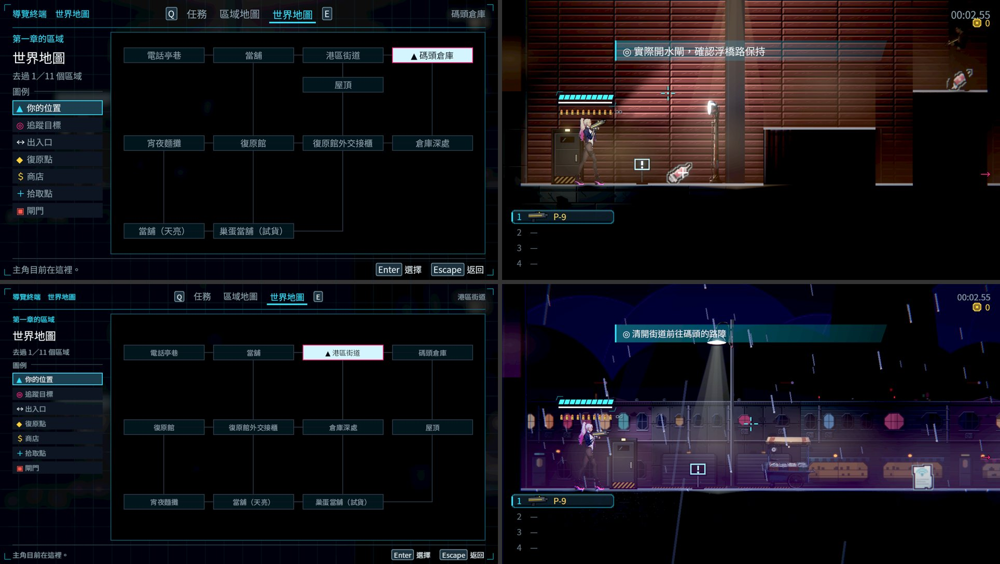

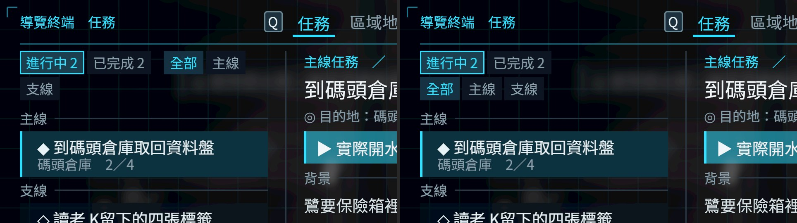

# Commit-7

## 內文

正式任務已經併進 main（第一章 10 項、第二章 10 項、第三章 9 項），之前在故事分支上預先做的檢查要在 main 上重跑。重跑時另外看到兩個問題：第二、三章的任務稽核找不到章節入口，退回成「整章每一區都是入口」，可達性等於沒檢查；世界地圖在區域多、放不下一排時會蛇形折列，折列後的連線直接穿過別的區域框（例如碼頭倉庫的線穿過屋頂接到序章），看不出誰接誰。存檔的導覽資料也一直只有同一程序內的快照往返，沒有真正關掉遊戲再讀。

改動：稽核的入口改成「上一章的最後一區通往本章的那一區」（第二、三章都是當舖），第一章沒有上一章才用原本的判斷。世界地圖的排法改成：梯子是上下層（屋頂在當舖正上方），靠左右的出口往左右，中段的門看對面那一側；只有單向出口的序章擺在它通往的當舖旁邊；名稱放不下一行時先折成兩行，真的放不下才折列。連線相鄰且中間沒有別的區域才直接連，否則沿區域之間的空隙走直角，自動檢查擋「線穿過別的區域框」。新增跨程序讀檔工具：第一個程序從主選單開新遊戲、釘選一項支線、走到當舖、死一次再重來、換到第二章，然後像玩家一樣退出；第二個程序按「繼續遊戲」；第三個程序先把存檔裡的導覽資料改壞（找不到的任務、不存在的區域、超出地圖的格子）再讀。

驗收：四條逐狀態主線路線在 main 的正式資料上都沒有缺口，三章稽核都是 0 問題且入口正確；Forward+（雲端軟體 Vulkan）拍了亮的當舖、暗的碼頭倉庫與寬的港區街道，1280×720 與 1920×1080、文字 100% 與 120%，版面檢查 0 問題；跨程序讀檔三個模式全過，釘選、三區的探索格數與目標列在重開後都一樣，改壞的存檔不會讓遊戲崩潰，警告寫出具體欄位、有效的探索保留、釘選退回追蹤主線。勾選阻塞與釘選、任務資料、區域地圖、世界地圖、HUD 目標列、鎖門說明、完整句子、自動檢查、版面截圖、讀檔與損毀這十項。

沒有勾的項目與原因：
- 暫停選單的手把操作：合成手把的自動檢查一直都過，實體手把待本機原生驗收（NE-229）。
- 任務標題動詞開頭：第三章支線「第三個抽屜的錄音」不是動詞開頭，任務文字屬故事產生器，已記給故事 Session；其他 28 項都符合。
- 暫停畫面開啟不卡頓：地圖圖形快取有自動檢查，但卡頓要真顯示卡量，待本機原生驗收。
- 支線可選、實際清路障／看門狗／水閘、電話亭錄音：要走真正的遊玩流程，這次沒有驗。
- 第一章的阻塞原因與建議都寫在故事資料裡，但正常遊玩時任務一公開前置就已滿足，所以實際畫面看不到「阻塞中」；介面在驗證樣本上的顯示已在 Commit-5 驗過。

### 測試結果

| 項目 | 結果 |
|---|---|
| 逐狀態主線（main 資料） | 序章 17 個狀態、跳過 4 個、留下 34 個、離開 32 個；缺口都是 0，留下與離開都走到第一章完成 |
| 任務稽核 | 第一章入口序章、11 區、10 項；第二章入口當舖、10 區、10 項；第三章入口當舖、9 區、9 項；都是 0 問題 |
| 跨程序讀檔 | 寫入 17 項、繼續 9 項、損毀 8 項，全過 |
| 版面檢查 | 當舖 1280×720 100%、碼頭倉庫 1920×1080 120%、港區街道 1280×720 120%、當舖 1920×1080 100%，都是 0 問題 |
| 劇本與玩家文字檢查 | 6930 條，0 錯誤、0 警告 |
| 任務與地圖套件 | 238 檢查、0 失敗（新增「世界地圖連線不穿過別的區域框」） |
| 受影響範圍（rebase 到 origin/main 623f7b4a 後重跑） | 13 組、5,329 檢查；0 新失敗、0 已知失敗，215 秒；三章稽核與四條路線在 24d7db5c 重跑結果不變 |

分支 `claude/ui-2i98t8`，已併入 main：[6165eb17](https://github.com/deadline314/Nest-Egg/commit/6165eb17)。

### 截圖

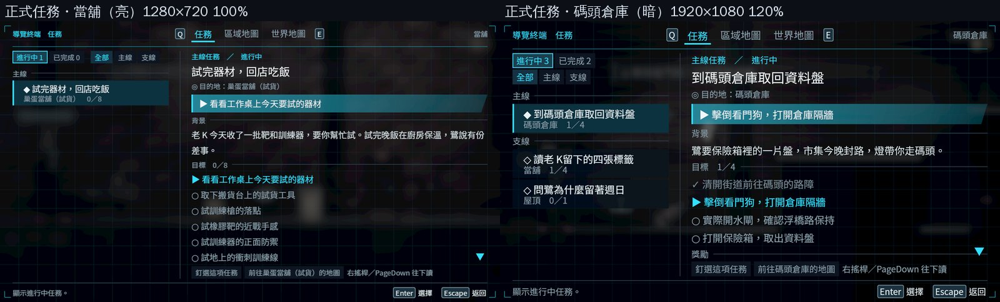

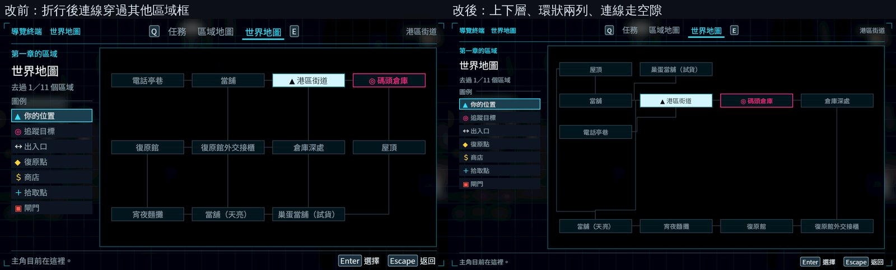

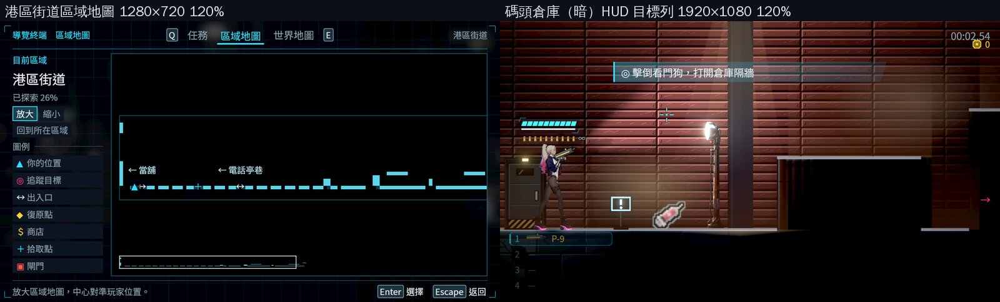

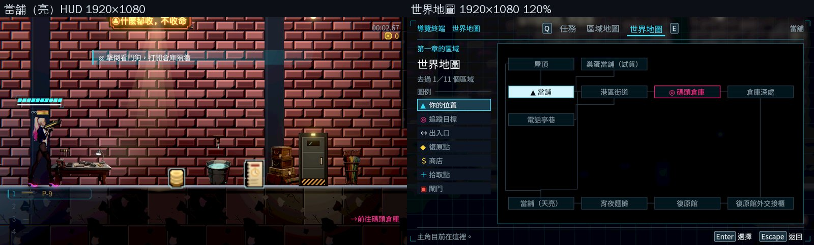

# Commit-8

## 內文

舊存檔已取得資料盤、卻還缺街道路障、看門狗或水閘紀錄時，取盤任務原本直接進「已完成」，指引提早跳到交盤。現在取盤任務會保留尚未完成的路線步驟，預設追蹤第一個缺少的目標；真正完成後才收進已完成。序章長按略過仍照原規則結束，不會把未做的練習算完成。

先檢視 Hollow Knight、Blasphemous、Hades、Cyberpunk 2077 與 The Witcher 3 的任務／地圖原圖，依據與來源保留於[設計紀錄](../../design/18-quest-map-ux/ROUTE_COMPLETION.md)及[原圖索引](attachments/NE-223-route-references/sources.json)。本次不更動使用者選定的終端機版面。

### 測試結果

| 項目 | 結果 |
|---|---|
| 修正前負控制 | 相同 277 項檢查，原來源重現 23 項新案例失敗 |
| 任務回歸 | 277 項、0 失敗；涵蓋三個路線旗標的八種組合、預設追蹤、略過與舊規則相容 |
| 原選擇器受影響範圍，固定基準 7b032bcc | 26 組、7,959 項、0 新失敗、0 已知失敗；原錯誤過濾與門檻未改 |
| 真正保存與冷續玩 | 兩個獨立 Main 程序皆 0 失敗；正式物品與明示的舊旗標樣本，沒有代填缺少路線旗標 |
| 三章資料與四路主線檢查 | 三章皆無問題；正常序章、略過、留下與離開路線皆 0 缺口（旗標／機制事件模擬） |
| 畫面 | 軟體 Vulkan Forward+；1280×720 前後、1920×1080 120% 字級；版面檢查皆 0 問題 |

序章／略過流程工具退出時出現 PagedAllocator 資源診斷；未修改的 main（7b032bcc）略過工具也重現，原錯誤過濾會判為非預期，完整輸出保留，沒有當作乾淨 log。26 組受影響測試與真正冷續玩無此診斷。

完整輸出、基準與環境見[證據收據](attachments/NE-223-route-completion/receipt.json)及[原始紀錄](attachments/NE-223-route-completion/logs.zip)。票務盤點另存[57 張未完成票](../unfinished-tickets-2026-10-20.csv)及[54 張待驗收票](../review-tickets-2026-10-20.csv)，以本輪起點狀態為準。

### 截圖

以下是正式任務資料配上明示的舊旗標狀態樣本，用於驗證缺少路線紀錄時的指引；不是實際擊倒敵人或整章通關。

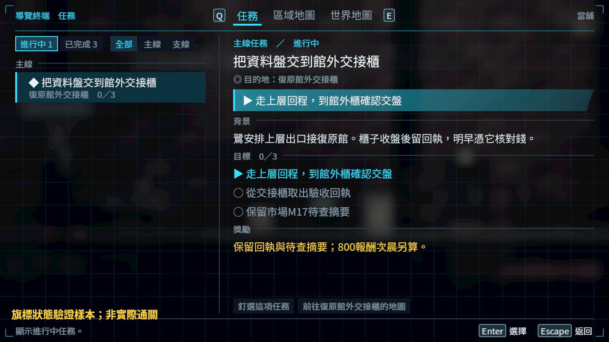
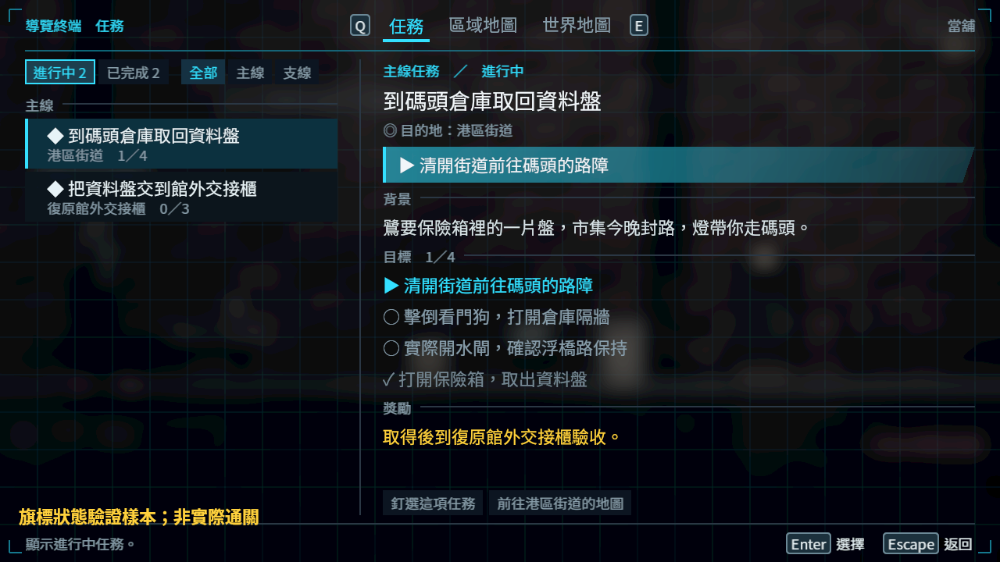
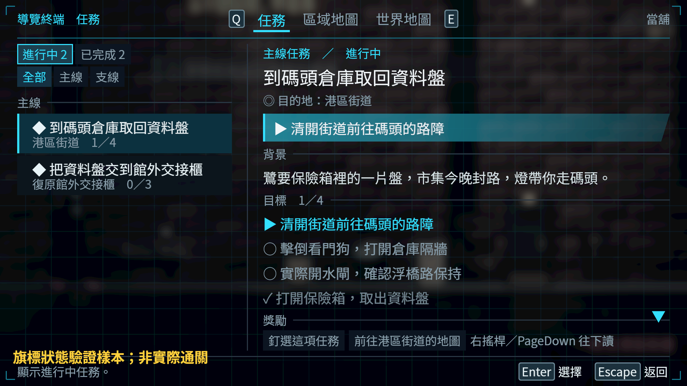

# Commit-9

## 內文

任務已提供日英文，畫面卻一直顯示中文。現在任務列、細節、步驟與HUD沿用玩家選擇的劇本語言，缺譯有可追溯的安全退回。已開啟的任務頁會即時更新，保留選取、釘選與焦點；其他畫面的焦點不會被搶走。完整目標可在細節或Hover閱讀，長列有省略號，放大文字時追蹤標籤保持在說明列。

第三章最後一項非動詞標題改成「借閱第三個抽屜的錄音」，同步更新三語正式來源。沿用Commit-7其餘28項標題及既有分頁／跳圖證據，補勾任務目錄條件；其他驗收勾選不變。

### 測試結果

| 項目 | 結果 |
|---|---|
| 固定基準、原受影響範圍 | 26組、8,469項，0新／已知失敗，210秒 |
| 最終探針／原顯示來源對照 | 原生55／0對55／19；自動336／32負控制，無腳本錯誤 |
| 即時更新焦點問題 | 修前3語均失敗；修後原生55項與原回歸均通過 |
| 全文與正式重建 | 7,175條、0錯誤／警告；僅同一項3語標題異動 |
| 版面／畫面 | 5組25張涵蓋明暗、720p／1080p與放大文字；實際檢視與原始資料分開保存 |

[全部證據、失敗版本與界線](attachments/NE-223-language/README.md)；[五款參考圖與決策](../../design/18-quest-map-ux/QUEST_LANGUAGE.md)。這批是顯示與任務標題，未以明示旗標樣本代稱整章實玩、實體手把或硬體效能。

### 截圖

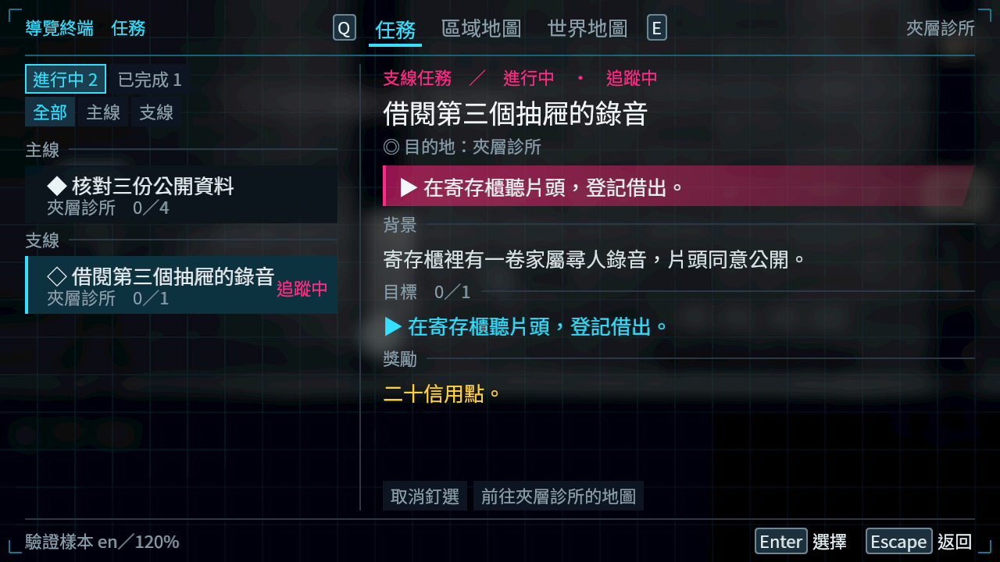
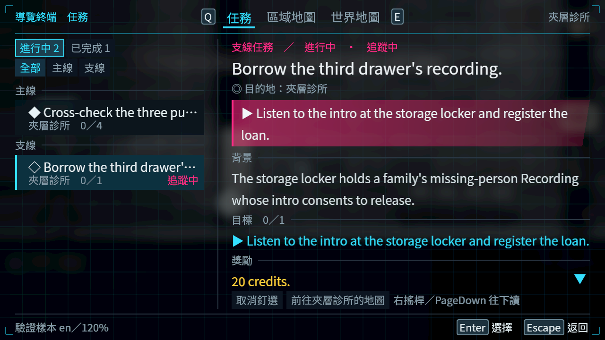
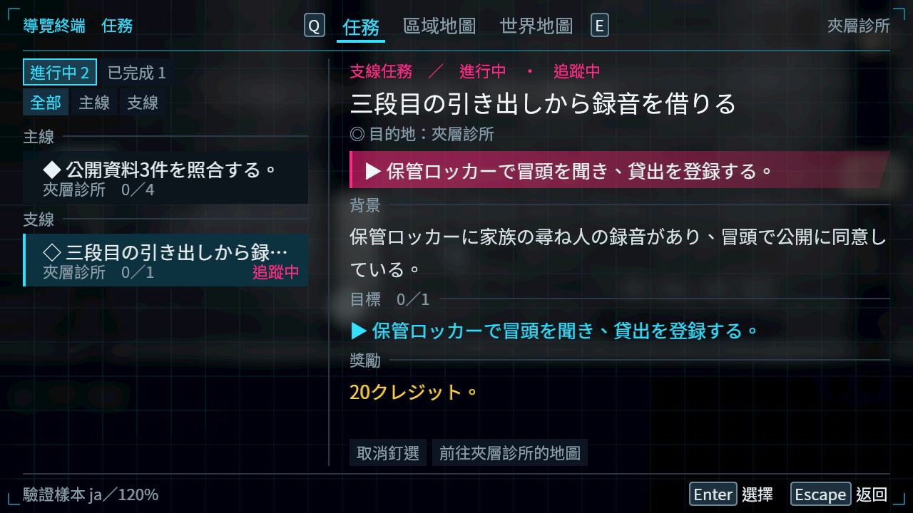
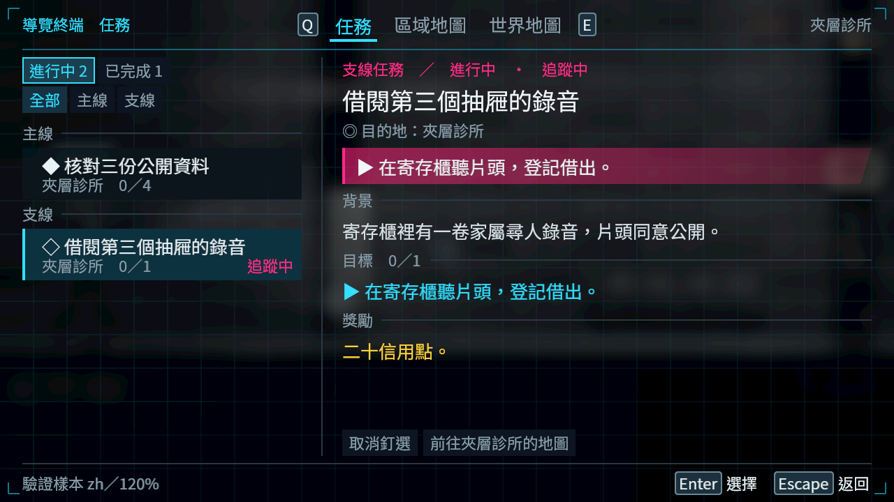
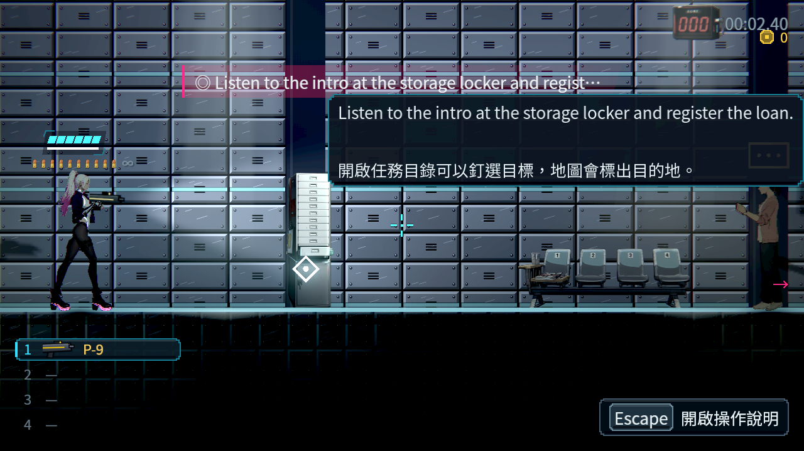
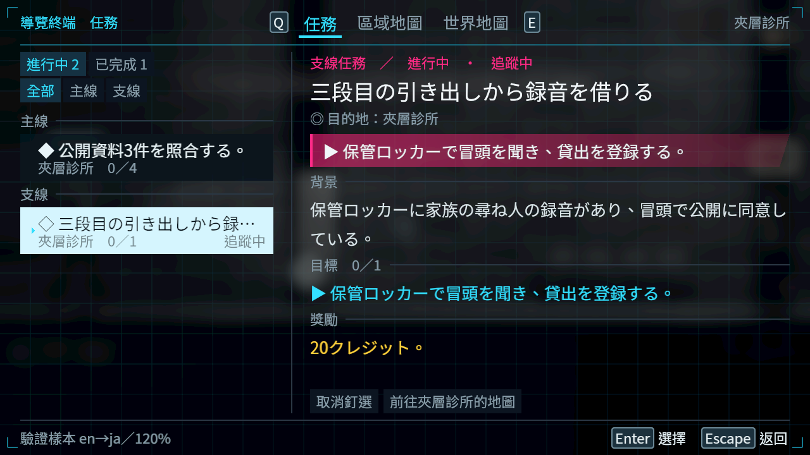

# Commit-10

## 內文

電話亭與耳機互動範圍重疊時，靠電話亭較近卻會開追問。現在依最近的可用來源決定同一次互動，撥號期間不另開交談；任務完成後也不再把保留的舊釘選誤標成追蹤中。

由真正Main撥號、確認錄音、先返回、主動接受、保留第二問再回來答完，任務依序維持未接受、1/2與2/2，沒有直接填旗標。真正任務頁、HUD與兩個獨立程序續玩均一致，補勾電話亭／自願追問條件。

原三個產品檔搭配新增回歸393項有7預期失敗，原斷言逐byte保留；修正後原選擇器60組、63,182項、0新／已知失敗。最終原生writer67、獨立reader18、1080p獨立reader18項全過，三輪0引擎ERROR。雲端軟體Forward+與合成公開輸入、安排的區域和站位皆已標示。

[五作原圖、所有原生版本、負控制、冷續玩與六份原回歸raw](attachments/NE-223-phone-producers/README.md)。整票維持進行中。

# Commit-11

## 內文

實際清完街道與兩次增援、打倒看門狗並踩開水閘後，目標依序前進；事先持有資料盤不會掩蓋未清的路線。正式溺斃、復原、電話亭備份及另一程序續玩後，世界與已完成任務仍一致，死亡與錢不重發。

無頭寫入41／0、獨立繼續16／0；原生一般寫入50／0、1080p放大字獨立繼續19／0，兩程序exit0、0引擎ERROR。12張最終圖逐張看過，死後已回到世界；中途回溯卡誤判與其他失敗完整保留。

[真正來源、安排條件、研究、原檔與SHA](attachments/NE-223-combat-producers/README.md)。只勾本條路線及續玩驗收；虛擬搖桿與生存下限安排不代替實體手把或人工整章。

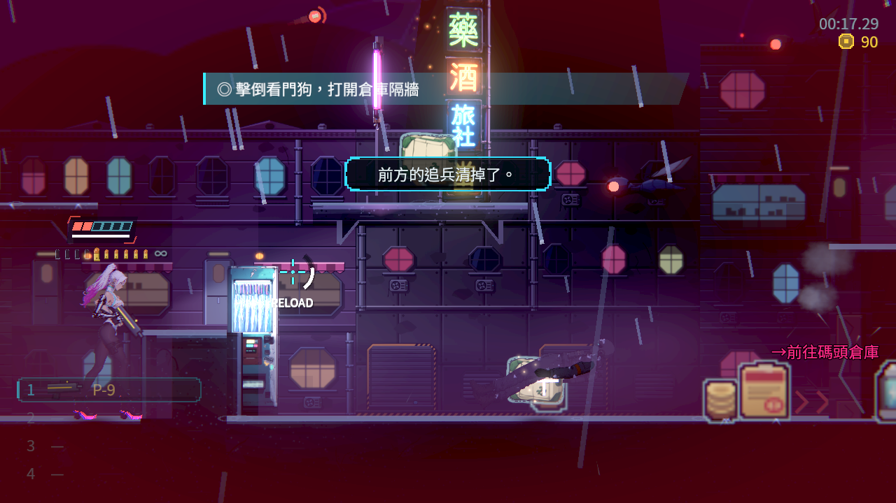
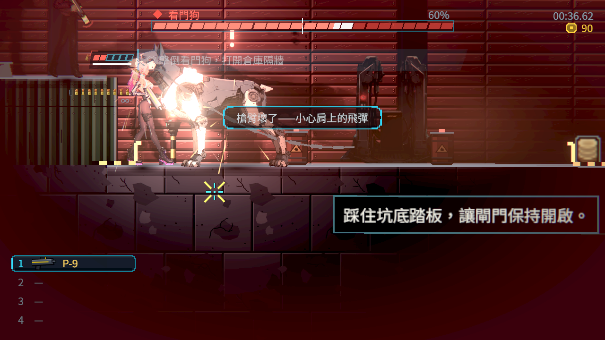
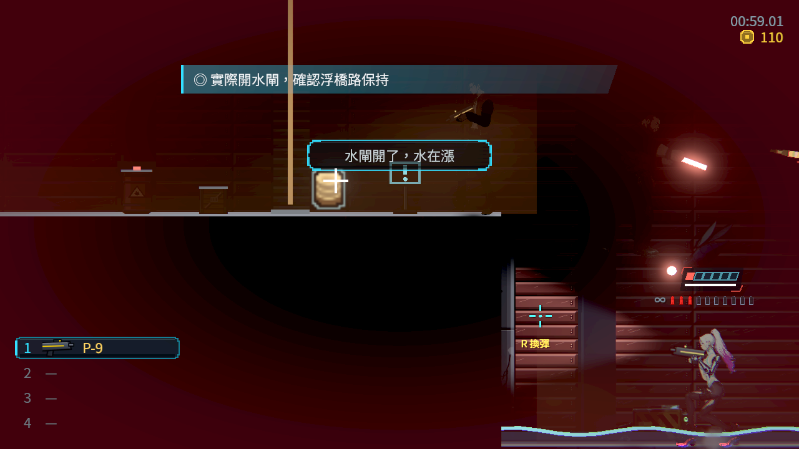
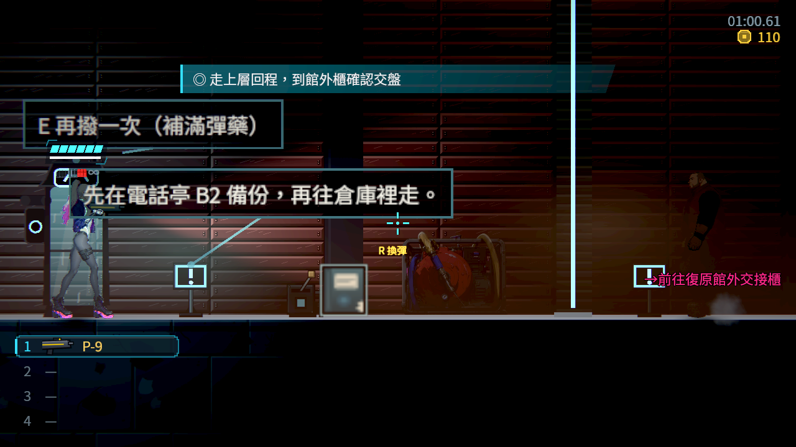
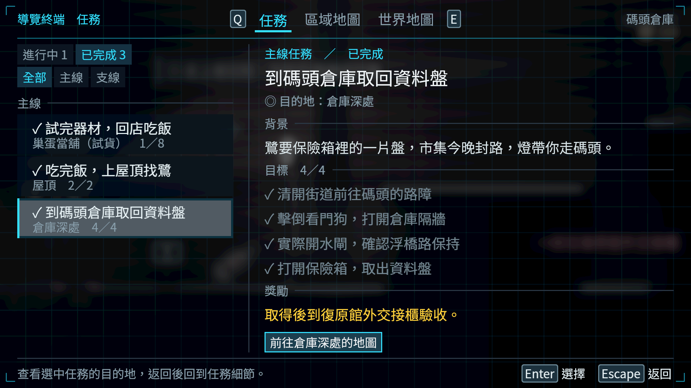
