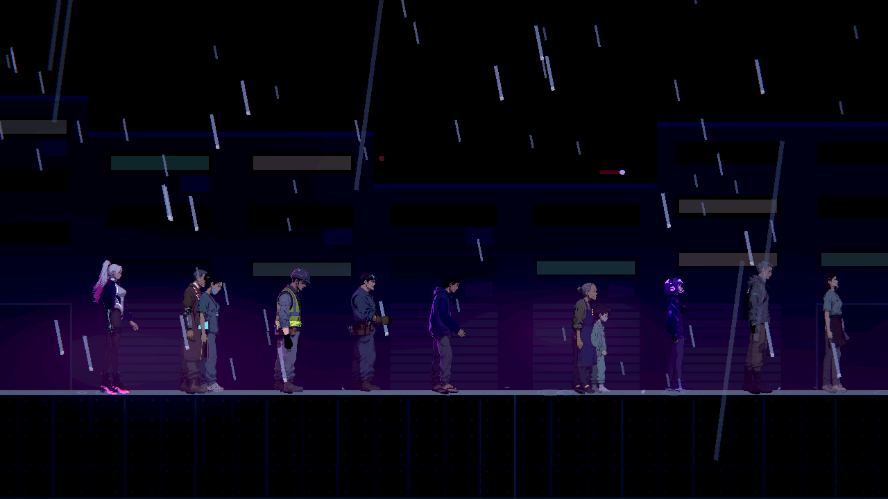
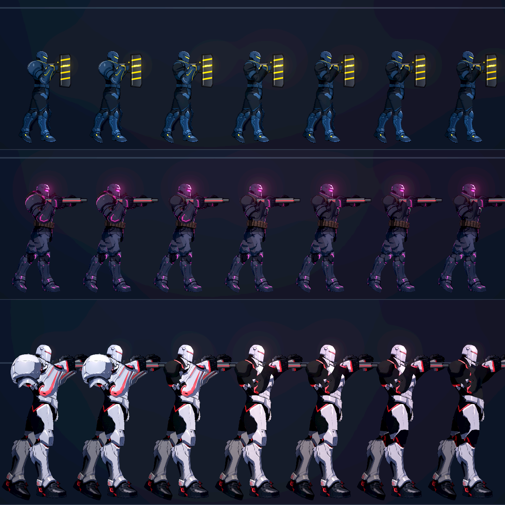
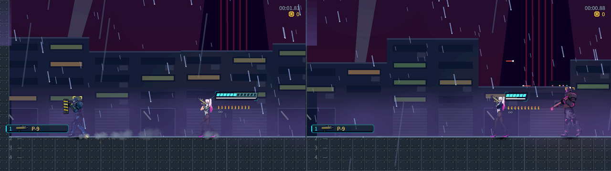
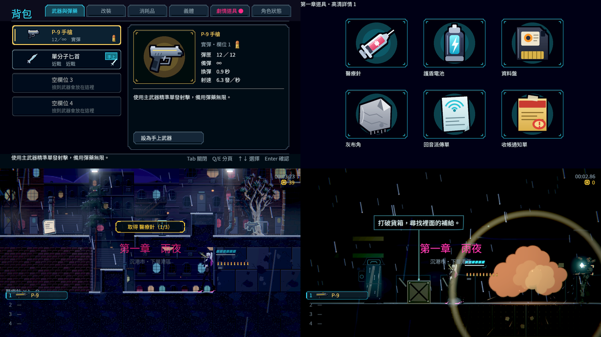
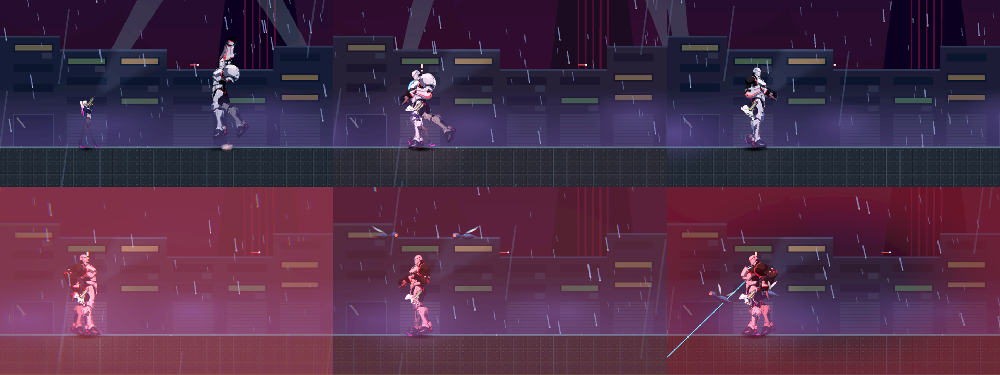

# [NE-224] 驗收雲端角色成果的遊戲整合

> 狀態：進行中

## 內文

### 需求

角色工作中的程式、資料與受影響測試交由雲端執行後，由主 Session 在成果整合後驗證實際遊戲品質。與主 Session 原本的角色測試同輪進行，避免重复完整測試和本機 GPU 競爭。雲端的無頭／軟體渲染結果與實際 Forward+、操作及硬體效能分別記錄；只有所有適用證據通過才交付相關角色票。

### 2026-10-11 使用者要求與停工交接索引

雲端及headless成果仍由主Session做真正Forward+、HDR2D、全部接點／人體／動作、操作及同條件效能驗收。軟體GPU與局部綠測試不得降低門檻或取代最後實機檢查。

[角色製作、品質要求、拒收例子與業界原始參考](../user_guide.md) · [本次停工交接](../handoff/character-art-2026-10-11.md)。本次只整理既有需求與證據，既有驗收勾選和真實狀態保持原樣。

### 來源

2026-10-09 使用者授權雲端 Nest-Egg 執行及測試非 ComfyUI 工作，要求另外開票等待主 Session 最終整合測試，與既有測試一併處理，檢查門檻維持不變。工作組責任與交接規格見 [雲端交接規格](../../design/12-cast-redraw/CLOUD_CHARACTER_HANDOFF.md)。

### 驗收條件

- [x] 每組雲端成果有可追溯基線、差異、實際測試結果與執行環境，主 Session 已核對其真實覆蓋範圍。
- [x] 整合後受影響測試通過，沒有新增腳本錯誤；完整測試由 CI 執行，沒有以空集合或修改已知失敗清單替代驗證。
- [ ] 角色所有適用接點、動作與切換在左右面向及遊戲／過場倍率通過；小裂縫、一像素孔洞、錯切、多餘肢體及不合理姿勢均不接受。
- [ ] 三名敵人的裝甲脫落、底層、握持、掛點、槍口與實際戰鬥結果通過。
- [x] 眨眼與衣襬串接後，九名角色的實際場景播放及 30 秒檢查通過。
- [x] 高解析圖示、背包 UI、拾取物及既有機關的整合回歸通過。
- [x] 實際 Forward+ 光照、HDR／發光及相同條件硬體效能通過，原生畫面與量測可重現；軟體渲染結果沒有冒充這些驗收。

### 測試流程

1. 核對雲端基線、差異與命令，整合至最新 main 後以固定差異範圍執行受影響套件。
2. 同輪執行主 Session 原定角色逐格、操作、裝備、NPC、UI 與機關驗證，保存本票專案 images 的原生證據。
3. 執行相同且沒有生成工作的 Forward+／硬體效能對照，核對 CI 完整測試；逐條確認原票已驗證範圍。

---

# 跟其他票的關係

- Blocks：NE-79、NE-80、NE-81、NE-221
- Blocked by：無
- Related：ST-8、NE-181、NE-222、NE-218、NE-90

---

# Commit-1

## 內文

雲端派工現在分為 NPC、其餘人形敵人與四足／非人形三組，並有各自的角色責任、環境確認與退回條件。所有既有 Session 已收到同一組最新 main 同步、逐票交付、受影響測試與提交身份規則；原本的角色範圍及檢查門檻維持不變。

本次核對了派工與環境回報。NPC 組能讀取專案，但網路代理連線失敗且引擎版本不符；人形敵人組首次回報環境尚未就緒。這些紀錄沒有被計為角色、遊戲畫面或正式測試通過。

### 檢查結果

| 項目 | 結果 |
|---|---|
| 派工責任與同步規則 | 三組均有具體責任及驗收／退回條件；已送達 Session 2～7 |
| 文件與引用 | 本票與交接規格引用一致，文件預覽已核對 |
| 遊戲測試 | 本次僅交付文件，未執行；本票角色驗收條件保持未勾選 |

### 文件預覽

---

# Commit-2

## 內文

這一批角色工作（凜的功能姿勢骨架、第一章六個角色與看門狗、三個重裝敵人的接點、老 K 與阿婆的衣襬）都併入 main 之後，還沒有在同一輪用實體顯示卡把整合結果看過一次。

這次在 RTX 4070 SUPER、Godot 4.7.2、Forward+、HDR 2D 開啟的原生視窗做了五件事，結果如下。全部在本機做，這一批沒有新的雲端成果進來。

**1. 場景連續 30 秒：眨眼與衣襬（通過）。** 在正式關卡場地與小巷光影下放 11 個角色（原本的九個加上鷺與阿梨），用遊戲實際的動畫流程連續播放 30.0 秒、4,285～5,057 格，沒有指定眼睛狀態，也沒有錯誤訊息。每個角色眨眼 7～12 次。有衣襬的凜、老 K、阿婆來回走動，衣襬有擺動、停下後回到原位。
量的時候發現老 K 與阿婆走路時衣襬只擺 1.6 度左右，畫面上看不出來；把彈簧的增益調高後是 4.8 度，跑步時下襬明顯往後飄。這是 NE-221 的收尾，一併在這次提交。

**2. 同條件效能對照（通過）。** 同一個場景、同一份光影設定、同樣九個角色、關閉垂直同步，連續 30 秒，和這一批開工前的版本比：

| | 開工前 | 現在 |
|---|---|---|
| 九個角色，平均每格 | 5.48 ms | 5.11 ms |
| 九個角色，最慢的 1% | 6.30 ms | 5.98 ms |
| 不放角色，平均每格 | 3.40 ms | 3.02 ms |
| 九個角色佔的時間 | 2.08 ms | 2.09 ms |

角色佔的時間沒有增加。放滿 11 個角色（小巷光影）平均 5.9 ms，約 169 格／秒。每一輪各有一格 40～60 ms，發生在截圖讀回畫面的那一格。

**3. 重裝敵人（部分通過，未勾選）。** 鎮暴員與重裝機槍手的既有戰鬥路線在現在的版本原生重播：鎮暴員 16 項檢查、重裝機槍手 13 項檢查，全部通過（正面射擊被盾擋下、衝撞造成傷害、繞到背後才打得到；機槍預熱時護甲關閉、散熱時可以被打）。三個敵人的裝甲脫落七個階段逐一看過，脫落後露出的底層、握把上的手與槍口位置都正常。
沒有通過的部分：監管者沒有戰鬥路線的重播，弱點命中屬於 NE-248；三個敵人頸部與手腕還有真正的接點缺口（見第 4 點）。

**4. 接點（未通過，未勾選）。** 逐格接點稽核涵蓋左右面向與兩種倍率。真正的缺口都是 1～3 個像素，但還沒有歸零：凜 4,465／65,280（其中 3,828 是外套敞開的前襟被算成洞）；鷺 8、阿梨 640、清掃兵 20、兩種收帳人合計 1,304（共 268,800）；鎮暴員 340、重裝機槍手 296、監管者 766（共 161,280）；老 K 與阿婆合計 4,356／107,520，集中在頸、手腕、手肘。

**5. 圖示、背包、拾取物與機關（通過）。** 原生畫面拍了道具圖示、背包各分頁、拾取提示與可破壞貨箱，沒有錯誤訊息；相關的 14 組測試 1,906 項檢查全過。

第一條「雲端成果的基線與覆蓋範圍」沒有勾：先前雲端交回的兩份回歸紀錄（鎮暴員動作、重裝機槍手美術）這次沒有重新逐項核對，只用上面的原生重播確認了現在的結果。

### 測試結果

| 項目 | 結果 |
|---|---|
| 受影響範圍測試 | 4 組、5,138 項檢查，0 新失敗、0 已知失敗 |
| 另外指定的 14 組（圖示、背包、拾取、機關、曝光、角色、眨眼、動畫稽核） | 1,906 項檢查，0 新失敗 |
| CI 完整測試 | 最新的 main 通過 |
| 場景 30 秒 | 30.0 秒、11 個角色、每個眨眼 7～12 次、無錯誤訊息 |
| 戰鬥重播 | 鎮暴員 16／16、重裝機槍手 13／13 |
| 效能 | 九個角色佔 2.09 ms（開工前 2.08 ms） |

### 截圖

擷取工具與原始數字在 `attachments/NE-224-scene-check/`。分支 `feature/character-art`。

---

# Commit-3

## 內文

第一項驗收條件「雲端成果的基線、差異、測試結果與環境，並核對真實覆蓋範圍」上次沒有做。

這次把四份和本批角色有關的雲端紀錄逐份核對：

| 紀錄 | 基線 | 內容怎麼進到 main | 雜湊清單 | 它自己聲明沒驗的 |
|---|---|---|---|---|
| 鎮暴員動作回歸（NE-79） | `aeb45f77`，在目前版本的歷史裡 | 只新增一組測試，由本機提交 `5db3dfdd` 套用 | 40／40、13／13 相符 | 只測 CPU，沒有畫面 |
| 重裝機槍手美術回歸（NE-80） | `89b16e63`，在歷史裡；那個版本的 CI 是綠的 | 只新增一組測試，由本機提交 `e267ac22` 套用 | 52／52、14／14 相符 | 沒有原生畫面，沒有啟動生成 |
| 監管者核心原點（NE-81） | `b4c186ea`，在歷史裡 | 附的修補檔與本機提交 `eadc5f8f` 的內容逐字相同，目前的檔案就是修補後的樣子 | 109／109 相符 | 八動作、全部接縫、完整頭目戰不由它驗收 |
| 雲端生物（NE-90） | `c0250bff`，在歷史裡 | 只有附件與圖；附的修補檔沒有套用，看門狗後來由 NE-218 另外做 | 圖 2,230／2,230 相符；來源清單 30 筆不符，都是之後在 main 上改過的檔案 | 明寫「不是已交付或完整驗收通過」，原生光影、效能、實際操作留給本票 |

每份都有記下指令、套件、檢查數與環境（都是無畫面或軟體繪製，Godot 4.7 或 4.7.2）。它們真正涵蓋的只有「程式邏輯與數字」，畫面一律沒有涵蓋——這和各份自己的聲明一致，畫面的部分由本票與各角色票的原生檢查負責。

核對時發現、照實記下的不足：鎮暴員與重裝機槍手兩份，雲端那邊自己的提交不在本機（內容是本機重新套用的）；兩份都是手動指定套件，沒有跑「依更動自動挑選」的那一種；CI 設定的引擎版本寫 4.7，雲端實際跑的是 4.7.2。

這一項勾選。接點與三個重裝敵人兩項仍未通過，票維持進行中。

另外這一輪在實體顯示卡上做的事，紀錄在各自的票：髖部缺口的修正與 13 人重建（NE-218）、其餘 NPC 與敵人的接點稽核與裝甲全掉後的檢查（NE-90）。

### 測試結果

| 項目 | 結果 |
|---|---|
| 雜湊核對 | 四份共 2,458 筆封存檔案相符；不符的 30 筆是後來更動過的來源檔，不是封存檔 |
| 測試 | 這次只有票的更動，不需要跑 |

分支 `feature/character-art`。

---

# Commit-4

## 內文

**典獄長的實際戰鬥。** 之前只看過典獄長的預覽姿勢，沒有在關卡裡真的打過。這次在頭目場地用原生畫面（RTX 4070 SUPER、Forward+）讓他和主角對打 16.6 秒，每 1.5 秒拍一格並記錄狀態：

- 走過的狀態：待機 → 跳躍重踏 → 連射預備 → 轉階段 → 核心預備；第一、二階段都進到了
- 一共看到 7 發子彈，離槍口最近的一發生成在槍口 4.4 像素內；槍口到武器掛點的距離全程固定（22.59）
- 主角生命 999 → 184，確實有被打中
- 沒有腳本錯誤

**還不能算通過的部分。** 第二階段整個畫面是紅色調，主角大半時間站在典獄長身後被擋住，這幾格看不出命中當下的樣子；接點也只在這個縮圖倍率看過，沒有放大。驗收條件說的三名敵人（清掃兵、兩種收帳人）這一輪沒有重打。所以「實際戰鬥結果通過」這一條不勾。

**接點稽核的畫法。** 稽核現在預設連同一根骨頭上的其他零件一起畫（穿著的樣子），另外保留只畫一對零件的舊畫法；兩種都失敗的才算真缺口。舊角色目前的數字在 NE-90。

### 測試結果

| 項目 | 結果 |
|---|---|
| 典獄長原生戰鬥 | 16.6 秒、11 格、兩個階段、7 發子彈、0 腳本錯誤 |
| 受影響範圍測試 | 7,758 項檢查，0 新失敗、0 已知失敗，輸出沒有腳本錯誤 |

### 截圖

拍攝腳本：`pm/Nest-Egg/attachments/NE-224-warden-combat/`。

分支 `feature/character-art`。
