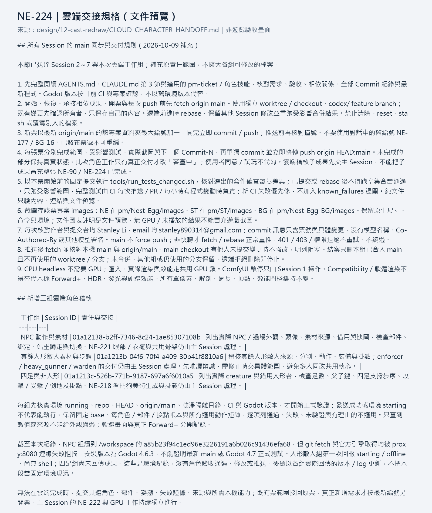

# [NE-224] 驗收雲端角色成果的遊戲整合

> 狀態：進行中

## 內文

### 需求

角色工作中的程式、資料與受影響測試交由雲端執行後，由主 Session 在成果整合後驗證實際遊戲品質。與主 Session 原本的角色測試同輪進行，避免重复完整測試和本機 GPU 競爭。雲端的無頭／軟體渲染結果與實際 Forward+、操作及硬體效能分別記錄；只有所有適用證據通過才交付相關角色票。

### 來源

2026-10-09 使用者授權雲端 Nest-Egg 執行及測試非 ComfyUI 工作，要求另外開票等待主 Session 最終整合測試，與既有測試一併處理，檢查門檻維持不變。工作組責任與交接規格見 [雲端交接規格](../../design/12-cast-redraw/CLOUD_CHARACTER_HANDOFF.md)。

### 驗收條件

- [ ] 每組雲端成果有可追溯基線、差異、實際測試結果與執行環境，主 Session 已核對其真實覆蓋範圍。
- [ ] 整合後受影響測試通過，沒有新增腳本錯誤；完整測試由 CI 執行，沒有以空集合或修改已知失敗清單替代驗證。
- [ ] 角色所有適用接點、動作與切換在左右面向及遊戲／過場倍率通過；小裂縫、一像素孔洞、錯切、多餘肢體及不合理姿勢均不接受。
- [ ] 三名敵人的裝甲脫落、底層、握持、掛點、槍口與實際戰鬥結果通過。
- [ ] 眨眼與衣襬串接後，九名角色的實際場景播放及 30 秒檢查通過。
- [ ] 高解析圖示、背包 UI、拾取物及既有機關的整合回歸通過。
- [ ] 實際 Forward+ 光照、HDR／發光及相同條件硬體效能通過，原生畫面與量測可重現；軟體渲染結果沒有冒充這些驗收。

### 測試流程

1. 核對雲端基線、差異與命令，整合至最新 main 後以固定差異範圍執行受影響套件。
2. 同輪執行主 Session 原定角色逐格、操作、裝備、NPC、UI 與機關驗證，保存本票專案 images 的原生證據。
3. 執行相同且沒有生成工作的 Forward+／硬體效能對照，核對 CI 完整測試；逐條確認原票已驗證範圍。

---

# 跟其他票的關係

- Blocks：NE-79、NE-80、NE-81、NE-221
- Blocked by：無
- Related：ST-8、NE-181、NE-222、NE-218、NE-90

---

# Commit-1

## 內文

雲端派工現在分為 NPC、其餘人形敵人與四足／非人形三組，並有各自的角色責任、環境確認與退回條件。所有既有 Session 已收到同一組最新 main 同步、逐票交付、受影響測試與提交身份規則；原本的角色範圍及檢查門檻維持不變。

本次核對了派工與環境回報。NPC 組能讀取專案，但網路代理連線失敗且引擎版本不符；人形敵人組首次回報環境尚未就緒。這些紀錄沒有被計為角色、遊戲畫面或正式測試通過。

### 檢查結果

| 項目 | 結果 |
|---|---|
| 派工責任與同步規則 | 三組均有具體責任及驗收／退回條件；已送達 Session 2～7 |
| 文件與引用 | 本票與交接規格引用一致，文件預覽已核對 |
| 遊戲測試 | 本次僅交付文件，未執行；本票角色驗收條件保持未勾選 |

### 文件預覽

