# [NE-224] 驗收雲端角色成果的遊戲整合

> 狀態：進行中

## 內文

### 需求

角色工作中的程式、資料與受影響測試交由雲端執行後，由主 Session 在成果整合後驗證實際遊戲品質。與主 Session 原本的角色測試同輪進行，避免重复完整測試和本機 GPU 競爭。雲端的無頭／軟體渲染結果與實際 Forward+、操作及硬體效能分別記錄；只有所有適用證據通過才交付相關角色票。

### 2026-10-11 使用者要求與停工交接索引

雲端及headless成果仍由主Session做真正Forward+、HDR2D、全部接點／人體／動作、操作及同條件效能驗收。軟體GPU與局部綠測試不得降低門檻或取代最後實機檢查。

[角色製作、品質要求、拒收例子與業界原始參考](../user_guide.md) · [本次停工交接](../handoff/character-art-2026-10-11.md)。本次只整理既有需求與證據，既有驗收勾選和真實狀態保持原樣。

### 來源

2026-10-09 使用者授權雲端 Nest-Egg 執行及測試非 ComfyUI 工作，要求另外開票等待主 Session 最終整合測試，與既有測試一併處理，檢查門檻維持不變。工作組責任與交接規格見 [雲端交接規格](../../design/12-cast-redraw/CLOUD_CHARACTER_HANDOFF.md)。

### 驗收條件

- [x] 每組雲端成果有可追溯基線、差異、實際測試結果與執行環境，主 Session 已核對其真實覆蓋範圍。
- [x] 整合後受影響測試通過，沒有新增腳本錯誤；完整測試由 CI 執行，沒有以空集合或修改已知失敗清單替代驗證。
- [ ] 角色所有適用接點、動作與切換在左右面向及遊戲／過場倍率通過；小裂縫、一像素孔洞、錯切、多餘肢體及不合理姿勢均不接受。
- [x] 三名敵人的裝甲脫落、底層、握持、掛點、槍口與實際戰鬥結果通過。
- [x] 眨眼與衣襬串接後，九名角色的實際場景播放及 30 秒檢查通過。
- [x] 高解析圖示、背包 UI、拾取物及既有機關的整合回歸通過。
- [x] 實際 Forward+ 光照、HDR／發光及相同條件硬體效能通過，原生畫面與量測可重現；軟體渲染結果沒有冒充這些驗收。

### 測試流程

1. 核對雲端基線、差異與命令，整合至最新 main 後以固定差異範圍執行受影響套件。
2. 同輪執行主 Session 原定角色逐格、操作、裝備、NPC、UI 與機關驗證，保存本票專案 images 的原生證據。
3. 執行相同且沒有生成工作的 Forward+／硬體效能對照，核對 CI 完整測試；逐條確認原票已驗證範圍。

---

# 跟其他票的關係

- Blocks：NE-79、NE-80、NE-81、NE-221
- Blocked by：無
- Related：ST-8、NE-181、NE-222、NE-218、NE-90

---

# Commit-1

## 內文

雲端派工現在分為 NPC、其餘人形敵人與四足／非人形三組，並有各自的角色責任、環境確認與退回條件。所有既有 Session 已收到同一組最新 main 同步、逐票交付、受影響測試與提交身份規則；原本的角色範圍及檢查門檻維持不變。

本次核對了派工與環境回報。NPC 組能讀取專案，但網路代理連線失敗且引擎版本不符；人形敵人組首次回報環境尚未就緒。這些紀錄沒有被計為角色、遊戲畫面或正式測試通過。

### 檢查結果

| 項目 | 結果 |
|---|---|
| 派工責任與同步規則 | 三組均有具體責任及驗收／退回條件；已送達 Session 2～7 |
| 文件與引用 | 本票與交接規格引用一致，文件預覽已核對 |
| 遊戲測試 | 本次僅交付文件，未執行；本票角色驗收條件保持未勾選 |

### 文件預覽

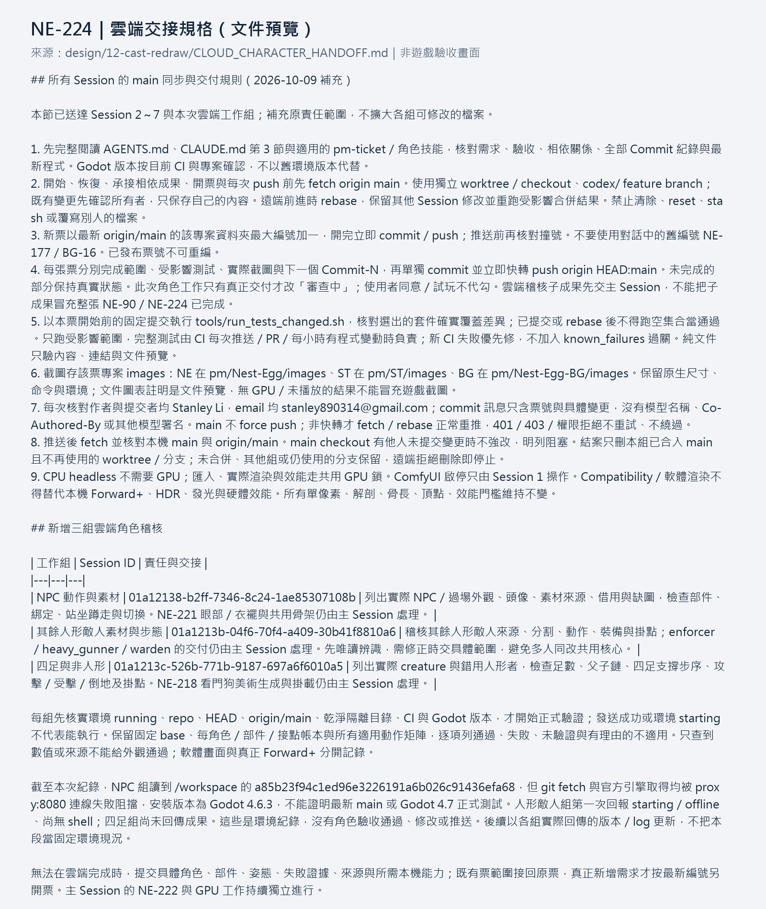

---

# Commit-2

## 內文

這一批角色工作（凜的功能姿勢骨架、第一章六個角色與看門狗、三個重裝敵人的接點、老 K 與阿婆的衣襬）都併入 main 之後，還沒有在同一輪用實體顯示卡把整合結果看過一次。

這次在 RTX 4070 SUPER、Godot 4.7.2、Forward+、HDR 2D 開啟的原生視窗做了五件事，結果如下。全部在本機做，這一批沒有新的雲端成果進來。

**1. 場景連續 30 秒：眨眼與衣襬（通過）。** 在正式關卡場地與小巷光影下放 11 個角色（原本的九個加上鷺與阿梨），用遊戲實際的動畫流程連續播放 30.0 秒、4,285～5,057 格，沒有指定眼睛狀態，也沒有錯誤訊息。每個角色眨眼 7～12 次。有衣襬的凜、老 K、阿婆來回走動，衣襬有擺動、停下後回到原位。
量的時候發現老 K 與阿婆走路時衣襬只擺 1.6 度左右，畫面上看不出來；把彈簧的增益調高後是 4.8 度，跑步時下襬明顯往後飄。這是 NE-221 的收尾，一併在這次提交。

**2. 同條件效能對照（通過）。** 同一個場景、同一份光影設定、同樣九個角色、關閉垂直同步，連續 30 秒，和這一批開工前的版本比：

| | 開工前 | 現在 |
|---|---|---|
| 九個角色，平均每格 | 5.48 ms | 5.11 ms |
| 九個角色，最慢的 1% | 6.30 ms | 5.98 ms |
| 不放角色，平均每格 | 3.40 ms | 3.02 ms |
| 九個角色佔的時間 | 2.08 ms | 2.09 ms |

角色佔的時間沒有增加。放滿 11 個角色（小巷光影）平均 5.9 ms，約 169 格／秒。每一輪各有一格 40～60 ms，發生在截圖讀回畫面的那一格。

**3. 重裝敵人（部分通過，未勾選）。** 鎮暴員與重裝機槍手的既有戰鬥路線在現在的版本原生重播：鎮暴員 16 項檢查、重裝機槍手 13 項檢查，全部通過（正面射擊被盾擋下、衝撞造成傷害、繞到背後才打得到；機槍預熱時護甲關閉、散熱時可以被打）。三個敵人的裝甲脫落七個階段逐一看過，脫落後露出的底層、握把上的手與槍口位置都正常。
沒有通過的部分：監管者沒有戰鬥路線的重播，弱點命中屬於 NE-248；三個敵人頸部與手腕還有真正的接點缺口（見第 4 點）。

**4. 接點（未通過，未勾選）。** 逐格接點稽核涵蓋左右面向與兩種倍率。真正的缺口都是 1～3 個像素，但還沒有歸零：凜 4,465／65,280（其中 3,828 是外套敞開的前襟被算成洞）；鷺 8、阿梨 640、清掃兵 20、兩種收帳人合計 1,304（共 268,800）；鎮暴員 340、重裝機槍手 296、監管者 766（共 161,280）；老 K 與阿婆合計 4,356／107,520，集中在頸、手腕、手肘。

**5. 圖示、背包、拾取物與機關（通過）。** 原生畫面拍了道具圖示、背包各分頁、拾取提示與可破壞貨箱，沒有錯誤訊息；相關的 14 組測試 1,906 項檢查全過。

第一條「雲端成果的基線與覆蓋範圍」沒有勾：先前雲端交回的兩份回歸紀錄（鎮暴員動作、重裝機槍手美術）這次沒有重新逐項核對，只用上面的原生重播確認了現在的結果。

### 測試結果

| 項目 | 結果 |
|---|---|
| 受影響範圍測試 | 4 組、5,138 項檢查，0 新失敗、0 已知失敗 |
| 另外指定的 14 組（圖示、背包、拾取、機關、曝光、角色、眨眼、動畫稽核） | 1,906 項檢查，0 新失敗 |
| CI 完整測試 | 最新的 main 通過 |
| 場景 30 秒 | 30.0 秒、11 個角色、每個眨眼 7～12 次、無錯誤訊息 |
| 戰鬥重播 | 鎮暴員 16／16、重裝機槍手 13／13 |
| 效能 | 九個角色佔 2.09 ms（開工前 2.08 ms） |

### 截圖

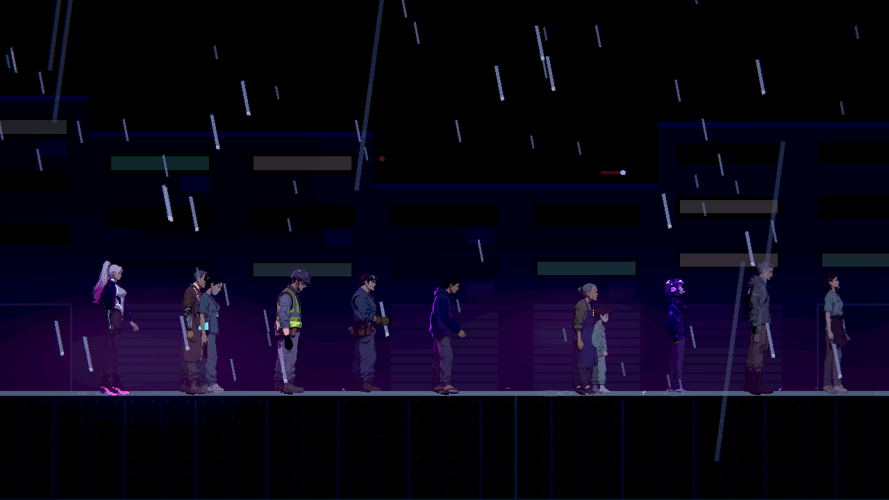

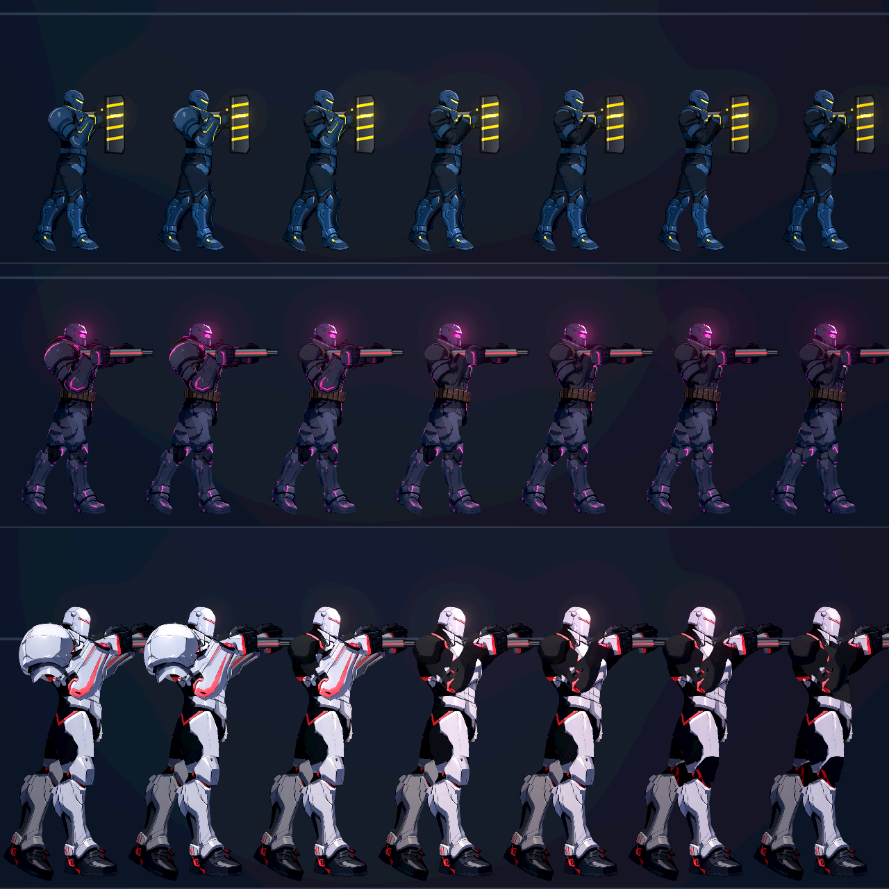

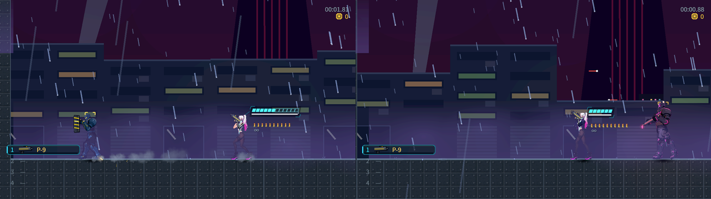

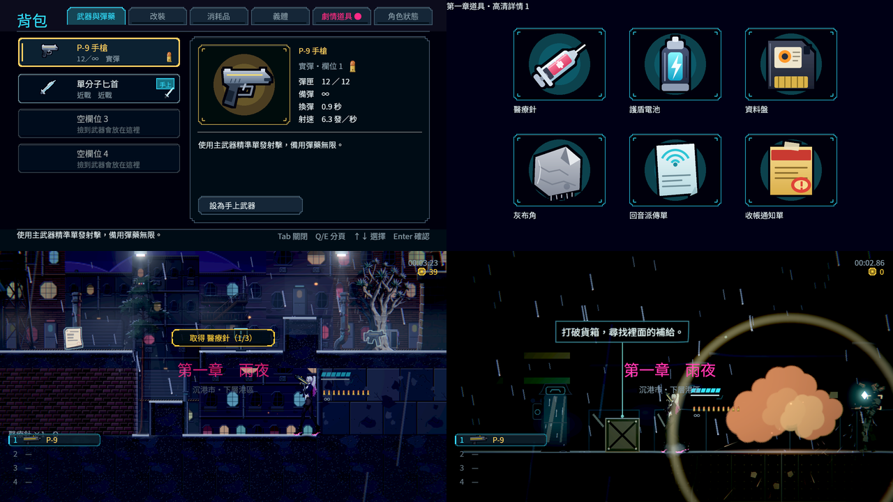

擷取工具與原始數字在 `attachments/NE-224-scene-check/`。分支 `feature/character-art`。

---

# Commit-3

## 內文

第一項驗收條件「雲端成果的基線、差異、測試結果與環境，並核對真實覆蓋範圍」上次沒有做。

這次把四份和本批角色有關的雲端紀錄逐份核對：

| 紀錄 | 基線 | 內容怎麼進到 main | 雜湊清單 | 它自己聲明沒驗的 |
|---|---|---|---|---|
| 鎮暴員動作回歸（NE-79） | `aeb45f77`，在目前版本的歷史裡 | 只新增一組測試，由本機提交 `5db3dfdd` 套用 | 40／40、13／13 相符 | 只測 CPU，沒有畫面 |
| 重裝機槍手美術回歸（NE-80） | `89b16e63`，在歷史裡；那個版本的 CI 是綠的 | 只新增一組測試，由本機提交 `e267ac22` 套用 | 52／52、14／14 相符 | 沒有原生畫面，沒有啟動生成 |
| 監管者核心原點（NE-81） | `b4c186ea`，在歷史裡 | 附的修補檔與本機提交 `eadc5f8f` 的內容逐字相同，目前的檔案就是修補後的樣子 | 109／109 相符 | 八動作、全部接縫、完整頭目戰不由它驗收 |
| 雲端生物（NE-90） | `c0250bff`，在歷史裡 | 只有附件與圖；附的修補檔沒有套用，看門狗後來由 NE-218 另外做 | 圖 2,230／2,230 相符；來源清單 30 筆不符，都是之後在 main 上改過的檔案 | 明寫「不是已交付或完整驗收通過」，原生光影、效能、實際操作留給本票 |

每份都有記下指令、套件、檢查數與環境（都是無畫面或軟體繪製，Godot 4.7 或 4.7.2）。它們真正涵蓋的只有「程式邏輯與數字」，畫面一律沒有涵蓋——這和各份自己的聲明一致，畫面的部分由本票與各角色票的原生檢查負責。

核對時發現、照實記下的不足：鎮暴員與重裝機槍手兩份，雲端那邊自己的提交不在本機（內容是本機重新套用的）；兩份都是手動指定套件，沒有跑「依更動自動挑選」的那一種；CI 設定的引擎版本寫 4.7，雲端實際跑的是 4.7.2。

這一項勾選。接點與三個重裝敵人兩項仍未通過，票維持進行中。

另外這一輪在實體顯示卡上做的事，紀錄在各自的票：髖部缺口的修正與 13 人重建（NE-218）、其餘 NPC 與敵人的接點稽核與裝甲全掉後的檢查（NE-90）。

### 測試結果

| 項目 | 結果 |
|---|---|
| 雜湊核對 | 四份共 2,458 筆封存檔案相符；不符的 30 筆是後來更動過的來源檔，不是封存檔 |
| 測試 | 這次只有票的更動，不需要跑 |

分支 `feature/character-art`。

---

# Commit-4

## 內文

**典獄長的實際戰鬥。** 之前只看過典獄長的預覽姿勢，沒有在關卡裡真的打過。這次在頭目場地用原生畫面（RTX 4070 SUPER、Forward+）讓他和主角對打 16.6 秒，每 1.5 秒拍一格並記錄狀態：

- 走過的狀態：待機 → 跳躍重踏 → 連射預備 → 轉階段 → 核心預備；第一、二階段都進到了
- 一共看到 7 發子彈，離槍口最近的一發生成在槍口 4.4 像素內；槍口到武器掛點的距離全程固定（22.59）
- 主角生命 999 → 184，確實有被打中
- 沒有腳本錯誤

**還不能算通過的部分。** 第二階段整個畫面是紅色調，主角大半時間站在典獄長身後被擋住，這幾格看不出命中當下的樣子；接點也只在這個縮圖倍率看過，沒有放大。驗收條件說的三名敵人（清掃兵、兩種收帳人）這一輪沒有重打。所以「實際戰鬥結果通過」這一條不勾。

**接點稽核的畫法。** 稽核現在預設連同一根骨頭上的其他零件一起畫（穿著的樣子），另外保留只畫一對零件的舊畫法；兩種都失敗的才算真缺口。舊角色目前的數字在 NE-90。

### 測試結果

| 項目 | 結果 |
|---|---|
| 典獄長原生戰鬥 | 16.6 秒、11 格、兩個階段、7 發子彈、0 腳本錯誤 |
| 受影響範圍測試 | 7,758 項檢查，0 新失敗、0 已知失敗，輸出沒有腳本錯誤 |

### 截圖

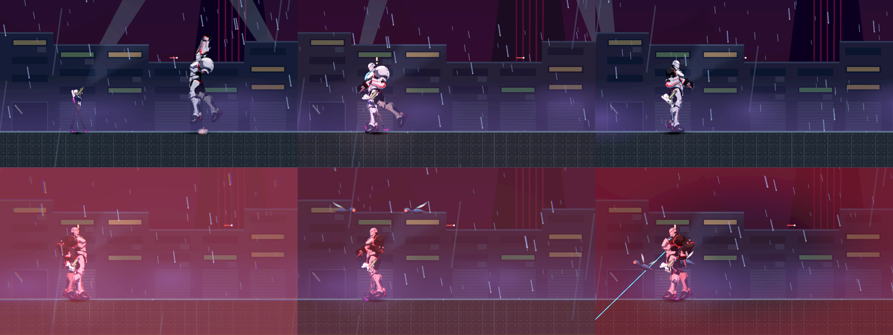

拍攝腳本：`pm/Nest-Egg/attachments/NE-224-warden-combat/`。

分支 `feature/character-art`。

---

# Commit-5（重裝敵人的整場裝甲與武器驗收）

## 內文

依[雲端交接規格](../../design/12-cast-redraw/CLOUD_CHARACTER_HANDOFF.md)核對鎮暴員、重裝機槍手與監管者。三名敵人各從兩側實戰打到歸零，逐次收到四組裝甲脫落事件，最後仍看得到頭、軀幹與骨盆的底層。鎮暴員先擋住正面手槍，衝撞後可反擊，生命剩一點時可用終結技卸下最後一組甲。重裝機槍手正面封甲擋槍，實際掃射命中凜，散熱時打得到。監管者由手槍自然打進第二階段，外露核心命中扣 2 點，身體及核心關閉時扣 1 點。

武器握點、掛點與槍口依正式角色的骨架和武器資料計算世界座標。機槍手的實彈在第一個看見的物理影格距槍口最多 2.42 像素，落在一格飛行範圍內。監管者實戰核對待機、連射、核心準備時的機槍掛點與槍口，核心砲真正生成座標沿用[雙面向 30 發原點證據](attachments/NE-81-core-origin/README.md)並重跑正式回歸。

本輪勾選三名敵人裝甲與實戰驗收。角色全部動作與過場倍率的接點仍待逐格核對，票維持進行中。

### 測試結果

| 項目 | 結果 |
|---|---|
| 正式裝甲、重裝敵人與動作回歸 | 4 套，33,058 項，0 新失敗、0 已知失敗 |
| 原生戰鬥 | RX 9070 XT、Forward+，三名敵人各兩側打完，各脫落 4 組，0 腳本錯誤 |
| 武器與實彈 | 握點最大距離 0.000069 px，槍口世界座標差為 0；重裝機槍手 39 發實彈的第一格距槍口最大 2.42 px |

[原生實戰、重跑方式與原始紀錄](attachments/NE-224-armored-replay-2026-11-19/README.md)

### 截圖

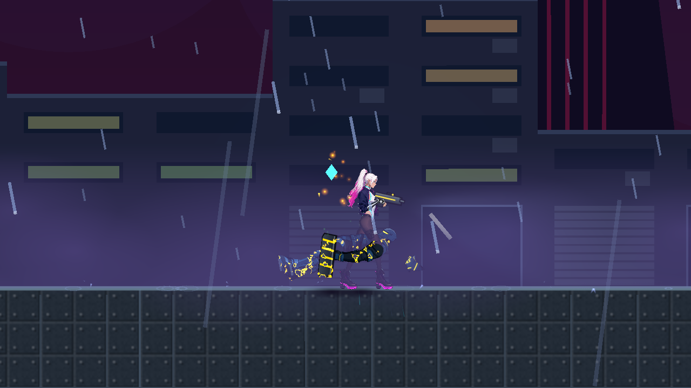

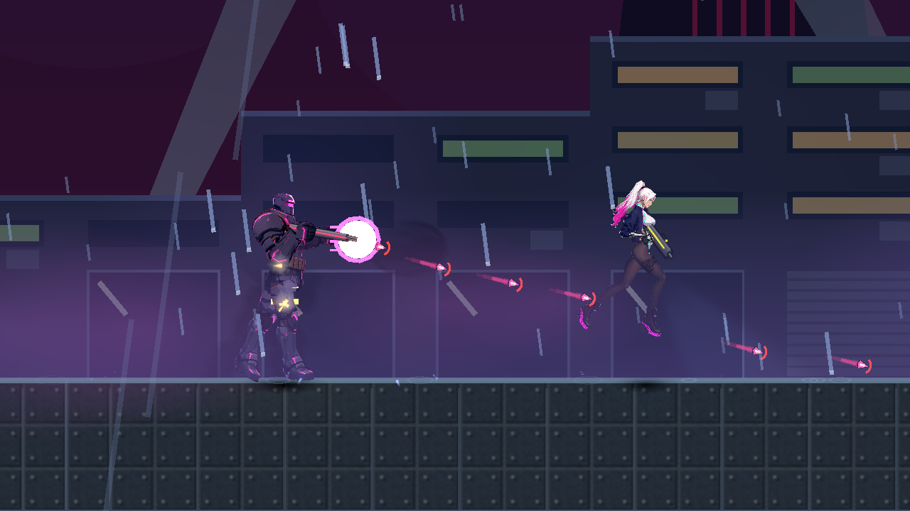

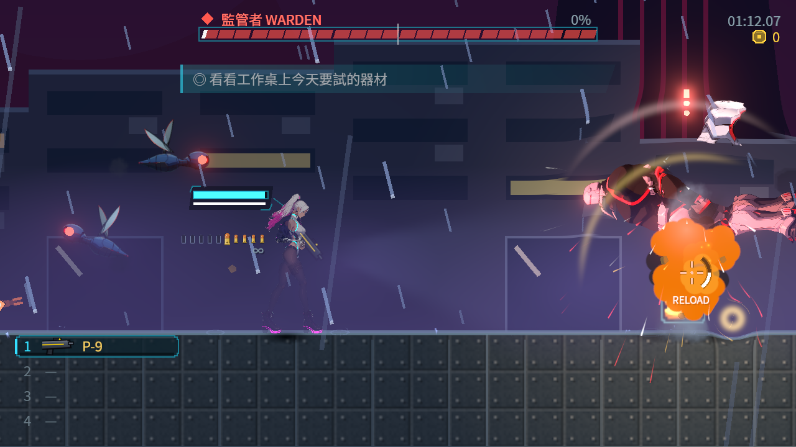

---

# Commit-6（監管者手套與袖口）

## 內文

監管者轉身、抬槍或擋擊時，護腕邊緣會透出背景。手套在袖口下方補上原有的深色內襯，左右手沿用原尺寸、支點與原畫。逐步脫甲的全彩畫面也核對了手套與底層前臂的接合。

### 測試結果

| 項目 | 結果 |
|---|---|
| 全裝手腕逐格檢查 | RX 9070 XT、Forward+，八種動作、兩手、兩面向、遊戲與過場倍率共 7,680 個樣本。封閉洞、斷面或失去中心覆蓋由 3,360 降為 0。剩餘 1,376 筆為輪廓凹口或肢體跨出採樣區。 |
| 隔離前臂與手套檢查 | 同樣 7,680 個樣本。修前有 240 筆外緣凹口，修後 0 筆，無孔洞或碎片。 |
| 來源與受影響回歸 | 原切件可重建且骨架輸出一致。4 套、7,676 項全過，32 秒，無腳本錯誤。 |

[原生原圖、逐格報表與正式回歸](attachments/NE-224-warden-wrist-2026-11-21/evidence.zip)

### 截圖

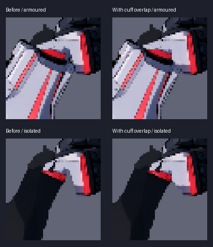

---

# Commit-7（鎮暴員衣領與胸甲）

## 內文

鎮暴員前胸裝甲與衣領的夾縫在抬手、跳躍與硬直時會透出背景。原有深藍底衣在交界補足重疊。從全裝到脫甲逐格檢查，黃色飾線、裝甲造型與底層布料的銜接一致。

### 測試結果

| 項目 | 結果 |
|---|---|
| 全裝衣領逐格檢查 | RX 9070 XT Forward+，八種動作、雙面向遊戲與過場倍率，3,840 樣本。透空、失去中心覆蓋或碎片由 1,920 降至 70。殘留項的位置見報表。 |
| 隔離頭與軀幹 | 3,840 樣本，修前、修後均無內部孔洞或碎片。 |
| 全身與鄰接關節 | 全身 1,152 樣本，原圈內透空由 570 降至 140。另比對雙肩與腰 3,456 樣本，未新增透空樣本。 |
| 受影響的回歸 | 4 套、7,676 項全過，31 秒，無腳本錯誤。 |

[源檔核對、原生影格與回歸紀錄](attachments/NE-224-enforcer-collar-2026-11-21/evidence.zip)

### 截圖

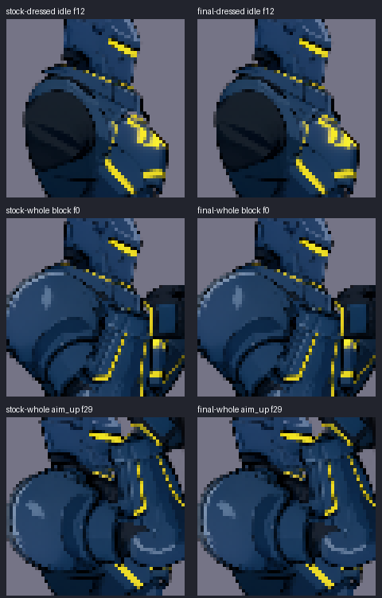
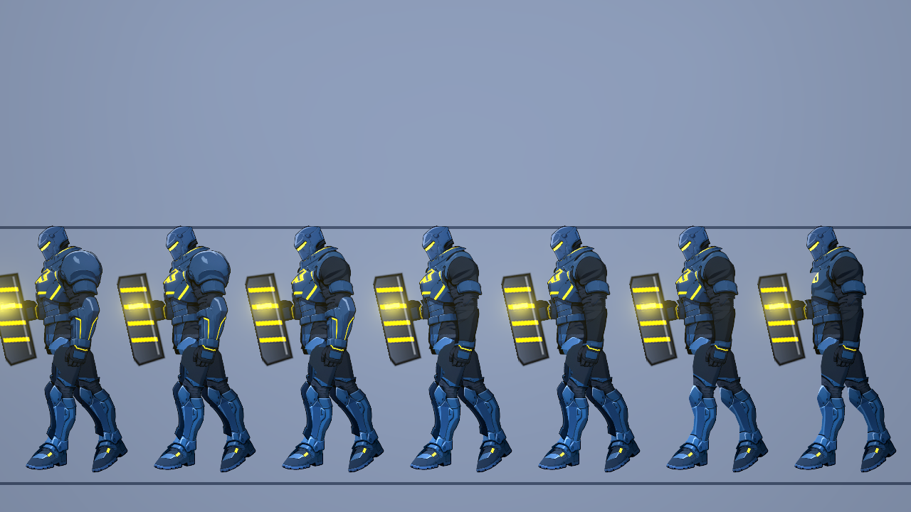

---

# Commit-8（監管者蹲姿胸甲）

## 內文

監管者蹲下時，抬起的前臂上方會從胸甲旁透出背景。原先的黑色底衣補足交界。全身、原裝甲與單獨前臂三種畫面都逐格比對，保持原骨架、裝甲外形和前臂姿勢。

### 測試結果

| 項目 | 結果 |
|---|---|
| 全身手肘範圍 | RX 9070 XT Forward+，八種姿勢、雙面向、遊戲與過場倍率共 3,840 個樣本。蹲姿 226 筆透空降為 0。原有倒地兩筆位置見附件。 |
| 相鄰關節與輪廓 | 頸、雙肩、腰共 4,608 個樣本，透空數由 380 降至 216，沒有新透空。隔離前臂與單對裝甲的原圖逐檔一致已核對。 |
| 來源及正式回歸 | 原尺寸切件可重建。4 套、7,676 項全過，31 秒，無腳本錯誤。 |

[原生原圖、雙尺度逐格資料與回歸紀錄](attachments/NE-224-warden-chest-2026-11-21/evidence.zip)

### 截圖

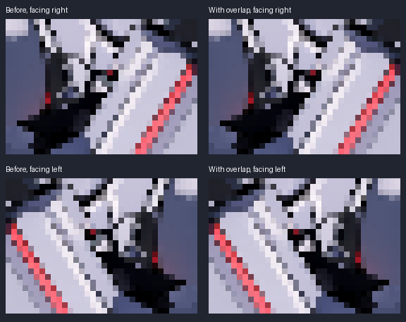

---

# Commit-9（監管者倒地時的前臂甲）

## 內文

監管者倒地翻轉時，前臂甲和相鄰零件之間在左右面向各透出一個像素。前臂甲內側沿原淺灰邊緣保留少量重疊。前臂甲仍循原有生命門檻脫落，露出的手臂沿用原畫。

### 測試結果

| 項目 | 結果 |
|---|---|
| 全身後肘逐格檢查 | RX 9070 XT Forward+，雙面向雙倍率、八姿勢共 3,840 個樣本，封閉孔由 2 降為 0。剩餘 10 筆是外輪廓凹口。 |
| 雙肘雙腕對照 | 全身和局部各 4,608 個樣本。沒有新缺口或外緣旗標，原有 252 筆其他位置見附件。只畫內層手臂的原圖逐檔一致。 |
| 受影響回歸 | 4 套、7,676 項全過，34 秒，無腳本錯誤。 |

[前後原圖、實際匯入與逐格報表](attachments/NE-224-warden-defeat-2026-11-21/evidence.zip)

### 截圖

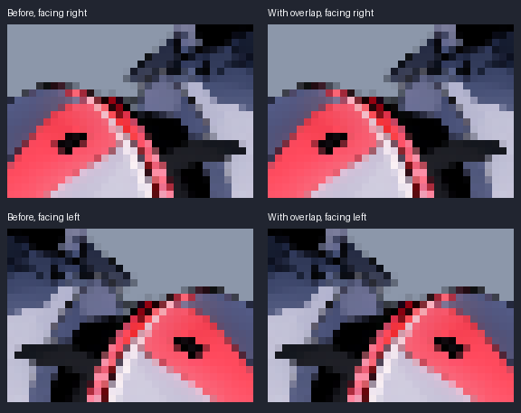
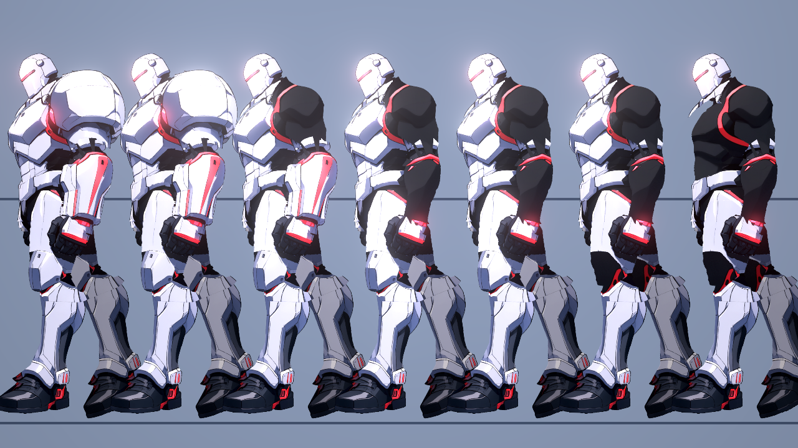

---

# Commit-10（監管者衣領外側的胸甲接縫）

## 內文

監管者待機、跑步及受擊時，胸甲與衣領交界會透出背景。原深色底衣沿裝甲內緣延伸，靠近倒地時翻轉的衣摺處逐漸收窄。完整動作和脫去外甲時的頭盔、胸甲及底衣皆用正式素材核對。

### 測試結果

| 項目 | 結果 |
|---|---|
| 全身衣領取樣 | RX 9070 XT Forward+，八姿勢、雙面向及兩倍率。3,840 個樣本中的透明孔或斷面由 746 降至 4。 |
| 裝甲及鄰接骨架 | 局部有甲和只畫頭與軀幹各 3,840 個樣本，雙肩、腰和後肘另 4,608 個樣本。沒有新增缺口或外緣旗標。 |
| 受影響回歸 | 4 套、7,676 項全過，31 秒，無腳本錯誤。 |

[原生影格、透空位置及正式回歸](attachments/NE-224-warden-collar-2026-11-21/evidence.zip)

### 截圖

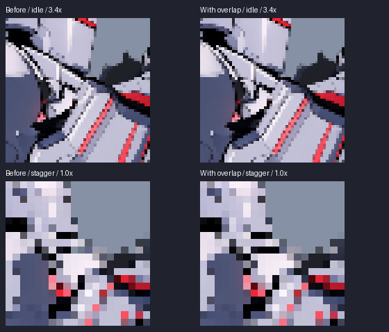

---

# Commit-11（鎮暴員胸甲下緣與腰部）

## 內文

鎮暴員受擊和倒地時，胸甲與腰間護甲之間有缺口。沿原衣料補足 148 個邊緣像素，重建對應法線。裝甲脫落時仍會露出原來的底衣和腰帶。

### 測試結果

| 項目 | 結果 |
|---|---|
| 裝甲與軀幹的腰部交界 | RX 9070 XT Forward+，八姿勢、雙面向、兩倍率共 3,840 個樣本，透空由 304 降至 0。隔離腰部另 3,840 個樣本，修前與修後均無透空。 |
| 全身與鄰接關節 | 腰部 3,840 個樣本，透空由 20 降至 2，剩餘兩筆在倒地的盾緣。衣領 3,840 個樣本，透空由 70 降至 2。另比對 5,760 個相鄰關節樣本，沒有新增透空或外緣旗標。 |
| 來源與受影響回歸 | 原切件與匯入後的貼圖皆可重建。4 套、7,676 項全過，30 秒，無腳本錯誤。 |

[原生影格、逐格報表及回歸紀錄](attachments/NE-224-enforcer-waist-2026-11-21/evidence.zip)

### 截圖

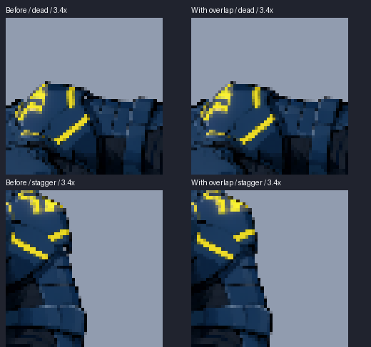
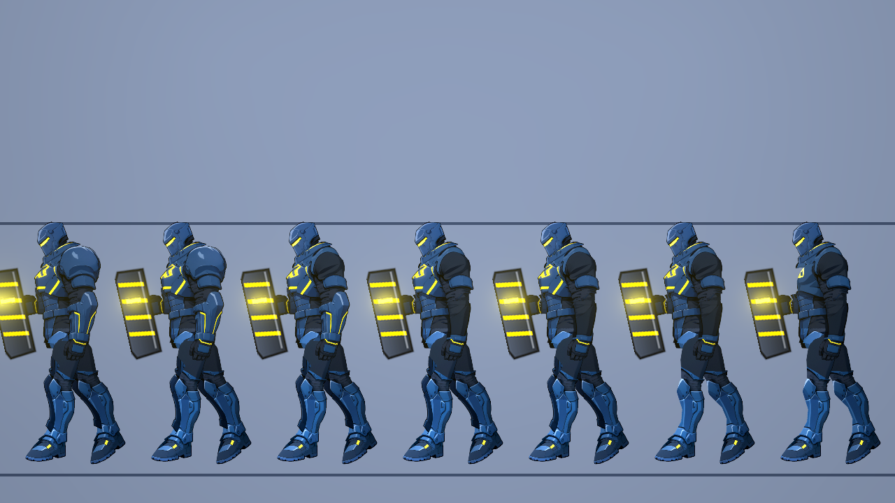

---

# Commit-12（鎮暴員舉盾時的衣領接合）

## 內文

鎮暴員舉盾時，前臂、衣領和胸口之間會透出背景。沿衣領前方補上原有深藍底衣的重疊，讓抬起的前臂下方保持連接。底色和法線沿用同一份來源重建。

### 測試結果

| 項目 | 結果 |
|---|---|
| 全身衣領 | RX 9070 XT Forward+。八姿勢、兩個倍率及雙面向共 3,840 個樣本。格擋透空 240 → 0，其他瞄準缺口另見逐格報表。 |
| 局部與相鄰部位 | 局部衣領和隔離頭／軀幹各 3,840 個樣本，另檢查鄰接骨點 5,760 個樣本。沒有新增透空或外輪廓旗標。 |
| 受影響回歸 | 4 套、7,676 項全過，40 秒，無腳本錯誤。 |

[原生影格、逐格報表、分件重建及回歸](attachments/NE-224-enforcer-guard-collar-2026-11-21/evidence.zip)

### 截圖

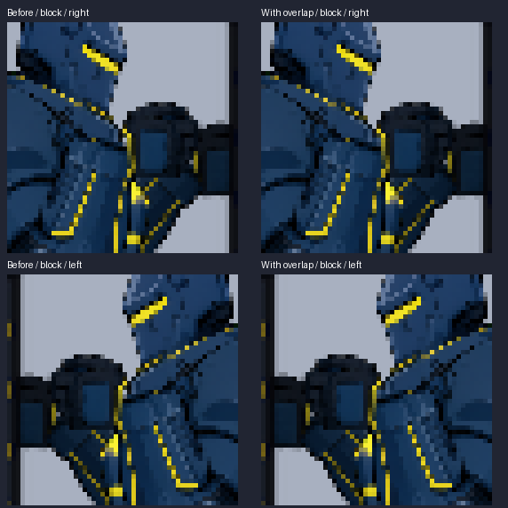
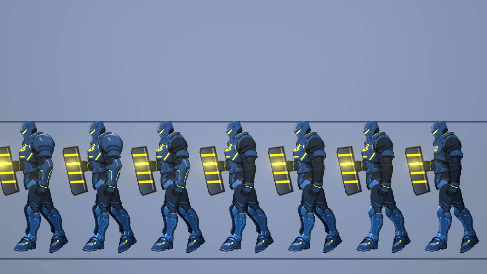

# Commit-13（封住鎮暴員向上瞄準時的衣領小孔）

## 內文

鎮暴員向上抬槍時，衣領與胸甲交界在兩個面向各露出一個像素。沿同一段底衣邊緣補上兩個半透明來源像素，重建對應法線與遊戲貼圖，避免擴大衣領輪廓。

正式匯入後以 RX 9070 XT Forward+ 重驗八種姿勢、雙面向及兩個倍率。著裝衣領的 3,840 個樣本中，透空由 2 降到 0。隔離部位與全身各 3,840 個樣本，以及 5,760 個相鄰部位樣本，沒有新增透空或外緣旗標。全身診斷的另外 272 筆向上瞄準樣本保留在報表中。

### 截圖

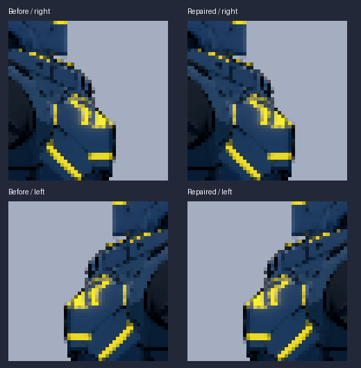

### 測試結果

受影響的 4 套、7,676 項全過。匯入、分件重建、原圖與比對記錄見[原始證據](attachments/NE-224-enforcer-neck-edge-2026-11-21/evidence.zip)。

---

# Commit-14（鎮暴員抬臂時的頭盔內襯接合）

## 內文

抬臂瞄準診斷中，頭盔下緣與前臂之間會露出背景。把孔位對回原分件，沿暗色內襯補出重疊。頭盔貼圖在原取樣格向下延伸 8 像素，支點與原有霓虹像素保持一致。

### 驗收

- RX 9070 XT Forward+。八種姿勢、雙面向和兩倍率各跑 120 格。全身的 3,840 筆樣本中，封閉透空由 272 降至 6，剩餘六筆在眼罩與抬起前臂之間，原報表仍列出。著裝和隔離接點各 3,840 筆，皆無封閉透空；鄰接的 5,760 筆無新增標記。
- 以港區街道的原督察 AI 在安排好的站位觸發蓄力、撲斬與收招。兩面向和兩倍率共 12 組，修前修後的位置、頭部座標、血量與動作一致。抬臂瞄準的極角由原生稽核另驗。
- 來源重建、規格、貼圖、原生法線與正式匯入通過。受影響回歸 4 組、7,676 項全過，35 秒，0 腳本錯誤。

[原生圖、來源映射、逐格檢查及受影響回歸](attachments/NE-224-helmet-lining-2026-11-22/evidence.zip)

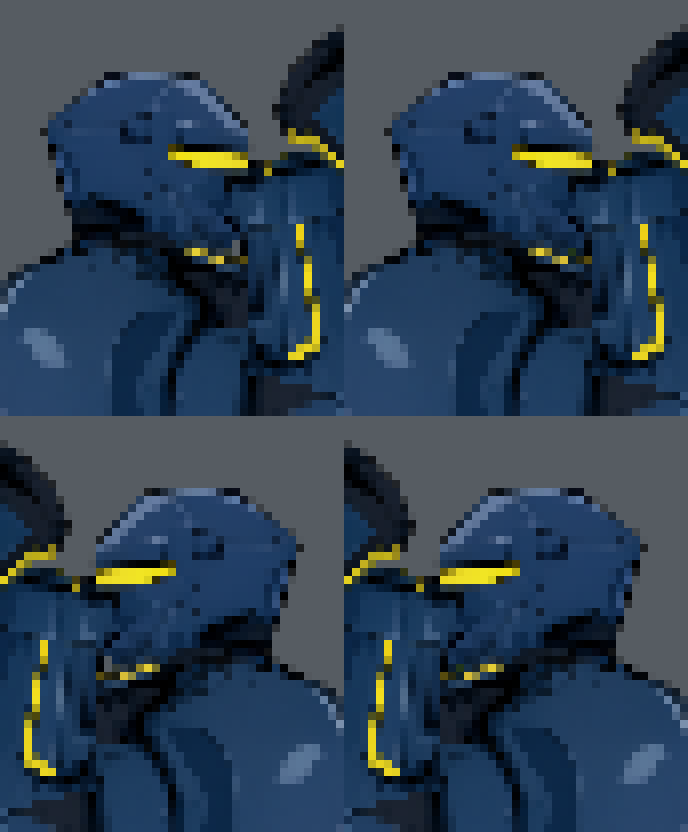

---

# Commit-15（鎮暴員抬臂與倒地時的肩部接合）

## 內文

倒地時肩甲下方的衣料有細縫，抬臂時前後肩附近的頭盔內襯也有透空。依原生影格反投影的位置，沿原軀幹補 15 個像素，沿原頭盔來源補 19 個像素。護甲、霓虹貼圖、裁切尺寸與支點均沿用原資料。

### 驗收

- RX 9070 XT Forward+。八種姿勢、雙面向、兩個倍率，各 120 格。全身肩部 7,680 筆中的封閉透空由 100 筆降到 0，著裝的 12 筆降到 0，隔離接點維持 0。鄰接的 5,760 筆無新增標記，原有的邊緣標記與其餘部位保留在報表。
- 正式港區街道由原督察 AI 蓄力，再由角色傷害流程觸發倒地，取兩面向及兩倍率共 36 組。位置、血量、動作、頭與雙肩座標一致。
- 來源重建、規格、貼圖與 Godot 匯入通過。受影響回歸 4 組、7,676 項全過，48 秒，0 腳本錯誤。

[原生影格、接點來源與回歸](attachments/NE-224-shoulder-lining-2026-11-22/evidence.zip)

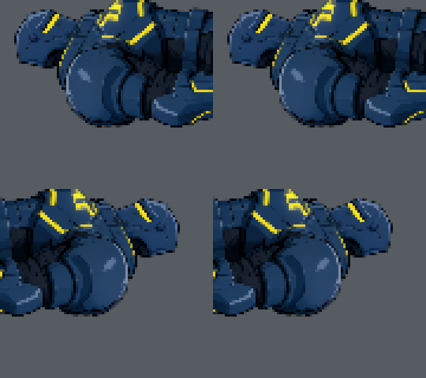

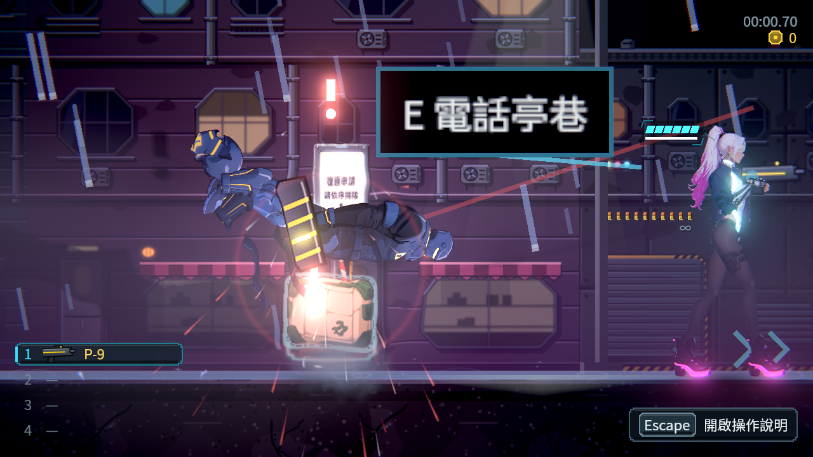

---

# Commit-16（監管者受擊硬直時的胸甲內襯）

## 內文

監管者受重擊時，胸甲斜邊與前臂之間露出背景。沿原本的深色內襯補上重疊，並在原倍率核對跑步與格擋的領口。正式底色共改 756 個透明或半透明像素，重建法線後沿用相同的裁切、支點與護甲資料。

### 驗收

- RX 9070 XT Forward+。前腕取樣範圍內的硬直透空由 236 筆降到 0。八種姿勢、兩面向和兩倍率共 15,360 筆全身取樣，封閉透空合計由 444 降到 206。全身無新增標記。著裝與隔離各 15,360 筆無新增封閉透空、斷件或中心失去覆蓋。兩組各多了 224 筆領口邊緣標記，逐格比對都是原本就透明、可沿對角連回背景的單一像素，沒有不透明像素消失。其他姿勢的標記與領口對照原圖均附於證據。
- 在原關卡的頭目入口安排出生後的站位，由原機制生成監管者，再經角色傷害流程觸發硬直。28 組呈現前後的血量、動作、位置及頭與雙肩座標一致。
- 來源重建、規格、貼圖與 Godot 匯入通過。受影響回歸 4 組、7,676 項全過，43 秒，0 腳本錯誤。

[原生影格、逐格稽核與回歸](attachments/NE-224-warden-impact-2026-11-22/evidence.zip)

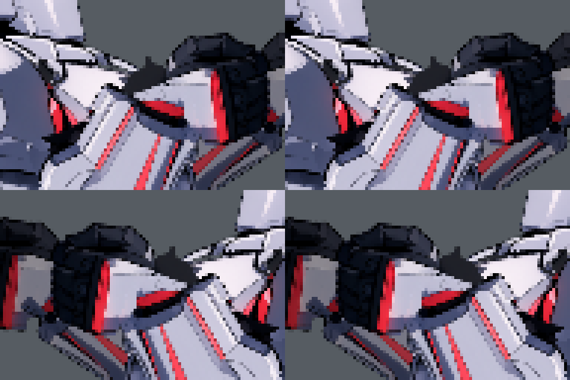

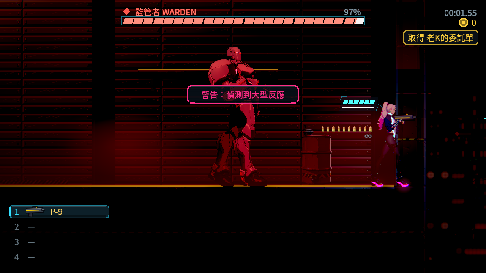

---

# Commit-17（監管者格擋的頭盔內襯和倒地護臂）

## 內文

格擋時肩甲與頭盔之間，倒地後護臂跨過髖部的內緣，各有一個小透空。沿原暗色內襯補合，頭盔改 32 個、護臂改 43 個未全不透明像素，維持原尺寸、支點與頭盔發光圖。首次匯入的頭盔版本在相鄰角度新增 12 筆封閉透空，調整內襯後重新匯入與檢查。

### 驗收

- RX 9070 XT Forward+，左右面向和兩個倍率。全身、著裝、隔離各 15,360 筆。全身格擋肩部真透空 86→0，延長倒地診斷的前腕帶 100→0。全身封閉透空 206→20。這三組的原始標記和比對都在附件。
- 原頭目入口生成的監管者走正式傷害流程。原生 52 組對照的狀態、血量、位置及頭和雙肩座標一致，其中 24 組在原倒地存留期。晚期倒地接點取自延長診斷。
- 來源重建、規格、貼圖與 Godot 匯入通過。受影響回歸 4 組、7,676 項全過，57 秒，0 腳本錯誤。

[原生影格、逐格稽核與回歸](attachments/NE-224-warden-guard-fall-2026-11-22/evidence.zip)

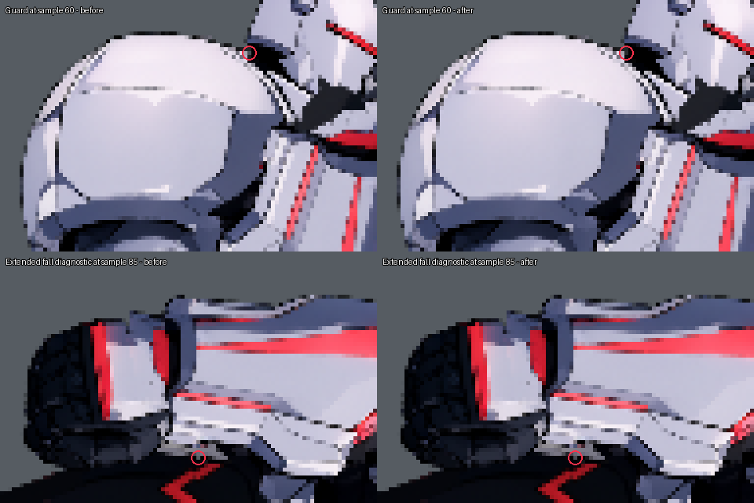

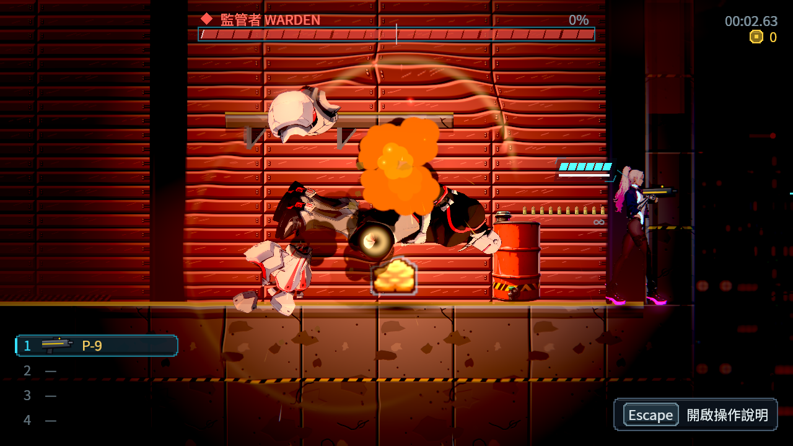

---

# Commit-18（監管者下蹲與格擋起手的下巴內襯）

## 內文

監管者下蹲與開始格擋時，下巴內緣與前臂之間仍有透空。沿原深色材質補足接合，正式底色改了 228 個未完全不透明像素，原裁切、支點與發光圖一致。

### 驗收

- RX 9070 XT Forward+。肩、頸、前腕四個取樣部位，八種姿勢、兩面向與兩倍率，全身、著裝與隔離各 15,360 筆。全身剩餘封閉透空與斷件判定由 20→0，著裝與隔離仍為 0。三組各新增 254 個原透明、沿對角連通背景的一像素邊緣標記，逐格確認對照中沒有不透明像素消失。原始報表和邊緣對照均附於證據。
- 第一章原頭目場按既有傷害流程觸發監管者硬直與倒地，52 組前後狀態、血量、位置與骨架點一致。下蹲和格擋起手照片來自獨立姿勢診斷。
- 來源重建、規格和 Godot 匯入通過。受影響回歸 4 組、7,676 項全過，44 秒，0 腳本錯誤。

[原生對照、逐格結果與回歸](attachments/NE-224-warden-chin-2026-11-22/evidence.zip)

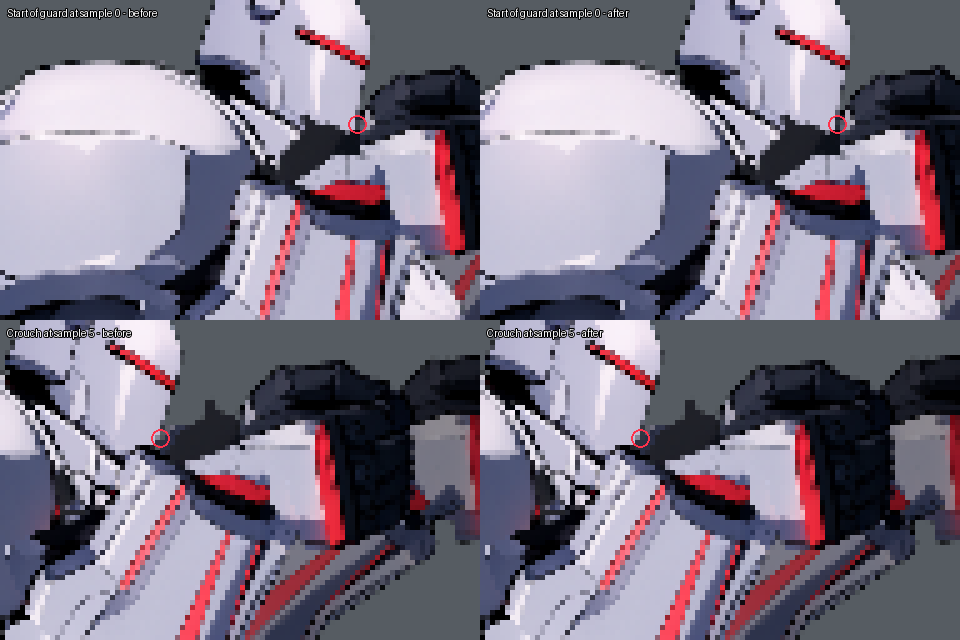

---

# Commit-19（鎮暴員倒地的盾緣內襯）

## 內文

鎮暴員剛開始倒下時，盾的內緣和大腿之間會透出背景。於原盾圖補上九個有透明度的內襯像素，沿用原裁切放大規則，從新底色重算法線。盾的發光、尺寸與握點一致。

### 驗收

- RX 9070 XT、Forward+。八個姿勢、兩種倍率、左右面向及每段 120 格。五處接合在全身／著裝／隔離各量 19,200 筆。全身倒地盾緣的 8 筆封閉小孔歸零，其他 6 筆抬頭護目部位仍待修。三組均沒有新增標記。
- 用正式街道的巡察員觀察自然準備攻擊及正式致死反應，前後 36 組位置、姿態和血量一致。受影響範圍 4 組、7,676 項全過，52 秒，0 腳本錯誤。

[原始影格、材質重建、逐格報告與街道對照](attachments/NE-224-enforcer-shield-lining-2026-11-22/evidence.zip)

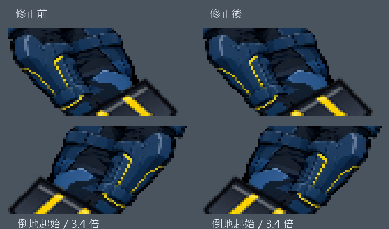

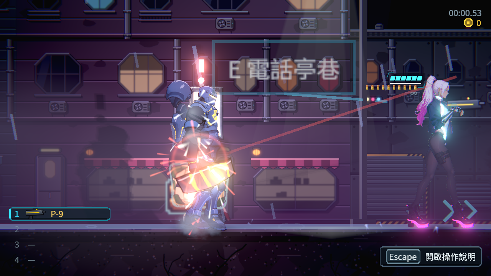

---

# Commit-20（鎮暴員抬頭時的護臂內襯）

## 內文

抬頭起手時，護目部位與前景手套間的小孔落在遠側護臂原裁切尾端。補 181 個來源圖的內襯像素並依原裁切相位重建，貼圖尾端增加五個像素，手肘原點一致。遠側腕部的交疊只補兩處。頭盔與手套沿用原材質。

### 驗收

- RX 9070 XT Forward+，八姿勢、九接點、兩倍率、雙面向、每段 120 格。全身的 521 筆透空降至 229，抬頭護目的六筆均歸零；著裝及隔離各 34,560 筆無封閉小孔。全身及著裝新增的邊緣標記均連通外緣，三組沒有新增透空。全身 3.4 倍的前腕輪廓有六筆邊緣像素的 Alpha 由 128 降至 126 或 127。
- 正式街道自然起手和致死反應的 36 組對照，時間、位置和血量一致。受影響範圍 4 組、7,676 項全過，44 秒，0 腳本錯誤。
- 其餘腕肘的透空樣本仍需逐項修復，整體驗收維持進行中。

[原生影格、逐格比對及素材重建紀錄](attachments/NE-224-enforcer-raised-forearm-2026-11-22/evidence.zip)

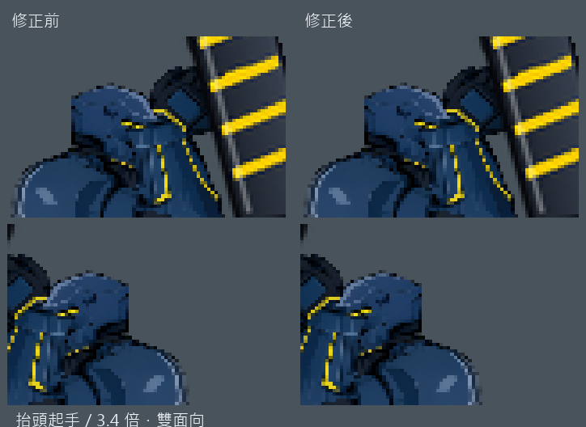

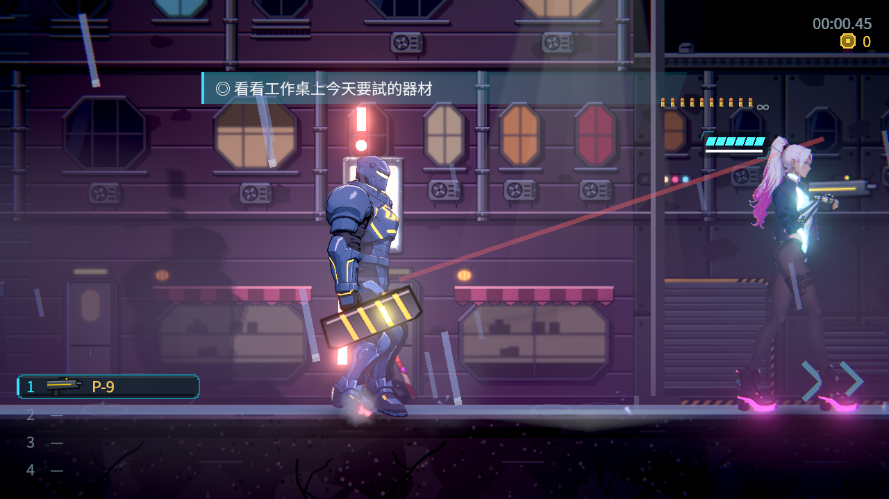

---

# Commit-21（鎮暴員抬頭時的領邊）

## 內文

抬頭時遠側肘移過領口，原生畫面露出一個細孔。對照實際骨架的材質座標後，在原尺寸軀幹內襯補八個像素並重算法線。護臂、護盾及關節沿用原資料。

### 驗收

- RX 9070 XT Forward+，九接點、八姿勢、兩倍率、雙面向，每段 120 格。全身 34,560 筆，封閉透空從 229 降至 163，遠側肘區的 66 筆全數消除。著裝及相鄰材質隔離各 34,560 筆，標記一致且沒有透空。
- 其餘腕部與盾緣的 163 筆待查。正式街道 36 組的戰鬥位置、時間及血量一致。受影響範圍 4 組、7,676 項全過，0 腳本錯誤。

[全身原生影格、材質座標與回歸](attachments/NE-224-enforcer-elbow-collar-2026-11-22/evidence.zip)

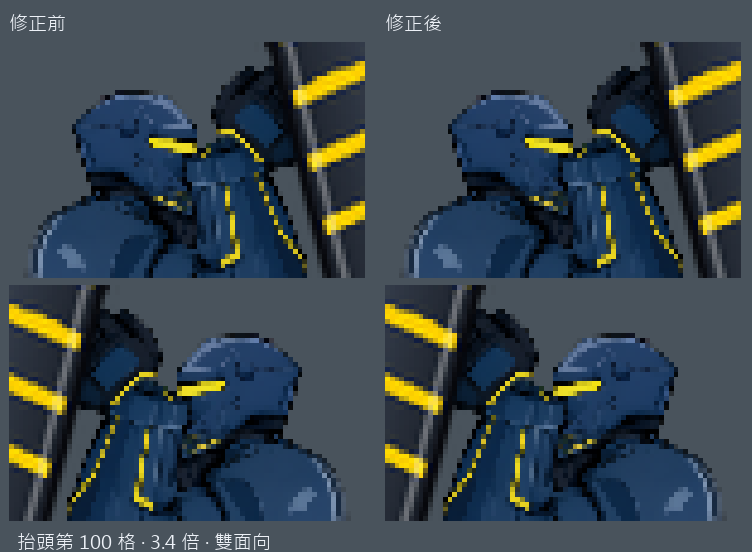

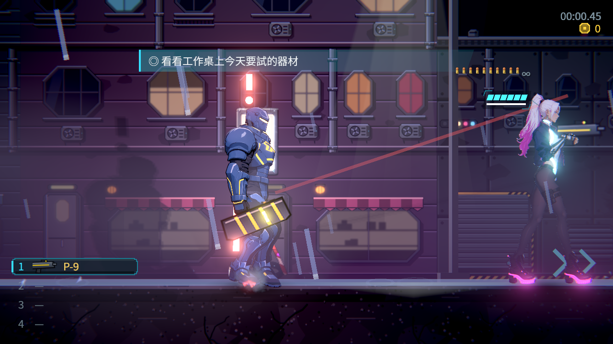

---

# Commit-22（鎮暴員格擋時的手套邊）

## 內文

格擋時遠側手腕區的小孔落在前手手套邊。沿原袖口補五個內襯像素並重算法線。原貼圖尺寸和握點一致，沿用既有同尺寸覆寫的資產建置規則。

### 驗收

- RX 9070 XT Forward+，九接點、八姿勢、兩倍率、雙面向，每段 120 格。全身 34,560 筆，封閉透空從 163 降至 93，格擋手腕的 70 筆全數消除。新增的 142 筆邊緣標記均通往外緣，原不透明像素維持。著裝及相鄰材質隔離各 34,560 筆，標記一致且沒有透空。
- 抬頭時盾緣仍有 93 筆待修。正式街道 36 組的戰鬥位置、時間及血量一致。受影響範圍 4 組、7,676 項全過，0 腳本錯誤。

[全身原生影格、材質座標與回歸](attachments/NE-224-enforcer-glove-cuff-2026-11-22/evidence.zip)

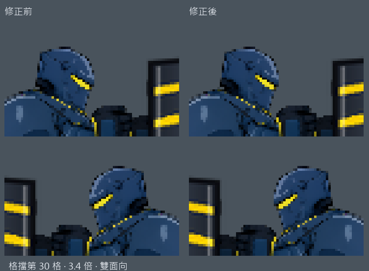

---

# Commit-23（鎮暴員抬盾的背面支撐）

## 內文

抬盾時前護臂與盾背之間露出背景。在原盾牌來源補出暗色支撐面，沿正式五倍取樣重建並重算法線。握點、盾面標線與發光層沿用原資料。

### 驗收

- RX 9070 XT Forward+，九接點、八姿勢、兩倍率、雙面向，每段 120 格。上身及髖部九接點共 34,560 筆，抬盾的 93 筆封閉透空全數消除，同組其餘動作無封閉透空。新增的 1,122 個輪廓標記均通往外緣，原超過半透明的像素未穿越該門檻。著裝及相鄰部件隔離各 34,560 筆均無封閉透空。
- 另驗五個腰腿接點共 19,200 筆，四筆新增的腰側輪廓標記都連通外緣，膝與腳踝既有的 318 筆封閉透空修前修後一致。正式街道 36 組的戰鬥位置、時間及血量一致。受影響範圍 4 組、7,676 項全過，0 腳本錯誤。

[全身原生影格、材質座標與回歸](attachments/NE-224-enforcer-shield-backing-2026-11-22/evidence.zip)

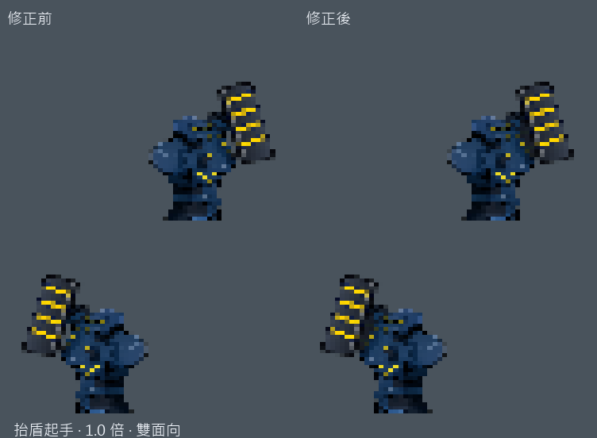

---

# Commit-24（鎮暴員膝與腳踝的雙腿重疊核對）

## 內文

在 RX 9070 XT Forward+ 比對鎮暴員腰、膝、腳踝的原生畫面。八姿勢、雙面向、兩個倍率，每段 120 格。全身、著裝單腿與相鄰部件各 19,200 筆，另以同一套動作僅保留雙腿逐影格對照。著裝單腿包含原護膝。只顯示雙腿的腰欄省略軀幹，該欄不計入雙腿比較。

### 驗收

- 全身下肢 318 筆看似封閉的背景區域，在僅保留雙腿時逐像素重現。318 筆在著裝單腿和相鄰部件中均通往外緣。最大兩處出現在跑步交叉兩腿時。單腿與相鄰部件本身的 19,200 筆都無封閉透空或游離部件。
- 複核從腰以下的動作仍維持現有形狀。上身與髖部的九接點另有本票前一筆交付。這次更新的是原生驗收證據，受影響選擇器無遊戲程式測試。

[全身、單腿、雙腿的座標對照與影格](attachments/NE-224-enforcer-leg-crossing-2026-11-22/evidence.zip)

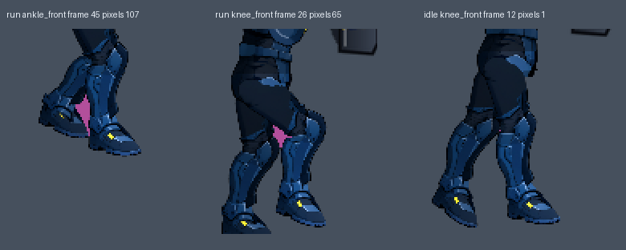

---

# Commit-25（監管者倒地時補合後護臂與髖部）

## 內文

監管者倒地後，護臂交疊在髖部上的內緣會露出小透空。沿護臂內側調整了 94 個像素，重新產生法線。貼圖和部件仍從同一位置掛載，原有裝甲外形與光效保持。

### 驗收

- RX 9070 XT Forward+，八種姿勢、兩個倍率及雙面向。全身、著裝接點及相鄰部件各 53,760 筆。全身原版封閉透空 486→218，倒地的前髖、後髖、後腕分別少 96、78、94 筆。對照使用同一角色和畫格配置，三種範圍都沒有新增封閉透空。
- 正式關卡由原入口生成監管者並受到傷害，52 組畫面中的位置、血量、狀態和骨架座標相同。其餘腳部及角色的逐格驗收繼續進行。
- 來源重建、貼圖規格及 Godot 匯入通過。受影響回歸 4 組、7,676 項全過，61 秒，0 腳本錯誤。

[相同場地的原圖、逐格資料、重建與回歸](attachments/NE-224-warden-fallen-cuff-2026-11-22/evidence.zip)

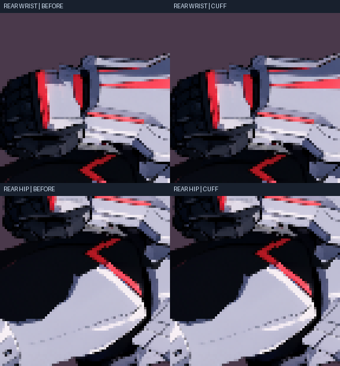

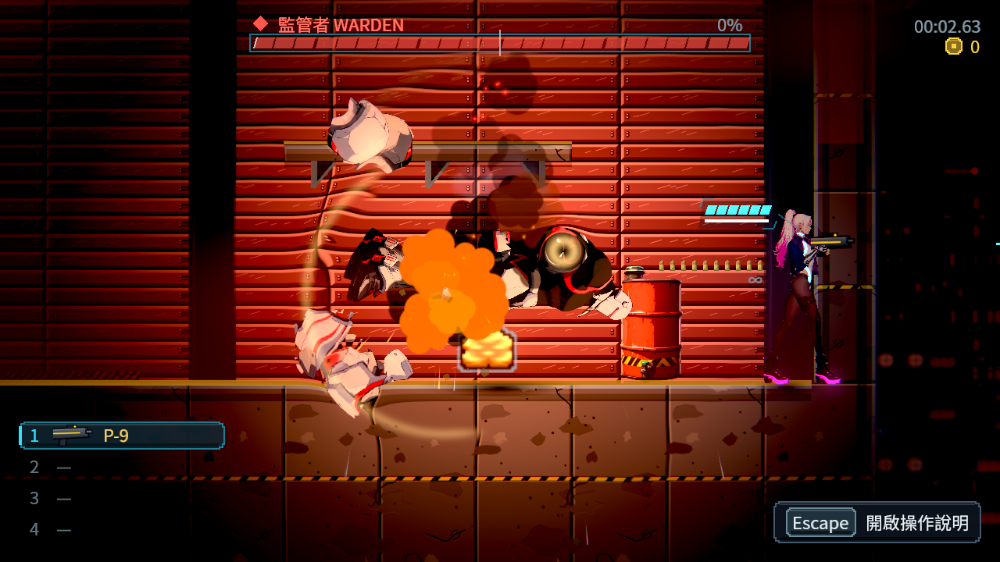

---

# Commit-26（機槍重兵與監管者的雙腿重疊核對）

## 內文

在 RX 9070 XT Forward+ 用八姿勢、雙面向、兩倍率，每段 120 格，比對機槍重兵與監管者的膝和腳踝。保留原著裝，再逐格比較全身、著裝接點、相鄰部件及僅保留雙腿的畫面。

### 驗收

- 全身膝與腳踝的 465 筆背景區域（機槍重兵 242 筆、監管者 223 筆），在只顯示雙腿時逐像素重現，共 6,545 像素。兩種相鄰部件檢查的同一處都維持開口。只畫腿時另有 17 筆在全身由其他部件覆蓋，沒有列入全身結果。
- 本次保存原生驗收紀錄，沒有改動材質。受影響測試選擇器沒有選出遊戲套件。

[全身與雙腿的原生影格、座標及檢查結果](attachments/NE-224-armored-leg-crossing-2026-11-22/evidence.zip)

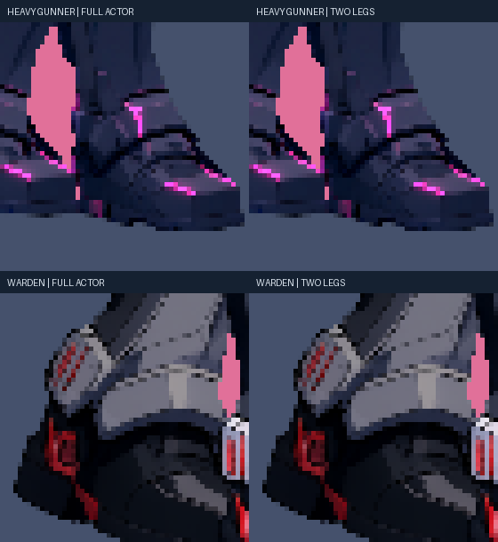

---

# Commit-27（機槍重兵倒地時的頭盔底緣）

## 內文

機槍重兵倒地起手時，頭盔與前肩間在兩個面向各露出一個背景像素。沿原頭盔底緣比對後補兩個像素，按原流程重建法線，保留貼圖尺寸、掛點與頭盔發光。

### 驗收

- RX 9070 XT Forward+，八姿勢、兩倍率與雙面向，全身、著裝接點及相鄰部件各 53,760 筆。兩筆肩部透空均補合；其他 242 筆全身標記均由上次的雙腿重疊測試解釋，著裝接點及相鄰部件維持 0 處封閉透空。
- 在原第二章場地以正式傷害入口打倒機槍重兵。16 組前後畫面的倒地狀態、血量、位置、頭與前肩骨座標一致。
- 原始貼圖重建、規格及 Godot 匯入通過。受影響回歸 4 組、7,676 項全過，195 秒，0 腳本錯誤。

[前後影格、內側補色與回歸紀錄](attachments/NE-224-heavy-gunner-fall-2026-11-22/evidence.zip)

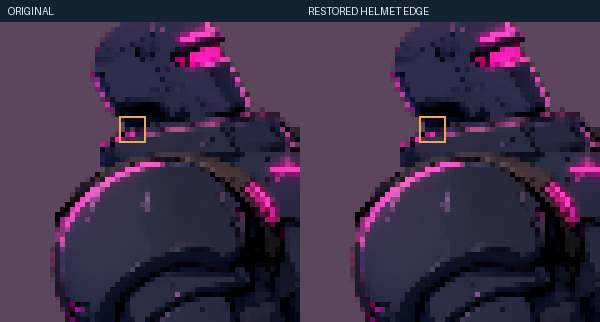

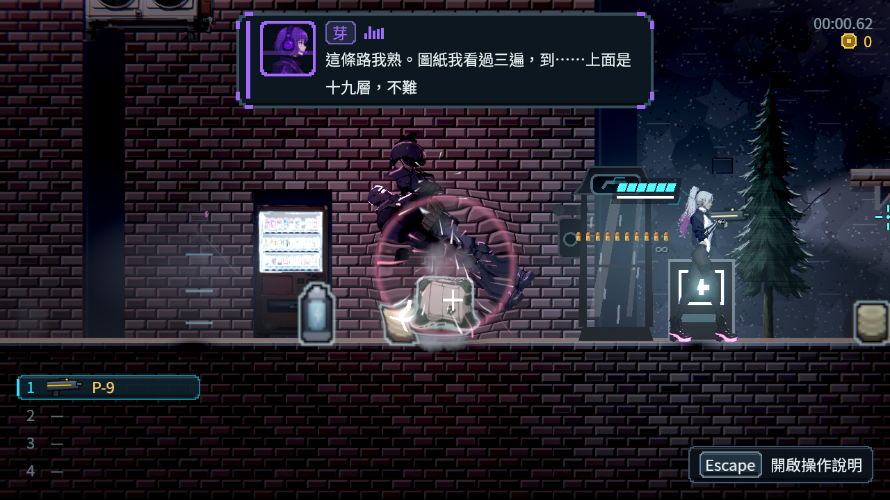

---

# Commit-28（麵攤阿婆額前髮尾與衣領）

## 內文

阿婆轉頭時，額前會浮出一個像素，坐著聽話時後衣領也會透出背景。這次在原頭部貼圖調整 12 個邊緣像素並重新產生法線。髮型、臉部、貼圖尺寸、掛點與表演資料維持原樣。

### 驗收

- RX 9070 XT Forward+，五種姿勢、兩個倍率及雙面向。全身、著裝接點和相鄰部件各 33,600 筆。全身的封閉、游離及中心透空標記 1,579→1,477，三種範圍都沒有新增上述標記。其他接點還有待驗案例。
- 原第一章麵攤以實際互動鍵從兩側開啟對話，對照工作、交談與完成共 12 組。頭部座標、攪湯循環、顯示台詞與交談完成次數一致。
- 來源重建、貼圖規格與 Godot 匯入通過。受影響回歸 4 組、7,676 項全過，174 秒，0 腳本錯誤。

[原生影格、原麵攤互動與回歸紀錄](attachments/NE-224-ah-po-head-2026-11-22/evidence.zip)

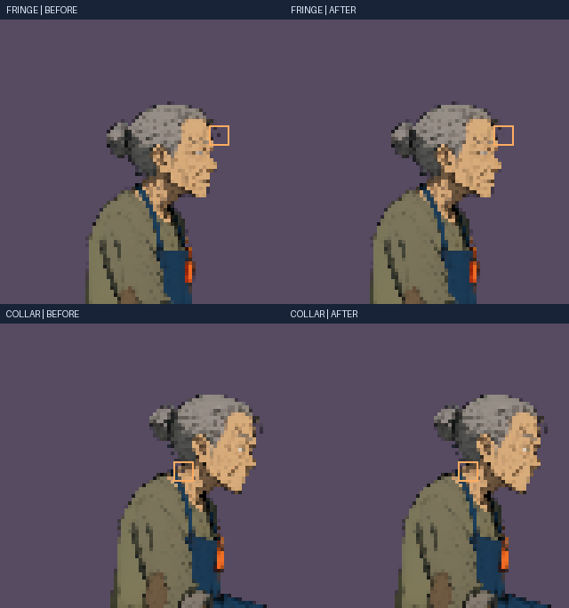

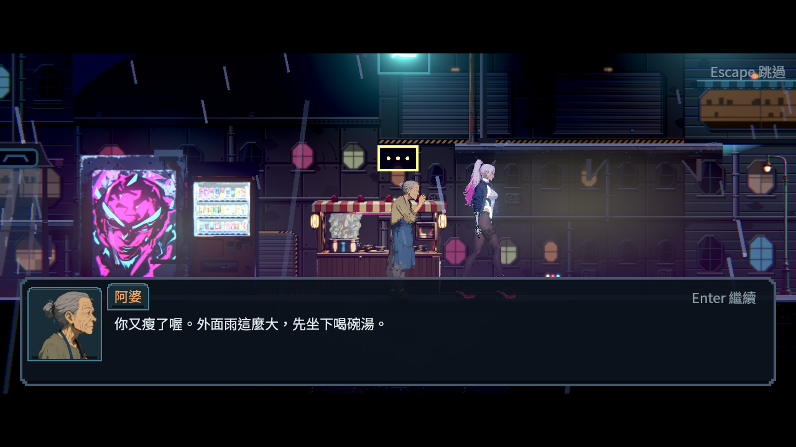

---

# Commit-29（老 K 與麵攤阿婆的站姿鞋靴）

## 內文

在 RX 9070 XT Forward+ 比對老 K 和麵攤阿婆站立、揮手時的腳踝。兩個倍率、雙面向，每段 120 格。全身與只保留雙腿的版本以相同畫格配置擷取，另外對照著裝單腿及相鄰部件。

### 驗收

- 全身判定封閉的 1,920 處在只保留雙腿時逐像素重現，共 9,600 像素。著裝單腿和相鄰部件的同一位置維持開口。兩人站姿與揮手時的開口都位在前後腳之間。
- 本次交付畫面與座標核對，材質沿用原樣。受影響測試選擇器無遊戲套件。

[原生前後腳、逐格座標與測試選擇結果](attachments/NE-224-shop-npc-boots-2026-11-22/evidence.zip)

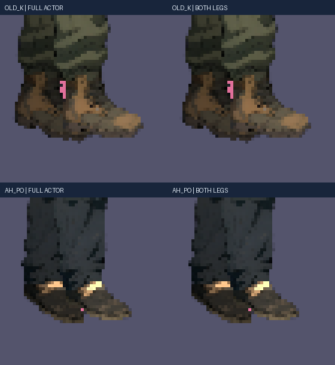

---

# Commit-30（老 K 坐姿手腕與外套輪廓）

## 內文

老 K 坐著說話時，近側手掌與袖口間偶爾露出一個像素的背景。補合手腕，保留外套、原手掌輪廓與動作。

### 驗收

- RX 9070 XT Forward+，用兩倍率、雙面向、五種原動作驗證安裝後材質。全身、著裝與相鄰零件各 33,600 項，原手腕 44 筆孔洞全部消失，三組都沒有新增封閉孔洞、鬆脫片或露出接點。
- 4,636 筆手臂與衣襬之間的畫面，隱藏前臂與手掌即可接通外緣。超過一像素的原空隙仍保留，每筆最多縮小兩像素。
- 在正式第一章當舖用互動鍵完成原對話，修正前後 12 筆量測一致，四次對話各記錄一次。受影響回歸 4 組、7,676 項全過，0 腳本錯誤。

[接點量測、當舖互動與回歸](attachments/NE-224-old-k-seated-wrist-2026-11-23/evidence.zip)

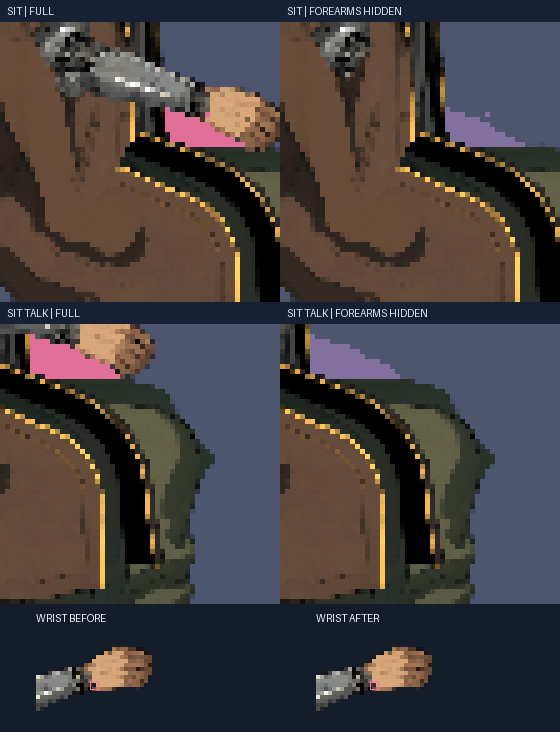
