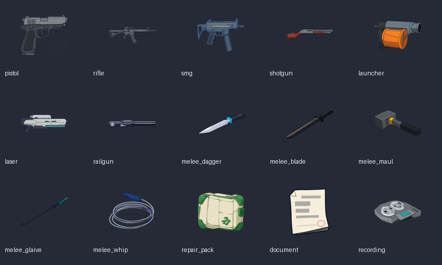
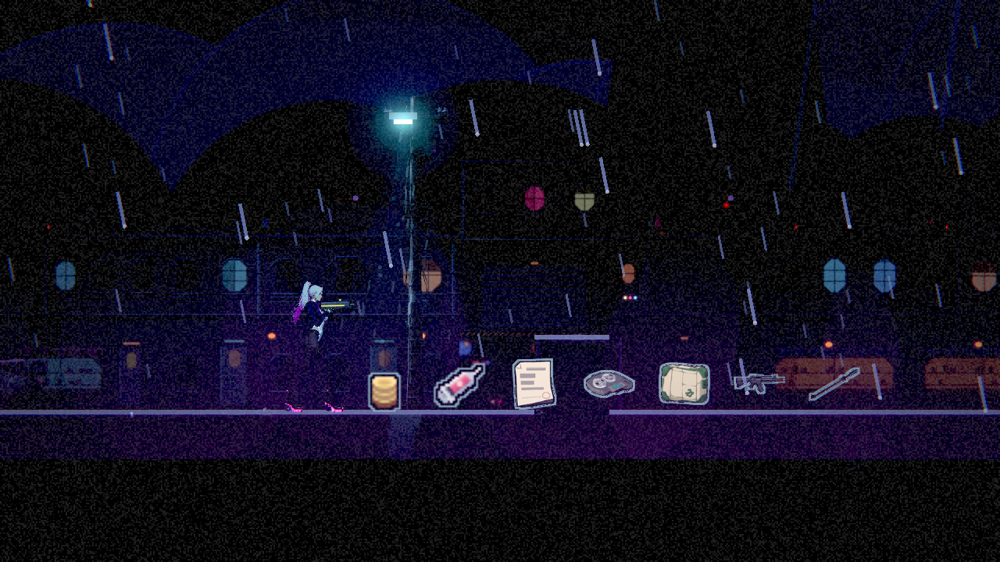
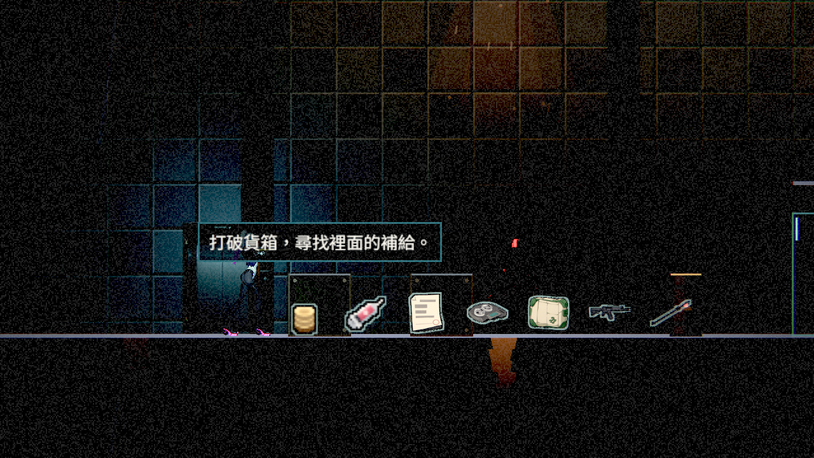

# [NE-225] 補齊章節地上道具的實物圖示

> 狀態：完成

## 內文

### 需求
盤點已實作章節的地上道具，將仍用簡略幾何符號表示的武器、修復補給等改成能辨認用途的實物圖示。使用 ComfyUI 生成並加工為現有賽璐璐風格，避免寫實塑膠光澤、假字及過多碎細節。

### 來源
2026-10-10，Stanley 要求檢查第一章與已實作第二章，用 ComfyUI 補上地上道具圖示並放進遊戲；設計見 design/19-world-item-art/DESIGN.md。

### 驗收條件
- [x] 正式已實作關卡的拾取種類有完整盤點表，標示沿用及替換，第二章若存在亦涵蓋。
- [x] 所有盤點中仍為簡略符號的拾取類型改成實物圖示，正常倍率可區分武器、修復補給與其他道具。
- [x] 生成提示詞、種子、原圖及加工參數可追溯並可重跑，透明背景無白邊、假字或多餘零件。
- [x] 第一章與第二章真實 Forward+ 畫面各留原生修前修後截圖，圖示與既有場景畫風一致。
- [x] 拾取、滿血不浪費、背包上限與重生保存的相關局部測試通過。

### 測試流程
1. 遍歷已實作關卡的拾取種類，核對圖示清單。
2. 在第一章與第二章看替換道具，正常倍率辨認輪廓，放大檢查透明邊緣。
3. 撿取武器與補給，滿血及背包滿時再次接近，確認物品按原玩法保留。

---

# 跟其他票的關係

- Blocks：無
- Blocked by：無
- Related：無

---

# Commit-1

## 內文

已盤點 11 個正式關卡、10 張地圖、24 種拾取圖示。15 張武器、修復包、文件及錄音實物圖已用 ComfyUI 逐張生成並放進遊戲；其餘沿用既有素材。新圖以與原小圖相同的世界尺寸顯示，保留淡色外緣與小幅浮動，正常倍率可分辨用途。

[盤點、來源、記憶體觀察與完整證據](attachments/NE-225/REPORT.md)；[原圖雜湊及透明檢查](attachments/NE-225/asset_checks.json)。ComfyUI 已停止並釋放模型，沒有留下整批圖片快取。

### 測試結果

| 項目 | 結果 |
|---|---|
| 固定基準 4b32e788 的受影響範圍 | 49 群、33,312 checks，0 新失敗、0 known failures；261 秒 |
| 同步 main 811351caf 後 6 套交集複驗 | 3,197 checks，0 新失敗；27 秒 |
| 原生 Forward+ 畫面 | 12 張 1280×720修前／修後，低／高畫質；最新佈景上使用相同道具配置比較 |
| 實際關卡盤點 | 24 種圖示、113 次關卡出現，缺圖 0；清晨當舖與夜景共用地圖，次數按關卡計 |
| 15 張生成素材 | 640×640 原生透明來源，96×96 遊戲貼圖、24×24 世界尺寸；來源雜湊與透明通道均通過 |
| 拾取及保存 | 武器／補給、滿血不浪費、背包上限、進度保存與原輪廓回歸通過 |

首次測試沒有斷言失敗，但主選單的 headless 貼圖初始化曾出現 `Parameter "t" is null`，該次不算通過。相同範圍重新執行後通過，沒有修改錯誤過濾或已知失敗清單。原始失敗與最終通過輸出均保留。

### 截圖

另有相同擷取配置的修前圖，以及第一章中性明亮光照的辨識壓力測試；明亮組不是正式街道的夜景。

原始輸出：[受影響範圍](attachments/NE-225/ne225-final-affected.log)、[最新 main 交集複驗](attachments/NE-225/ne225-rebase-tests.log)、[修前](attachments/NE-225/ne225-before.log)、[修後](attachments/NE-225/ne225-capture-latest.log)。
