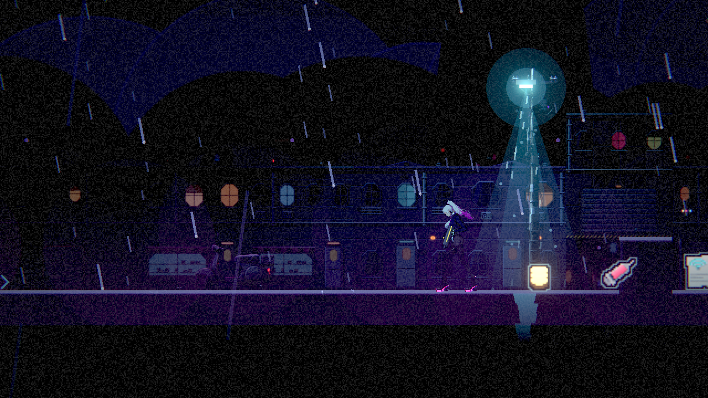
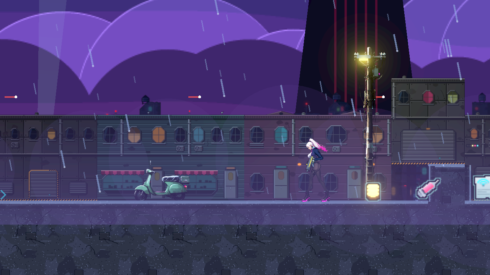
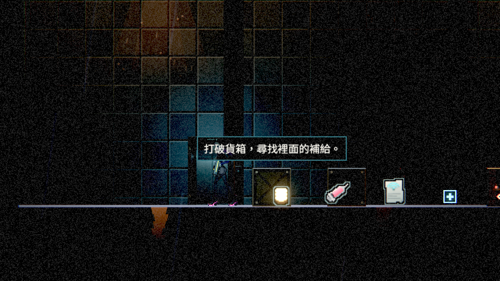

# [NE-226] 強化可拾取物的克制辨識提示

> 狀態：完成

## 內文

### 需求
玩家要能快速分辨地上哪些物件可以撿。參考業界與玩家回饋後，為真正可拾取物提供淡色細外框、小幅浮動與靠近才出現的提示，保持圖示可讀與場景氛圍。

### 來源
2026-10-10，Stanley 建議可拾取物有微量外框或浮空特效，要求先研究業界與玩家偏好再實作；研究及決策見 design/19-world-item-art/DESIGN.md。

### 驗收條件
- [x] 設計記錄業界範例、玩家回饋與採用理由，不把零星討論當多數玩家結論。
- [x] 可拾取物有克制且一致的輪廓及微量浮動，普通裝飾不套用拾取提示。
- [x] 暗／明背景、低／高畫質下的原生 Forward+ 截圖可辨識圖示，不被外框或泛光蓋成白塊。
- [x] 接近、離開、撿取、滿血及背包滿時的提示與保留行為正確，已收集後不殘留提示。
- [x] 受影響的拾取、特效與提示相關局部測試通過。

### 測試流程
1. 比較同場景的可拾取物與普通裝飾。
2. 切換低／高畫質，暗場與亮場接近各種拾取物。
3. 撿取、離開後再接近，在滿血及背包滿狀態重試，核對提示与保存行為。

---

# 跟其他票的關係

- Blocks：無
- Blocked by：無
- Related：無

---

# Commit-1

## 內文

場景小圖現在保留原圖細節，外緣加一個世界像素的淡青色常駐輪廓；沿用小幅浮動及靠近提示。一般佈景沒有拾取輪廓。輪廓僅建立一次，不在每影格產生圖片。

比較第一章街道與第二章，以及街道套用中性明亮光照的同場景，低／高畫質皆可辨識。明亮組是刻意換光照的辨識壓力測試，不代表正式街道的原始夜景。滿血與背包滿時道具及提示保留，離開淡出、返回再顯示，收集後兩者移除。

### 測試結果

| 項目 | 結果 |
|---|---|
| 受影響範圍 | 49 群、33,281 checks，0 新失敗；3 程序，311 秒 |
| 新增提示生命週期與既有提示回歸 | 58 checks，0 新失敗；1 程序，29 秒 |
| 輪廓 | 原圖不被覆蓋，外緣不裁切，貼圖快取重用 |
| 原生畫面 | 12 張 1280×720，Godot 4.7.2／Intel Arc B580／Forward+，低／高畫質 |
| 執行輸出 | 無新腳本錯誤；測試故意缺檔及退出資源訊息依既有 filter，截圖工具有退出 ObjectDB warning |

原始輸出：[受影響測試](attachments/NE-226/ne226-affected.log)、[提示回歸](attachments/NE-226/ne226-lifecycle.log)、[修前擷取](attachments/NE-226/ne226-before-final.log)、[修後擷取](attachments/NE-226/ne226-after-final.log)。

### 截圖

